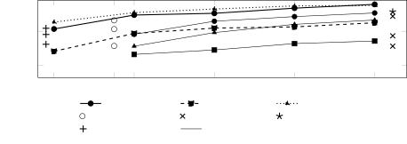
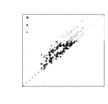

# Can Programs Replace LLM Judges? Executable Program Judges for Scalable and Efficient Relevance Labeling

CCS: Information systems Evaluation of retrieval results

Eugene Agichtein Affiliation: Emory University, Atlanta, GA, USA email:
<eugene.agichtein@emory.edu> , Charles L. A. Clarke
Affiliation: University of Waterloo, Waterloo, ON, Canada email:
<claclark@gmail.com> , Kaustubh Dhole Note: Work partially done at Emory
University. Affiliation: Stanford University, Stanford, CA, USA email:
<kdhole@stanford.edu> and William Stern Affiliation: Emory University,
Atlanta, GA, USA email: <william.stern@emory.edu>

2027

###### Abstract.

Large language model (LLM) judges have become a common way to create
large-scale relevance judgments for retrieval evaluation. However, each
judgment requires a potentially expensive call to a frontier model, and
the judgments are hard to interpret and may not be reproducible. In this
paper, we ask whether an LLM can write a readable program for each topic
that replaces its per-document judgments. To address these issues, we
propose ExecJudges, a method for generating fast, inspectable and
scalable judges for automatic relevance labeling. Specifically,
ExecJudges uses a frontier LLM to turn assessment guidelines into
executable programs, which rely only on lexical matching, standard NLP
libraries like parsers, and pool statistics. An ExecJudges-L variant
also uses examples of human labels if available. We evaluate ExecJudges
on seven TREC collections by comparing the produced labels with trained
NIST assessors, frontier LLM judges, and recently proposed per-topic
classifiers. Our results show that ExecJudges agrees with NIST assessors
at the level of the Claude Sonnet 5.5 LLM judges on TREC DL 2019–2021.
With a small number of human labels per topic, the ExecJudges-L variant
agrees with NIST more than per-topic classifiers with the same labels on
all seven collections, and either exceeds the agreement of LLM judges
provided the same labels or is within about 0.05 of it in Krippendorff’s
$`\alpha`$. The labels rank the official TREC DL runs with Kendall’s
$`\tau`$ of 0.87 to 0.94, and writing the programs incurs a one-time
cost of \$0.17 to \$0.49 per topic, with no additional costs for
grading. Our results suggest that ExecJudges offers a reproducible,
inspectable, efficient and cost-effective alternative to LLM judges for
labeling deep result pools for system evaluation or ranking
improvements.

###### Keywords: 

relevance judgments, LLM judges, program synthesis, test collections

## 1. Introduction

Relevance judgments are essential for evaluating information retrieval
systems. Obtaining them from human assessors is expensive and difficult
to scale. Large language models (LLMs) have emerged as a promising
alternative. Their relevance labels often approach the agreement between
human assessors (Thomas et al., 2024; Upadhyay et al., 2025). However,
relying on LLMs as relevance judges introduces several limitations.
First, an expensive and often GPU-dependent model must evaluate each
document. Assessment costs therefore grow with the size of the document
pool and with every new retrieval run. Second, the decision process of
an LLM judge is largely opaque. Even when the LLM provides an
explanation, it is difficult to verify which criteria determined its
judgment. Third, irrelevant or adversarial content can influence LLM
judges. Query terms and instructions embedded in an assessed document
are examples of such content (Alaofi et al., 2024). These limitations
raise concerns about the reliability, reproducibility, and suitability
of LLM-generated relevance judgments as substitutes for human
assessments (Faggioli et al., 2023; Soboroff, 2025).

Relevance assessment involves repeatedly applying the same
topic-specific criteria to different documents. For a given topic,
assessors must determine whether a document addresses the requested
subject, provides an answer, and satisfies the conditions for higher
relevance grades. Although these criteria vary across topics, their
interpretation and application need not be reconstructed independently
for every document. Recent work on executable rubrics converts the
natural-language evaluation criteria of LLM judges into explicit
programs (Dhole et al., 2026). These programs replace repeated LLM
judgments with deterministic scoring procedures that people can inspect.
Motivated by this direction, we ask a related question for information
retrieval: Can an LLM write a readable, generalizable relevance program
for each topic that replaces its per-document relevance judgments? Such
an approach could keep the topic-specific reasoning of LLMs. It would
also reduce inference costs and make the assessment logic explicit and
open to inspection.

We propose ExecJudges, a method that uses LLMs to generate
topic-specific relevance assessors in the form of human-readable Python
programs. Each program uses deterministic operations, including lexical
matching, text parsing, and pool-level statistics, to evaluate the
evidence needed for a relevance judgment. Two design choices distinguish
our approach. First, the programs answer the conditions of the official
assessment guidelines. These conditions include whether a passage is on
topic, contains an answer, provides an exact answer, or is dedicated to
the query. A fixed grading function then maps the answers to relevance
grades. This function follows the structure of the assessment scale.
Second, we generate several programs for each topic independently and
average their grades. Averaging reduces the effect of errors in single
programs and reduces over-grading. In this way, ExecJudges uses the LLM
once per topic to construct a reusable assessment procedure. People can
run, inspect and revise this procedure. Specifically, our contributions
are:

- •
  We propose ExecJudges, a new method that uses an LLM to generate
  relevance-grading programs. The programs label deep document pools
  without further LLM calls. ExecJudges agrees with NIST at the level of
  the Sonnet judges on TREC DL 2019–2021 (Sections 3 and 5) at a
  one-time cost of \$0.17 to \$0.49 per topic.
- •
  We investigate adding a few human labels of each topic to the writer
  prompt. With 16 labels, ExecJudges-L agrees with NIST more than
  per-topic classifiers on all seven collections, and more than frontier
  LLM judges given the same labels on TREC DL 2019–2022 (Sections 3
  and 5).
- •
  We show that ExecJudges ranks the systems similarly to the official
  ranking based on the NIST relevance labels with Kendall’s $`\tau`$ of
  0.87 to 0.94 (Sections 4 and 5).
- •
  We analyze the number of programs, per-topic and collection-level
  programs, rubric induction, and the choice of labeled examples
  (Section 6). Appendix C reports all prompts and labeling details.

## 2. Related Work

We now review related work to contextualize our contributions.

LLM relevance judges: The past few years have seen an increasing use of
large language models (LLMs) as automated relevance assessors. Faggioli
et al. (Faggioli et al., 2023) provided an early framework for LLM-based
relevance judgment. Their framework outlines a spectrum of human-LLM
collaboration from human-assisted assessment to fully automated
evaluation. Thomas et al. (2024) showed that LLMs can predict searcher
preferences. Their LLM relevance judgments were comparable to those of
human assessors at a much lower annotation cost. Subsequently, Upadhyay
et al. (Upadhyay et al., 2025) introduced UMBRELA, an open-source
relevance assessment framework based on GPT-4o. UMBRELA reproduced the
Bing relevance assessment method and showed promising results on the
TREC Deep Learning benchmarks. Others extended automated assessment to
retrieval-augmented generation (RAG) (Thakur et al., 2025; Dhole et al., 2025) by comparing LLMs with human judges. ExecJudges uses the same
guidelines as these judges and removes the per-document model call.

Per-topic relevance assessment: Prior work has explored topic-specific
supervision and artifacts to improve relevance assessment. Gienapp et
al. (Gienapp et al., 2026) train lightweight classifiers on 64–256 human
judgments per topic. These classifiers agree with human assessors more
than prompted LLMs. They need topic-specific annotations. Otero et
al. (Otero and Parapar, 2026) generate a reusable relevance description
for each topic. An LLM then applies this description to judge documents.
Farzi et al. (Farzi and Dietz, 2024) use per-query exam questions to
grade passages. RubricRAG (Dhole and Agichtein, 2026) retrieves related
rubrics to generate query-specific evaluation criteria. Qworld (Su
et al., 2026) recursively generates fine-grained, question-specific
evaluation criteria for LLM responses. Wang et al. (Wang et al., 2023)
generate topic-specific Boolean queries that provide high-precision but
low-recall filtering. These approaches prepare labels, examples or other
artifacts for each topic. Most of them still apply a model to every
document.

Limitations of LLMs as relevance assessors: LLM relevance judges also
have known limitations. Soboroff (Soboroff, 2025) argued against relying
on LLM-generated judgments for TREC-style evaluations. He emphasized the
importance of independent human assessments. Similarly, Clarke and
Dietz (Clarke and Dietz, 2025) highlighted fundamental limitations such
as susceptibility to evaluation gaming, circularity, and distorted
system rankings. Two practical problems have received less attention.
LLM relevance assessments are hard to interpret. Their computational
cost makes large-scale assessment slow and expensive.

Symbolic distillation and program synthesis: A parallel line of work
distills the behavior of black-box models into explicit symbolic rules.
Examples include circuit discovery (Rai et al., 2026), symbolic models
distilled from trained networks (Cranmer et al., 2020), and the
translation of predictions into rules or reasoning trails (Armgaan
et al., 2024; Rorseth et al., 2026). Most of these methods fit rules to
a trained model or to its predictions. More recent methods have an LLM
write programs directly. ALCHEmist (Huang et al., 2024) has an LLM write
labeling programs for classification tasks to label data without model
calls. Most recently, Dhole et al. (2026) translated natural-language
rubrics into executable Python rubrics to give faster and verifiable
preference annotations of long-form responses. Unlike previous works,
ExecJudges uses an LLM to convert general assessment guidelines into
labeling programs, without requiring explicit per-topic rubrics or LLM
relevance labels.

## 3. The ExecJudges Method

ExecJudges replaces the per-document calls of an LLM judge with programs
that an LLM writes once for each topic.

### 3.1. Writer inputs and tools

The program writer is an LLM that is called once per topic. It receives
the topic, the grading guidelines and a few examples, and returns
programs that grade documents. The programs then label every document of
the pool without further model calls. Figure 1 contrasts this process,
on the right, with LLM judges, on the left. Our implementation uses
Claude Opus 5.5 as the program writer. For each topic, the program
writer receives the following inputs:

Figure 1. Relevance assessment with an LLM judge (a) and with ExecJudges
(b). The LLM judge is called for every document. ExecJudges calls the
LLM once per topic to write programs, and the programs grade all
documents.

- •
  Topic information: The topic as presented to the human assessors,
  consisting of the query for TREC Deep Learning, and the title,
  description, and narrative for TREC-COVID and Robust04.
- •
  Relevance grading guidelines: The official assessor grade definitions,
  reproduced verbatim from the corresponding track guidelines.
- •
  Grade distribution: A calibration statement that gives the share of
  each relevance grade. For DL 2019 and 2020, the shares come from the
  NIST labels of the DL 2019 and 2020 topics. For the other collections,
  they come from the example topics.
- •
  Labeled examples: One NIST-labeled passage per relevance grade from
  each of a few example topics of the same collection. We use three
  example topics. DL 2020 uses the DL 2019 example topics. Topics
  included in the prompt or used for training are excluded from all
  evaluations.
- •
  Unlabeled examples: A few unlabeled passages sampled from the target
  topic’s document pool to illustrate the input text format. We use five
  passages.
- •
  Tool-use policy: A specification of the permitted libraries,
  operations, and execution constraints for the generated programs.

The prompt contains only a few examples. This choice follows the
in-context learning literature, in which three to five examples have
been shown to be a successful setting for code generation tasks (Austin
et al., 2021; Li et al., 2024; Oskooei et al., 2025). The grade
distribution statement follows the guidance on instructing non-expert
assessors with clear calibration and mapping of utility to relevance
levels (Sormunen, 2002; Alonso and Mizzaro, 2012). Without ExecJudges-L
labels, the program writer never sees a relevance label of the topic for
which it writes a program.

The programs use only deterministic, lightweight operations. Grading is
therefore cheap and gives the same labels on every run. The programs may
call the Python standard library and a small toolkit. The toolkit
tokenizes text with Snowball stemming. It computes BM25 scores and
percentiles within the pool of the topic (Robertson and Zaragoza, 2009).
It also matches phrases within a window, splits sentences, and parses
numbers, dates and units. Two helpers measure how much of a passage
supports given terms and how much of it is unrelated text. The programs
run in a sandbox with time and memory limits. The sandbox blocks network
access and model calls.

### 3.2. Program structure and consensus labeling

Each program answers the questions that the official grade definitions
pose about a document. A fixed formula then maps the answers to a grade.
For example, for the query _when was the salvation army founded_, a
program checks whether a passage is about the Salvation Army, whether it
states when the organization was founded, and whether it is mainly about
this question. Figure 2 shows this topic. This design keeps the grading
scale outside the generated code. The writer only decides what counts as
evidence for each question.

Each program defines one function, assess. This function receives the
query and the whole pool of the topic. It returns one record of answers
for each document. On the 0–3 scale of TREC Deep Learning, the answers
are on_subject, some_answer, exact_answer and dedicated. The formula
follows the NIST definitions. A passage that is not on the subject gets
grade 0. A passage on the subject without an answer gets grade 1. A
passage with an exact answer that is dedicated to the query gets grade 3. Every other passage gets grade 2. On the 0–2 scales of TREC-COVID and
Robust04, the answers are relevant and key. These two answers correspond
to the definitions of grades 1 and 2 in the track guidelines. The prompt
asks the writer to set an answer to true only on explicit evidence.
Missing evidence therefore lowers the grade.

We run each new program on test passages from the pool. If the program
fails or violates the tool policy, the writer gets one chance to repair
it. We allow a single repair attempt, mainly to handle possible API or
connection timeouts.

ExecJudges labels a document with the consensus of several independently
written programs. Single programs make different errors and tend to
grade too high. Averaging their grades reduces both effects.
Specifically, the writer writes $`k`$ programs independently from the
same prompt. Program $`i`$ assigns the grade $`g_{i}(d)`$ to document
$`d`$. The label of the document is the mean grade, rounded down:
$`\ell(d)=\lfloor\frac{1}{k}\sum_{i=1}^{k}g_{i}(d)\rfloor`$. Our
implementation uses $`k=3`$, because more programs added little
agreement in our experiments on the development and pilot collections
(Section 6). We chose the rounding rule after a control experiment on
the same collections. Appendix B describes this experiment. We fixed
$`k`$ and the rounding rule before any run on the test collections.
Figure 2 shows the main method on one DL 2019 topic.

Figure 2. ExecJudges (Figure 1b) on DL 2019 topic 962179, with the grade
formula and the rounding of the mean. Passage $`d_{2}`$ mentions the
Salvation Army without its founding date. Rounding down gives grade 0,
the NIST grade.

### 3.3. Optional topic labels

When a few human labels of a topic exist, ExecJudges-L uses them to show
the writer where the assessors drew the lines between the grades. The
writer prompt then contains a small set of judged passages of the topic
with their NIST grades. The prompt asks the writer to encode general
rules that give these passages their grades. The rules must not refer to
the passages by their wording. Everything else is the same as in the
main method. The programs grade every passage of the pool, including the
labeled passages.

We compare two ways to choose the passages to label. The first shows how
much labels can help. The second is one that an assessor could apply in
practice. _Stratified sampling_ takes the same number of passages from
each NIST grade. Our implementation uses 1 to 4 passages per grade, for
4 to 16 labels per topic. Our implementation uses 5 passages per grade
plus one passage from the largest grade to reach 16 labels on the 0–2
collections. Smaller label sets are subsets of larger ones. Stratified
sampling uses the NIST grades. It therefore measures how much a given
number of labels can help. _BM25 top $`k`$_ labels the $`k`$ judged
passages with the highest BM25 scores. An assessor who judges the top of
a lexical ranking would label these passages first. Our implementation
uses $`k=3`$ for ExecJudges-L, following the same in-context learning
setting of three to five examples, and $`k=16`$ and $`k=64`$ for the
classifier. The original classifier paper uses 64 labels as its smallest
training size. When we use ExecJudges-L labels as qrels, the labeled
passages keep their human grades.

### 3.4. Ablation variants

Two variants test the main design choices of a per-topic program.
ExecJudges-1P tests the value of averaging. It uses only the first
program of each topic. ExecJudges-R tests whether an explicit rubric
helps. Its writer first induces 3 to 9 criteria for the topic. Each
criterion carries the grade level that requires it. The writer then
writes one check function per criterion. The grade is the highest level
whose criteria all pass.

Two further variants test whether the programs must be specific to a
topic. ExecJudges-Global is one program for all topics. ExecJudges-GR is
one rubric with one set of check functions for all topics. These two
variants label new topics without any LLM call.

## 4. Experimental Setup

We evaluate ExecJudges on seven TREC collections against LLM judges and
supervised per-topic methods, by label agreement, system-ranking
agreement and cost.

### 4.1. Collections and protocol

We divide the collections into development, pilot and test collections.
This division ensures that the test results do not depend on choices
made during method design. DL 2019 and 2020 (Craswell et al., 2019;
Craswell et al., 2020) serve for development. DL 2021 (Craswell et al., 2021) serves as the pilot test. The test collections are DL
2022 (Craswell et al., 2022), DL 2023 (Craswell et al., 2023),
TREC-COVID (Voorhees et al., 2020) and Robust04 (Voorhees, 2004). DL
grades range from 0 to 3. TREC-COVID and Robust04 grades range from 0 to 2. We load all collections with ir_datasets (MacAvaney et al., 2021). We
evaluate every method on the same topics. Table 14 in Appendix C gives
the size of each collection. The same appendix lists the topics that we
excluded and the reasons.

We separated prompt development from testing. We developed the program
writer prompts on the development collections and then froze them. DL
2021 served as the pilot test. Appendix B lists the changes that we made
after the pilot. We ran ExecJudges and ExecJudges-L once on each test
collection with the frozen prompts. The runs marked ^(†) in Table 1 were
made separately, once each. For DL 2023, we have only these separate
runs. API costs use October 2026 prices.

### 4.2. Baselines

We compare ExecJudges with LLM judges, with supervised per-topic
methods, and with baselines that use no LLM. All baselines label the
same passages as ExecJudges. The label-based baselines receive the same
labels as ExecJudges-L.

- •
  _LLM judges_: We use Claude Sonnet 5.5 and Claude Haiku 5.5 as judges.
  The judges receive the same inputs as the program writer. The
  pointwise judge uses the UMBRELA prompt (Upadhyay et al., 2025) with
  one passage per call. The listwise judge grades a numbered list of up
  to 100 passages of the pool per request. Table 1 reports the listwise
  Sonnet judge on all collections. Section 4.1 describes which of these
  runs were made separately.
- •
  _LLM judges with topic labels_: These are the same judges with the
  labeled passages of ExecJudges-L added to the prompt.
- •
  *Topic classifier* (Gienapp et al., 2026): The tables call this
  baseline Classifier. It trains one LoRA adapter per topic on
  monoT5-base with the same labels as ExecJudges-L. With the released
  training settings, it labels almost every passage relevant. We
  therefore tuned three settings on 8 DL 2019 topics. This tuning favors
  the classifier on DL 2019. Appendix B gives the details.
- •
  *One-shot labeling* (MacAvaney and Soldaini, 2023): The tables call
  this baseline One-shot. DuoT5-3B compares each passage with the
  highest-graded passage of the 16-label set, as in the released
  autoqrels code. Cut points turn the DuoT5 score into grades.
  One-shot (1) fits the cut points on the labeled passages of other
  collections. One-shot (16) fits them on the 16 labels of the topic.
  One-shot labeling was designed to label the unjudged documents of a
  pool. Our reuse experiment tests it in that use. On Robust04 and
  TREC-COVID, we cut each document to its first 230 tokens. This cut
  keeps both documents within the 512-token input of the released code.
- •
  _Without an LLM_: BM25 cutoffs rank the pool by BM25 and cut the
  ranking at the grade proportions of the example topics. Embedding
  cutoffs apply the same cut to the cosine similarity of
  bge-small-en-v1.5 embeddings (Xiao et al., 2024). The lexical
  classifier is a logistic regression on the features of our toolkit. We
  train it on the Sonnet labels of DL 2019 and 2020.

The supervised baselines and ExecJudges-L use the labels in different
ways. The supervised baselines fit a model or cut points to the labels.
The program writer uses the labels to adjust rules that it derives from
the grading guidelines.

### 4.3. Measures

We measure label agreement with ordinal Krippendorff’s
$`\alpha`$ (Krippendorff, 2018). Gienapp et al. use binary $`\alpha`$ at
grade $`\geq`$ 1. We also report this measure. We pool agreement over
all evaluation passages of a collection. No method is evaluated on a
passage whose label it saw. Our implementation uses the residual
passages for evaluation: the judged passages of each topic without its
16 stratified labels and its BM25 top passages, 3 on DL 2019–2021 and 16
on the test collections.

We measure how well the labels preserve the ranking of retrieval systems
with Kendall’s $`\tau_{b}`$ and with $`\tau_{AP}`$ (Yilmaz et al.,
2008). Stars in the tables mark $`p<0.05`$ and $`p<0.01`$. For
$`\alpha`$, the test is a paired t-test over topics of per-topic
$`\alpha`$. For $`\tau`$, the stars mark topic-bootstrap intervals that
exclude 0. Our implementation uses 95% paired-bootstrap intervals of the
difference in pooled $`\alpha`$ for the intervals in the text. We do not
correct for multiple comparisons.

## 5. Results

Programs written once per topic reach the label agreement of frontier
LLM judges on TREC DL and exceed supervised per-topic methods when a few
labels are available.

Method DL 2019 DL 2020 DL 2021 DL 2022 DL 2023 Robust04 TREC-COVID _No
labels_ ExecJudges .613 .483 .653 .549 .490^(†) .392 .508 Sonnet,
listwise .559^(†) .496 .635 .542^(†) .538^(†) .482^(†) .679^(†) One-shot
(1) .489 .439 .490^(∗∗) .461^(∗∗) – $`-`$.515^(∗∗) .271^(∗∗) _16 labels_
ExecJudges-L .756 .649 .750 .702 .607^(†) .424 .626 Sonnet, listwise
.626^(†) .531^(∗∗) .713^(∗) .591^(†) .604^(†) .473^(†) .678^(†)
Classifier .706 .543^(∗) .665^(∗∗) .573^(∗∗) .493 .131^(∗∗) .506^(∗∗)
One-shot (16) .577^(∗∗) .459^(∗∗) .593^(∗∗) .532^(∗∗) – $`-`$.063^(∗∗)
.393^(∗∗) _64 labels_ ExecJudges-L .785^(†) .724^(†) .826^(†) .734^(†)
.651^(†) .505^(†) .613^(†) Sonnet, listwise .709^(†) .638^(†) .767^(†)
.647^(†) .665^(†) .491^(†) .686^(†)

Table 1. Main results: ordinal $`\alpha`$ against NIST. Sonnet is the
listwise judge. Stars: against ExecJudges (no labels) or ExecJudges-L
(16 labels). ^(†)Separate single runs on matched passages, without
tests. TREC-COVID: 36 topics with labels. –: not run.

### 5.1. Main results

Without labels, ExecJudges agrees with NIST labels at the level of the
Sonnet judges on the development and pilot collections. Its differences
from the pointwise and listwise Sonnet judges are within the confidence
intervals on DL 2019–2021. On DL 2019–2022, ExecJudges is within 0.054
of the listwise Sonnet judge. It is below this judge on DL 2023,
Robust04 and TREC-COVID. Table 1 shows these results. Tables 7 and 10 in
Appendix A list the intervals. Without labels, the writer has to infer
from the guidelines alone where the assessors drew the lines between the
grades. Section 5.2 shows that a few labels of the topic supply this
information.

DL 2022 Robust04 TREC-COVID (7,402 docs) (3,950) (1,794) Sonnet,
pointwise .577 / .434 .500 / .491 .693 / .676 ExecJudges .513^(∗) / .412
.367^(∗∗) / .364^(∗∗) .496^(∗∗) / .480^(∗∗) ExecJudges-L (16) .628^(∗) /
.579^(∗∗) .442 / .436 .661 / .621^(∗)

Table 2. Test collections: ordinal / binary $`\alpha`$ on the documents
that the pointwise Sonnet judge labeled. (16): 16 labels per topic.
Stars: against Sonnet.

A significance test on the test collections confirms this order. We
compare ExecJudges with the pointwise Sonnet judge on the documents that
the judge labeled. Without labels, ExecJudges is significantly below the
judge on DL 2022, Robust04 and TREC-COVID at $`p<0.05`$. With labels,
ExecJudges-L is significantly above the judge on DL 2022. Its
differences from the judge on Robust04 and TREC-COVID are not
significant. Table 2 lists these results, with binary $`\alpha`$. With
labels, the programs are therefore no longer significantly below the
judge on any of these collections.

ExecJudges-L agrees with NIST labels more than an LLM judge with the
same labels on TREC DL. On DL 2019–2022, ExecJudges-L is above the
listwise Sonnet judge with the same labels by 0.037 to 0.130. On
Robust04 and TREC-COVID, it is below this judge by about 0.05. Table 1
shows these results, including the values with larger label sets. Both
document collections have long documents and topics with narratives.
Relevant documents are also rare on Robust04. These conditions appear to
be harder for lexical programs than passage ranking.

With the same human labels, ExecJudges-L agrees with NIST labels more
than both supervised baselines on every collection. This result holds
for passage and document collections and for both grading scales. All
three methods receive the same 16 labels per topic. The difference from
the classifier is significant on five of the seven collections. The
exceptions are DL 2019 and DL 2023. The DL 2023 value of ExecJudges-L
comes from a separate run without a test. The difference from One-shot
is significant on all six collections where we ran One-shot. Table 1
shows these results. Table 4 in Appendix A gives binary $`\alpha`$ for
the same methods. A likely reason is that 16 labels are too few to fit a
supervised model and its cut points. The program writer uses the labels
only to adjust rules that it derives from the grading guidelines. The
analysis of the cut points in Section 5.3 supports this explanation.

Some cells of Table 1 come from separate single runs, marked ^(†). In
those runs, the programs with labels differ from our runs by up to
0.075. For comparisons that involve these cells, we therefore treat
differences below 0.04 as ties. All other comparisons use the
significance tests of Section 4.

Figure 3. A few labels of the topic raise agreement. ExecJudges-L with
0–16 stratified labels and with the BM25 top 3 (open circles). Gray: the
topic classifier.

### 5.2. Topic labels

A few human labels of a topic raise agreement substantially. Sixteen
labels per topic raise the $`\alpha`$ of ExecJudges-L by 0.096 to 0.166
on the development and pilot collections. More than half of this gain
comes from the first four labels, one per grade. The intervals of all
these gains exclude 0. Figure 3 and Table 7 in Appendix A show these
results. The labels also remove most of the bias toward high grades. A
likely reason is that the guidelines alone leave open where the
assessors drew the lines between the grades. The labels supply this
information.

The choice of labeled passages matters more than their number. The three
BM25 top passages change $`\alpha`$ by at most 0.031. The intervals of
these changes include 0. A likely reason is that the BM25 top passages
do not cover all grades. Appendix B discusses which passages to label.

ExecJudges-L stays above the LLM judges when the judges receive the same
labels. The labels raise the $`\alpha`$ of the judges as well.
ExecJudges-L remains above the listwise Sonnet judge by 0.117 on DL 2020
and by 0.037 on DL 2021. The intervals of both differences exclude 0.
Appendix A lists the differences from the other judges. With labels, the
Sonnet judges still grade too high on DL 2021. A likely reason is that
the writer turns the labels into explicit rules. The programs apply
these rules in the same way to every document of the pool.

### 5.3. Comparison with supervised per-topic methods

ExecJudges-L agrees with NIST labels more than the topic classifier
trained on the same labels. On the development and pilot collections,
the gap in ordinal $`\alpha`$ is 0.050 to 0.106. The bootstrap intervals
of all three gaps exclude 0. The paired t-test of Table 1 is not
significant on DL 2019. The gap grows with fewer labels. It also holds
for binary $`\alpha`$. One-shot (16) is further below ExecJudges-L.
Appendix A lists these values. The classifier grades too high. The
analysis of the cut points below explains this bias.

The classifier needs many more labels to reach higher agreement than
ExecJudges-L. With four times as many labels chosen by BM25, the
classifier remains below ExecJudges-L with stratified labels. In the
published setting of Gienapp et al., their classifiers use 64 to 256
labels per topic. These classifiers agree with NIST more than
ExecJudges-L with 16 labels. Tables 13 and 11 in Appendix A list these
results. The two methods therefore fit different label budgets.
ExecJudges-L fits a few labels per topic. The classifier fits larger
label sets.

Figure 4. Share of Robust04 evaluation documents labeled relevant.
Methods fitted to the stratified labels over-predict relevance.

ExecJudges-L also agrees with NIST labels more than the classifier and
One-shot on the test collections. DL 2022, Robust04 and TREC-COVID were
not used while designing the methods. ExecJudges-L is above the
classifier on 69% to 89% of the topics of each collection. It is above
One-shot (16) on a larger share of the topics. Figure 8 shows the
per-topic results. The advantage of ExecJudges-L therefore does not
depend on the collections that we used to design the method.

The gap is largest when relevant documents are rare, because methods
fitted to the labels then label too many documents relevant. Only 3.5%
of the Robust04 evaluation documents are relevant. More than half of the
stratified labels of a topic are relevant. Figure 4 shows this effect.
Most of the gap comes from the cut points that turn scores into grades.
Oracle cut points give the documents of each topic exactly their NIST
grade distribution. With oracle cut points, both supervised baselines
improve and remain significantly below ExecJudges-L at $`p<0.05`$. Class
weights, MaxP scoring, the mean of per-topic $`\alpha`$ and the removal
of duplicate DL 2022 passages do not change this order. Table 13 in
Appendix A and Appendix B report these checks.

### 5.4. System rankings

Figure 5. System rankings in TREC style. Each point is one official run:
its nDCG@10 under NIST labels and under a method’s labels. Points on the
diagonal have the same score under both. Labeled passages keep their
NIST grades. DL 2022: 65 topics.

ExecJudges and ExecJudges-L rank the official runs close to the ranking
under NIST labels. We rank the official passage runs of DL 2019–2022 by
nDCG@10 under each label set. Labeled passages keep their NIST grades.
Unjudged passages have gain 0. Over all runs, Kendall’s $`\tau`$ is 0.87
to 0.91 for ExecJudges and 0.93 to 0.94 for ExecJudges-L with 16 labels.
Figure 5 shows DL 2021 and 2022. Table 8 in Appendix A lists all label
sets. Ranking agreement at this level is usually considered acceptable
for comparing systems.

The topic classifier ranks the runs less accurately and inflates their
scores. With the same labels, its $`\tau`$ is 0.059 to 0.085 below
ExecJudges-L on DL 2020–2022. The intervals of these differences exclude 0. The classifier labels also raise the nDCG@10 of every run. The
ExecJudges-L labels change nDCG@10 by less than 0.01 on average. This
inflation follows from the over-grading of the classifier reported in
Section 5.3.

Label agreement and ranking agreement can differ. The embedding cutoffs
have low $`\alpha`$ on DL 2019 and 2020. Their $`\tau`$ is still above
0.85. The BM25 cutoffs give negative $`\tau`$. These cutoffs give the
highest gains to the passages that BM25-like runs retrieve. A label
source therefore has to be evaluated with both measures.

ExecJudges-L labels also make the pools the most reusable among the
label sources we tested. We leave one run group at a time out of the DL
2019–2021 pools. The judged passages that only this group retrieved are
then counted as non-relevant or labeled by a method. ExecJudges-L labels
change the nDCG@10 of the left-out runs by less than 0.005 on average.
This change is significantly smaller than for every other label source.
Table 9 in Appendix A lists all label sources. Program labels can
therefore fill the unjudged passages of a pool when new systems are
evaluated.

### 5.5. Cost

Figure 6. API cost per topic with 16 labels. Writing the programs is a
fixed cost. The programs are cheaper than the listwise judge beyond
about 200 to 350 documents per topic (dots).

The programs are cheaper than the listwise Sonnet judge once a topic has
more than about 200 to 350 documents. Figure 6 shows this break-even
point. Writing the programs costs \$0.17 to \$0.49 per topic. The
programs then grade any number of documents without API calls. Grading
takes less than one second per topic. The cost of the programs is paid
once per topic and does not depend on the number of documents. The cost
of an LLM judge grows with every document. The saving therefore grows
with the depth of the pool.

The supervised baselines trade API cost for GPU time. The topic
classifier has no API cost. Its training takes 13 seconds per topic on a
GPU. The programs need no GPU, because they use only deterministic,
lightweight operations. Table 5 in Appendix A lists the cost and time
per collection.

## 6. Analysis

We now analyze what the programs do, which design choices matter, and
where the programs fail.

### 6.1. The generated programs

The programs are short and mostly lexical. The median program has about
70 lines and two functions. Topic-specific regular expressions and term
lists make most decisions. On TREC DL, nearly all programs call
jk.unrelated_share to decide whether a passage is dedicated to the
query. On Robust04 and TREC-COVID, the programs encode the conditions of
the narrative. For example, a whale-watching article counts only if it
names Californian places at least half as often as other places. A
hydroxychloroquine article gets grade 2 only if it describes a study.
Figure 7 shows parts of these two programs. Table 6 in Appendix A gives
the statistics per collection. The topic-specific criteria are therefore
explicit in the code.

Robust04 660: _whale watching California_; narrative: _mention of one or
more Californian site or guide services for watching whales_

WW_RE = re.compile(r"whale\[\\s-\]\*watch\\w\*\|

whale\\s+sightings?\|whale\[\\s-\]\*(tours?\|

trips?\|cruises?)\|...")

CA_PLACES = \["california", "monterey",

"point reyes", "dana point", ...\] \# 60

FOREIGN_RE = re.compile(r"\\b(baja\|mexico\|

hawaii\|alaska\|cape cod\|iceland\|...)\\b")

SERVICE_RE = re.compile(r"\\b(boats?\|

charters?\|naturalists?\|tickets?\|...)\\b")

def assess(query, results):

for r in results:

ca_ok = ca \> 0 and ca \>= foreign \* 0.5

relevant = (ww \>= 1 and ca_ok) or

(migr \>= 1 and whales \>= 2 and ca_ok

and service \>= 2)

det = jk.detail(DETAIL_TERMS, text,

min_terms=2)

key = relevant and ww \>= 2 and det \>= 4

and service \>= 4 and ca \>= 2

TREC-COVID 28: _coronavirus hydroxychloroquine_; narrative: _basic
science or clinical studies assessing the benefit and harms of treating
Covid-19 with hydroxychloroquine_

HCQ_PAT = re.compile(r"hydroxy\\s\*-?\\s\*

chloroquine\|\\bhcq\\b\|plaquenil\|...")

EVIDENCE_PAT = re.compile(r"randomi\[sz\]ed\|

clinical trial\|cohort\|in vitro\|ec50\|

mortality\|viral load\|qt prolong\|...")

STUDY_PAT = re.compile(r"randomi\[sz\]ed\|

cohort\|meta-analysis\|in vitro\|\\d+ patients\|

confidence interval\|95%\|...")

def assess(query, results):

for r in results:

hcq_ev_sents = sum(1 for s in

jk.sentences(full) if HCQ_PAT.search(s)

and EVIDENCE_PAT.search(s))

relevant = covid and (title_hcq or

(n_hcq \>= 2 and (hcq_ev_sents \>= 1

or det \>= 2)) or ...)

key = relevant and title_hcq and

study \>= 1 and hcq_ev_sents \>= 1

Figure 7. Parts of two ExecJudges programs, shortened (...). The two
answers encode the narrative of the topic. Figure 2 shows a TREC DL
program.

Figure 8. ExecJudges-L is above the topic classifier on most topics.
Per-topic ordinal $`\alpha`$ with the same 16 labels. Points above the
diagonal favor ExecJudges-L.

ExecJudges-L agrees with NIST more than the classifier on most topics.
With the same labels, ExecJudges-L is ahead on 84 of the 142 development
and pilot topics. A sign test gives $`p<0.001`$. Figure 8 shows the
per-topic values. The largest gains are on topics about a named entity,
such as _who sings monk theme song_, _who is robert gray_ and _what is
mamey_. On these topics, a relevant passage has to name the entity. The
classifier is ahead on topics whose answer is a number or a comparison,
such as _reba mcentire’s net worth_ and _difference between a hotel and
motel_. The rules of the programs do not capture these answers. The
difference between the two methods is not related to pool size, the
share of relevant passages or query length.

### 6.2. Design choices

The programs have to be written for each topic to reach the agreement of
the LLM judges. The lexical classifier learns from Sonnet labels with
the same kind of features as the programs. It is 0.20 to 0.47 below
ExecJudges on the development and pilot collections. ExecJudges-Global
and ExecJudges-GR share one program or one rubric across all topics.
Both variants are below the lexical classifier on every year. Table 7 in
Appendix A lists these results. The topic-specific rules and term lists
therefore account for most of the agreement.

Averaging more programs improves agreement up to three programs. We
wrote two more programs per topic from the same prompt on the
development and pilot collections. We then averaged every subset of
$`k`$ programs. From $`k=1`$ to $`k=3`$, $`\alpha`$ rises by 0.016 to
0.031. Most of the gain comes from the second program. Beyond three
programs, the gain is smaller than the difference between two rewrites
of the same program. Each program adds one writer call per topic. We
therefore fixed $`k=3`$.

ExecJudges depends on a strong program writer. We replaced the program
writer with an open-weight model and kept the same prompts, tests and
repair step. Our implementation uses GPT-OSS-120B (OpenAI, 2025) as the
open-weight writer. With this writer, the $`\alpha`$ of ExecJudges is at
most 0.486 on the development and pilot collections. All values of
ExecJudges and ExecJudges-L are significantly below the values with the
main writer at $`p<0.01`$. Table 7 lists these results. The programs of
the open-weight writer grade too low. Writing rules that match the
criteria of the assessors therefore requires a capable writer model at
present.

Corrections based on labeled errors did not raise agreement on new
passages. We tried four ways to correct program errors after we fixed
the main method. None of them raised agreement on passages outside those
used for the correction. Appendix A describes these attempts. A likely
reason is that corrections fitted to a few labeled errors do not
generalize to other passages.

### 6.3. Errors

The largest error of ExecJudges is a missed top grade. On DL 2019 and
2020, ExecJudges gives grade 0 to more than a quarter of the passages
that NIST graded 3. A few topics hold most of these errors. The labels
remove most of this error. With labels, the share falls below 9%.
ExecJudges-L also over-grades less than the classifier with the same
labels. Table 12 in Appendix A lists all error types. A likely reason is
that a labeled passage of the top grade shows the writer which evidence
the assessors accepted for that grade.

Query: passage N E L S C _what is cold bridging_: “Think of anything in
your wall that’s not insulation as a bridge. Heat and cold will travel
across that bridge…” 2 0 0 2 1 Every program looks for the phrase
_cold_, _heat_ or _thermal bridge_. The passage contains none of them.
_example of what a family advocate does_: “Some of the duties of a Child
advocate might include: Assessment of child and family… Practical
assistance to family.” 2 0 2 2 2 The programs without labels give grade
2 mainly to passages that name family or parent advocates. The labels
include victim and nurse advocates graded 2, and the programs written
with them accept other advocates who work with families or children.
_what does london breed stand for_: “London is a Certified Applied
Animal Behaviorist and Certified Pet Dog Trainer…” 0 0 0 0 2 The query
names the politician London Breed. The passage is about a dog trainer
named London. _what is the name of a baby nurse_: “…the meaning of
Fatima is ‘baby’s nurse’.” 0 0 0 2 0 The query words appear as the
meaning of a first name.

Table 3. DL 2022 passages with large errors. N: NIST; E: ExecJudges; L:
ExecJudges-L (16); S: Sonnet, pointwise; C: classifier (16).

The four methods make different kinds of errors. We compare them on the
DL 2022 passages that the pointwise Sonnet judge also labeled. The
classifier with 16 labels is two or more grades off the NIST grade on
17.0% of these passages. ExecJudges, ExecJudges-L and the Sonnet judge
are two or more grades off on at most 7.7%. Most errors of the
classifier are grades of 2 or 3 for passages that NIST graded 0.
ExecJudges makes the opposite error. It gives grade 0 to passages that
NIST graded 2 or 3. Table 3 shows one example of each kind of error.
Appendix A gives the error counts of each method. These patterns match
the biases reported above. The classifier grades too high. The programs
without labels miss relevant passages.

### 6.4. Implications and limitations

The results indicate where each variant fits. ExecJudges without labels
fits passage collections with short queries. On the development and
pilot collections, it agreed with NIST at the level of the Sonnet
judges. ExecJudges-L fits when an assessor can label a few passages per
topic. With 16 labels, it agreed with NIST more than both supervised
baselines on every collection. Two settings call for caution: document
collections with narrative topics, and the ordering of the best runs.
The cost of both variants is fixed per topic. The saving over an LLM
judge therefore grows with the depth of the pool.

Our study has four limitations. They concern the human labels, the
ranking of the best systems, evaluation gaming, and the models that we
used. For each limitation, we say what it means for the results.

#### Dependence on human labels.

The better-performing variant, ExecJudges-L, requires human labels of
each topic. In our experiments, the labels are stratified by grade. This
selection requires the assessor grades before labeling. A practical
procedure has to choose the passages without knowing their grades. The
gains that we report for ExecJudges-L therefore show how much a given
number of labels can help. A possible future direction is active
learning, which requests labels from a human assessor or from a more
capable and more expensive teacher model.

#### Ranking the best systems.

All methods that we compared order the best runs less reliably than the
full set of runs. Over all runs, the ranking agreement of ExecJudges is
at a level usually considered acceptable. On the ten runs that NIST
ranks highest, $`\tau`$ is lower and varies by year for every automatic
method. Appendix A lists these values. The labels are therefore suited
to comparing systems of different quality. More work is needed to make
ExecJudges and other automatic evaluators reliable for ranking
high-performing retrieval systems.

#### Evaluation gaming and readability.

Readable programs can be read by system builders as well as by
evaluators. A system builder who reads a released ExecJudges program
could tune a ranker to its rules. We did not test this risk. We also did
not measure how well people can read and check the programs. While by
examination, the programs appear well structured, we did not perform
usability testing of the generated code, which may be a promising
extension.

#### Writer and LLM judge models.

Our results were generated using one family of models and on a strong
program writer. All LLM judges and all but one program writer were
closed frontier models from Anthropic Claude family. With an open-weight
writer, label agreement dropped (Section 6). The results may therefore
differ for other model families. A natural extension is to test open
models optimized for code generation. Such models could reduce the
reliance on frontier models for this task.

## 7. Conclusions

This paper presented ExecJudges, a method that replaces the per-document
calls of an LLM judge with executable programs that an LLM writes once
for each topic. The programs then label document pools of any depth
without further LLM calls, and people can inspect and rerun them. We
demonstrated that ExecJudges agrees with NIST assessors at the level of
a frontier LLM judge, Claude Sonnet 5.5, on TREC DL 2019–2021. When a
few human labels per topic are available, ExecJudges-L agrees with NIST
more than per-topic classifiers (Gienapp et al., 2026) given the same
labels on all seven collections, and its agreement is either higher than
that of LLM judges given the same labels or within about 0.05 of it in
Krippendorff’s $`\alpha`$. The resulting labels rank the official TREC
DL runs close to the ranking under NIST labels, with Kendall’s $`\tau`$
of 0.87 to 0.94. Writing the programs with one of the most capable
frontier models incurs a one-time cost of less than \$0.50 per topic,
and does not depend on the number of result documents to label.

Possible future directions include testing and improving the robustness
of ExecJudges to adversarial content such as keyword stuffing, and
writing programs that judge several topics, or topics from different
domains to reduce program generation costs, without loss of label
agreement. Another direction is to extend the method to long-form
generative IR, where ExecJudges could provide low-cost rewards for
training generators, and to web-scale labeling workloads.

We report all the prompts, settings, and experimental details used in
this study, and plan to publicly release all code and data.

## References

- Alaofi et al. (2024) Marwah Alaofi, Paul Thomas, Falk Scholer, and
  Mark Sanderson. 2024. LLMs can be Fooled into Labelling a Document as
  Relevant: best café near me; this paper is perfectly relevant. In
  _Proceedings of the 2024 Annual International ACM SIGIR Conference on
  Research and Development in Information Retrieval in the Asia Pacific
  Region (SIGIR-AP)_. 32–41.
  [doi:10.1145/3673791.3698431](https://doi.org/10.1145/3673791.3698431)
- Alonso and Mizzaro (2012) Omar Alonso and Stefano Mizzaro. 2012. Using
  Crowdsourcing for TREC Relevance Assessment. _Information Processing &
  Management_ 48, 6 (2012), 1053–1066.
- Armgaan et al. (2024) Burouj Armgaan, Manthan Dalmia, Sourav Medya,
  and Sayan Ranu. 2024. Graphtrail: Translating GNN predictions into
  human-interpretable logical rules. _Advances in Neural Information
  Processing Systems_ 37 (2024), 123443–123470.
- Austin et al. (2021) Jacob Austin, Augustus Odena, Maxwell Nye,
  Maarten Bosma, Henryk Michalewski, David Dohan, Ellen Jiang, Carrie
  Cai, Michael Terry, Quoc Le, and Charles Sutton. 2021. Program
  Synthesis with Large Language Models. _arXiv preprint
  arXiv:2108.07732_ (2021).
- Clarke and Dietz (2025) Charles L. A. Clarke and Laura Dietz. 2025.
  LLM-based relevance assessment still can’t replace human relevance
  assessment. In _Proceedings of the Eleventh International Workshop on
  Evaluating Information Access (EVIA 2025), a Satellite Workshop of the
  NTCIR-18 Conference_.
  [doi:10.20736/0002002105](https://doi.org/10.20736/0002002105)
- Cranmer et al. (2020) Miles Cranmer, Alvaro Sanchez Gonzalez, Peter
  Battaglia, Rui Xu, Kyle Cranmer, David Spergel, and Shirley Ho. 2020.
  Discovering symbolic models from deep learning with inductive biases.
  _Advances in neural information processing systems_ 33 (2020),
  17429–17442.
- Craswell et al. (2021) Nick Craswell et al. 2021. Overview of the TREC
  2021 Deep Learning Track. In _Proceedings of the Thirtieth Text
  REtrieval Conference (TREC 2021)_.
- Craswell et al. (2022) Nick Craswell et al. 2022. Overview of the TREC
  2022 Deep Learning Track. In _Proceedings of the Thirty-First Text
  REtrieval Conference (TREC 2022)_.
- Craswell et al. (2023) Nick Craswell et al. 2023. Overview of the TREC
  2023 Deep Learning Track. In _Proceedings of the Thirty-Second Text
  REtrieval Conference (TREC 2023)_.
- Craswell et al. (2020) Nick Craswell, Bhaskar Mitra, Emine Yilmaz, and
  Daniel Campos. 2020. Overview of the TREC 2020 Deep Learning Track. In
  _Proceedings of the Twenty-Ninth Text REtrieval Conference (TREC 2020)_.
- Craswell et al. (2019) Nick Craswell, Bhaskar Mitra, Emine Yilmaz,
  Daniel Campos, and Ellen M. Voorhees. 2019. Overview of the TREC 2019
  Deep Learning Track. In _Proceedings of the Twenty-Eighth Text
  REtrieval Conference (TREC 2019)_.
- Dhole and Agichtein (2026) Kaustubh Dhole and Eugene Agichtein. 2026.
  RubricRAG: Towards interpretable and reliable LLM evaluation via
  domain knowledge retrieval for rubric generation. In _Proceedings of
  the 49th International ACM SIGIR Conference on Research and
  Development in Information Retrieval_. 3681–3687.
- Dhole et al. (2026) Kaustubh Dhole, Charles L. A. Clarke, and Eugene
  Agichtein. 2026. ExecRubrics: Executable Tool-Augmented Rubrics for
  Verifiable, Efficient and Explainable Evaluation. In _Findings of the
  Association for Computational Linguistics: EMNLP 2026_. 25232–25256.
- Dhole et al. (2025) Kaustubh Dhole, Kai Shu, and Eugene
  Agichtein. 2025. ConQRet: A new benchmark for fine-grained automatic
  evaluation of retrieval augmented computational argumentation. In
  _Proceedings of the 2025 Conference of the Nations of the Americas
  Chapter of the Association for Computational Linguistics: Human
  Language Technologies (Volume 1: Long Papers)_. 5687–5713.
- Faggioli et al. (2023) Guglielmo Faggioli et al. 2023. Perspectives on
  Large Language Models for Relevance Judgment. In _Proceedings of the
  2023 ACM SIGIR International Conference on Theory of Information
  Retrieval (ICTIR)_.
- Farzi and Dietz (2024) Naghmeh Farzi and Laura Dietz. 2024. Pencils
  Down! Automatic Rubric-based Evaluation of Retrieve/Generate Systems.
  In _Proceedings of the 2024 ACM SIGIR International Conference on
  Theory of Information Retrieval (ICTIR)_.
- Farzi and Dietz (2025) Naghmeh Farzi and Laura Dietz. 2025.
  Criteria-Based LLM Relevance Judgments. In _Proceedings of the 2025
  International ACM SIGIR Conference on Innovative Concepts and Theories
  in Information Retrieval (ICTIR)_. 254–263.
  [doi:10.1145/3731120.3744591](https://doi.org/10.1145/3731120.3744591)
- Gienapp et al. (2026) Lukas Gienapp, Martin Potthast, Andrew Yates,
  Harrisen Scells, and Eugene Yang. 2026. Topic-Specific Classifiers are
  Better Relevance Judges than Prompted LLMs. In _Proceedings of the
  49th International ACM SIGIR Conference on Research and Development in
  Information Retrieval_.
- Huang et al. (2024) Tzu-Heng Huang, Catherine Cao, Vaishnavi Bhargava,
  and Frederic Sala. 2024. The ALCHEmist: Automated Labeling 500x
  CHEaper than LLM Data Annotators. In _Advances in Neural Information
  Processing Systems_, Vol. 37. 62648–62672.
- Krippendorff (2018) Klaus Krippendorff. 2018. _Content Analysis: An
  Introduction to Its Methodology_ (4 ed.). SAGE.
- Li et al. (2024) Jia Li, Yunfei Zhao, Yongmin Li, Ge Li, and Zhi
  Jin. 2024. AceCoder: An Effective Prompting Technique Specialized in
  Code Generation. _ACM Transactions on Software Engineering and
  Methodology_ 33, 8 (2024), 1–26.
  [doi:10.1145/3675395](https://doi.org/10.1145/3675395)
- MacAvaney and Soldaini (2023) Sean MacAvaney and Luca Soldaini. 2023.
  One-Shot Labeling for Automatic Relevance Estimation. In _Proceedings
  of the 46th International ACM SIGIR Conference on Research and
  Development in Information Retrieval_.
- MacAvaney et al. (2021) Sean MacAvaney, Andrew Yates, Sergey Feldman,
  Doug Downey, Arman Cohan, and Nazli Goharian. 2021. Simplified Data
  Wrangling with ir_datasets. In _Proceedings of the 44th International
  ACM SIGIR Conference on Research and Development in Information
  Retrieval_.
- OpenAI (2025) OpenAI. 2025. gpt-oss-120b & gpt-oss-20b Model Card.
  [https://openai.com/index/gpt-oss-model-card/](https://openai.com/index/gpt-oss-model-card/).
- Oskooei et al. (2025) Amirkia Rafiei Oskooei, Kaan Baturalp Cosdan,
  Husamettin Isiktas, and Mehmet S. Aktas. 2025. When Many-Shot
  Prompting Fails: An Empirical Study of LLM Code Translation. _arXiv
  preprint arXiv:2510.16809_ (2025).
- Otero and Parapar (2026) David Otero and Javier Parapar. 2026. Hybrid
  Pooling with LLMs via Relevance Context Learning. In _Proceedings of
  the 49th International ACM SIGIR Conference on Research and
  Development in Information Retrieval_.
- Rai et al. (2026) Daking Rai, Mor Geva, and Ziyu Yao. 2026.
  Data-driven Circuit Discovery for Interpretability of Language Models.
  _arXiv preprint arXiv:2605.09129_ (2026).
- Robertson and Zaragoza (2009) Stephen Robertson and Hugo
  Zaragoza. 2009. The Probabilistic Relevance Framework: BM25 and
  Beyond. _Foundations and Trends in Information Retrieval_ 3, 4 (2009).
- Rorseth et al. (2026) Joel Rorseth, Parke Godfrey, Lukasz Golab,
  Divesh Srivastava, and Jarek Szlichta. 2026. RUBEN: Rule-Based
  Explanations for Retrieval-Augmented LLM Systems. In _2026 IEEE 42nd
  International Conference on Data Engineering (ICDE)_. 4198–4202.
  [doi:10.1109/ICDE65706.2026.00325](https://doi.org/10.1109/ICDE65706.2026.00325)
- Soboroff (2025) Ian Soboroff. 2025. Don’t Use LLMs to Make Relevance
  Judgments. _Information Retrieval Research_ (2025).
- Sormunen (2002) Eero Sormunen. 2002. Liberal Relevance Criteria of
  TREC: Counting on Negligible Documents?. In _Proceedings of the 25th
  Annual International ACM SIGIR Conference on Research and Development
  in Information Retrieval_. 324–330.
  [doi:10.1145/564376.564433](https://doi.org/10.1145/564376.564433)
- Su et al. (2026) Yuchang Su, Shanghua Gao, Pengwei Sui, Curtis R
  Ginder, and Marinka Zitnik. 2026. Qworld: Question-Specific Evaluation
  Criteria for LLMs. In _Third Conference on Language Modeling_.
  [https://openreview.net/forum?id=6vN4nviSAw](https://openreview.net/forum?id=6vN4nviSAw)
- Thakur et al. (2025) Nandan Thakur, Ronak Pradeep, Shivani Upadhyay,
  Daniel Campos, Nick Craswell, Ian Soboroff, Hoa Trang Dang, and Jimmy
  Lin. 2025. Assessing Support for the TREC 2024 RAG Track: A
  Large-Scale Comparative Study of LLM and Human Evaluations. In
  _Proceedings of the 48th International ACM SIGIR Conference on
  Research and Development in Information Retrieval_. 2759–2763.
  [doi:10.1145/3726302.3730165](https://doi.org/10.1145/3726302.3730165)
- Thomas et al. (2024) Paul Thomas, Seth Spielman, Nick Craswell, and
  Bhaskar Mitra. 2024. Large language models can accurately predict
  searcher preferences. In _Proceedings of the 47th International ACM
  SIGIR Conference on Research and Development in Information
  Retrieval_. 1930–1940.
- Upadhyay et al. (2025) Shivani Upadhyay, Ronak Pradeep, Nandan Thakur,
  Daniel Campos, Nick Craswell, Ian Soboroff, and Jimmy Lin. 2025. A
  large-scale study of relevance assessments with large language models
  using UMBRELA. In _Proceedings of the 2025 International ACM SIGIR
  Conference on Innovative Concepts and Theories in Information
  Retrieval (ICTIR)_. 358–368.
- Voorhees et al. (2020) Ellen Voorhees et al. 2020. TREC-COVID:
  Constructing a Pandemic Information Retrieval Test Collection. _ACM
  SIGIR Forum_ 54, 1 (2020).
- Voorhees (2004) Ellen M. Voorhees. 2004. Overview of the TREC 2004
  Robust Track. In _Proceedings of the Thirteenth Text REtrieval
  Conference (TREC 2004)_.
- Wang et al. (2023) Shuai Wang, Harrisen Scells, Bevan Koopman, and
  Guido Zuccon. 2023. Can ChatGPT Write a Good Boolean Query for
  Systematic Review Literature Search?. In _Proceedings of the 46th
  International ACM SIGIR Conference on Research and Development in
  Information Retrieval_.
- Xiao et al. (2024) Shitao Xiao, Zheng Liu, Peitian Zhang, Niklas
  Muennighoff, Defu Lian, and Jian-Yun Nie. 2024. C-Pack: Packed
  Resources for General Chinese Embeddings. In _Proceedings of the 47th
  International ACM SIGIR Conference on Research and Development in
  Information Retrieval_. 641–649.
- Yilmaz et al. (2008) Emine Yilmaz, Javed A. Aslam, and Stephen
  Robertson. 2008. A New Rank Correlation Coefficient for Information
  Retrieval. In _Proceedings of the 31st Annual International ACM SIGIR
  Conference on Research and Development in Information Retrieval_.

## Appendix A Additional results

Method DL 2019 DL 2020 DL 2021 DL 2022 DL 2023 Robust04 TREC-COVID _No
labels_ ExecJudges .565 .442 .582 .507 .435^(†) .390 .481 Sonnet,
listwise .461^(†) .443 .556 .463^(†) .439^(†) .466^(†) .626^(†) One-shot
(1) .470 .407 .413^(∗∗) .435^(∗) – $`-`$.547^(∗∗) .267^(∗∗) _16 labels_
ExecJudges-L .704 .619 .705 .676 .577^(†) .420 .575 Sonnet, listwise
.525^(†) .478^(∗∗) .646^(∗) .524^(†) .518^(†) .458^(†) .620^(†)
Classifier .636 .506^(∗∗) .596^(∗∗) .541^(∗∗) .452 .123^(∗∗) .432^(∗∗)
One-shot (16) .509^(∗∗) .404^(∗∗) .500^(∗∗) .515^(∗∗) – $`-`$.074^(∗∗)
.349^(∗∗) _64 labels_ ExecJudges-L .747^(†) .702^(†) .785^(†) .718^(†)
.629^(†) .498^(†) .561^(†) Sonnet, listwise .627^(†) .584^(†) .698^(†)
.603^(†) .603^(†) .477^(†) .624^(†)

Table 4. Binary $`\alpha`$ at grade $`\geq`$ 1 for the methods of
Table 1. The conventions are those of Table 1.

ExecJudges Sonnet, listwise Collection 0 labels 16 labels 64 labels 0
labels 16 labels 64 labels DL 2019 .177 .210 .320 .066 .071 .150 DL 2020
.173 .204 .289 .082 .083 .174 DL 2021 .173 .217 .342 .053 .059 .124 DL
2022 .176 .222 .303 .092 .101 .209 DL 2023 .184 .232 .553 .085 .098 .213
Robust04 .231 .306 .669 .324 .460 1.038 TREC-COVID .225 .489 1.011 .233
.344 .767 Writing or judging (s/topic) 60.0 77.2 88.0 2.5 3.5 4.0
Grading (s/passage) 0.002 0.003 0.004 – – –

Table 5. API cost per topic in USD at standard prices, including retries
and failed calls, and mean time. ExecJudges: writing and running the
programs. Sonnet: listwise judging of the test passages.

Collection Count Lines Regex calls Toolkit calls Listed terms DL 2019
120 74 \[55, 92\] 6 \[4, 10\] 2 \[2, 3\] 14 \[0, 71\] DL 2020 162 70
\[54, 86\] 7 \[5, 11\] 2 \[2, 3\] 12 \[0, 51\] DL 2021 150 72 \[54, 90\]
7 \[4, 9\] 3 \[2, 4\] 12 \[0, 60\] DL 2022 219 75 \[56, 94\] 7 \[4, 11\]
2 \[2, 3\] 12 \[0, 61\] Robust04 237 73 \[51, 96\] 6 \[3, 9\] 1 \[1, 3\]
4 \[0, 79\] TREC-COVID 131 70 \[50, 92\] 6 \[1, 9\] 1 \[1, 3\] 16 \[0,
118\] DL 19–21 (16) 432 66 \[50, 83\] 8 \[4, 12\] 2 \[1, 3\] 0 \[0, 45\]

Table 6. Programs per collection: median \[10th, 90th percentile\].
Toolkit calls are calls of jk.\*. Listed terms are strings in literal
lists of three or more terms. We count all topics with programs. (16):
ExecJudges-L with 16 labels.

Method DL19 DL20 DL21 $`\kappa`$ DL21 _No labels of the evaluated topic_
ExecJudges .613 .483 .653 .527 ExecJudges-1P .589^(∗∗) .442 .632 .519
ExecJudges-R .581 .470 .588^(∗∗) .432 ExecJudges-GR .225^(∗∗) .156^(∗∗)
.151^(∗∗) .057 ExecJudges-Global .122^(∗∗) .076^(∗∗) $`-`$.091^(∗∗)
$`-`$.026 ExecJudges (GPT-OSS) .486^(∗∗) .393^(∗∗) .344^(∗∗) .230 _With
labels of the evaluated topic_ ExecJudges-L (4) .694^(∗∗) .587^(∗∗)
.708^(∗∗) .548 ExecJudges-L (8) .704^(∗∗) .618^(∗∗) .729^(∗∗) .559
ExecJudges-L (12) .734^(∗∗) .625^(∗∗) .747^(∗∗) .581 ExecJudges-L (16)
.756^(∗∗) .649^(∗∗) .750^(∗∗) .588 ExecJudges-L (3 BM25) .612 .514 .663
.500 ExecJudges-L (16, GPT-OSS) .521^(∗∗) .467^(∗∗) .438^(∗∗) .223
Classifier (4) .582^(∗∗) .465^(∗∗) .513^(∗∗) .387 Classifier (3 BM25)
.431^(∗∗) .330^(∗∗) .511^(∗∗) .429 _LLM judges_ Sonnet, pointwise .581
.524 .617 .506 Sonnet, pointwise (16) – – .706^(∗) .584 Haiku, pointwise
.504^(∗∗) .447 .580^(∗∗) .486 Haiku, pointwise (16) .573^(∗∗) .513^(∗∗)
.687^(∗∗) .527 _No LLM_ Embedding cutoffs .378^(∗∗) .250^(∗∗) .210^(∗∗)
.175 Lexical classifier .307^(∗∗) .281^(∗∗) .183^(∗∗) .023 BM25 cutoffs
.151^(∗∗) .056^(∗∗) $`-`$.048^(∗∗) $`-`$.006

Table 7. Variants and further baselines on DL 2019–2021 (residual
passages): ordinal $`\alpha`$, and binary $`\kappa`$ at grade $`\geq`$ 2
on DL 2021. (n): n labels per topic. Stars: against ExecJudges, or
ExecJudges-L with the same labels for labeled rows.

DL19 (36 runs) DL20 (59 runs) DL21 (62 runs) Labels $`\tau`$
$`\tau_{AP}`$ $`\tau`$ $`\tau_{AP}`$ $`\tau`$ $`\tau_{AP}`$ ExecJudges
.905 .865 .903 .793 .869 .866 ExecJudges-1P .927 .859 .889 .772 .891
.886 ExecJudges-R .892 .822 .917 .837 .890 .874 Sonnet, pointwise .917
.909 .952^(∗) .880 .896 .884 Sonnet, listwise – – .940 .855 .901 .884
Haiku, pointwise .927 .886 .917 .758 .910 .867 Embedding cutoffs .867
.816 .856 .701 .702^(∗∗) .564^(∗∗) Lexical classifier .027^(∗∗)
.090^(∗∗) .302^(∗∗) .301^(∗∗) .436^(∗∗) .286^(∗∗) BM25 cutoffs
$`-`$.559^(∗∗) $`-`$.354^(∗∗) $`-`$.174^(∗∗) $`-`$.225^(∗∗) .171^(∗∗)
.193^(∗∗) ExecJudges-L (16) .927 .854 .944 .914 .926 .916 ExecJudges +
NIST (16) .902 .895 .911 .838 .889 .886 Classifier (16) .917 .799
.859^(∗) .676^(∗) .854^(∗) .747^(∗) One-shot (16) .913 .847 .917
.775^(∗) .881 .810 Sonnet, listwise (16) – – .940 .824 .916 .905 Sonnet,
pointwise (16) – – – – .899 .847 Haiku, pointwise (16) .924 .912 .932
.819 .926 .922 ExecJudges-L (64 BM25) .975 .973 .973 .951 .912 .901
Classifier (64 BM25) .962 .931 .942 .852 .911 .840 ExecJudges (GPT-OSS)
.543^(∗∗) .305^(∗) .833^(∗) .712 .856 .824 ExecJudges-L (16, GPT-OSS)
.898 .804 .933 .911 .862^(∗) .793

Table 8. System rankings on DL 2019–2021 (official runs, nDCG@10).
ExecJudges + NIST: ExecJudges labels with the 16 NIST labels inserted.
Stars: against the first row of each block; GPT-OSS rows against the
same method with Opus 5.5.

DL19 (11 groups) DL20 (19) DL21 (15) Removed passages $`|\Delta|`$
$`\tau`$ $`|\Delta|`$ $`\tau`$ $`|\Delta|`$ $`\tau`$ Non-relevant
2.16^(∗) 0.879 1.19^(∗) 0.978 3.98^(∗) 0.863 ExecJudges 0.81^(∗) 0.908
0.88^(∗) 0.986 0.86^(∗) 0.947 ExecJudges-L (16) 0.25 0.971 0.25 0.987
0.46 0.967 Sonnet, pointwise 0.69^(∗) 0.940 0.80^(∗) 0.981 1.73^(∗)
0.899 Classifier (16) 1.12^(∗) 0.943 1.00^(∗) 0.952 1.07^(∗) 0.951
One-shot (16) 1.28^(∗) 0.956 1.00^(∗) 0.977 0.80^(∗) 0.952

Table 9. Pool reuse on DL 2019–2021, one run group left out at a time:
mean $`|\Delta|`$ nDCG@10 of its runs ($`\times 100`$) and $`\tau`$ with
the NIST ranking. Stars: group-bootstrap interval against ExecJudges-L
(16).

DL19 DL20 DL21 _Ordinal $`\alpha`$: ExecJudges minus_ Sonnet, pointwise
+.032 \[$`-`$.028, +.092\] $`-`$.042 \[$`-`$.090, +.006\] +.036
\[$`-`$.020, +.100\] Sonnet, listwise – $`-`$.014 \[$`-`$.061, +.029\]
+.018 \[$`-`$.045, +.098\] Haiku, pointwise +.109 \[+.050, +.167\] +.036
\[$`-`$.015, +.091\] +.073 \[+.014, +.137\] _Ordinal $`\alpha`$: row
minus ExecJudges_ ExecJudges-L (4) +.081 \[+.028, +.160\] +.104 \[+.049,
+.165\] +.054 \[+.024, +.089\] ExecJudges-L (16) +.143 \[+.069, +.240\]
+.166 \[+.098, +.245\] +.096 \[+.056, +.139\] _Ordinal $`\alpha`$:
ExecJudges-L (16) minus, same labels_ Classifier +.050 \[+.008, +.096\]
+.106 \[+.049, +.166\] +.084 \[+.037, +.140\] One-shot (16) +.179
\[+.130, +.233\] +.190 \[+.124, +.272\] +.156 \[+.095, +.230\] Sonnet,
listwise – +.117 \[+.062, +.181\] +.037 \[+.003, +.075\] Haiku,
pointwise +.183 \[+.117, +.262\] +.135 \[+.081, +.195\] +.062 \[+.023,
+.115\] _$`\tau`$: ExecJudges minus_ Sonnet, pointwise $`-`$.013
\[$`-`$.127, +.051\] $`-`$.049 \[$`-`$.127, $`-`$.003\] $`-`$.028
\[$`-`$.103, +.031\] Haiku, pointwise $`-`$.022 \[$`-`$.130, +.051\]
$`-`$.014 \[$`-`$.136, +.026\] $`-`$.041 \[$`-`$.108, +.021\] _$`\tau`$:
ExecJudges-L (16) minus_ ExecJudges +.022 \[$`-`$.035, +.133\] +.041
\[+.007, +.151\] +.057 \[$`-`$.001, +.106\] ExecJudges + NIST +.025
\[$`-`$.048, +.095\] +.033 \[$`-`$.006, +.117\] +.037 \[$`-`$.006,
+.083\] Classifier (16) +.010 \[$`-`$.066, +.090\] +.085 \[+.015,
+.131\] +.072 \[+.008, +.114\]

Table 10. Differences on the residual passages with 95% topic-bootstrap
intervals: ordinal $`\alpha`$ (top) and $`\tau`$ of the run rankings
(bottom).

Method Labels $`\alpha`$ (5,950) $`\alpha`$ (6,575) Topic classifier^(†)
64 .811 .810 Topic classifier^(†) 128 .812 .808 Topic classifier^(†) 192
.834 .831 Topic classifier^(†) 256 .877 .877 ExecJudges-L 4 .623 –
ExecJudges-L 8 .658 – ExecJudges-L 12 .665 – ExecJudges-L 16 .674 –
ExecJudges-L (3 BM25) 3 .511 – ExecJudges 0 .485 .496 GPT-4o,
UMBRELA^(†) 0 .526 .539 Qwen3-Next, 8-shot^(†) 0 .566 .575 Sonnet 5.5,
pointwise 0 .557 .571 Haiku 5.5, pointwise 0 .477 .496 Haiku 5.5,
pointwise (16) 16 .532 – Sonnet 5.5, listwise 0 .515 – Sonnet 5.5,
listwise (16) 16 .540 – ExecJudges-L (64, their pool)^(‡) 64 – .330 with
label-mix note^(‡) 64 – .407

Table 11. The DL 2020 setting of Gienapp et al.: binary $`\alpha`$ on
their evaluation passages, without our labeled passages (5,950) and all
(6,575). ^(†)Recomputed from their released predictions. ^(‡)64 labels
from outside their evaluation set (Section 6).

Labels Exact $`\geq`$2 off 3$`\to`$0 0$`\to\geq`$2 Mean diff. *DL 2019*
ExecJudges 61.9 8.4 26.4 4.0 +0.01 ExecJudges-L (16) 69.8 4.6 1.2 2.5
$`-`$0.02 Sonnet, pointwise 56.8 7.2 24.0 4.1 +0.11 Haiku, pointwise
53.6 8.6 23.6 6.1 +0.17 Classifier (16) 64.7 6.7 0.8 7.0 +0.14 One-shot
(16) 57.2 7.9 7.7 6.3 +0.06 _DL 2020_ ExecJudges 65.0 8.5 28.3 5.0 +0.11
ExecJudges-L (16) 73.3 5.3 8.1 3.6 +0.04 Sonnet, pointwise 64.3 6.8 17.0
4.7 +0.19 Haiku, pointwise 57.9 7.5 10.4 6.5 +0.25 Classifier (16) 67.0
9.1 6.2 9.7 +0.22 One-shot (16) 61.5 8.7 1.7 6.2 +0.16 _DL 2021_
ExecJudges 54.9 8.0 2.4 7.8 +0.12 ExecJudges-L (16) 63.8 3.9 1.3 4.5
+0.03 Sonnet, pointwise 51.1 7.8 0.1 9.1 +0.34 Haiku, pointwise 49.0 8.1
0.0 12.4 +0.34 Classifier (16) 57.2 8.0 0.3 11.6 +0.22 One-shot (16)
54.8 8.7 2.6 9.1 +0.04 _DL 2022_ ExecJudges 53.0 7.7 6.5 6.3 +0.13
ExecJudges-L (16) 63.0 5.6 2.7 5.6 +0.09 Sonnet, pointwise 55.1 5.3 1.9
4.9 +0.27 Classifier (16) 45.0 17.0 0.8 25.2 +0.58

Table 12. Error types (%): exact agreement, two or more grades off, NIST
3 labeled 0, NIST 0 labeled 2 or 3, and the mean of label minus NIST
grade. DL 2019–2021: residual passages; DL 2022: the 7,402 passages the
Sonnet judge labeled.

DL19 DL20 DL21 DL22 Rob04 COVID ExecJudges .616^(∗∗) .463^(∗∗) .665^(∗∗)
– – – ExecJudges-L (16) .767 .643 .762 .702 .424 .626 ExecJudges-L (64
BM25) .693 .569 .715 – – – Classifier (16) .733 .539^(∗) .688^(∗)
.573^(∗∗) .131^(∗∗) .506^(∗∗) oracle cut points – – – .673^(∗) .385^(∗∗)
.562^(∗∗) weighted – – – .575^(∗∗) .131^(∗∗) .510^(∗∗) wtd., oracle cuts
– – – .669^(∗) .386^(∗∗) .566^(∗∗) MaxP – – – – $`-`$.118^(∗∗) – MaxP,
oracle cuts – – – – .404^(∗∗) – MaxP, wtd., oracle – – – – .408^(∗∗) –
Classifier (4) – – – .474^(∗∗) .054^(∗∗) .488^(∗∗) Classifier (16 BM25)
– – – .426^(∗∗) .095^(∗∗) .366^(∗∗) Classifier (64 BM25) .639 .534^(∗)
.702^(∗) .564 .203 .494 One-shot (16) – – – .532^(∗∗) $`-`$.063^(∗∗)
.393^(∗∗) oracle cut points – – – .587^(∗∗) .254^(∗∗) .474^(∗∗) Sonnet,
pointwise .555^(∗∗) .504^(∗∗) .605^(∗∗) – – –

Table 13. Label sets and classifier variants, ordinal $`\alpha`$. DL
2019–2021: residual passages without the 64 BM25 passages. Oracle:
per-topic cut points that reproduce the NIST grade distribution. Stars:
against ExecJudges-L (16); (64 BM25) rows on the held-out collections
are evaluated without their 64 labels (TREC-COVID: 42 topics) and not
tested.

#### Per-collection values for the main comparisons.

This paragraph gives the per-collection values behind Section 5.1.
Without labels, ExecJudges is below the listwise Sonnet judge on DL 2023
by 0.048, on Robust04 by 0.090 and on TREC-COVID by 0.171. With 16
labels, ExecJudges-L is below this judge on Robust04 by 0.049 and on
TREC-COVID by 0.052. With 64 labels, ExecJudges-L is above the judge by
0.059 to 0.087 on DL 2019–2022. It is within 0.04 of the judge on DL
2023 and Robust04. It is below the judge on TREC-COVID by 0.073. On DL
2019–2021, ExecJudges is above the pointwise Haiku judge by 0.109 on DL
2019 and by 0.073 on DL 2021. The intervals of both differences exclude 0. One-shot (1) is 0.124 below ExecJudges on DL 2019 and 0.163 below on
DL 2021. On the documents that the pointwise Sonnet judge labeled, the
judge reaches 0.577, 0.500 and 0.693 on DL 2022, Robust04 and
TREC-COVID. ExecJudges reaches 0.513, 0.367 and 0.496. ExecJudges-L
reaches 0.628, 0.442 and 0.661. On DL 2022, these documents are the
7,402 judged passages in the top 10 of some run. On Robust04 and
TREC-COVID, they are 50 random documents per topic.

#### Per-collection values for topic labels.

This paragraph gives the per-collection values behind Section 5.2.
Prompting ExecJudges-L with just four labels per topic, one per grade,
raises its $`\alpha`$ by 0.081, 0.104 and 0.054 on DL 2019–2021. Sixteen
labels raise $`\alpha`$ by 0.143, 0.166 and 0.096. Going from 12 to 16
labels adds only 0.003 to 0.024. The mean difference from the NIST grade
is +0.01 to +0.12 for ExecJudges. With 16 labels, this difference falls
to $`-`$0.02 to +0.04. The three BM25 top passages change $`\alpha`$ by
only $`-`$0.001 to +0.031. The labels raise the $`\alpha`$ of the judges
by 0.035 to 0.107. ExecJudges-L remains above the pointwise Haiku judge
by 0.062 to 0.183. It remains above the pointwise Sonnet judge by 0.043
on DL 2021. With labels, the mean difference from the NIST grade on DL
2021 is +0.25 for the pointwise Sonnet judge and +0.16 for the listwise
Sonnet judge. The mean difference for ExecJudges-L is +0.03.

#### Per-collection values for the supervised baselines.

This paragraph gives the per-collection values behind Section 5.3. On DL
2019–2021, the gap in ordinal $`\alpha`$ between ExecJudges-L and the
classifier is 0.050, 0.106 and 0.084. The gap in binary $`\alpha`$ is
0.067, 0.113 and 0.110. With 4 labels, the gap in ordinal $`\alpha`$
grows to 0.112, 0.122 and 0.195. The mean difference of the classifier
from the NIST grade is +0.14 to +0.22. One-shot (16) is 0.156 to 0.190
below ExecJudges-L. With 64 BM25 labels, the classifier reaches 0.639,
0.534 and 0.702. ExecJudges-L with the same 64 BM25 labels is 0.012 to
0.054 above the classifier. These differences are not significant. In
the published setting of Gienapp et al., the binary $`\alpha`$ of their
classifiers is 0.81 to 0.88. ExecJudges-L reaches 0.674. On DL 2022,
Robust04 and TREC-COVID, ExecJudges-L is above the classifier on 45 of
65, 69 of 79 and 32 of 36 topics. It is above One-shot (16) on 48, 75
and 36 of these topics. On average, 9 of the 16 stratified labels of a
Robust04 topic are relevant. The classifier reaches at most 0.203 on
Robust04 with any label set. With oracle cut points, the classifier
reaches 0.673, 0.385 and 0.562. One-shot (16) reaches 0.587, 0.254 and
0.474.

#### Per-collection values for system rankings.

This paragraph gives the per-collection values behind Section 5.4.
Without labels, ExecJudges reaches $`\tau`$ of 0.905, 0.903, 0.869 and
0.882 on DL 2019–2022. These values are within the intervals of the
pointwise Sonnet and Haiku judges on all years except DL 2020. On DL
2020, the Sonnet judge is 0.049 higher. With 16 labels, ExecJudges-L
reaches 0.927, 0.944, 0.926 and 0.925. As a control, we inserted the
same 16 NIST grades into the ExecJudges labels. This control reaches
0.902, 0.911 and 0.889 on DL 2019–2021. ExecJudges-L is 0.025 to 0.037
above the control. The intervals of these differences include 0. With
the same labels, the classifier reaches 0.917, 0.859, 0.854 and 0.866.
The average increase of nDCG@10 under the classifier labels is 0.14 on
DL 2021 and 0.20 on DL 2022. The embedding cutoffs have $`\alpha`$ of
only 0.378 and 0.250 on DL 2019 and 2020. Their $`\tau`$ is still 0.867
and 0.856. In the reuse experiment, ExecJudges-L labels change the
nDCG@10 of the left-out runs by 0.0025 to 0.0046 on average. ExecJudges
labels change nDCG@10 by 0.0081 to 0.0088. Counting the passages as
non-relevant changes it by 0.0119 to 0.0398.

#### Ranking the best runs.

On the ten runs that NIST ranks highest, ranking agreement is much lower
than over all runs. On DL 2022, $`\tau`$ on these runs is 0.244 for
ExecJudges. With 16 labels, it is 0.689 for ExecJudges-L, 0.511 for the
topic classifier and 0.600 for One-shot. On DL 2019, 2020 and 2021,
$`\tau`$ on these runs is 0.733, 0.467 and 0.857 for ExecJudges.

#### Cost, programs and errors.

This paragraph gives the values behind Sections 5.5 and 6. Writing the
programs costs \$0.17 to \$0.24 per topic without labels. With 16
labels, writing costs \$0.20 to \$0.49 per topic. The listwise Sonnet
judge with 16 labels costs \$0.53 to \$2.31 per 1,000 judgments.
Figure 6 uses \$0.60 for TREC DL and \$2.00 for Robust04 and TREC-COVID.
The break-even points are about 350 and 200 documents per topic. In
Figure 3, 0 labels is ExecJudges, the values are on the residual
passages, and the judge markers are shifted sideways. The median program
has 66 to 75 lines and two functions. The median program contains 6 to 8
regular expressions and one to three toolkit calls. On Robust04, 92% of
the programs look for one sentence that meets the conditions of the
topic. With 16 labels, the programs list fewer terms and use one more
regular expression. With 16 labels each, ExecJudges-L is ahead of the
classifier by more than 0.02 on 84 of 142 DL 2019–2021 topics. It is
behind on 42 topics. ExecJudges-L gains 0.6 to 1.0 on the named-entity
topics. All Spearman correlations of the per-topic difference with pool
size, the share of relevant passages and query length satisfy
$`|\rho|\leq 0.15`$ with $`p>0.07`$. In the larger set of programs that
contains the prompt variants of Appendix C, going from three to five
programs adds only 0.005 to 0.009. Going from five to seven programs
adds 0.002 to 0.007. Two rewrites of the same program differ by up to
0.024 on one collection. Each writer call costs about one third of the
writing cost. With GPT-OSS-120B as the writer, ExecJudges reaches 0.486,
0.393 and 0.344 on DL 2019–2021. ExecJudges-L with 16 labels reaches
0.521, 0.467 and 0.438. The mean difference of the GPT-OSS programs from
the NIST grade is $`-`$0.14 to $`-`$0.48. On DL 2019 and 2020,
ExecJudges gives grade 0 to 26% and 28% of the passages that NIST graded 3. The Sonnet judge gives grade 0 to 24% and 17% of these passages. Four
topics per year hold 90 to 95% of these errors. With labels, the share
falls to 1.2%, 8.1% and 1.3% on DL 2019–2021. On DL 2019–2021,
ExecJudges-L gives grade 2 or 3 to 2.5 to 4.5% of the passages that NIST
graded 0. The classifier gives these grades to 7.0 to 11.6% of these
passages. On the 7,402 DL 2022 passages that the pointwise Sonnet judge
also labeled, ExecJudges, ExecJudges-L and the Sonnet judge are two or
more grades off on 7.7%, 5.6% and 5.3%. The classifier gives grades of 2
or 3 to 25.2% of the NIST grade-0 passages. The other three methods give
them to at most 6.3%. ExecJudges gives grade 0 to 10.6% of the passages
that NIST graded 2 or 3. The other three methods give grade 0 to at most
5.8% of these passages.

#### Classifier with the released settings.

With the released training settings, the classifier labels almost every
passage relevant. Section 4 describes these settings. We ran the
classifier with these settings on matched test passages in the separate
runs. With 16 or 64 labels, its binary $`\alpha`$ is $`-`$0.62 to
$`-`$0.13 on six of the seven collections of Table 1. On TREC-COVID, its
binary $`\alpha`$ is 0.04 with 16 labels and 0.09 with 64 labels.

#### The published setting of Gienapp et al.

In this setting, the classifiers of Gienapp et al. agree with NIST more
than every other method. We use their DL 2020 evaluation passages and
their released predictions. Table 11 lists the results. Their
classifiers trained on 64 to 256 labels per topic reach $`\alpha`$ of
0.81 to 0.88. ExecJudges-L with 16 stratified labels reaches 0.674.
ExecJudges reaches 0.485. GPT-4o with the UMBRELA prompt reaches 0.526.
The Sonnet judge reaches 0.557. The share of relevant passages in this
evaluation set ranges from 0% to 100% across topics. Pooled $`\alpha`$
is therefore higher for a method that labels the correct share in each
topic. On the 28 topics with more than 50 relevant passages, the
64-label classifier reaches only 0.681. The training labels of these
classifiers are 94% non-relevant. With 64 of these labels, the programs
label too few passages relevant. Appendix B describes this experiment.

#### What did not help.

We tried four ways to correct program errors after we fixed the main
method. None of them raised agreement on passages outside those used for
the correction. First, the writer revised the shared code that turns the
answers into a grade. We split DL 2019 and 2020 into 57 training topics
and 37 held-out topics for this test. In four rounds, held-out
$`\alpha`$ changed by $`-`$0.014 to +0.003. Second, the writer revised a
block of guidance in its own prompt. The one round within the 350-word
limit lowered held-out $`\alpha`$ by 0.010. Third, the writer revised
each ExecJudges-L program after seeing its errors on the 16 labeled
passages. The errors on these passages fell from 9–12% to 3–4%. On the
other passages, $`\alpha`$ changed by only +0.002, $`-`$0.005 and
+0.006. Fourth, the writer induced written guidelines per year from 10
topics with NIST labels. These guidelines lowered $`\alpha`$ on the
other topics by 0.017 on DL 2019 and by 0.037 on DL 2021. The interval
of the DL 2021 change excludes 0. We also fitted a rule per year that
maps the four answers to grades. This rule lost 0.02 to 0.05 $`\alpha`$
on topics it was not fitted on. The released package will contain the
guidelines and revision logs.

#### Errors of each method on DL 2022.

Most large errors are made by only one of the four methods. We count
passages that are two or more grades off the NIST grade on the 7,402
passages of Table 3. Only the classifier is off on 884 passages. Only
ExecJudges is off on 226 passages. Only the Sonnet judge is off on 130
passages. Only ExecJudges-L is off on 91 passages. All four methods are
off on 47 passages. The over-grading of the classifier occurs on 63 of
the 65 topics. The missed grades of ExecJudges occur on 36 topics. One
topic, _example of what a family advocate does_, holds 31 of these 149
passages. With 16 labels, 37 of these passages receive grade 2 or 3.
Each program error in Table 3 traces back to a term list or pattern in
the code.

## Appendix B Method details and further analyses

#### Changes after the pilot.

DL 2021 served as the pilot test. After the pilot, we changed the
program to return answers to the grade questions, replaced the single
rubric program with the mean of three per-query programs, and added
ExecJudges-L and all label-based baselines.

#### Classifier settings.

We tuned three settings of the topic classifier because the released
settings fail on our labels. The classifier trains one LoRA adapter per
topic on monoT5-base with rank 64 and $`\alpha=128`$. We keep the
released optimizer settings and the mean squared error loss. With the
released input pairs, 10 epochs and example weights of 0.95 and 0.05,
the classifiers labeled almost every DL 2019 passage relevant. We tuned
three settings on 8 DL 2019 topics. These settings are the input format
of monoT5, 60 epochs and the inverse share of relevant labels as example
weights. We report a graded version that trains on the grade divided by 3. It cuts the score at $`(g-0.5)/3`$ for $`g=1,2,3`$. On the tuning
topics, the graded version reached binary $`\alpha`$ of 0.62 against
0.57 for the binary version. The graded version reads the first 512
tokens of each document. Table 13 reports both variants. On the 32 DL
2019 topics outside the tuning topics, ExecJudges-L is 0.047 above the
classifier.

#### Rounding the mean of three programs.

The best rounding direction depends on the bias of single programs. On
DL 2019–2021, single programs grade too high. On DL 2021, they are 0.27
too high on average. Rounding the mean down then gives higher $`\alpha`$
than rounding to the nearest grade. The gain is 0.003, 0.006 and 0.017.
On the held-out collections, single programs are close to unbiased on DL
2022 and Robust04. They grade too low on TREC-COVID by 0.15 to 0.19.
Rounding to the nearest grade then gives 0.557, 0.413 and 0.576.
ExecJudges with rounding down reaches 0.549, 0.392 and 0.508. The
difference is significant at $`p<0.01`$ on Robust04 and TREC-COVID. The
rounding direction should follow the bias of the programs. Labeled
passages can measure this bias when they exist.

#### Disagreement among the programs.

Disagreement among the programs of a topic does not identify the topics
on which the programs fail. On the held-out collections, the programs of
a topic disagree on 23.6%, 6.7% and 21.7% of its evaluation documents on
average. This share is not correlated with the $`\alpha`$ of the topic.
The Spearman correlations are $`-`$0.05, +0.14 and +0.11 with $`p>0.2`$.

#### Held-out diagnostics.

The classifier needs 16 stratified labels to reach the level of
ExecJudges on DL 2022 and TREC-COVID. With 16 labels, it reaches 0.573
and 0.506 against 0.549 and 0.507 for ExecJudges. One-shot (16) is level
with ExecJudges on DL 2022 and below it on the other two collections.
Its scores still rank the documents of a topic well. The mean per-topic
AUC for NIST grade $`\geq`$ 1 is 0.74 to 0.78. MaxP scoring takes the
maximum score over windows of 150 words. It labels 43% of the Robust04
documents relevant. The mean of per-topic $`\alpha`$ orders the methods
as pooled $`\alpha`$ does. On DL 2022 with one passage per distinct
text, ExecJudges-L reaches 0.669 and the classifier 0.518.

#### Rubric programs.

Rubric programs agree with NIST no better than per-query programs.
Induced rubrics improve LLM judges in prior work (Farzi and Dietz,
2025). In our setting, the writer compiles an induced rubric into
lexical checks of a program. ExecJudges-R agrees with NIST as well as
ExecJudges-1P on the development years. The differences are $`-`$0.008
and +0.028 and not significant. On DL 2021, ExecJudges-R is 0.044 below
ExecJudges-1P. Each criterion becomes a lexical check that can fail. A
failed check at the lowest level sets the grade to 0. On DL 2019 and
2020, ExecJudges-R gave grade 0 to 23–28% of the passages NIST graded 3
in this way. The per-query program already decomposes relevance into the
grade questions of the guidelines. An induced rubric repeats these
questions and adds checks that can fail. This result concerns rubrics
compiled into programs. We did not test rubrics applied by an LLM judge.

#### What the program should return.

A program should return the answers to the grade questions or a grade. A
binary output lowers agreement. We compared the three outputs with the
64 labels of the DL 2020 setting of Table 11. A program that returns a
binary label is below the four answers of ExecJudges in binary
$`\alpha`$ by 0.113 for a single program. The interval of this
difference is 0.059 to 0.170. For the mean of three programs, the
difference is 0.191. Its interval is 0.124 to 0.265. A program that
returns a grade 0–3 does not differ from the four answers. The
difference is $`-`$0.009 with an interval of $`-`$0.054 to +0.039.

#### Which passages to label.

The labels should cover all grades. In the DL 2020 setting, the 64
labels had to come from judged passages outside the evaluation set of
the released classifiers. Only 4.7 of these 64 labels per topic were
relevant on average. With these labels, the programs label 23–26% of the
passages relevant. NIST labels 50% of them relevant. The programs reach
binary $`\alpha`$ of 0.33 to 0.38. These values are below ExecJudges
without labels at 0.50. We told the writer that relevant passages are
under-represented among the labels. This note raised $`\alpha`$ to 0.41
to 0.46. The intervals of these gains include 0. The BM25 top-3 result
of Section 5.2 points the same way.

## Appendix C Reproduction details

#### Prompt variants.

None of three prompt variants improved a single per-query program. We
tested the variants after the pilot. The first variant uses stemmed
phrase matching in any order with static checks. The second variant adds
embedding similarity from bge-small-en-v1.5. The third variant uses one
shared grading function with per-topic settings. On DL 2021, the
variants reached $`\alpha`$ of 0.615, 0.606 and 0.581 on all judged
passages of the pilot run. The program of Section 3 reached 0.636. We
use the variant programs only in the pooled analysis of the number of
programs.

#### Collections and example topics.

Table 14 gives the size of each collection and the grade distribution of
its evaluation passages. The example topics are 1063750, 1103812 and
168216 for DL 2019 and DL 2020; 1040198, 1111577 and 1129560 for DL
2021; 2003976, 2004237 and 2044423 for DL 2022; 2004980, 2006402 and
3100119 for DL 2023; 612, 620 and 633 for Robust04; and 5, 11 and 42 for
TREC-COVID. The collections have 40, 54 and 50 topics for DL 2019, 2020
and 2021. The test collections DL 2022, DL 2023, TREC-COVID and Robust04
have 73, 79, 47 and 79 topics after we remove the example topics.
Table 1 reports the real and synthetic topics of DL 2023 together. On 8
DL 2022 topics, NIST attached the same 42,393 short passages to the
topic with one grade per topic. We evaluate DL 2022 on the other 65
topics. On 5 TREC-COVID topics about SARS-CoV-2 biology, the API refused
some writer requests on every attempt. We therefore evaluate TREC-COVID
on the other 42 topics. With 16 labels in the prompt, the writer reply
was cut off for 6 more topics. The comparisons with 16 labels therefore
use 36 topics. TREC-COVID documents consist of the title and abstract of
each article. We cut DL 2022 and 2023 passages to 4,000 characters. We
cut Robust04 documents to 8,000 characters.

#### Prompt and tools.

Figure 10 gives the writer prompt for TREC DL with the grade definitions
and grade distribution of DL 2019. From DL 2021 on, the grade
definitions are the NIST guideline text. Figure 10 gives the tool
policy. Table 15 lists the model settings, the sandbox limits and the
seed.

Collection Topics Judged Evaluation Grades 0/1/2/3 (%) DL 2019 40 8,145
7,407 59 / 16 / 18 / 7 DL 2020 54 11,386 10,397 71 / 16 / 8 / 5 DL 2021
50 10,216 9,284 41 / 28 / 21 / 10 DL 2022 65 33,627 31,595 68 / 20 / 9 /
4 DL 2023 79 21,460 19,029 63 / 20 / 9 / 8 Robust04 79 64,314 61,930
96.5 / 2.6 / 0.9 / – TREC-COVID 42 58,522 57,186 62 / 16 / 22 / –

Table 14. Collections: evaluated topics, judged passages of these
topics, evaluation passages and their NIST grade distribution.
Evaluation passages exclude the labeled passages (Section 4). TREC-COVID
comparisons with 16 labels use 36 of the 42 topics. DL 2023: the cells
of Table 1 come from separate runs on other passages.

Program writer claude-opus-5-5, effort medium, thinking on (the model
default), at most 32,000 output tokens including thinking Writer inputs
5 unlabeled pool passages of up to 1,200 characters; for ExecJudges-L,
labeled passages of up to 600 characters on DL and 1,200 on Robust04 and
TREC-COVID Repair one repair call when a program fails on the test
passages or violates the tool policy Sandbox 300 s per program over the
pool of one topic on DL 2019–2021 and 900–1,800 s on the held-out
collections; 4 GB memory; no network, files or subprocesses Pointwise
judges claude-sonnet-5-5 with thinking type between_tools;
claude-haiku-5-5 without thinking; effort medium; at most 200 output
tokens; temperature not sent Listwise judge up to 100 passages per call,
15 output tokens per passage, up to 2 follow-up calls for passages
without a grade Seed 20261017, for the pool order and the unlabeled
passages in the writer prompt Prices USD per million input / output
tokens: Opus 4 / 20, Sonnet 2 / 10, Haiku 0.10 / 0.50

Table 15. Run settings. Model IDs are those of the Anthropic API.

Writer prompt for TREC DL (writer_p1_levels.md). Placeholders are in
double braces.

You will write a Python program that assigns relevance grades to
passages for one search query. The program replaces a human relevance
assessor for this query: it will be run once over every passage in the
judging pool, with no further help from you.

Query:

{{query}}

{{narrative_block}}{{scale}}

{{calibration}}

{{labeled_examples}}

The program receives the whole judging pool for this query:
{{pool_size}} passages, in random order. The pool was formed from the
top results of many retrieval systems, so most passages share words with
the query; grades should separate passages that answer the query from
passages that only mention its topic. Grades may use statistics over the
pool (for example a passage's BM25 percentile within the pool, or its
term coverage relative to the best-covered passage).

Here are {{n_examples}} passages from this query's pool, unlabeled, to
show the text format:

{{examples}}

{{tool_policy}}

Write exactly this function:

def assess(query: str, results: list\[dict\]) -\> list\[dict\]:

"""results: list of {"id": str, "text": str}. Return one dict per
passage, in the same order:

{"on_subject": bool, "some_answer": bool, "exact_answer": bool,
"dedicated": bool}"""

The grade is computed outside your code from these four answers,
following the grade definitions: grade 0 when on_subject is false; grade
1 when on_subject is true and some_answer is false; grade 3 when
some_answer, exact_answer and dedicated are all true; grade 2 in the
other cases where some_answer is true.

- on_subject: the passage is about the specific subject of the query.
  Sharing words or the general topic with the query does not make a
  passage on_subject.

- some_answer: the passage contains at least part of the answer the
  query asks for.

- exact_answer: the passage states the exact answer.

- dedicated: the passage is mainly about the query; an answer hidden
  among unrelated material does not make a passage dedicated.

Set a value to true only when the passage gives explicit evidence for
it. When the evidence is absent or uncertain, set it to false, so that
the grade goes down. jk.detail and jk.unrelated_share measure how much
of a passage supports the query and how much is unrelated.

Specific to this query, decide which entities, concepts, answer types (a
number, date, definition, procedure, list) and wording establish each of
the four answers, and encode those decisions in the program. Write
constants such as synonym lists and answer patterns into the program. Do
not define a function named label. The function must return a list of
len(results) dicts and must not raise on empty or unusual text.

Reply with one \`\`\`python code block containing the complete program
and nothing else.

Filled-in blocks for DL 2019: {{scale}}, {{calibration}} and the start
of {{labeled_examples}}. {{narrative_block}} is empty on DL.

Grades (TREC Deep Learning passage judgments):

3 = perfectly relevant: the passage is dedicated to the query and
contains the exact answer.

2 = highly relevant: the passage has some answer for the query, but the
answer may be a bit unclear, or hidden among extraneous information.

1 = related: the passage seems related to the query but does not answer
it.

0 = irrelevant: the passage has nothing to do with the query.

Grade distribution: in past TREC Deep Learning judging pools, 64% grade
0, 17% grade 1, 13% grade 2, 6% grade 3. Most pooled passages share
words with the query, and many passages that share words or the general
topic with the query were graded 0. Use grade 1 only for passages that
are about the specific subject of the query but do not answer it.

Examples graded by NIST assessors, from 3 other topics (one passage per
grade; passages may be shortened):

Example topic 1. Query: why did the us volunterilay enter ww1

Grade 3: The triggering cause was the continued sinking of neutral
ships, which harmed American commercial interests. ...

Grade 2: ... Grade 1: ... Grade 0: ...

Paragraph added for ExecJudges-L after {{labeled_examples}}. Each
labeled passage is a line \[L$`i`$\] NIST grade $`g`$: followed by the
passage text.

Here are {{n_labeled}} passages from this query's pool with the grades
that NIST assessors gave them. They show where the assessors drew the
lines between the grades for this query. The program will grade every
passage in the pool, these included. Encode general rules for this query
that give these passages their NIST grades; do not single out these
passages by their wording.

{{topic_labeled}}

Tool policy. The program may import only:

- Python standard library modules: re, math, string, collections,
  itertools, functools, statistics, unicodedata, difflib, heapq, bisect,
  typing, dataclasses, operator, fractions, decimal, datetime, calendar,
  json, random (seed it if used).

- Lightweight libraries: numpy, scipy, rapidfuzz, rank_bm25,
  scikit-learn (linear models, SVM, naive Bayes, trees, gradient
  boosting), sklearn_crfsuite, dateparser, quantulum3, pint,
  snowballstemmer.

- The helper module \`from pilot import judgekit as jk\`, which
  provides:

jk.tokenize(text) -\> list\[str\] lowercased alphanumeric tokens

jk.terms(text, stemmed=True, drop_stopwords=True) -\> list\[str\]

jk.stem(token) -\> str Snowball English stemmer

jk.STOPWORDS frozenset of English stopwords

jk.bm25_scores(query, texts, k1=0.9, b=0.4) -\> list\[float\] BM25 with
statistics from \`texts\`

jk.coverage(query, text) -\> float fraction of distinct query terms in
text

jk.idf_coverage(query, text, pool_texts) -\> float

jk.bigram_coverage(query, text) -\> float

jk.phrase_in(phrase, text) -\> bool exact phrase match on normalized
tokens

jk.fuzzy(a, b) -\> float rapidfuzz partial_ratio in \[0, 1\]

jk.numbers(text) -\> list\[float\]; jk.years(text) -\> list\[int\]

jk.percentiles(scores) -\> list\[float\] rank of each score within the
list, in \[0, 1\]

jk.cut(values, cutoffs) -\> list\[int\] grade = number of increasing
cutoffs at or below each value

jk.nlp() cached spaCy en_core_web_sm pipeline; jk.entities(text) -\>
\[(text, label)\]

jk.sentences(text) -\> list\[str\] sentences split at . ! ? and line
breaks

jk.detail(terms, text, min_terms=2) -\> int number of sentences
containing at least min_terms of the given

words or phrases (stemmed); 2 or more means substance beyond a mention

jk.unrelated_share(reference, text) -\> float share of the passage's
words in sentences that share no content

term with \`reference\` (the query or the narrative); 0 = all related

No neural models other than jk.nlp(), no LLMs, no embeddings, no
network, no file access, no subprocesses,

no eval/exec/open. The program must be deterministic and must finish in
under 60 seconds for 500 passages

(jk.nlp() costs about 1 ms per passage; use it only where it helps).

Figure 9. Writer prompt of the main method on TREC DL.

Figure 10. Tool policy ({{tool_policy}} in Figure 10). It lists the
allowed imports and the toolkit functions. The sandbox enforces the
import rules.
