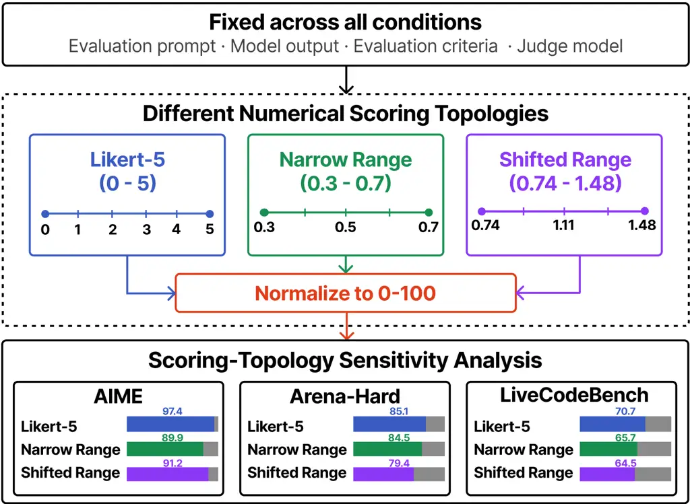
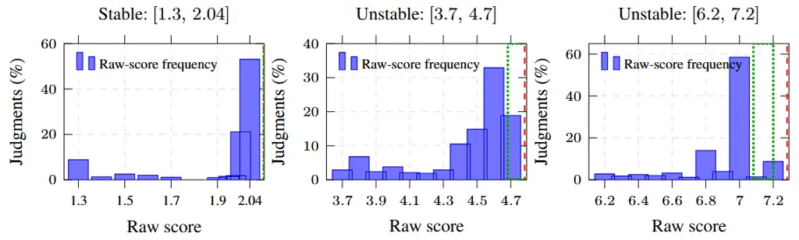

# Same Judgment, Different Scores: Numerical Scoring Topology in LLM-as-a-Judge Evaluation

Doyun Kim Email: [doyunkim@soongsil.ac.kr](mailto:)    Chanwoo Kim
Email: [kcw4776@soongsil.ac.kr](mailto:)    Jiwoo Kum
Email: [goldi1204@soongsil.ac.kr](mailto:)    Minsoo Song
Email: [ecoses042@soongsil.ac.kr](mailto:)    Chanjun ParkSoongsil
University Email: [chanjun.park@ssu.ac.kr](mailto:)

###### Abstract

LLMs are increasingly used as automated evaluators to reduce the cost
and time required for human annotation. However, the role of
scoring-scheme design in the reliability of LLM-as-a-Judge evaluation
remains underexplored. To address this problem, we introduce numerical
scoring topology, which characterizes the structural design of a scoring
scheme in terms of its scale width, granularity, offset, symmetry, and
boundary placement. Building on this definition, we conduct the first
systematic study of how numerical scoring topology influences zero-shot
LLM-as-a-Judge evaluation across diverse benchmarks and judge models.
Our results show that numerical scoring topology systematically affects
judge scores, calibration, and robustness, particularly in
judgment-intensive evaluations. Shifted and narrow ranges tend to induce
some of the largest score deviations across many settings. We further
find that stronger and larger judge models generally achieve higher
discriminative validity and greater robustness to scoring-topology
changes. These findings suggest that numerical scoring topology should
be treated as an integral component of LLM-as-a-Judge evaluation and
highlight the need for more principled and standardized scoring
protocols.

^(†)^(†)footnotetext: Corresponding authors.



Figure 1: Overview of the scoring-topology sensitivity analysis. We keep
the evaluation prompt, model output, evaluation criteria, and judge
model fixed while varying only the numerical scoring topology. Scores
are normalized and compared across representative benchmarks.

## 1 Introduction

Large Language Models (LLMs) are increasingly used as automated
evaluators, a paradigm commonly known as LLM-as-a-Judge Zheng et al.
(2023); Liu et al. (2023). By reducing the need for costly and time
consuming human annotation, LLM judges provide a scalable approach to
evaluating model outputs across diverse tasks, including mathematical,
reasoning, code generation, instruction following, and dialogue Tan et
al. (2024); Tong and Zhang (2024). As automated evaluation plays an
increasingly central role in model development and benchmarking,
ensuring the reliability and reproducibility of LLM judges has become an
important research challenge.

Prior studies have identified factors that influence the reliability of
LLM judges, including candidate response order, response length, model
identity, prompt formulation, and differences in evaluator
calibration Zheng et al. (2023); Zhuo et al. (2024); Chen et al. (2025).
To mitigate these sources of variability, researchers have explored
improved evaluation prompts, explicit scoring criteria, model alignment,
and judge models specifically trained for evaluation Liu et al. (2025);
Kim et al. (2024). Most of these studies concentrate on the semantic and
behavioral aspects of the evaluation process.

However, the numerical scoring scheme itself remains comparatively
underexplored. Existing evaluation protocols employ diverse scoring
formats, including binary decisions, Likert scales, percentage scores,
bounded integer ranges, and custom numerical intervals Li et al. (2025);
Lee et al. (2024). Researchers often select these formats based on
convenience, benchmark compatibility, or downstream evaluation
requirements. Despite their structural differences, these scoring
schemes are commonly treated as equivalent representations of the same
underlying judgment and are assumed to produce comparable evaluator
behavior after normalization.

In this paper, we demonstrate that this assumption does not consistently
hold. As illustrated in Figure 1, we keep the evaluation prompt, model
output, evaluation criteria, and judge model fixed while varying only
the numerical scoring topology. This change alone substantially affects
the judgments produced by zero-shot LLM judges. Small changes to score
design can lead to substantial differences in score distributions and
calibration patterns. The magnitude of this effect varies across tasks:
some evaluations show limited sensitivity, whereas others produce less
consistent outcomes under semantically equivalent evaluation settings.

To investigate this phenomenon systematically, we introduce numerical
scoring topology, which we use operationally to denote the structural
configuration of a numerical score space rather than topology in the
formal mathematical sense. Specifically, it characterizes a scoring
scheme in terms of its scale width, granularity, offset, symmetry, and
boundary placement. We conduct an empirical study across thirteen
scoring topologies and diverse evaluation benchmarks covering both
answer-verification and judgment-intensive tasks. Our experimental
design varies only the numerical scoring topology while keeping the
evaluation prompts, criteria, model outputs, and judge models fixed.

Our experiments show that the effect of numerical scoring topology on
LLM judge behavior varies across evaluation tasks. With the Shifted
Range (0.74–1.48), the normalized score drops from 97.4 to 89.9 on
Arena-Hard and from 70.7 to 65.7 on AIME. A similar decline appears on
LiveCodeBench, where the score decreases from 85.1 with Likert-5 to 79.4
with the Narrow Range (0.3–0.7). Overall, these results indicate that
numerical scoring schemes are not interchangeable, even after
normalization, and that score design can materially affect LLM-based
evaluation outcomes.

Our study addresses the following research questions:

- •
  RQ1: How does numerical scoring topology influence LLM-as-a-Judge
  evaluation across different scoring schemes and evaluation tasks?
- •
  RQ2: Which properties of numerical scoring topology drive evaluation
  instability?
- •
  RQ3: How does the interaction between response language and evaluation
  language affect sensitivity to numerical scoring topology?
- •
  RQ4: How consistently do the effects of numerical scoring topology
  generalize across different response generators and LLM judge models?
- •
  RQ5: How effectively can prompt-based strategies mitigate evaluation
  instability induced by numerical scoring topology?

## 2 Related Work

##### LLM-as-a-Judge.

LLMs increasingly serve as automated evaluators across a broad range of
natural language processing (NLP) tasks, reducing reliance on costly
human annotation Zheng et al. (2023); Liu et al. (2023). Prior studies
demonstrate substantial agreement between LLM judgments and human
preferences across dialogue evaluation, summarization, instruction
following, reasoning, and code generation Tong and Zhang (2024); Chen et
al. (2025). LLM judges commonly evaluate responses through pairwise
preference judgment or pointwise numerical scoring based on predefined
criteria Kim et al. (2024).

Efforts to improve LLM judge reliability focus on prompt design,
explicit evaluation criteria, calibration, model alignment, and
judge-specific training Liu et al. (2025); Kim et al. (2024). These
approaches mainly address the semantic and behavioral components of
evaluation, while the structural design of the numerical scoring space
rarely serves as an independent experimental variable.

##### Numerical Scoring Design in LLM Evaluation.

Numerical scores are widely used in automatic evaluation, with common
schemes including binary labels, Likert scales, percentage scores,
bounded integer ranges, and custom intervals Kim et al. (2024); Lee et
al. (2024); Li et al. (2025). These schemes are typically selected
according to benchmark conventions, implementation preferences, or
downstream requirements. Despite their structural differences, they are
commonly treated as equivalent after normalization.

However, this assumption remains largely unexamined. The structural
design of the numerical scoring space, including score boundaries, range
width, numerical offsets, and boundary alignment, rarely serves as an
independent experimental variable. Our work addresses this problem by
treating numerical score design as an independent factor in
LLM-as-a-Judge evaluation.

| Scoring Scale                          | MATH-500    | AIME        | GPQA Main   | LCB         | Arena-Hard  | IFEval      |
| -------------------------------------- | ----------- | ----------- | ----------- | ----------- | ----------- | ----------- |
| Unit-interval (0 to 1)                 | 85.7 (-0.8) | 67.4 (-3.3) | 73.1 (-4.4) | 84.6 (-0.5) | 94.9 (-2.5) | 80.2 (-3.0) |
| Likert-5 (0 to 5)                      | 86.5 (+0.0) | 70.7 (+0.0) | 77.5 (+0.0) | 85.1 (+0.0) | 97.4 (+0.0) | 83.2 (+0.0) |
| Likert-10 (0 to 10)                    | 86.8 (+0.3) | 69.7 (-1.0) | 77.8 (+0.3) | 82.9 (-2.2) | 93.3 (-4.1) | 81.4 (-1.8) |
| Linear-50 (0 to 50)                    | 87.2 (+0.7) | 71.3 (+0.6) | 78.6 (+1.1) | 84.3 (-0.8) | 94.8 (-2.6) | 82.5 (-0.7) |
| Linear-100 (0 to 100)                  | 87.8 (+1.3) | 71.0 (+0.3) | 78.0 (+0.5) | 84.1 (-1.0) | 93.3 (-4.1) | 82.5 (-0.7) |
| Linear-1000 (0 to 1000)                | 87.4 (+0.9) | 70.2 (-0.5) | 77.3 (-0.2) | 81.3 (-3.8) | 93.9 (-3.5) | 80.8 (-2.4) |
| Positive Offset (3 to 15)              | 85.8 (-0.7) | 68.3 (-2.4) | 76.7 (-0.8) | 83.3 (-1.8) | 94.3 (-3.1) | 81.4 (-1.8) |
| Narrow Range (0.3 to 0.7)              | 85.2 (-1.3) | 67.8 (-2.9) | 73.8 (-3.7) | 79.4 (-5.7) | 88.3 (-9.1) | 77.2 (-6.0) |
| Symmetric Range ($`-5`$ to 5)          | 87.2 (+0.7) | 68.9 (-1.8) | 75.9 (-1.6) | 84.2 (-0.9) | 97.6 (+0.2) | 82.0 (-1.2) |
| Asymmetric Range ($`-5`$ to 2)         | 88.2 (+1.7) | 68.7 (-2.0) | 80.0 (+2.5) | 83.3 (-1.8) | 98.0 (+0.6) | 82.7 (-0.5) |
| Shifted Range (0.74 to 1.48)           | 85.4 (-1.1) | 65.7 (-5.0) | 73.0 (-4.5) | 80.8 (-4.3) | 89.9 (-7.5) | 77.6 (-5.6) |
| Irregular Range I ($`-3.7`$ to 8.9)    | 89.1 (+2.6) | 71.1 (+0.4) | 78.2 (+0.7) | 84.1 (-1.0) | 94.9 (-2.5) | 82.3 (-0.9) |
| Irregular Range II ($`-2.35`$ to 7.85) | 88.3 (+1.8) | 71.9 (+1.2) | 78.1 (+0.6) | 84.7 (-0.4) | 94.5 (-2.9) | 83.3 (+0.1) |

Table 1: Mean normalized judge scores across diverse scoring topologies.
GPT-5-mini is used both to generate the benchmark responses and to
evaluate them under all scoring topologies. All raw scores are
normalized to a 0–100 scale for comparison. Values in parentheses denote
the deviation relative to the Likert-5 baseline; red indicates an
increase and blue indicates a decrease in normalized judge scores.

|                                        |          |           |            |           |            |            |
| -------------------------------------- | -------- | --------- | ---------- | --------- | ---------- | ---------- | --- | --- |
| Scoring Scale                          | MATH-500 | AIME      | GPQA Main  | LCB       | Arena-Hard | IFEval     |
| Disagreement Rate ($`                  | \Delta   | >10`$)    |            |           |            |            |     |     |
| Unit-interval (0 to 1)                 | 9.0 (45) | 20.8 (25) | 20.8 (93)  | 9.7 (17)  | 4.8 (24)   | 28.1 (152) |
| Likert-10 (0 to 10)                    | 4.8 (24) | 10.0 (12) | 6.9 (31)   | 8.0 (14)  | 6.2 (31)   | 20.0 (108) |
| Linear-50 (0 to 50)                    | 4.8 (24) | 6.7 (8)   | 7.6 (34)   | 8.6 (15)  | 6.4 (32)   | 21.4 (116) |
| Linear-100 (0 to 100)                  | 5.0 (25) | 9.2 (11)  | 7.6 (34)   | 5.7 (10)  | 6.6 (33)   | 24.2 (131) |
| Linear-1000 (0 to 1000)                | 5.8 (29) | 8.3 (10)  | 7.1 (32)   | 10.3 (18) | 6.2 (31)   | 20.7 (112) |
| Positive Offset (3 to 15)              | 8.4 (42) | 17.5 (21) | 17.0 (76)  | 12.6 (22) | 9.4 (47)   | 27.7 (150) |
| Narrow Range (0.3 to 0.7)              | 9.0 (45) | 9.2 (11)  | 13.6 (61)  | 19.4 (34) | 23.4 (117) | 32.2 (174) |
| Symmetric Range ($`-5`$ to 5)          | 5.2 (26) | 18.3 (22) | 11.4 (51)  | 9.7 (17)  | 5.0 (25)   | 21.4 (116) |
| Asymmetric Range ($`-5`$ to 2)         | 8.6 (43) | 16.7 (20) | 12.1 (54)  | 13.1 (23) | 7.2 (36)   | 25.7 (139) |
| Shifted Range (0.74 to 1.48)           | 8.8 (44) | 23.3 (28) | 22.5 (101) | 19.4 (34) | 28.8 (144) | 36.4 (197) |
| Irregular Range I ($`-3.7`$ to 8.9)    | 8.8 (44) | 18.3 (22) | 15.8 (71)  | 12.0 (21) | 7.6 (38)   | 25.5 (138) |
| Irregular Range II ($`-2.35`$ to 7.85) | 9.6 (48) | 16.7 (20) | 18.3 (82)  | 13.1 (23) | 7.6 (38)   | 28.8 (156) |
| Disagreement Rate ($`                  | \Delta   | >20`$)    |            |           |            |            |     |     |
| Unit-interval (0 to 1)                 | 2.6 (13) | 3.3 (4)   | 2.9 (13)   | 5.7 (10)  | 1.8 (9)    | 15.2 (82)  |
| Likert-10 (0 to 10)                    | 1.4 (7)  | 1.7 (2)   | 1.6 (7)    | 4.6 (8)   | 1.0 (5)    | 11.3 (61)  |
| Linear-50 (0 to 50)                    | 1.2 (6)  | 0.8 (1)   | 2.0 (9)    | 4.6 (8)   | 1.8 (9)    | 12.4 (67)  |
| Linear-100 (0 to 100)                  | 2.2 (11) | 3.3 (4)   | 1.1 (5)    | 2.9 (5)   | 1.0 (5)    | 12.6 (68)  |
| Linear-1000 (0 to 1000)                | 2.8 (14) | 1.7 (2)   | 1.8 (8)    | 6.3 (11)  | 2.8 (14)   | 12.4 (67)  |
| Positive Offset (3 to 15)              | 2.4 (12) | 2.5 (3)   | 3.8 (17)   | 5.1 (9)   | 3.4 (17)   | 15.9 (86)  |
| Narrow Range (0.3 to 0.7)              | 1.8 (9)  | 1.7 (2)   | 2.0 (9)    | 8.6 (15)  | 7.8 (39)   | 18.1 (98)  |
| Symmetric Range ($`-5`$ to 5)          | 2.8 (14) | 3.3 (4)   | 1.8 (8)    | 6.3 (11)  | 1.6 (8)    | 12.4 (67)  |
| Asymmetric Range ($`-5`$ to 2)         | 4.2 (21) | 2.5 (3)   | 5.4 (24)   | 4.6 (8)   | 2.6 (13)   | 13.5 (73)  |
| Shifted Range (0.74 to 1.48)           | 2.4 (12) | 5.0 (6)   | 2.9 (13)   | 6.9 (12)  | 6.4 (32)   | 13.7 (74)  |
| Irregular Range I ($`-3.7`$ to 8.9)    | 4.4 (22) | 2.5 (3)   | 4.9 (22)   | 5.1 (9)   | 3.0 (15)   | 14.2 (77)  |
| Irregular Range II ($`-2.35`$ to 7.85) | 5.2 (26) | 6.7 (8)   | 3.8 (17)   | 8.0 (14)  | 2.0 (10)   | 15.3 (83)  |

Table 2: Disagreement rates across scoring topologies. GPT-5-mini
generates the benchmark responses and evaluates the same responses under
all scoring topologies. Values denote the percentage of instances whose
normalized scores differ from the Likert-5 reference by more than
$`\delta\in\{10,20\}`$, with counts shown in parentheses. Higher rates
indicate greater sensitivity to numerical scoring topology.

| Benchmark                | Avg\_(\>10) | Avg\_(\>20) |
| ------------------------ | ----------- | ----------- |
| Judgment-Intensive Tasks |             |             |
| Arena-Hard               | 9.9         | 2.9         |
| IFEval                   | 26.0        | 13.9        |
| WildBench                | 23.1        | 8.6         |
| WritingBench             | 20.7        | 6.2         |
| Group Average            | 19.9        | 7.9         |
| Answer-Verifiable Tasks  |             |             |
| MATH-500                 | 7.3         | 2.8         |
| AIME                     | 14.6        | 2.9         |
| GPQA Main                | 13.4        | 2.8         |
| LCB                      | 11.8        | 5.7         |
| Group Average            | 11.8        | 3.6         |

Table 3: Average sensitivity to numerical scoring topology by task type
using GPT-5-mini. Each value shows the disagreement rate relative to
Likert-5, averaged over the twelve non-reference scoring topologies.
Group averages are macro-averaged across the four benchmarks.

|                  |                         |      |      |      |       |      |        |             |             |
| ---------------- | ----------------------- | ---- | ---- | ---- | ----- | ---- | ------ | ----------- | ----------- |
| Factor           | Scoring Scale           | MATH | AIME | GPQA | Arena | LCB  | IFEval | Avg\_(\>10) | Avg\_(\>20) |
| Width sweep      | Baseline (0.74 to 1.48) | 8.0  | 14.2 | 17.2 | 13.8  | 12.0 | 30.9   | 16.0        | 6.4         |
|                  | Width 0.74 to 2.48      | 9.0  | 7.5  | 17.9 | 8.4   | 10.9 | 27.7   | 13.6        | 6.7         |
|                  | Width 0.74 to 4.74      | 8.0  | 6.7  | 10.3 | 4.4   | 9.1  | 20.3   | 9.8         | 4.4         |
|                  | Width 0.74 to 8.74      | 7.4  | 7.5  | 10.3 | 4.6   | 7.4  | 23.8   | 10.2        | 5.1         |
|                  | Width 0.74 to 15.74     | 6.8  | 4.2  | 8.7  | 4.2   | 8.6  | 25.0   | 9.6         | 4.6         |
| Round Max        | 1.0 to 2.0              | 9.2  | 9.2  | 17.0 | 7.6   | 14.9 | 27.2   | 14.2        | 8.8         |
|                  | 3.0 to 4.0              | 8.4  | 10.0 | 19.2 | 14.4  | 10.3 | 32.9   | 15.9        | 9.7         |
|                  | 6.0 to 7.0              | 9.6  | 10.8 | 17.0 | 11.6  | 14.3 | 32.7   | 16.0        | 11.3        |
| Non-round Max    | 1.3 to 2.04             | 8.2  | 8.3  | 15.4 | 4.8   | 9.7  | 25.9   | 12.1        | 6.2         |
|                  | 3.7 to 4.7              | 36.0 | 32.5 | 65.0 | 73.4  | 75.4 | 72.8   | 59.2        | 22.7        |
|                  | 6.2 to 7.2              | 63.8 | 63.3 | 81.5 | 96.6  | 91.4 | 92.4   | 81.5        | 57.7        |
| Narrow Non-round | 2.11 to 2.85            | 7.6  | 11.7 | 12.7 | 10.4  | 15.4 | 29.2   | 14.5        | 7.4         |
|                  | 3.33 to 4.07            | 7.0  | 10.0 | 14.5 | 6.2   | 9.1  | 27.4   | 12.4        | 6.1         |

Table 4: Ablation analysis of boundary alignment and score width using
GPT-5-mini. Each value denotes the percentage of instances whose
normalized score differs from the Linear-100 reference by more than 10
($`\mathrm{Avg}_{>10}`$) or 20 ($`\mathrm{Avg}_{>20}`$). MATH, GPQA, and
Arena refer to MATH-500, GPQA Main, and Arena-Hard, respectively. LCB
denotes LiveCodeBench. The 0.74–1.48 baseline corresponds to the shifted
range used in the main experiment. Bold values highlight large increases
in disagreement under non-round maximum boundaries.

| Scoring Range       | MFS | Count | Prop. |
| ------------------- | --- | ----- | ----- |
| Likert-5 (0–5)      | 5.0 | 1,801 | 78.9% |
| Non-round (3.7–4.7) | 4.6 | 752   | 32.9% |
| Non-round (6.2–7.2) | 7.0 | 1,335 | 58.5% |

Table 5: Concentration of raw judge scores under different scoring
ranges. MFS denotes the most frequently assigned score, and Prop.
denotes its proportion across 2,284 evaluation instances.

| Scoring Scale                          | MATH-500     | AIME         | GPQA Main    | LCB          | Arena-Hard   | IFEval       |
| -------------------------------------- | ------------ | ------------ | ------------ | ------------ | ------------ | ------------ | --- | --- |
| Disagreement Rate ($`                  | \Delta       | >10`$)       |              |              |              |              |     |     |
| Unit-interval (0 to 1)                 | 11.6 (+2.6)  | 20.0 (-0.8)  | 21.0 (+0.2)  | 16.6 (+6.9)  | 6.8 (+2.0)   | 32.5 (+4.4)  |
| Likert-10 (0 to 10)                    | 6.2 (+1.4)   | 9.2 (-0.8)   | 12.7 (+5.8)  | 10.9 (+2.9)  | 5.6 (-0.6)   | 27.9 (+7.9)  |
| Linear-50 (0 to 50)                    | 5.6 (+0.8)   | 8.3 (+1.7)   | 12.1 (+4.5)  | 13.1 (+4.6)  | 9.4 (+3.0)   | 26.8 (+5.4)  |
| Linear-100 (0 to 100)                  | 7.0 (+2.0)   | 8.3 (-0.8)   | 12.7 (+5.1)  | 14.3 (+8.6)  | 8.2 (+1.6)   | 28.1 (+3.9)  |
| Linear-1000 (0 to 1000)                | 6.4 (+0.6)   | 9.2 (+0.8)   | 11.6 (+4.5)  | 14.9 (+4.6)  | 9.0 (+2.8)   | 28.3 (+7.6)  |
| Positive Offset (3 to 15)              | 10.4 (+2.0)  | 17.5 (+0)    | 19.2 (+2.2)  | 12.6 (+0)    | 11.2 (+1.8)  | 33.6 (+5.9)  |
| Narrow Range (0.3 to 0.7)              | 14.6 (+5.6)  | 19.2 (+10.0) | 26.8 (+13.2) | 23.4 (+4.0)  | 44.0 (+20.6) | 47.3 (+15.2) |
| Symmetric Range ($`-5`$ to 5)          | 7.6 (+2.4)   | 15.8 (-2.5)  | 14.7 (+3.3)  | 12.0 (+2.3)  | 7.0 (+2.0)   | 29.0 (+7.6)  |
| Asymmetric Range ($`-5`$ to 2)         | 8.8 (+0.2)   | 15.0 (-1.7)  | 16.3 (+4.2)  | 16.6 (+3.4)  | 8.4 (+1.2)   | 32.3 (+6.7)  |
| Shifted Range (0.74 to 1.48)           | 22.4 (+13.6) | 27.5 (+4.2)  | 40.4 (+17.9) | 47.4 (+28.0) | 53.8 (+25.0) | 53.6 (+17.2) |
| Irregular Range I ($`-3.7`$ to 8.9)    | 13.4 (+4.6)  | 19.2 (+0.8)  | 20.8 (+4.9)  | 13.1 (+1.1)  | 12.2 (+4.6)  | 33.1 (+7.6)  |
| Irregular Range II ($`-2.35`$ to 7.85) | 13.2 (+3.6)  | 20.8 (+4.2)  | 18.5 (+0.2)  | 16.0 (+2.9)  | 11.6 (+4.0)  | 34.2 (+5.4)  |
| Disagreement Rate ($`                  | \Delta       | >20`$)       |              |              |              |              |     |     |
| Unit-interval (0 to 1)                 | 4.4 (+1.8)   | 3.3 (+0)     | 5.4 (+2.5)   | 8.0 (+2.3)   | 2.6 (+0.8)   | 19.6 (+4.4)  |
| Likert-10 (0 to 10)                    | 3.6 (+2.2)   | 0.8 (-0.8)   | 4.0 (+2.5)   | 6.3 (+1.7)   | 2.0 (+1.0)   | 15.5 (+4.3)  |
| Linear-50 (0 to 50)                    | 2.6 (+1.4)   | 3.3 (+2.5)   | 4.5 (+2.5)   | 8.0 (+3.4)   | 3.0 (+1.2)   | 15.2 (+2.8)  |
| Linear-100 (0 to 100)                  | 3.4 (+1.2)   | 2.5 (-0.8)   | 4.2 (+3.1)   | 8.6 (+5.7)   | 2.6 (+1.6)   | 15.0 (+2.4)  |
| Linear-1000 (0 to 1000)                | 2.8 (+0)     | 4.2 (+2.5)   | 4.2 (+2.5)   | 9.7 (+3.4)   | 3.0 (+0.2)   | 16.5 (+4.1)  |
| Positive Offset (3 to 15)              | 4.6 (+2.2)   | 3.3 (+0.8)   | 5.4 (+1.6)   | 6.9 (+1.7)   | 4.4 (+1.0)   | 17.7 (+1.8)  |
| Narrow Range (0.3 to 0.7)              | 5.6 (+3.8)   | 3.3 (+1.7)   | 6.5 (+4.5)   | 7.4 (-1.1)   | 6.0 (-1.8)   | 22.7 (+4.6)  |
| Symmetric Range ($`-5`$ to 5)          | 3.6 (+0.8)   | 5.0 (+1.7)   | 4.5 (+2.7)   | 8.0 (+1.7)   | 2.2 (+0.6)   | 18.3 (+5.9)  |
| Asymmetric Range ($`-5`$ to 2)         | 4.4 (+0.2)   | 4.2 (+1.7)   | 7.1 (+1.8)   | 6.9 (+2.3)   | 2.4 (-0.2)   | 19.4 (+5.9)  |
| Shifted Range (0.74 to 1.48)           | 12.8 (+10.4) | 9.2 (+4.2)   | 12.5 (+9.6)  | 21.7 (+14.9) | 13.4 (+7.0)  | 29.4 (+15.7) |
| Irregular Range I ($`-3.7`$ to 8.9)    | 7.6 (+3.2)   | 5.8 (+3.3)   | 9.2 (+4.2)   | 8.0 (+2.9)   | 3.2 (+0.2)   | 18.5 (+4.3)  |
| Irregular Range II ($`-2.35`$ to 7.85) | 7.6 (+2.4)   | 8.3 (+1.7)   | 6.9 (+3.1)   | 10.9 (+2.9)  | 2.2 (+0.2)   | 19.2 (+3.9)  |

Table 6: Cross-lingual impact on evaluator calibration. Disagreement
rates under Korean-language judging relative to the condition-specific
Likert-5 reference. Values in parentheses denote percentage-point
differences compared with English-language judging (red: increased
instability, blue: decreased instability). The results indicate that
Korean-language evaluation can increase sensitivity to numerical scoring
topology.

| Condition           | MATH | LCB  | Arena | IFEval | Max  |
| ------------------- | ---- | ---- | ----- | ------ | ---- |
| EN$`\rightarrow`$EN | 7.5  | 12.0 | 10.2  | 26.3   | 33.9 |
| KO$`\rightarrow`$EN | 1.8  | 13.0 | 9.3   | 29.9   | 31.9 |
| EN$`\rightarrow`$KO | 10.6 | 17.6 | 15.6  | 33.9   | 21.9 |
| KO$`\rightarrow`$KO | 4.1  | 14.9 | 14.4  | 39.0   | 23.0 |
| EN$`\rightarrow`$ZH | 4.2  | 16.8 | 17.6  | 33.5   | 14.3 |
| EN$`\rightarrow`$JA | 2.1  | 15.3 | 13.8  | 34.2   | 38.7 |

Table 7: Disagreement rates and maximum-score usage across language
conditions using GPT-5-mini. The benchmark columns show $`|\Delta|>10`$
disagreement rates averaged across twelve non-reference topologies. Max
shows maximum-score usage for the shifted range 0.74–1.48 across four
benchmarks. EN$`\rightarrow`$KO, EN$`\rightarrow`$ZH and
EN$`\rightarrow`$JA denote English responses evaluated using Korean,
Chinese, and Japanese judge prompts, respectively.

## 3 Experimental Setup

Due to space limitations, detailed descriptions of the scoring
topologies, evaluation metrics, and inference settings are provided in
Appendix A.

We use an experimental framework in which only the numerical scoring
topology varies, while the evaluation task, prompt, criteria, model
output, and judge model remain fixed. This setup isolates the effect of
score design on evaluator behavior.

We conduct the primary thirteen-topology analysis on six benchmarks and
extend the task-type analysis to two additional judgment-intensive
benchmarks, using seventeen LLM judges in the generalization
experiments.

### 3.1 Evaluation Benchmarks

We evaluate LLM judges on eight benchmarks covering mathematical
reasoning, scientific reasoning, code generation, conversational
quality, instruction following, and writing evaluation.

MATH-500 Lightman et al. (2024) and AIME ¹¹ 1
[https://huggingface.co/datasets/allenai/aime-2022-2025](https://huggingface.co/datasets/allenai/aime-2022-2025)
evaluate mathematical reasoning with well-defined reference answers. We
use 500 examples from MATH-500 and 120 problems from AIME 2022–2025.
GPQA Main Rein et al. (2023) contains 448 expert-level questions in
biology, physics, and chemistry. LiveCodeBench (LCB) Jain et al. (2024)
includes 175 code-generation examples spanning easy, medium, and hard
difficulty levels.

Arena-Hard Li et al. (2024) contains 500 challenging prompts, while
WildBench Lin et al. (2024) includes 256 real-world user queries. Both
benchmarks evaluate response quality in settings where judges assess
dimensions such as helpfulness, relevance, and overall quality.
IFEval Zhou et al. (2023) contains 541 examples with explicit
instruction-following constraints. WritingBench Wu et al. (2026)
evaluates generated writing across diverse tasks and criteria, and we
use 555 examples from its English subset.

These benchmarks represent evaluation settings that differ in answer
verifiability and in the degree of evaluator discretion required when
assigning numerical scores. This diversity allows us to examine whether
sensitivity to numerical scoring topology varies across different forms
of evaluation.

### 3.2 Judge Models

We use GPT-5-mini as the primary model for both inference and judging.
To examine whether sensitivity to numerical scoring topology generalizes
across model families and scales, we evaluate seventeen LLM judge
models: GPT-5.4 ²² 2
[https://openai.com/index/introducing-gpt-5-4/](https://openai.com/index/introducing-gpt-5-4/),
GPT-5-mini ³³ 3
[https://openai.com/index/gpt-5-system-card/](https://openai.com/index/gpt-5-system-card/),
GPT-4o-mini Hurst et al. (2024), GPT-OSS-120B, GPT-OSS-20B OpenAI
(2025), MiniMax-M3 ⁴⁴ 4
[https://www.minimax.io/blog/minimax-m3](https://www.minimax.io/blog/minimax-m3),
DeepSeek-V4-Pro DeepSeek-AI (2026), Gemini-2.5-Flash-Lite Comanici et
al. (2025), Qwen3.7-Plus, Qwen3-32B, Qwen3-14B, Qwen3-8B Team (2025),
Llama-3.1-70B, Llama-3.1-8B Grattafiori et al. (2024), Gemma-3-27B,
Gemma-3-12B, and Gemma-3-4B Team et al. (2025). The complete generation
and judging prompts, including multilingual variants and prompt-based
mitigation strategies, are provided in Appendix B.

### 3.3 Experimental Design

Our experimental design follows the five research questions introduced
in Section 1.

For RQ1, we use GPT-5-mini as both the response generator and judge
model and evaluate identical responses across thirteen scoring
topologies. We compare normalized scores and disagreement rates across
benchmarks to examine how numerical scoring topology affects evaluation
outcomes and task-level sensitivity.

For RQ2, we conduct ablations of score width and boundary configuration.
We vary range width, boundary placement, numerical offset, and boundary
alignment while holding the benchmark responses, evaluation criteria,
and judge model fixed.

For RQ3, we compare six response–evaluation language configurations:
EN$`\rightarrow`$EN, KO$`\rightarrow`$EN, EN$`\rightarrow`$KO,
KO$`\rightarrow`$KO, EN$`\rightarrow`$ZH, and EN$`\rightarrow`$JA. This
setup examines the effects of response language, evaluation language,
and their interaction on sensitivity to numerical scoring topology.

For RQ4, we evaluate response generators and seventeen judge models
across multiple model families and scales. We measure judge
discrimination using AUROC and topology robustness using disagreement
rates to assess whether the observed effects generalize across
generators and judges.

For RQ5, we compare two prompt-based mitigation strategies, Allowed List
and Explicit Max, against a scale-only baseline. We measure disagreement
rates relative to the Likert-5 reference across all conditions and
maximum-score usage for the two mitigation strategies to assess their
effectiveness in reducing sensitivity to numerical scoring topology.

## 4 Results

### 4.1 RQ1: How does numerical scoring topology influence LLM-as-a-Judge evaluation across different scoring schemes and evaluation tasks?

We examine the overall effect of numerical scoring topology, identify
the numerical properties responsible for evaluation instability, and
compare sensitivity across task types.

##### Finding 1: Numerical scoring topology changes evaluation outcomes even when all semantic evaluation conditions are held constant.

Table 1 shows that normalized benchmark scores vary when only the
numerical scoring topology is changed. The largest decreases occur under
the Shifted Range, including $`-7.5`$ points on Arena-Hard and $`-5.6`$
points on IFEval, whereas several asymmetric and irregular ranges
increase scores on other benchmarks. This indicates that topology
changes affect both the magnitude and direction of evaluation outcomes.

Table 2 further confirms substantial instance-level variation. Across
all non-reference topologies, 14.2% of matched evaluation instances
differ from Likert-5 by more than 10 normalized points, and 5.7% differ
by more than 20 points. The Shifted Range produces the highest overall
disagreement at $`|\Delta|>10`$, reaching 24.0%, while the Narrow Range
produces the highest disagreement for $`|\Delta|>20`$ at 7.5%. These
results demonstrate that numerical score design itself systematically
alters LLM judge evaluations.

##### Finding 2: Judgment-intensive tasks are more sensitive to numerical scoring topology than answer-verifiable tasks.

The task-level variation observed in Tables 1 and 2 motivates an
additional analysis of evaluation type. We therefore extend the
benchmark suite with WildBench and WritingBench and group the tasks into
answer-verifiable benchmarks (MATH-500, AIME, GPQA Main, and LCB) and
judgment-intensive benchmarks (Arena-Hard, IFEval, WildBench, and
WritingBench). Detailed results for WildBench and WritingBench are
provided in Appendix C.1 and Appendix C.2.

As shown in Table 3, the judgment-intensive group exhibits higher
disagreement rates than the answer-verifiable group: 19.9% versus 11.8%
for $`|\Delta|>10`$ and 7.9% versus 3.6% for $`|\Delta|>20`$. IFEval,
WildBench, and WritingBench show particularly high sensitivity, whereas
Arena-Hard remains relatively stable. These results indicate that tasks
requiring qualitative assessment or the aggregation of multiple criteria
are generally more sensitive to numerical score representation than
tasks with explicit answers or execution-based correctness.

### 4.2 RQ2: Which properties of numerical scoring topology drive evaluation instability?

We analyze how score width and boundary configuration affect evaluation
stability and examine the raw-score behavior underlying highly unstable
configurations.

##### Finding 1: Boundary configuration affects evaluation stability more strongly than score width alone.

Table 4 compares the effects of score width and boundary configuration.
Increasing the width of the shifted range generally reduces
disagreement, with the average $`|\Delta|>10`$ rate decreasing from
16.0% under 0.74–1.48 to 9.6% under 0.74–15.74. A similar overall
tendency is observed at $`|\Delta|>20`$, although the reduction is not
strictly monotonic. These results suggest that wider scoring ranges
generally reduce sensitivity to numerical scoring topology.

Boundary configuration produces substantially larger effects. Ranges
with round maximum values show average $`|\Delta|>10`$ disagreement
rates between 14.2% and 16.0%, whereas 3.7–4.7 and 6.2–7.2 increase
disagreement to 59.2% and 81.5%, respectively. However, the 1.3–2.04
range remains comparatively stable because judges frequently assign a
score of 2.0, which lies close to the upper boundary of 2.04 and
therefore maps to a high normalized score. Thus, instability is
associated with how frequently used numerical anchors align with the
range boundaries, rather than with non-round values in general.

##### Finding 2: Unstable boundary configurations induce concentration around score anchors that do not align with the specified maximum.

To investigate the mechanism underlying the high disagreement, we
analyze the raw scores assigned under the two most unstable
configurations. Table 5 shows the most frequently assigned score (MFS)
and its proportion. For Likert-5, the judge assigns the maximum score of
5.0 in 78.9% of evaluations. In contrast, scores in the non-round ranges
concentrate on values below their specified maxima.

For 3.7–4.7, the most frequent score is 4.6, accounting for 32.9% of the
evaluations. For 6.2–7.2, the judge assigns 7.0 in 58.5% of the
evaluations rather than using the specified maximum of 7.2. After
normalization, these values correspond to 90 and 80 points,
respectively, whereas the most frequent Likert-5 score corresponds to
100 points. Consequently, judgments concentrated near the upper end of
the raw scale can be mapped to substantially different normalized scores
depending on boundary placement.

These results suggest that the judge does not consistently adapt its
preferred score anchors to the exact boundaries of the scoring range.
The mismatch between raw-score concentration and the specified
boundaries provides a behavioral explanation for the large disagreement
observed under specific numerical configurations. Detailed
boundary-ablation results are provided in Appendix C.3 and Appendix C.4.

### 4.3 RQ3: How does the interaction between response language and evaluation language affect sensitivity to numerical scoring topology?

We analyze whether sensitivity to numerical scoring topology changes
across response and evaluation languages. By comparing six language
configurations, we examine whether the effect of cross-lingual
evaluation varies across tasks.

##### Finding 1: Korean evaluation increases sensitivity to numerical scoring topology.

Table 6 compares disagreement rates under EN$`\rightarrow`$KO condition
with those under the EN$`\rightarrow`$EN baseline. Across most
benchmarks and scoring topologies, Korean evaluation produces higher
disagreement relative to the condition-specific Likert-5 reference. The
increase is particularly pronounced for the Shifted Range, where the
$`|\Delta|>10`$ disagreement rate rises by 13.6 percentage points on
MATH-500, 28.0 points on LCB, 25.0 points on Arena-Hard, and 17.2 points
on IFEval.

The effect is also visible under the stricter $`|\Delta|>20`$ threshold.
For the Shifted Range, disagreement increases by 10.4 percentage points
on MATH-500, 14.9 points on LCB, 7.0 points on Arena-Hard, and 15.7
points on IFEval. Although some configurations show reduced or unchanged
disagreement, the overall pattern indicates that numerical scoring
topology becomes more sensitive when English responses are evaluated
using Korean instructions.

##### Finding 2: The effect of language configuration varies across tasks and evaluation languages.

Table 7 shows that disagreement rates vary substantially across language
conditions. English evaluation is generally the most stable, with
KO$`\rightarrow`$EN achieving the lowest disagreement on MATH-500 and
Arena-Hard and EN$`\rightarrow`$EN performing best on LCB and IFEval.
However, the effect of non-English evaluation is not uniform. Japanese
evaluation remains relatively stable on MATH-500, reaching 2.1%
disagreement, but produces higher disagreement on LCB, Arena-Hard, and
IFEval. Chinese evaluation also shows greater sensitivity on the
remaining benchmarks. Korean evaluation produces consistently elevated
disagreement, with IFEval reaching 39.0% under KO$`\rightarrow`$KO.

These results indicate that Korean evaluation is consistently sensitive
to scoring topology. Evaluation language also affects maximum-score
usage under the shifted range: it decreases from 31.9–33.9% under
English evaluation to 21.9–23.0% under Korean evaluation and 14.3% under
Chinese evaluation, whereas Japanese evaluation reaches 38.7%. This
suggests that adaptation to the upper boundary depends on the evaluation
language. Detailed results are provided in Appendix C.5.

| Judge Model           | AUROC | $`   | \Delta | >10`$ | $`  | \Delta | >20`$ |
| --------------------- | ----- | ---- | ------ | ----- | --- | ------ | ----- |
| GPT-5.4               | 0.934 | 12.7 | 4.9    |
| MiniMax-M3            | 0.931 | 17.5 | 10.6   |
| GPT-OSS-120B          | 0.930 | 16.7 | 2.5    |
| DeepSeek-V4-Pro       | 0.919 | 13.7 | 12.1   |
| GPT-5-mini            | 0.913 | 22.7 | 3.3    |
| Qwen3.7-Plus          | 0.907 | 5.3  | 5.3    |
| Gemini-2.5-Flash-Lite | 0.900 | 38.7 | 19.0   |
| Gemma-3-4B            | 0.875 | 88.0 | 86.1   |
| Qwen3-8B              | 0.841 | 15.7 | 14.1   |
| Llama-3.1-8B          | 0.696 | 99.1 | 92.6   |

Table 8: Judge discriminative validity and sensitivity to numerical
scoring topology. AUROC is computed on pooled GPQA Main and AIME, while
$`|\Delta|>10`$ and $`|\Delta|>20`$ report cross-topology disagreement
rates.

### 4.4 RQ4: How consistently do the effects of numerical scoring topology generalize across different response generators and LLM judge models?

We use GPQA Main and AIME because both provide objectively verifiable
answers, enabling generated responses to be labeled as correct or
incorrect independently of the judge. This allows us to measure judge
discrimination using AUROC. We additionally measure topology sensitivity
using $`|\Delta|>10`$ and $`|\Delta|>20`$, where $`\Delta`$ is the
normalized-score difference between Likert-5 and the Shifted Range
(0.74–1.48).

##### Finding 1: Higher-capability judges generally combine discriminative validity with greater robustness to numerical scoring topology.

Table 8 compares six high-capability judges with four lower-capability
judges using responses generated by GPT-5-mini. Higher-capability judges
achieve AUROC values between 0.907–0.934 on GPQA Main and AIME. Among
the lower-capability judges, Gemini-2.5-Flash-Lite obtains an AUROC of
0.900, followed by Gemma-3-4B at 0.875, Qwen3-8B at 0.841, and
Llama-3.1-8B at 0.696.

Higher-capability judges also tend to be less sensitive to numerical
scoring topology. Qwen3.7-Plus obtains the lowest $`|\Delta|>10`$
disagreement rate at 5.3%, while GPT-OSS-120B obtains the lowest
$`|\Delta|>20`$ rate at 2.5%. By contrast, Gemma-3-4B and Llama-3.1-8B
exhibit disagreement rates above 86% at both thresholds. Overall, higher
judge capability is generally associated with strong discriminative
validity and cross-topology robustness.

|               |       |      |        |
| ------------- | ----- | ---- | ------ | ----- | --- | ------ | ----- |
| Judge Model   | AUROC | $`   | \Delta | >10`$ | $`  | \Delta | >20`$ |
| GPT-5.4       | 0.934 | 12.7 | 4.9    |
| GPT-5-mini    | 0.913 | 22.7 | 3.3    |
| GPT-4o-mini   | 0.898 | 25.0 | 7.6    |
| GPT-OSS-120B  | 0.930 | 16.7 | 2.5    |
| GPT-OSS-20B   | 0.916 | 51.1 | 10.2   |
| Llama-3.1-70B | 0.888 | 94.0 | 84.0   |
| Llama-3.1-8B  | 0.696 | 99.1 | 92.6   |
| Gemma-3-27B   | 0.879 | 51.6 | 45.1   |
| Gemma-3-12B   | 0.879 | 72.7 | 50.5   |
| Gemma-3-4B    | 0.875 | 88.0 | 86.1   |
| Qwen3-32B     | 0.841 | 21.0 | 17.8   |
| Qwen3-14B     | 0.848 | 19.5 | 15.3   |
| Qwen3-8B      | 0.841 | 15.7 | 14.1   |

Table 9: Within-group judge performance and topology sensitivity. AUROC
is computed on pooled GPQA Main and AIME, while $`|\Delta|>10`$ and
$`|\Delta|>20`$ report cross-topology disagreement rates.

| Benchmark     | Scoring Range  | Baseline       | Allowed List |        | Explicit Max |                |
| ------------- | -------------- | -------------- | ------------ | ------ | ------------ | -------------- | ------ | ------ | ---- | -------------- | ------ | ------ |
|               |                | $`\boldsymbol{ | \Delta       | >10}`$ | %Max         | $`\boldsymbol{ | \Delta | >10}`$ | %Max | $`\boldsymbol{ | \Delta | >10}`$ |
| MATH-500      | \[6.2, 7.2\]   | 64.8           | 72.4         | 25.4   | 95.4         | 3.2            |
|               | \[3.7, 4.7\]   | 33.3           | 94.3         | 3.7    | 96.5         | 2.5            |
|               | \[0.74, 1.48\] | 8.8            | 95.7         | 2.1    | 97.0         | 2.0            |
| Arena-Hard    | \[6.2, 7.2\]   | 97.1           | 3.0          | 93.7   | 24.2         | 71.6           |
|               | \[3.7, 4.7\]   | 94.5           | 14.1         | 83.9   | 35.2         | 62.8           |
|               | \[0.74, 1.48\] | 28.8           | 71.7         | 24.6   | 63.3         | 14.1           |
| LiveCodeBench | \[6.2, 7.2\]   | 93.7           | 11.4         | 81.1   | 65.7         | 28.6           |
|               | \[3.7, 4.7\]   | 86.9           | 42.3         | 50.9   | 64.6         | 24.6           |
|               | \[0.74, 1.48\] | 19.4           | 78.3         | 15.4   | 78.3         | 12.6           |
| IFEval        | \[6.2, 7.2\]   | 92.9           | 5.2          | 83.4   | 37.3         | 54.3           |
|               | \[3.7, 4.7\]   | 85.5           | 16.6         | 74.9   | 43.3         | 49.6           |
|               | \[0.74, 1.48\] | 36.4           | 60.1         | 36.0   | 60.8         | 30.6           |
| GPQA Main     | \[6.2, 7.2\]   | 83.5           | 21.9         | 67.0   | 65.4         | 22.5           |
|               | \[3.7, 4.7\]   | 72.1           | 48.9         | 41.7   | 65.6         | 21.2           |
|               | \[0.74, 1.48\] | 22.5           | 70.2         | 23.7   | 71.9         | 18.8           |
| AIME          | \[6.2, 7.2\]   | 63.3           | 52.5         | 25.8   | 70.0         | 14.2           |
|               | \[3.7, 4.7\]   | 41.7           | 67.5         | 16.7   | 70.0         | 13.3           |
|               | \[0.74, 1.48\] | 23.3           | 71.7         | 11.7   | 70.8         | 11.7           |

Table 10: Effectiveness of prompt-based mitigation strategies across six
benchmarks and three scoring ranges using GPT-5-mini. %Max denotes
maximum-score usage, while $`|\Delta|>10`$ represents the disagreement
rate relative to the Likert-5 reference.

##### Finding 2: Increasing model scale generally improves judge performance and robustness to numerical scoring topology.

Table 9 shows that larger models generally achieve stronger
discriminative validity and lower cross-topology disagreement. Within
GPT-OSS, scaling from 20B to 120B increases AUROC from 0.916 to 0.930
while reducing the $`|\Delta|>10`$ and $`|\Delta|>20`$ rates from 51.1%
and 10.2% to 16.7% and 2.5%. Llama-3.1 improves from 0.696 at 8B to
0.888 at 70B, with modest reductions in both disagreement rates. Gemma-3
shows nearly unchanged AUROC across scales, while its $`|\Delta|>20`$
rate decreases from 86.1% at 4B to 45.1% at 27B.

This scaling benefit is not strictly monotonic across all model
families. Within Qwen3, the 14B model achieves the highest AUROC,
whereas the 8B model exhibits the lowest disagreement rates.
Nevertheless, the overall results indicate that increasing parameter
scale generally strengthens judge discrimination and, in several model
families, reduces sensitivity to numerical scoring topology. Detailed
judge-level robustness results are provided in Appendix C.6,
Appendix C.7, and Appendix C.8.

### 4.5 RQ5: How effectively can prompt-based strategies mitigate evaluation instability induced by numerical scoring topology?

We compare two prompt-based mitigation strategies, Allowed List and
Explicit Max, against a baseline condition. The baseline condition asks
the judge to assign a single score within the specified range. The
Allowed List condition explicitly provides a predefined set of permitted
score values, such as $`{6.2,6.3,\ldots,7.2}`$, and asks the judge to
select one of them. The Explicit Max condition instructs the judge to
assign the specified maximum score to a fully correct or excellent
response.

##### Finding 1: Explicit maximum-score instructions substantially reduce evaluation instability across scoring topologies.

Table 10 shows that Explicit Max consistently achieves lower
disagreement rates than the baseline across all evaluated benchmarks and
scoring ranges. On MATH-500, the $`|\Delta|>10`$ disagreement rate
decreases from 64.8% to 3.2% for $`[6.2,7.2]`$ and from 33.3% to 2.5%
for $`[3.7,4.7]`$. Similar reductions are observed on LiveCodeBench,
where disagreement decreases from 93.7% to 28.6% and from 86.9% to
24.6%, respectively.

Explicit Max also generally achieves higher maximum-score usage than
Allowed List. On MATH-500, maximum-score usage increases from 72.4% to
95.4% for $`[6.2,7.2]`$ and from 94.3% to 96.5% for $`[3.7,4.7]`$.
LiveCodeBench shows a similar pattern, with maximum-score usage
increasing from 11.4% to 65.7% and from 42.3% to 64.6%, respectively.
These results suggest that explicitly linking the upper scoring boundary
to response quality can reduce evaluation instability associated with
numerical-anchor misalignment.

## 5 Conclusion

In this paper, we introduce numerical scoring topology as a structural
factor in LLM-as-a-Judge evaluation and systematically examine its
effects on zero-shot judgments. Our results show that numerical scoring
topology affects LLM-as-a-Judge evaluation. Judgment-intensive tasks are
particularly sensitive, while evaluation language can substantially
modulate topology sensitivity, producing larger or qualitatively
different effects across language and task conditions. Specific boundary
configurations also cause greater instability than score width alone.
Stronger and larger judge models are generally more robust to these
changes. Furthermore, prompt-based mitigation strategies, particularly
explicit maximum-score instructions, can reduce evaluation instability.
These findings highlight the need to consider and standardize numerical
scoring schemes in LLM-based evaluation.

## Limitations

This work has several limitations that also suggest directions for
future research. First, although our experiments cover diverse
evaluation benchmarks, scoring topologies, and seventeen LLM judges from
both proprietary and open-source model families, they cannot encompass
the full diversity of rapidly evolving foundation models. Evaluating
future generations of LLM judges will help assess the generality of the
observed phenomena.

Second, we focus on point-based numerical scoring. It remains an open
question whether similar sensitivity to numerical scoring topology
arises in alternative evaluation protocols, such as pairwise preference,
ranking-based evaluation, or rubric-guided assessment.

Third, our multilingual analysis considers English and Korean as
response languages and English, Korean, Chinese, and Japanese as
evaluation languages. Although these settings cover multiple
cross-lingual conditions, they do not represent the full diversity of
world languages.

Finally, although our results provide consistent evidence that numerical
scoring topology influences LLM-as-a-Judge evaluation, the mechanisms
underlying these effects remain unclear. Understanding why specific
boundary configurations alter evaluator behavior and incorporating these
insights into more principled evaluation protocols remain important
directions for future research.

## Ethical Considerations

This work uses existing benchmarks and model-generated responses and
does not involve human participants or the collection of personal data.
However, numerical scoring topology can influence evaluator outcomes and
model comparisons, potentially leading to misleading conclusions when
scoring schemes are treated as interchangeable. We therefore encourage
researchers to report scoring ranges and normalization procedures
transparently and to interpret LLM-judge scores with appropriate
caution.

## Acknowledgement

This work was supported by Korea Internet & Security Agency(KISA) grant
funded by the Korea government(PIPC) (No.RS-2026-25526342, Development
of Technologies for Preventing Sensitive Information Inference and Risk
Assessment in Foundation Model Operations). This work was also supported
by the National Research Foundation of Korea(NRF) grant funded by the
Korea government(MSIT) (RS-2026-25483747). In addition, this research
was supported by Culture, Sports and Tourism R&D Program through the
Korea Creative Content Agency grant funded by the Ministry of Culture,
Sports and Tourism in 2026 (Project Name: Develop AI agent technology to
connect knowledge through public cultural facility-based discussion and
communication, Project Number: RS-2026-25520645). Furthermore, this work
was supported by Institute of Information & communications Technology
Planning & Evaluation (IITP, AI Computing Support Project for R&D) grant
funded by the Korea government(MSIT) (High-Performance Research AI
Computing Infrastructure Support at the 2 PFLOPS Scale,
RS-2026-25505492). Lastly, we gratefully acknowledge VESSL for providing
GPU resources.

## References

- Airola et al. (2011) A. Airola, T. Pahikkala, W. Waegeman, B. De
  Baets, and T. Salakoski An experimental comparison of cross-validation
  techniques for estimating the area under the roc curve. Computational
  Statistics & Data Analysis 55 (4), pp. 1828–1844. Cited by: §A.2.
- Chen et al. (2025) Z. Chen, H. Wang, X. Zhang, E. Hu, and Y. Lin
  Beyond the surface: measuring self-preference in llm judgments. In
  Proceedings of the 2025 Conference on Empirical Methods in Natural
  Language Processing, pp. 1653–1672. Cited by: §1, §2.
- Comanici et al. (2025) G. Comanici, E. Bieber, M. Schaekermann, I.
  Pasupat, N. Sachdeva, I. Dhillon, M. Blistein, O. Ram, D. Zhang, E.
  Rosen, et al. Gemini 2.5: pushing the frontier with advanced
  reasoning, multimodality, long context, and next generation agentic
  capabilities. arXiv preprint arXiv:2507.06261. Cited by: §3.2.
- DeepSeek-AI (2026) DeepSeek-AI DeepSeek-v4: towards highly efficient
  million-token context intelligence. Cited by: §3.2.
- Grattafiori et al. (2024) A. Grattafiori, A. Dubey, A. Jauhri, A.
  Pandey, A. Kadian, A. Al-Dahle, A. Letman, A. Mathur, A. Schelten, A.
  Vaughan, et al. The llama 3 herd of models. arXiv preprint
  arXiv:2407.21783. Cited by: §3.2.
- Hurst et al. (2024) A. Hurst, A. Lerer, A. P. Goucher, A. Perelman, A.
  Ramesh, A. Clark, A. Ostrow, A. Welihinda, A. Hayes, A. Radford, et
  al. Gpt-4o system card. arXiv preprint arXiv:2410.21276. Cited by:
  §3.2.
- Jain et al. (2024) N. Jain, K. Han, A. Gu, W. Li, F. Yan, T. Zhang, S.
  Wang, A. Solar-Lezama, K. Sen, and I. Stoica Livecodebench: holistic
  and contamination free evaluation of large language models for code.
  arXiv preprint arXiv:2403.07974. Cited by: §3.1.
- Kim et al. (2024) S. Kim, J. Suk, S. Longpre, B. Y. Lin, J. Shin, S.
  Welleck, G. Neubig, M. Lee, K. Lee, and M. Seo Prometheus 2: an open
  source language model specialized in evaluating other language models.
  In Proceedings of the 2024 Conference on Empirical Methods in Natural
  Language Processing, pp. 4334–4353. Cited by: §1, §2, §2, §2.
- Lee et al. (2024) Y. Lee, J. Kim, J. Kim, H. Cho, J. Kang, P. Kang,
  and N. Kim Checkeval: a reliable llm-as-a-judge framework for
  evaluating text generation using checklists. arXiv preprint
  arXiv:2403.18771. Cited by: §1, §2.
- Li et al. (2025) D. Li, B. Jiang, L. Huang, A. Beigi, C. Zhao, Z.
  Tan, A. Bhattacharjee, Y. Jiang, C. Chen, T. Wu, et al. From
  generation to judgment: opportunities and challenges of
  llm-as-a-judge. In Proceedings of the 2025 Conference on Empirical
  Methods in Natural Language Processing, pp. 2757–2791. Cited by: §1,
  §2.
- Li et al. (2024) T. Li, W. Chiang, E. Frick, L. Dunlap, T. Wu, B.
  Zhu, J. E. Gonzalez, and I. Stoica From crowdsourced data to
  high-quality benchmarks: arena-hard and benchbuilder pipeline. arXiv
  preprint arXiv:2406.11939. Cited by: §3.1.
- Lightman et al. (2024) H. Lightman, V. Kosaraju, Y. Burda, H.
  Edwards, B. Baker, T. Lee, J. Leike, J. Schulman, I. Sutskever, and K.
  Cobbe Let’s verify step by step. In International Conference on
  Learning Representations, Vol. 2024, pp. 39578–39601. Cited by: §3.1.
- Lin et al. (2024) B. Y. Lin, Y. Deng, K. Chandu, F. Brahman, A.
  Ravichander, V. Pyatkin, N. Dziri, R. L. Bras, and Y. Choi Wildbench:
  benchmarking llms with challenging tasks from real users in the wild.
  arXiv preprint arXiv:2406.04770. Cited by: §3.1.
- Liu et al. (2025) S. Liu, X. Li, Z. Liu, Y. Yan, C. Yang, Z. Zeng, Z.
  Liu, M. Sun, and G. Yu Judge as a judge: improving the evaluation of
  retrieval-augmented generation through the judge-consistency of large
  language models. In Findings of the Association for Computational
  Linguistics: ACL 2025, pp. 5788–5807. Cited by: §1, §2.
- Liu et al. (2023) Y. Liu, D. Iter, Y. Xu, S. Wang, R. Xu, and C. Zhu
  G-eval: nlg evaluation using gpt-4 with better human alignment. In
  Proceedings of the 2023 conference on empirical methods in natural
  language processing, pp. 2511–2522. Cited by: §1, §2.
- OpenAI (2025) OpenAI Gpt-oss-120b & gpt-oss-20b model card. External
  Links: 2508.10925, [Link](https://arxiv.org/abs/2508.10925) Cited by:
  §3.2.
- Rein et al. (2023) D. Rein, B. L. Hou, A. C. Stickland, J.
  Petty, R. Y. Pang, J. Dirani, J. Michael, and S. R. Bowman Gpqa: a
  graduate-level google-proof q&a benchmark. arXiv preprint
  arXiv:2311.12022. Cited by: §3.1.
- Tan et al. (2024) S. Tan, S. Zhuang, K. Montgomery, W. Y. Tang, A.
  Cuadron, C. Wang, R. A. Popa, and I. Stoica Judgebench: a benchmark
  for evaluating llm-based judges. arXiv preprint arXiv:2410.12784.
  Cited by: §1.
- Team et al. (2025) G. Team, A. Kamath, J. Ferret, S. Pathak, N.
  Vieillard, R. Merhej, S. Perrin, T. Matejovicova, A. Ramé, M.
  Rivière, L. Rouillard, T. Mesnard, G. Cideron, J. Grill, S. Ramos, E.
  Yvinec, M. Casbon, E. Pot, I. Penchev, G. Liu, F. Visin, K.
  Kenealy, L. Beyer, X. Zhai, A. Tsitsulin, R. Busa-Fekete, A. Feng, N.
  Sachdeva, B. Coleman, Y. Gao, B. Mustafa, I. Barr, E. Parisotto, D.
  Tian, M. Eyal, C. Cherry, J. Peter, D. Sinopalnikov, S.
  Bhupatiraju, R. Agarwal, M. Kazemi, D. Malkin, R. Kumar, D. Vilar, I.
  Brusilovsky, J. Luo, A. Steiner, A. Friesen, A. Sharma, A.
  Sharma, A. M. Gilady, A. Goedeckemeyer, A. Saade, A. Feng, A.
  Kolesnikov, A. Bendebury, A. Abdagic, A. Vadi, A. György, A. S.
  Pinto, A. Das, A. Bapna, A. Miech, A. Yang, A. Paterson, A. Shenoy, A.
  Chakrabarti, B. Piot, B. Wu, B. Shahriari, B. Petrini, C. Chen, C. L.
  Lan, C. A. Choquette-Choo, C. Carey, C. Brick, D. Deutsch, D.
  Eisenbud, D. Cattle, D. Cheng, D. Paparas, D. S. Sreepathihalli, D.
  Reid, D. Tran, D. Zelle, E. Noland, E. Huizenga, E. Kharitonov, F.
  Liu, G. Amirkhanyan, G. Cameron, H. Hashemi, H. Klimczak-Plucińska, H.
  Singh, H. Mehta, H. T. Lehri, H. Hazimeh, I. Ballantyne, I.
  Szpektor, I. Nardini, J. Pouget-Abadie, J. Chan, J. Stanton, J.
  Wieting, J. Lai, J. Orbay, J. Fernandez, J. Newlan, J. Ji, J.
  Singh, K. Black, K. Yu, K. Hui, K. Vodrahalli, K. Greff, L. Qiu, M.
  Valentine, M. Coelho, M. Ritter, M. Hoffman, M. Watson, M.
  Chaturvedi, M. Moynihan, M. Ma, N. Babar, N. Noy, N. Byrd, N. Roy, N.
  Momchev, N. Chauhan, N. Sachdeva, O. Bunyan, P. Botarda, P.
  Caron, P. K. Rubenstein, P. Culliton, P. Schmid, P. G. Sessa, P.
  Xu, P. Stanczyk, P. Tafti, R. Shivanna, R. Wu, R. Pan, R. Rokni, R.
  Willoughby, R. Vallu, R. Mullins, S. Jerome, S. Smoot, S. Girgin, S.
  Iqbal, S. Reddy, S. Sheth, S. Põder, S. Bhatnagar, S. R. Panyam, S.
  Eiger, S. Zhang, T. Liu, T. Yacovone, T. Liechty, U. Kalra, U.
  Evci, V. Misra, V. Roseberry, V. Feinberg, V. Kolesnikov, W. Han, W.
  Kwon, X. Chen, Y. Chow, Y. Zhu, Z. Wei, Z. Egyed, V. Cotruta, M.
  Giang, P. Kirk, A. Rao, K. Black, N. Babar, J. Lo, E. Moreira, L. G.
  Martins, O. Sanseviero, L. Gonzalez, Z. Gleicher, T. Warkentin, V.
  Mirrokni, E. Senter, E. Collins, J. Barral, Z. Ghahramani, R.
  Hadsell, Y. Matias, D. Sculley, S. Petrov, N. Fiedel, N. Shazeer, O.
  Vinyals, J. Dean, D. Hassabis, K. Kavukcuoglu, C. Farabet, E.
  Buchatskaya, J. Alayrac, R. Anil, Dmitry, Lepikhin, S. Borgeaud, O.
  Bachem, A. Joulin, A. Andreev, C. Hardin, R. Dadashi, and L. Hussenot
  Gemma 3 technical report. External Links: 2503.19786,
  [Link](https://arxiv.org/abs/2503.19786) Cited by: §3.2.
- Team (2025) Q. Team Qwen3 technical report. External Links:
  2505.09388, [Link](https://arxiv.org/abs/2505.09388) Cited by: §3.2.
- Tong and Zhang (2024) W. Tong and T. Zhang Codejudge: evaluating code
  generation with large language models. In Proceedings of the 2024
  Conference on Empirical Methods in Natural Language Processing,
  pp. 20032–20051. Cited by: §1, §2.
- Wu et al. (2026) Y. Wu, J. Mei, M. Yan, C. Li, S. Lai, Y. Ren, Z.
  Wang, J. Zhang, M. Wu, Q. Jin, et al. Writingbench: a comprehensive
  benchmark for generative writing. Advances in Neural Information
  Processing Systems 38. Cited by: §3.1.
- Zheng et al. (2023) L. Zheng, W. Chiang, Y. Sheng, S. Zhuang, Z.
  Wu, Y. Zhuang, Z. Lin, Z. Li, D. Li, E. Xing, et al. Judging
  llm-as-a-judge with mt-bench and chatbot arena. Advances in neural
  information processing systems 36, pp. 46595–46623. Cited by: §1, §1,
  §2.
- Zhou et al. (2023) J. Zhou, T. Lu, S. Mishra, S. Brahma, S. Basu, Y.
  Luan, D. Zhou, and L. Hou Instruction-following evaluation for large
  language models. arXiv preprint arXiv:2311.07911. Cited by: §3.1.
- Zhuo et al. (2024) J. Zhuo, S. Zhang, X. Fang, H. Duan, D. Lin, and K.
  Chen ProSA: assessing and understanding the prompt sensitivity of
  llms. In Findings of the Association for Computational Linguistics:
  EMNLP 2024, pp. 1950–1976. Cited by: §1.

## Appendix A Experimental Setup Details

### A.1 Scoring Topologies

We compare thirteen numerical scoring topologies that include both
commonly used evaluation scales and deliberately constructed numerical
variants. We organize them into four categories.

1.  1.  Standard Scales: Unit-interval (0–1), Likert-5 (0–5), and Likert-10
        (0–10). These scales represent conventional scoring formats commonly
        used in LLM evaluation.
2.  2.  Fine-grained Linear Scales: Linear-50 (0–50), Linear-100 (0–100),
        and Linear-1000 (0–1000). These scales increase the numerical range
        and available score resolution while retaining conventional
        boundaries that begin at zero.
3.  3.  Shifted and Narrow Ranges: Positive Offset (3–15), Narrow Range
        (0.3–0.7), Symmetric Range ($`-5`$–5), Asymmetric Range ($`-5`$–2),
        and Shifted Range (0.74–1.48). These topologies modify the width,
        offset, symmetry, or location of the scoring range.
4.  4.  Irregular Boundary Scales: Irregular Range I ($`-3.7`$–8.9) and
        Irregular Range II ($`-2.35`$–7.85). These scales use nonstandard
        decimal boundaries that differ from conventional integer-based
        scoring ranges.

In addition to these thirteen scoring topologies, we conduct controlled
boundary experiments, shown in Table 4, to separate the effects of score
width, boundary placement, and boundary alignment. These experiments
address RQ2 by identifying which numerical properties are most strongly
associated with evaluator instability.

### A.2 Evaluation Metrics

Because each scoring topology uses a different numerical range, raw
scores are not directly comparable. We therefore normalize each raw
judge score $`S_{\mathrm{raw}}`$ to a common scale from 0 to 100.

```math
S_{\mathrm{norm}}=\frac{S_{\mathrm{raw}}-S_{\min}}{S_{\max}-S_{\min}}\times 100. \tag{1}
```

where $`S_{\min}`$ and $`S_{\max}`$ denote the minimum and maximum
values of the corresponding scoring topology. This transformation
preserves the relative position of each score within its original range
and allows comparison across different scoring schemes.

To measure sensitivity to numerical scoring topology, we use the
Disagreement Rate. For a scoring topology $`t`$, we compute the
proportion of matched evaluation instances whose normalized scores
differ from those obtained under the Likert-5 topology by more than a
threshold $`\delta`$:

```math
\mathrm{DR}_{\delta}(t)=\frac{1}{N}\sum_{i=1}^{N}\mathbb{I}\left(\left|S_{i,t}^{\mathrm{norm}}-S_{i,\mathrm{Likert5}}^{\mathrm{norm}}\right|>\delta\right), \tag{2}
```

where each matched evaluation instance $`i`$ corresponds to the same
benchmark example, model response, evaluation prompt, and judge model
under topology $`t`$ and the Likert-5 reference. $`N`$ denotes the total
number of matched instances, and $`\delta\in\{10,20\}`$. We use Likert-5
as the reference because it is a conventional scoring scheme in
LLM-as-a-Judge evaluation. A higher disagreement rate indicates greater
sensitivity to numerical scoring topology.

For benchmarks with binary correctness labels, we measure the
discriminative validity of each judge using the Area Under the Receiver
Operating Characteristic Curve (AUROC) Airola et al. (2011). AUROC
represents the probability that a randomly selected correct response
receives a higher judge score than a randomly selected incorrect
response, with ties receiving half credit:

```math
\displaystyle\mathrm{AUROC} \displaystyle=P\left(s_{\mathrm{correct}}>s_{\mathrm{incorrect}}\right) \tag{3}
```

```math
\displaystyle+\frac{1}{2}P\left(s_{\mathrm{correct}}=s_{\mathrm{incorrect}}\right).
```

where $`s_{\mathrm{correct}}`$ and $`s_{\mathrm{incorrect}}`$ denote the
judge scores assigned to correct and incorrect responses, respectively.
An AUROC of 0.5 indicates random discrimination, while a higher AUROC
indicates that the judge more reliably assigns higher scores to correct
responses.

### A.3 Inference Settings

We set the temperature to 0.0 for all judge models to minimize sampling
variability. The maximum output length is set to 1,024 tokens by default
and increased to 8,192–16,384 tokens for reasoning-oriented models,
including GPT-OSS, DeepSeek, Qwen3, and MiniMax, to prevent truncation
caused by reasoning-token consumption.

For GPT-5-mini and GPT-5.4, we use the low reasoning-effort setting. For
all other models, the reasoning configuration is left unspecified, and
the provider default is used.

Except for the prompt-based mitigation experiments in RQ5, all
evaluations use the scale-only prompt configuration, which instructs the
judge to return a single numerical score within the specified range
without rubric-specific numerical anchors. We do not use the
rubric-aware prompt variant. These settings are held fixed across
scoring topologies for each judge model.

## Appendix B Prompts

This section presents the prompts used for response generation and
evaluation. Placeholders enclosed in braces are replaced at runtime. The
reference-answer field is included only when a reference answer is
available.

### B.1 Generation Prompts

The generation prompts instruct the model to solve each benchmark
problem carefully, provide a clear reasoning process, and conclude with
a final answer. The prompts are designed to keep responses
self-contained and differ only in language, with equivalent English and
Korean versions used to control for linguistic effects during response
generation. The complete English and Korean generation prompts are
provided in Box B.1.1 and Box B.1.2, respectively.

### B.2 Judge Prompts

The judge prompts instruct the evaluator to assess each candidate
response in terms of correctness, completeness, and overall quality. The
judge must return a single numerical score within the specified range
without additional explanation. The question, candidate response, and,
when available, reference answer are included in the prompt. Equivalent
English, Korean, Chinese, and Japanese versions are used in the
corresponding language-condition experiments to isolate the effect of
evaluation language while keeping the evaluation criteria unchanged. The
complete English, Korean, Chinese, and Japanese judge prompts are
provided in Box B.2.1, Box B.2.2, Box B.2.3, and Box B.2.4,
respectively.

### B.3 Prompt-Based Mitigation Prompts

The prompt-based mitigation strategies aim to reduce evaluation
instability induced by numerical scoring topology. We consider two
strategies, Allowed List and Explicit Max, while retaining the same
evaluation criteria as the scale-only baseline. The Allowed List prompt
explicitly provides a list of valid score values and instructs the judge
to select one of them. The placeholder {allowed_scores} is replaced with
the corresponding score list at runtime. The Explicit Max prompt
instructs the judge to assign the specified maximum score to a fully
correct answer, the minimum score to a completely incorrect answer, and
intermediate scores to partially correct answers. The complete Allowed
List and Explicit Max prompts are provided in Box B.3.1 and Box B.3.2,
respectively.

## Appendix C Additional Results

This appendix shows additional results that complement the main
findings. We provide supplementary analyses on open-ended evaluation
benchmarks, boundary-level properties of numerical scoring ranges,
response–evaluation language conditions, and judge-level robustness.
Together, these results provide a more detailed view of how numerical
scoring topology affects both the absolute scores assigned by LLM judges
and the stability of those scores across evaluation settings.

Table 11 presents the results on WildBench and WritingBench. Despite
normalization to a common 0–100 scale, evaluation scores vary
substantially across scoring topologies. The symmetric and asymmetric
ranges produce the highest scores on both benchmarks, exceeding the
Likert-5 reference by approximately 1–2 points. In contrast, the narrow
and shifted ranges consistently produce lower scores. In particular, the
shifted range shows the largest decrease, with reductions of 9.3 points
on WildBench and 10.1 points on WritingBench. These results further
demonstrate that normalization does not eliminate the influence of the
original scoring-range structure on judge behavior.

Table 12 shows disagreement rates relative to the Likert-5 reference on
WildBench and WritingBench. The shifted range produces the highest
disagreement on both benchmarks, with 41.4% of WildBench instances and
42.7% of WritingBench instances differing by more than 10 normalized
points. The narrow range also shows consistently high disagreement,
particularly on WritingBench. In contrast, conventional integer-valued
ranges, such as Likert-10 and Linear-50, produce substantially lower
disagreement. These results indicate that narrow and shifted scoring
ranges are more sensitive to numerical scoring topology than standard
integer-aligned ranges, even on judgment-intensive benchmarks.

Table 13 provides a detailed analysis of the boundary-ablation
experiments by showing the most frequently assigned raw score under each
scoring-range configuration. Across the width-sweep conditions, the most
frequent score consistently coincides with the specified maximum,
although the degree of concentration varies with range width. The
round-maximum conditions exhibit particularly strong upper-bound
concentration, with 77.0–82.1% of evaluations assigned the maximum
score. In contrast, two non-round maximum conditions concentrate on
nearby salient values below the specified upper boundary: 4.6 instead of
4.7 and 7.0 instead of 7.2. However, this misalignment is not universal,
as the remaining non-round and narrow non-round settings retain
concentration at the true maximum. These patterns suggest that judge
outputs depend on the interaction between boundary placement and
numerical salience rather than on range width or decimal-valued
boundaries alone.

Figure 2 examines the raw-score distributions under representative
stable and unstable numerical scoring ranges. In the stable range
$`[1.3,2.04]`$, the most frequent score coincides with the specified
maximum, indicating strong alignment between the judge’s preferred score
and the upper boundary. Although an additional concentration appears at
2.00, this value remains close to the maximum after normalization.

In contrast, the unstable ranges $`[3.7,4.7]`$ and $`[6.2,7.2]`$
concentrate on salient values below their specified maxima. The range
$`[3.7,4.7]`$ peaks at 4.6 rather than 4.7, while $`[6.2,7.2]`$ shows a
particularly strong concentration at 7.0. Although 7.0 is numerically
close to the upper boundary, it corresponds to only 80 on the normalized
0–100 scale, producing a large difference from the Likert-5 reference.
These distributions provide direct evidence that instability arises from
misalignment between the specified boundary and the score values
preferred by the judge.

Table 14 examines whether these effects persist across
response–evaluation language conditions. The shifted range produces the
highest disagreement in most English–Korean and English–Chinese
conditions, with particularly large increases on Arena-Hard and IFEval.
However, the exact pattern is language dependent: under Japanese
evaluation, the narrow range shows the largest disagreement on several
benchmarks, while the shifted range remains highly unstable. Overall,
the shifted and narrow ranges are consistently among the most sensitive
scoring topologies, although their relative ordering varies across tasks
and evaluation languages. These results show that sensitivity to
numerical score design extends beyond a single response or evaluation
language.

Table 15 presents supplementary results on score separation and
cross-topology deviation across judge models. GPT-OSS-120B achieves the
largest score gap between correct and incorrect responses, while GPT-5.4
and Qwen3.7-Plus exhibit the lowest mean absolute deviation between
Likert-5 and shifted-range scores. Several smaller judge models display
substantially greater sensitivity to scoring topology. In particular,
Llama-3.1-8B and Gemma-3-4B show mean absolute deviations above 50
points, indicating that their evaluations change considerably when only
the numerical score range is modified. Overall, stronger judge models
tend to combine better separation between correct and incorrect
responses with greater robustness to numerical scoring topology,
although the relationship is not uniform across all models.

Table 16 presents the mean normalized judge scores of eight response
generators across six scoring topologies on MATH-500 and Arena-Hard. On
MATH-500, score differences across topologies are generally modest,
although the Shifted and Narrow Ranges consistently assign lower scores
than Likert-5. In contrast, Arena-Hard exhibits much larger
topology-dependent variation. The Shifted and Narrow Ranges reduce
scores across all generators, with larger decreases observed for several
lower-ranked generators. Despite these changes in absolute scores, the
relative ordering of the eight response generators remains unchanged
under all evaluated topologies on both benchmarks.

Finally, Table 17 summarizes these differences as the average score
change relative to Likert-5. On MATH-500, the mean shifts range from
$`-2.7`$ to $`+0.6`$ points, indicating relatively limited sensitivity.
Arena-Hard shows substantially larger downward shifts, with the Shifted
and Narrow Ranges reducing the average score by 9.8 and 9.4 points,
respectively. Nevertheless, the complete response-generator ranking is
preserved, with Kendall’s $`\tau=1.00`$ and no top-1 or pairwise ranking
flips. These results show that score stability and ranking stability are
distinct: numerical scoring topology can substantially alter absolute
evaluation scores without changing the relative ordering of response
generators.

#### B.1.1 English Generation Prompt


#### B.1.2 Korean Generation Prompt


#### B.2.1 English Judge Prompt


#### B.2.2 Korean Judge Prompt


#### B.2.3 Chinese Judge Prompt


#### B.2.4 Japanese Judge Prompt


#### B.3.1 Allowed List Prompt


#### B.3.2 Explicit Max Prompt


### C.1 Performance on Judgment-Intensive Benchmarks

| Scoring Scale                          | WildBench   | WritingBench |
| -------------------------------------- | ----------- | ------------ |
| Unit-interval (0 to 1)                 | 81.3 (-4.0) | 86.0 (-3.9)  |
| Likert-5 (0 to 5)                      | 85.3 (+0.0) | 89.9 (+0.0)  |
| Likert-10 (0 to 10)                    | 81.9 (-3.4) | 84.5 (-5.4)  |
| Linear-50 (0 to 50)                    | 82.4 (-2.9) | 87.1 (-2.8)  |
| Linear-100 (0 to 100)                  | 83.4 (-1.9) | 85.9 (-4.1)  |
| Linear-1000 (0 to 1000)                | 82.1 (-3.3) | 86.3 (-3.6)  |
| Positive Offset (3 to 15)              | 81.1 (-4.2) | 85.6 (-4.3)  |
| Narrow Range (0.3 to 0.7)              | 77.3 (-8.0) | 79.6 (-10.3) |
| Symmetric Range ($`-5`$ to 5)          | 86.9 (+1.6) | 91.4 (+1.4)  |
| Asymmetric Range ($`-5`$ to 2)         | 86.6 (+1.3) | 91.3 (+1.4)  |
| Shifted Range (0.74 to 1.48)           | 76.0 (-9.3) | 79.9 (-10.1) |
| Irregular Range I ($`-3.7`$ to 8.9)    | 84.3 (-1.0) | 89.5 (-0.5)  |
| Irregular Range II ($`-2.35`$ to 7.85) | 85.4 (+0.1) | 88.9 (-1.0)  |

Table 11: Performance on WildBench and WritingBench across numerical
scoring topologies. GPT-5-mini is used both to generate responses and to
evaluate them under all scoring topologies. All scores are normalized to
a 0–100 scale. Values in parentheses denote deviations from the Likert-5
reference.

### C.2 Judgment-Intensive Benchmark Disagreement

|                                        |            |           |              |            |
| -------------------------------------- | ---------- | --------- | ------------ | ---------- | ------ | ------ | ---------- | ------ | ------ | ---------- | ------ | ------ |
| Scoring Scale                          | WildBench  |           | WritingBench |            |
|                                        | $`\mathbf{ | \Delta    | >10}`$       | $`\mathbf{ | \Delta | >20}`$ | $`\mathbf{ | \Delta | >10}`$ | $`\mathbf{ | \Delta | >20}`$ |
| Unit-interval (0 to 1)                 | 18.8 (48)  | 8.6 (22)  | 18.7 (104)   | 6.7 (37)   |
| Likert-10 (0 to 10)                    | 13.7 (35)  | 3.9 (10)  | 9.0 (50)     | 1.4 (8)    |
| Linear-50 (0 to 50)                    | 16.8 (43)  | 3.5 (9)   | 16.4 (91)    | 3.1 (17)   |
| Linear-100 (0 to 100)                  | 17.2 (44)  | 4.7 (12)  | 14.1 (78)    | 3.8 (21)   |
| Linear-1000 (0 to 1000)                | 18.0 (46)  | 9.0 (23)  | 15.7 (87)    | 4.3 (24)   |
| Positive Offset (3 to 15)              | 22.3 (57)  | 9.8 (25)  | 21.4 (119)   | 5.2 (29)   |
| Narrow Range (0.3 to 0.7)              | 34.8 (89)  | 14.8 (38) | 38.4 (213)   | 13.0 (72)  |
| Symmetric Range ($`-5`$ to 5)          | 19.1 (49)  | 7.0 (18)  | 14.1 (78)    | 4.3 (24)   |
| Asymmetric Range ($`-5`$ to 2)         | 24.6 (63)  | 10.9 (28) | 20.0 (111)   | 8.5 (47)   |
| Shifted Range (0.74 to 1.48)           | 41.4 (106) | 13.7 (35) | 42.7 (237)   | 15.5 (86)  |
| Irregular Range I ($`-3.7`$ to 8.9)    | 25.0 (64)  | 8.2 (21)  | 19.6 (109)   | 4.5 (25)   |
| Irregular Range II ($`-2.35`$ to 7.85) | 25.8 (66)  | 7.8 (20)  | 18.2 (101)   | 4.5 (25)   |

Table 12: Disagreement rates on WildBench and WritingBench across
numerical scoring topologies using GPT-5-mini. Values report the
percentage of instances whose normalized scores differ from the Likert-5
reference by more than 10 or 20 points, with counts shown in
parentheses. Higher values indicate greater sensitivity to numerical
scoring topology.

### C.3 Boundary-Ablation Results

|                  |               |       |       |       |
| ---------------- | ------------- | ----- | ----- | ----- |
| Factor           | Scoring Range | MFS   | Count | Prop. |
| Width Sweep      | 0.74–2.48     | 2.48  | 993   | 43.5% |
|                  | 0.74–4.74     | 4.74  | 751   | 32.9% |
|                  | 0.74–8.74     | 8.74  | 584   | 25.6% |
|                  | 0.74–15.74    | 15.74 | 959   | 42.0% |
| Round Max        | 1.0–2.0       | 2.0   | 1,876 | 82.1% |
|                  | 3.0–4.0       | 4.0   | 1,759 | 77.0% |
|                  | 6.0–7.0       | 7.0   | 1,780 | 77.9% |
| Non-round Max    | 1.3–2.04      | 2.04  | 1,213 | 53.1% |
|                  | 3.7–4.7       | 4.6   | 752   | 32.9% |
|                  | 6.2–7.2       | 7.0   | 1,335 | 58.5% |
| Narrow Non-round | 2.11–2.85     | 2.85  | 1,001 | 43.8% |
|                  | 3.33–4.07     | 4.07  | 888   | 38.9% |

Table 13: Most frequently assigned raw scores across boundary-ablation
settings using GPT-5-mini. MFS denotes the most frequently assigned
score, and Prop. denotes the proportion of evaluations assigned that
score. Results are aggregated across 2,284 instances from MATH-500,
AIME, GPQA Main, Arena-Hard, LiveCodeBench, and IFEval. Bold rows
indicate the two boundary configurations with the highest disagreement
rates.

### C.4 Raw-Score Concentration and Boundary Misalignment



Figure 2: Raw-score distributions under representative stable and
unstable numerical scoring ranges using GPT-5-mini. In the stable range
$`[1.3,2.04]`$, the most frequent score coincides with the specified
maximum, while an additional concentration at 2.00 remains close to the
upper boundary after normalization. In contrast, the unstable ranges
$`[3.7,4.7]`$ and $`[6.2,7.2]`$ concentrate on salient values below
their specified maxima. In particular, 7.0 accounts for 58.5% of
judgments in $`[6.2,7.2]`$ but maps to only 80 on the normalized 0–100
scale. The dashed red and dotted green lines denote the specified
maximum and the most frequent score, respectively.

### C.5 Response–Evaluation Language Results

| Scoring Scale                          | MATH-500 |         | LCB     |         | Arena-Hard |         | IFEval  |         |
| -------------------------------------- | -------- | ------- | ------- | ------- | ---------- | ------- | ------- | ------- |
|                                        | $`>10`$  | $`>20`$ | $`>10`$ | $`>20`$ | $`>10`$    | $`>20`$ | $`>10`$ | $`>20`$ |
| EN$`\rightarrow`$KO                    |          |         |         |         |            |         |         |         |
| Unit-interval (0 to 1)                 | 11.6     | 4.4     | 16.6    | 8.0     | 6.8        | 2.6     | 32.5    | 19.6    |
| Likert-10 (0 to 10)                    | 6.2      | 3.6     | 10.9    | 6.3     | 5.6        | 2.0     | 27.9    | 15.5    |
| Linear-50 (0 to 50)                    | 5.6      | 2.6     | 13.1    | 8.0     | 9.4        | 3.0     | 26.8    | 15.2    |
| Linear-100 (0 to 100)                  | 7.0      | 3.4     | 14.3    | 8.6     | 8.2        | 2.6     | 28.1    | 15.0    |
| Linear-1000 (0 to 1000)                | 6.4      | 2.8     | 14.9    | 9.7     | 9.0        | 3.0     | 28.3    | 16.5    |
| Positive Offset (3 to 15)              | 10.4     | 4.6     | 12.6    | 6.9     | 11.2       | 4.4     | 33.6    | 17.7    |
| Narrow Range (0.3 to 0.7)              | 14.6     | 5.6     | 23.4    | 7.4     | 44.0       | 6.0     | 47.3    | 22.7    |
| Symmetric Range ($`-5`$ to 5)          | 7.6      | 3.6     | 12.0    | 8.0     | 7.0        | 2.2     | 29.0    | 18.3    |
| Asymmetric Range ($`-5`$ to 2)         | 8.8      | 4.4     | 16.6    | 6.9     | 8.4        | 2.4     | 32.3    | 19.4    |
| Shifted Range (0.74 to 1.48)           | 22.4     | 12.8    | 47.4    | 21.7    | 53.8       | 13.4    | 53.6    | 29.4    |
| Irregular Range I ($`-3.7`$ to 8.9)    | 13.4     | 7.6     | 13.1    | 8.0     | 12.2       | 3.2     | 33.1    | 18.5    |
| Irregular Range II ($`-2.35`$ to 7.85) | 13.2     | 7.6     | 16.0    | 10.9    | 11.6       | 2.2     | 34.2    | 19.2    |
| KO$`\rightarrow`$EN                    |          |         |         |         |            |         |         |         |
| Unit-interval (0 to 1)                 | 2.4      | 0.6     | 13.1    | 5.7     | 4.8        | 1.8     | 32.0    | 15.3    |
| Likert-10 (0 to 10)                    | 1.6      | 0.4     | 6.3     | 2.9     | 5.8        | 1.2     | 21.1    | 12.4    |
| Linear-50 (0 to 50)                    | 0.4      | 0.2     | 7.4     | 3.4     | 5.4        | 1.8     | 22.6    | 12.4    |
| Linear-100 (0 to 100)                  | 0.8      | 0.2     | 10.3    | 7.4     | 6.6        | 1.6     | 25.9    | 13.3    |
| Linear-1000 (0 to 1000)                | 1.0      | 0.4     | 11.4    | 6.3     | 7.4        | 2.2     | 23.7    | 14.4    |
| Positive Offset (3 to 15)              | 2.2      | 0.4     | 12.0    | 4.6     | 9.6        | 3.2     | 31.1    | 17.7    |
| Narrow Range (0.3 to 0.7)              | 2.8      | 1.4     | 22.3    | 9.7     | 22.2       | 5.6     | 37.3    | 20.1    |
| Symmetric Range ($`-5`$ to 5)          | 1.2      | 0.2     | 11.4    | 5.7     | 4.4        | 1.4     | 29.6    | 16.5    |
| Asymmetric Range ($`-5`$ to 2)         | 1.2      | 0.4     | 11.4    | 5.1     | 7.2        | 2.4     | 28.5    | 16.6    |
| Shifted Range (0.74 to 1.48)           | 3.6      | 0.2     | 24.0    | 5.1     | 25.0       | 6.0     | 43.1    | 17.4    |
| Irregular Range I ($`-3.7`$ to 8.9)    | 2.6      | 1.0     | 14.3    | 5.1     | 8.0        | 3.2     | 30.9    | 20.3    |
| Irregular Range II ($`-2.35`$ to 7.85) | 2.0      | 0.8     | 12.0    | 6.3     | 5.6        | 1.0     | 33.1    | 16.8    |
| KO$`\rightarrow`$KO                    |          |         |         |         |            |         |         |         |
| Unit-interval (0 to 1)                 | 2.8      | 0.8     | 14.9    | 8.0     | 7.4        | 3.2     | 38.3    | 22.0    |
| Likert-10 (0 to 10)                    | 1.8      | 0.6     | 8.6     | 6.3     | 5.4        | 1.8     | 30.1    | 18.5    |
| Linear-50 (0 to 50)                    | 1.4      | 0.4     | 9.7     | 9.1     | 7.2        | 2.4     | 34.2    | 17.9    |
| Linear-100 (0 to 100)                  | 1.8      | 0.4     | 7.4     | 4.6     | 7.8        | 2.6     | 32.3    | 19.4    |
| Linear-1000 (0 to 1000)                | 1.2      | 0.4     | 10.3    | 6.3     | 8.4        | 3.6     | 30.1    | 18.5    |
| Positive Offset (3 to 15)              | 3.8      | 2.6     | 11.4    | 6.3     | 9.2        | 4.2     | 38.3    | 22.9    |
| Narrow Range (0.3 to 0.7)              | 8.2      | 0.8     | 34.9    | 10.3    | 45.0       | 6.2     | 52.9    | 28.7    |
| Symmetric Range ($`-5`$ to 5)          | 1.8      | 0.8     | 8.6     | 5.7     | 5.2        | 2.2     | 33.5    | 21.4    |
| Asymmetric Range ($`-5`$ to 2)         | 2.0      | 0.8     | 10.3    | 5.7     | 9.2        | 4.2     | 37.2    | 23.8    |
| Shifted Range (0.74 to 1.48)           | 16.8     | 10.4    | 37.1    | 20.0    | 49.0       | 12.4    | 62.3    | 30.5    |
| Irregular Range I ($`-3.7`$ to 8.9)    | 3.6      | 1.8     | 10.3    | 5.1     | 8.6        | 2.6     | 38.1    | 23.5    |
| Irregular Range II ($`-2.35`$ to 7.85) | 3.8      | 2.2     | 14.9    | 9.1     | 10.4       | 2.8     | 40.9    | 23.8    |
| EN$`\rightarrow`$ZH                    |          |         |         |         |            |         |         |         |
| Unit-interval (0 to 1)                 | 2.0      | 1.4     | 11.7    | 4.1     | 7.0        | 2.4     | 30.9    | 17.4    |
| Likert-10 (0 to 10)                    | 2.6      | 1.6     | 11.4    | 6.9     | 6.8        | 3.2     | 25.7    | 15.3    |
| Linear-50 (0 to 50)                    | 1.6      | 1.0     | 11.0    | 6.4     | 8.6        | 2.6     | 24.6    | 14.8    |
| Linear-100 (0 to 100)                  | 1.2      | 1.0     | 12.0    | 8.6     | 8.6        | 2.8     | 29.2    | 17.3    |
| Linear-1000 (0 to 1000)                | 1.6      | 1.4     | 11.2    | 3.5     | 8.2        | 2.2     | 25.8    | 14.5    |
| Positive Offset (3 to 15)              | 2.2      | 1.6     | 15.2    | 9.4     | 10.4       | 3.8     | 35.4    | 20.8    |
| Narrow Range (0.3 to 0.7)              | 11.4     | 1.8     | 31.4    | 8.6     | 58.4       | 12.0    | 57.1    | 26.2    |
| Symmetric Range ($`-5`$ to 5)          | 1.4      | 1.0     | 9.9     | 7.6     | 6.4        | 2.6     | 26.0    | 15.8    |
| Asymmetric Range ($`-5`$ to 2)         | 2.0      | 1.2     | 15.0    | 7.5     | 10.8       | 3.8     | 30.7    | 20.3    |
| Shifted Range (0.74 to 1.48)           | 19.4     | 11.4    | 44.6    | 19.4    | 63.8       | 15.4    | 57.0    | 23.9    |
| Irregular Range I ($`-3.7`$ to 8.9)    | 2.4      | 1.8     | 13.9    | 9.2     | 10.4       | 2.8     | 28.5    | 16.2    |
| Irregular Range II ($`-2.35`$ to 7.85) | 2.6      | 1.8     | 13.7    | 9.1     | 12.2       | 3.6     | 30.6    | 15.9    |
| EN$`\rightarrow`$JA                    |          |         |         |         |            |         |         |         |
| Unit-interval (0 to 1)                 | 2.2      | 1.4     | 11.6    | 7.0     | 7.8        | 3.2     | 31.8    | 18.4    |
| Likert-10 (0 to 10)                    | 0.6      | 0.4     | 13.2    | 7.5     | 5.8        | 2.6     | 28.1    | 16.3    |
| Linear-50 (0 to 50)                    | 1.2      | 0.8     | 10.4    | 8.7     | 8.8        | 3.2     | 30.5    | 17.0    |
| Linear-100 (0 to 100)                  | 1.2      | 0.8     | 9.7     | 4.0     | 7.6        | 2.6     | 29.9    | 17.5    |
| Linear-1000 (0 to 1000)                | 1.0      | 1.0     | 13.4    | 8.1     | 9.3        | 2.6     | 28.7    | 16.7    |
| Positive Offset (3 to 15)              | 1.8      | 1.0     | 13.1    | 8.0     | 9.4        | 3.0     | 35.2    | 19.5    |
| Narrow Range (0.3 to 0.7)              | 4.6      | 1.0     | 26.3    | 12.6    | 47.8       | 8.6     | 49.1    | 25.9    |
| Symmetric Range ($`-5`$ to 5)          | 1.2      | 0.6     | 11.0    | 7.6     | 6.0        | 3.6     | 25.6    | 16.6    |
| Asymmetric Range ($`-5`$ to 2)         | 1.8      | 1.2     | 10.6    | 8.2     | 9.0        | 4.0     | 34.1    | 20.6    |
| Shifted Range (0.74 to 1.48)           | 5.6      | 3.0     | 32.0    | 16.6    | 31.8       | 5.8     | 48.1    | 24.6    |
| Irregular Range I ($`-3.7`$ to 8.9)    | 2.0      | 1.4     | 16.2    | 9.8     | 9.2        | 2.8     | 34.1    | 18.1    |
| Irregular Range II ($`-2.35`$ to 7.85) | 2.2      | 1.8     | 16.6    | 8.0     | 12.4       | 3.4     | 35.8    | 20.0    |

Table 14: Cross-topology disagreement rates across response–evaluation
language conditions using GPT-5-mini. Values report the percentage of
instances whose normalized scores differ from the condition-specific
Likert-5 reference by more than 10 or 20 points. Bold values indicate
the highest disagreement rates within each benchmark and language
condition.

### C.6 Judge-Level Robustness Results

|                       |           |      |
| --------------------- | --------- | ---- |
| Judge Model           | Score Gap | MAD  |
| GPT-5.4               | 75.1      | 3.7  |
| MiniMax-M3            | 71.5      | 7.2  |
| GPT-OSS-120B          | 82.9      | 8.3  |
| DeepSeek-V4-Pro       | 80.8      | 8.3  |
| GPT-5-mini            | 69.3      | 6.1  |
| Qwen3.7-Plus          | 80.8      | 3.7  |
| Gemini-2.5-Flash-Lite | 55.1      | 13.4 |
| GPT-4o-mini           | 44.7      | 7.1  |
| GPT-OSS-20B           | 79.4      | 10.3 |
| Llama-3.1-70B         | 23.9      | 41.3 |
| Llama-3.1-8B          | 11.2      | 56.5 |
| Gemma-3-27B           | 33.9      | 27.7 |
| Gemma-3-12B           | 40.6      | 26.1 |
| Gemma-3-4B            | 31.3      | 53.7 |
| Qwen3-32B             | 37.8      | 8.9  |
| Qwen3-14B             | 45.5      | 9.8  |
| Qwen3-8B              | 48.9      | 7.9  |

Table 15: Supplementary score separation and cross-topology deviation
across judge models. Score Gap denotes the difference between the mean
normalized scores assigned to correct and incorrect responses under
Likert-5 scoring. MAD shows the mean absolute difference between
normalized Likert-5 and Shifted-Range scores. Higher Score Gap indicates
greater mean score separation, whereas lower MAD indicates greater
robustness to changes in numerical scoring topology.

### C.7 Score Shifts and Ranking Stability across Response Generators

|                    |          |           |            |               |              |                    |
| ------------------ | -------- | --------- | ---------- | ------------- | ------------ | ------------------ |
| Response Generator | Likert-5 | Likert-10 | Linear-100 | Shifted Range | Narrow Range | Irregular Range II |
| MATH-500           |          |           |            |               |              |                    |
| GPT-5-mini         | 97.8     | 97.6      | 97.7       | 96.7          | 96.4         | 97.9               |
| GPT-OSS-120B       | 96.0     | 96.0      | 96.0       | 94.4          | 94.9         | 96.0               |
| GPT-OSS-20B        | 92.4     | 92.5      | 92.7       | 91.2          | 90.9         | 93.0               |
| Gemma-3-12B        | 85.9     | 85.9      | 86.2       | 83.3          | 83.5         | 85.8               |
| GPT-4o-mini        | 80.3     | 80.3      | 80.4       | 77.7          | 78.1         | 80.7               |
| Gemma-3-4B         | 76.8     | 76.4      | 77.4       | 73.3          | 74.7         | 78.0               |
| Llama-3.1-70B      | 66.9     | 67.3      | 67.2       | 62.8          | 64.5         | 68.5               |
| Llama-3.1-8B       | 52.2     | 51.7      | 53.2       | 47.1          | 48.6         | 53.0               |
| Arena-Hard         |          |           |            |               |              |                    |
| GPT-5-mini         | 96.4     | 92.2      | 92.5       | 89.2          | 87.1         | 94.5               |
| GPT-OSS-120B       | 91.1     | 87.6      | 89.5       | 84.3          | 83.9         | 90.1               |
| GPT-OSS-20B        | 83.6     | 79.7      | 83.2       | 75.1          | 75.0         | 83.9               |
| GPT-4o-mini        | 71.3     | 67.2      | 71.4       | 60.6          | 60.1         | 73.1               |
| Gemma-3-12B        | 69.3     | 65.4      | 68.5       | 59.3          | 58.4         | 68.7               |
| Llama-3.1-70B      | 58.6     | 56.4      | 59.6       | 46.9          | 48.2         | 60.3               |
| Gemma-3-4B         | 52.1     | 49.3      | 51.8       | 41.1          | 42.7         | 52.0               |
| Llama-3.1-8B       | 42.3     | 39.9      | 42.4       | 30.0          | 33.8         | 43.0               |

Table 16: Mean normalized judge scores of eight response generators on
MATH-500 and Arena-Hard across numerical scoring topologies. GPT-5-mini
is used as the judge for all evaluations. Each value denotes the average
score assigned by the judge to a response generator after converting the
raw scores under each topology to a common 0–100 scale. The evaluated
topologies include Likert-5 (0 to 5), Likert-10 (0 to 10), Linear-100 (0
to 100), Shifted Range (0.74 to 1.48), Narrow Range (0.3 to 0.7), and
Irregular Range II ($`-2.35`$ to 7.85). Although absolute judge scores
vary across scoring topologies, the relative ordering of all eight
response generators remains unchanged on both benchmarks.

### C.8 Average Score Shifts and Ranking Stability

| Scoring Topology   | MATH-500 | Arena-Hard        |
| ------------------ | -------- | ----------------- |
| Likert-10          | $`-0.1`$ | $`-3.4`$          |
| Linear-100         | $`+0.3`$ | $`-0.7`$          |
| Shifted Range      | $`-2.7`$ | $`\mathbf{-9.8}`$ |
| Narrow Range       | $`-2.1`$ | $`\mathbf{-9.4}`$ |
| Irregular Range II | $`+0.6`$ | $`+0.1`$          |

Table 17: Average normalized score shifts relative to Likert-5. Values
show the mean score change relative to Likert-5 across the eight
response generators in Table 16. Negative values indicate lower average
judge scores than Likert-5. The Shifted and Narrow Ranges produce the
largest downward shifts on Arena-Hard, reducing the mean score by 9.8
and 9.4 points, respectively. Despite these shifts, the complete
response-generator ranking is preserved on both benchmarks, with
Kendall’s $`\tau=1.00`$ and no top-1 or pairwise ranking flips.
