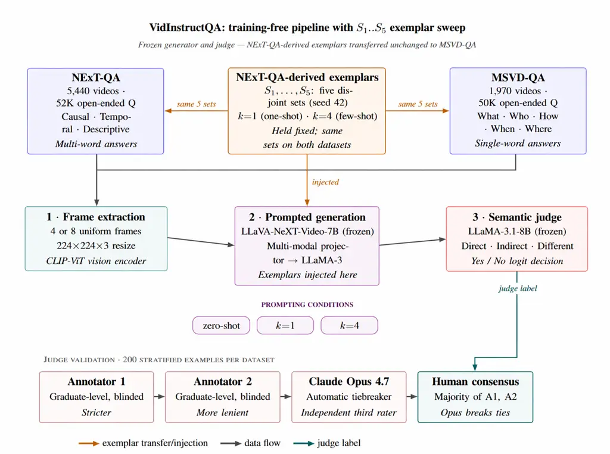
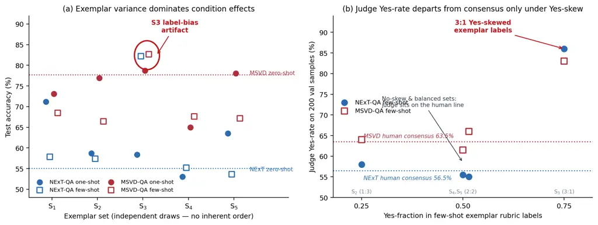

# Your Judge Inherits Your Prompt: In-Context Label Bias in an LLM-as-Judge Is Directional, Not Symmetric

Abdullah Ahmad Affiliation: Independent Researcher
Email: [abdullah.ahmad.ac@gmail.com](mailto:)    Ahmed J. O. Ahmed
Affiliation: Independent Researcher
Email: [eng.ahmedjafer@gmail.com](mailto:)    Luca Citi
Affiliation: University of Essex Email: [lciti@essex.ac.uk](mailto:)

###### Abstract

LLM-as-judge has become a standard way to score open-ended model
outputs, yet the judge is itself a frozen language model steered by a
few in-context examples, and such models are known to absorb the label
balance of their demonstrations rather than treat them as neutral
illustrations. We ask whether this label bias reaches an LLM judge used
inside a multimodal (video question answering) evaluation pipeline, and
what form it takes. Using a fully frozen generator–judge pipeline, we
hold the generated answers fixed and vary only the Yes/No balance of the
judge’s few-shot examples across four demonstration sets. Each verdict
is validated against a two-annotator human consensus on 200 examples per
dataset. The judge’s acceptance rate stays close to human consensus when
its examples are balanced or skewed toward rejection, but jumps sharply
(by about 30 points on NExT-QA and 20 on MSVD-QA, with a strongly
one-sided error profile) when the examples are skewed toward acceptance;
the opposite skew produces no matching drop. The bias is therefore
one-directional within the tested range of label ratios. A separate
five-draw analysis shows that results from a single example draw are
unreliable, varying by up to 18 points, more than any difference between
prompting conditions. We conclude that demonstration label bias in an
LLM judge is a directional, inflation-only failure mode that can
fabricate apparent benchmark gains but not losses, and that it is
cheaply avoided by balancing the judge’s examples and reporting results
averaged over several draws.

## 1 Introduction

A growing share of NLP analysis and evaluation is mediated by a second
language model: an “LLM-as-judge” that reads a model output, compares it
against a reference or rubric, and emits a verdict (Zheng et al., 2023).
The convenience is real, but the judge is not a neutral instrument. It
is a frozen LLM steered by an in-context prompt, and a substantial body
of work on in-context learning (ICL) shows that frozen LLMs do not read
their context neutrally. Zhao et al. (2021) showed that GPT-3
classification is systematically biased toward the majority label of its
demonstrations. Min et al. (2022) showed that the label distribution of
the demonstrations conditions the output more than their content
correctness does. Lu et al. (2022) showed that demonstration order alone
can swing accuracy by up to 30 points.

If these findings transfer to the judge setting, the leniency of an LLM
judge becomes partly a property of its prompt rather than of the outputs
it scores, and any absolute score it produces is confounded with the
label balance of its own demonstrations. Two gaps motivate this work.
The first gap is empirical. The exposed population is large and
unaudited: training-free multimodal VideoQA is a widely used pipeline
family that is routinely scored by an in-context-prompted LLM judge, yet
to our knowledge no such pipeline has ever audited the label balance of
its judge’s demonstrations. The second gap is conceptual: the _shape_ of
the bias, whether it acts symmetrically or in one direction, has not
been characterized, and it is the shape that determines whether the
failure inflates scores, deflates them, or both. We are explicit that
the judge itself is text-only: it compares generated text against
reference text, and the multimodality lives on the generator side. The
contribution is therefore not that multimodality changes the mechanism,
but that it exposes a widely used, judge-scored population to a
directional failure mode that has so far gone unaudited.

Across two video question answering benchmarks, we find that
demonstration label bias does reach the judge, but asymmetrically. When
the judge’s few-shot examples are balanced or skewed toward rejection,
its acceptance rate stays close to human consensus; only a strong skew
toward acceptance moves it, and then sharply and one-sidedly, inflating
measured accuracy while agreement with humans does not improve. The bias
thus pushes reported accuracy up but never down, an inflation-only
asymmetry that Jain et al. (2025) also observe behaviorally in another
judge setting (high acceptance of valid outputs, weak rejection of
invalid ones), and that we isolate causally here. Intuitively, the judge
already leans toward acceptance, so a Yes-skew pushes with that lean
while a No-skew must first cancel it (Section 5). A complementary
analysis shows that reporting a prompting result from a single example
draw is unreliable, because accuracy varies more across draws than
across prompting conditions. Together these results identify a
directional and cheaply mitigable failure mode in any evaluation
pipeline built on a prompted LLM judge. Even if the mechanism behind the
asymmetry is contested, the exemplar-variance result stands on its own:
single-draw prompting reports are unreliable, with a +16.09-point
one-shot lift from the best draw shrinking to a non-significant +5.88
five-draw mean ($`t{=}1.93`$, $`p{=}0.126`$).

#### Contributions.

\(1\) We show, in a controlled setting, that in-context label bias
reaches an LLM judge and is _directional_: a skew toward acceptance
inflates the judge’s verdicts, while an equal-and-opposite skew toward
rejection does not deflate them. This is a rectified, inflation-only
pattern. We isolate it with a fixed-generation intervention and
interpret it as the ICL label-prior (Zhao et al., 2021) composing with
the judge’s known positivity disposition (Wang et al., 2024a). (2) We
quantify exemplar variance with a five-draw replication, showing that
single-draw prompting effects are inflated relative to the population.
(3) We contribute a dual-dataset human-validation protocol for LLM
judges. (4) We provide cheap, mechanism-matched mitigations and release
all prompts, exemplars, annotations, and code.¹¹ 1 Code, prompts,
exemplars, annotations, and per-cell $`\kappa`$ tables:
[https://github.com/abuba8/LLM-Judge-Label-Bias](https://github.com/abuba8/LLM-Judge-Label-Bias)

## 2 Background and Related Work

#### Label bias and exemplar sensitivity in ICL.

Liu et al. (2022) and Rubin et al. (2022) documented that exemplar
choice materially affects GPT-3 accuracy. Zhao et al. (2021) identified
majority-label bias and proposed contextual calibration, a correction
applied directly to the model’s label-token priors; subsequent work
refined this line, with Fei et al. (2023) formalizing a typology of
label biases and showing that prior calibration does not address all of
them, and Zhou et al. (2024) unifying these methods via batch
calibration. Because the bias we characterize lives in the same
label-token prior, this calibration family supplies its
mechanism-matched fix. Min et al. (2022) showed that the demonstrations’
label distribution conditions output more than content correctness, and
Lu et al. (2022) showed order sensitivity of up to 30 points. Our work
reproduces this family of results in a new locus, the demonstrations
conditioning a judge’s verdicts rather than a classifier’s predictions,
and adds a wrinkle specific to judges: the effect is directional. We
interpret this through the judge’s decision rule, an argmax over
“Yes”/“No” logits, in which the demonstration prior acts as a bias term
on the Yes logit that, given the judge’s Yes-leaning operating point,
saturates on the No side.

#### LLM-as-judge reliability.

Zheng et al. (2023) showed that GPT-4 judgments correlate with human
preferences; Wang et al. (2024a) documented systematic leniency and
positivity biases; and Chiang and Lee (2023) found that LLM judges give
reliable relative rankings while their absolute calibration is
dataset-dependent. A rapidly growing literature now catalogs judge
biases (Gu et al., 2024), most of them arising from the _candidate
responses_: position, verbosity, and self-preference are among the
twelve types quantified by Ye et al. (2025). Judge verdicts are further
destabilized by prompt- and rubric-side perturbations: paraphrasing or
reformatting prompts can reverse model rankings (Mizrahi et al., 2024),
rubric-order and score-ID changes shift scores (Li et al., 2025), and
judges are inconsistent even under fixed inputs (Stureborg et al.,
2024). Our five-draw protocol is the demonstration-side analogue of
these multi-prompt reliability calls. The bias we study is different in
origin: it arises from the judge’s own _demonstrations_ rather than from
the responses being scored. Closest to our finding, Jain et al. (2025)
observe an “agreeableness” profile in which judges accept valid outputs
at high rates but fail to reject invalid ones (true-negative rates below
25%), inflating apparent reliability under class imbalance, a behavioral
signature of the same one-directional inflation we isolate
mechanistically here. We do not merely restate that judges are lenient.
We show that the ICL label-prior _composes_ with that leniency: a skew
toward acceptance amplifies it into a large acceptance spike, while an
equal skew toward rejection is absorbed and leaves the judge tracking
human consensus. The two known biases are not independent, and their
interaction is what makes judge label bias an inflation-only risk.

#### Training-free multimodal pipelines as the exposed population.

Training-free video QA steers frozen models with prompts: VideoAgent
(Wang et al., 2024b), VidIL (Wang et al., 2022), and ViperGPT (Surís et
al., 2023); Flamingo (Alayrac et al., 2022) noted exemplar sensitivity
even in few-shot-trained models, and MM-REACT (Yang et al., 2023) showed
that prompt structure determines output format. These works report
single-exemplar numbers and typically score with an LLM judge; to our
knowledge, none quantifies exemplar variance or audits
judge-demonstration balance. Fine-tuned video QA systems (Jiang and Han,
2020; Gao et al., 2023; Yu et al., 2023; Ye et al., 2023; Ko et al., 2023) sidestep the judge via multiple-choice protocols but at a compute
cost (a full fine-tune in our environment was projected at more than 140
GPU-hours per epoch), which is why the exposed training-free population
keeps growing.

## 3 Methodology

Figure 1: Generic structure: generator $`\rightarrow`$ judge
$`\rightarrow`$ human validation, with one manipulated variable (the
label balance of the judge’s demonstrations); the figure shows our
instantiation. The evaluation pipeline and judge-validation protocol.
Three frozen stages: frame extraction, prompted generation
(LLaVA-NeXT-Video-7B), and a semantic judge (LLaMA-3.1-8B) that emits a
Yes/No decision from its output logits. The five exemplar sets S1–S5 are
drawn once from NExT-QA train and transferred unchanged to MSVD-QA; they
are injected at the prompted-generation stage and are therefore visible
to _both_ the generator (as answer-format demonstrations) and the judge
(as rubric-verdict demonstrations), the two conditioning channels
analyzed in Section 5. Judge validation uses two blinded annotators with
an automatic tiebreaker on disagreements; the resulting consensus is the
reference used throughout.

Our goal is to isolate, and then characterize, the effect of the judge’s
demonstration labels on its verdicts. To do so we build a fully frozen
pipeline (Figure 1) in which nothing is trained and in which the only
variable we deliberately manipulate is the Yes/No balance of the judge’s
in-context examples. This section describes the pipeline, the datasets
and their question categories, the exemplar sweep that varies the label
balance, and the human-validation protocol against which the judge is
calibrated.

### 3.1 Pipeline

The pipeline has three frozen stages. (1) Frame extraction samples 4 or
8 uniform frames per video, resized to $`224\times 224\times 3`$. (2)
Prompted generation uses LLaVA-NeXT-Video-7B-hf (Liu et al., 2024; Zhang
et al., 2024), entirely frozen; we use the April 2024 release, which
predates the LLaVA-Video SFT corpus incorporating NExT-QA, so to our
knowledge neither benchmark is in this model’s training data. (3)
Semantic judging uses a frozen LLaMA-3.1-8B (Grattafiori et al., 2024)
judge that scores the generated answer against the ground truth. The
judge prompt defines three decision classes (Direct Match, Indirect
Context, and Different Context), which collapse to a binary decision:
the first two count as accept (Yes) and the third as reject (No). The
emitted verdict is the higher-probability logit between the “Yes” and
“No” tokens. This detail matters for interpretation, because
majority-label bias is precisely a shift in this label-token prior, and
it is therefore directly observable as a shift in the judge’s acceptance
rate. It is also why we study a binary judge: majority-label bias lives
in the label-token prior (Zhao et al., 2021), and a two-token argmax
isolates it most cleanly.

### 3.2 Datasets and Question Categories

We pair two open-ended benchmarks with deliberately different answer
distributions. NExT-QA (Xiao et al., 2021) contains 5,440 videos
(average 44s) and 52,044 questions whose ground-truth answers are often
multi-word phrases. MSVD-QA (Xu et al., 2017) contains 1,970 short clips
(under 10s) and 50,505 questions whose answers are overwhelmingly single
words. Pairing them lets us separate a generation-side format effect
from the judge-side label effect. Both benchmarks organize questions
into categories; Table 1 lists these categories together with their
counts in the 200-example, type-stratified validation sample used for
human validation. The multi-word versus single-word contrast, and the
differing category mixes, are what allow us to distinguish effects that
act through the generator from effects that act through the judge.

| Dataset | Category    | Corpus share | Val. $`n`$ |
| ------- | ----------- | ------------ | ---------- |
| NExT-QA | Causal      | 48%          | 105        |
|         | Temporal    | 29%          | 62         |
|         | Descriptive | 23%          | 33         |
| MSVD-QA | What        | n/a          | 119        |
|         | Who         | n/a          | 74         |
|         | How         | n/a          | 6          |
|         | When        | n/a          | 1          |
|         | Where       | n/a          | 0          |

Table 1: Question categories in each benchmark and their counts in the
200-example, type-stratified validation sample. NExT-QA shares are
corpus-level; per-type corpus shares for MSVD-QA are not reported by the
source, so we give validation counts only. The MSVD-QA sample
under-represents How and When and contains no Where, a coverage caveat
we carry forward.

### 3.3 Exemplar Sweep

Zero-shot prompting uses a system prompt plus the question. One-shot
($`k{=}1`$) adds a single worked exemplar (question, ground truth,
generated answer, and a binary rubric verdict), and few-shot ($`k{=}4`$)
adds four. By construction, an exemplar conditions the pipeline at two
levels: at the generation level it shapes the format of the generator’s
answers, and at the judge level the full (generated answer, rubric
verdict) pair is visible to the judge, so the verdicts act as in-context
demonstrations of the rubric.

We draw five disjoint exemplar sets, S1 through S5 (seed 42), from
35,653 deduplicated NExT-QA training rows, for each of the one-shot and
few-shot conditions, and transfer the same sets unchanged to MSVD-QA.
Within each exemplar set, demonstration order is held fixed across all
prompting conditions and datasets, so that any verdict change is
attributable to label balance rather than to order effects (Lu et al.,
2022). The sets vary along two axes. The controlled, judge-relevant axis
is the rubric-verdict balance: S2 is 1:3 Yes:No (Yes-fraction 0.25), S3
is 3:1 (0.75), and S4 and S5 are 2:2 (0.50). A second axis is category
composition: S1, S2, S4, and S5 use a 2/1/1 Causal/Temporal/Descriptive
split, whereas S3 uses 1/2/1. S1 predates the verdict-balance control
(it was drawn for the initial one-shot pilot) and is excluded from the
verdict-balance analysis. Because S3 differs on both axes, we do not
rest the mechanism on S3’s test accuracy alone; Section 4 separates
verdict balance from category composition using the fixed-generation
control, the one-shot ($`k{=}1`$) replication, and a bounded-magnitude
argument from the per-category accuracies. Each (dataset, frames,
condition, set, split) cell is a single full-split run, for 80
full-split cells plus zero-shot baselines, on 3$`\times`$ NVIDIA A30
24GB GPUs at roughly 3 GPU-hours per split.

### 3.4 Fixed-Generation Control and Human Validation

The central control is that, on the 200-example validation samples,
greedy generations are byte-identical across prompting conditions. Any
verdict that changes with the prompt on these samples is therefore
attributable to the judge’s demonstrations alone; this is a fixed-input
intervention that isolates the judge’s decision computation from the
generator. We state its scope precisely: the control separates
_judge-side_ conditioning from _generation-side_ conditioning, because
the generated text is held fixed, but it does not on its own separate
the two axes that vary _within_ the judge-side demonstrations, verdict
balance and category composition, which we disentangle in Section 4 and
Section 5.

For each dataset we sample 200 test examples stratified by question type
(Table 1). Two graduate-level annotators, blinded to the judge’s
decisions, independently label each (question, ground truth, generated
answer) triple as accept or reject, and an independent LLM tiebreaker
(Claude Opus 4.7) resolves disagreements under the same rubric.
Inter-annotator agreement is 85.00% on NExT-QA ($`\kappa{=}0.693`$) and
86.00% on MSVD-QA ($`\kappa{=}0.695`$), substantial (Landis and Koch, 1977) and nearly identical across datasets, so the resulting consensus
is a reliable reference. The tiebreaker resolved 30/200 and 28/200
disagreements, siding with the more lenient annotator; because any
leniency it shares would raise the consensus acceptance rate, its
influence is conservative for the effect we report. Unparseable judge
outputs are mapped to reject, and a drop-unparseable sensitivity
analysis preserves all within-condition rankings.

## 4 Results

### 4.1 The Judge Inherits Its Demonstrations’ Label Balance, in One Direction

Finding. A skew toward acceptance lifts the judge’s acceptance rate
20–30 points above human consensus with a one-sided error profile; an
equal skew toward rejection leaves it on the consensus line. Few-shot
set S3 produces an 82.22% judge acceptance rate on NExT-QA and 82.67% on
MSVD-QA, roughly 26.8 and 15.6 points above the mean of the matched
non-skewed few-shot sets (S2, S4, S5). Table 2 shows why this is
inflation rather than improvement. Because each Yes-fraction level is
represented by a single set per dataset, the rejection-side conclusion
rests on two points (one Yes-skewed and one No-skewed set per dataset),
so we ground it in the one-sided error profile, the depressed
$`\kappa`$, and the one-shot replication below, rather than in the point
estimates alone. On the fixed-generation validation samples, the judge’s
acceptance rate stays within 2.5 points of human consensus for every set
at or below balance (Yes-fractions 0.25 and 0.50) on both datasets, and
then jumps to 86.0% on NExT-QA and 83.0% on MSVD-QA, 29.5 and 19.5
points above consensus, at the single set skewed toward acceptance (S3).
The skew toward rejection (S2) produces no matching downward departure:
its acceptance rate is within 1.5 points of consensus. The two skewed
sets sit at equal distance from balance (0.25 vs. 0.75), so the
asymmetry holds at matched skew magnitude; whether a more extreme
rejection skew would deflate the judge is untested, and our claim is
scoped to this range.

|         |         |      |      |          |     |     |       |
| ------- | ------- | ---- | ---- | -------- | --- | --- | ----- |
| Set     | Yes-fr. | J%   | C%   | Bias     | FP  | FN  | FP:FN |
| NExT-QA |         |      |      |          |     |     |       |
| S2      | 0.25    | 58.0 | 56.5 | +1.5     | 33  | 30  | 1.1   |
| S4      | 0.50    | 55.5 | 56.5 | $`-`$1.0 | 40  | 42  | 1.0   |
| S5      | 0.50    | 55.0 | 56.5 | $`-`$1.5 | 33  | 36  | 0.9   |
| S3      | 0.75    | 86.0 | 56.5 | +29.5    | 66  | 7   | 9.4   |
| MSVD-QA |         |      |      |          |     |     |       |
| S2      | 0.25    | 64.0 | 63.5 | +0.5     | 31  | 30  | 1.0   |
| S4      | 0.50    | 61.5 | 63.5 | $`-`$2.0 | 35  | 39  | 0.9   |
| S5      | 0.50    | 66.0 | 63.5 | +2.5     | 32  | 27  | 1.2   |
| S3      | 0.75    | 83.0 | 63.5 | +19.5    | 52  | 13  | 4.0   |

Table 2: Few-shot judge versus human consensus on the fixed-generation
200-example validation samples. J% is the judge acceptance rate, C% the
human-consensus acceptance rate, and Bias $`=`$ J $`-`$ C. FP and FN are
raw false-accept and false-reject counts (out of 200), and FP:FN their
ratio. The acceptance rate stays within $`\pm`$2.5 points of consensus
for every set at or below balance, and departs, upward only and with a
strongly one-sided error profile (66 vs. 7 at S3 on NExT-QA), at the
single Yes-skewed set.

The error profile confirms the direction. Only S3 develops a one-sided
profile, with false accepts far exceeding false rejects (66 vs. 7 on
NExT-QA, a ratio of 9.4, and 52 vs. 13 on MSVD-QA, a ratio of 4.0),
against a near-even split for every other set (e.g. 33 vs. 30 for the
rejection-skewed S2 on NExT-QA). Agreement with humans does not improve
at S3: its $`\kappa`$ is 0.195 (NExT-QA) and 0.209 (MSVD-QA), no better
than the balanced sets. Figure 2b visualizes the pattern. Section 5
explains why the response is rectified rather than symmetric.

Figure 2: Main results. (a) Per-set test accuracy at 4 frames. The five
exemplar sets are independent draws with no inherent order, so they are
shown as unconnected points; the spread of the one-shot draws exceeds
every condition-level gap, and the sole few-shot outlier is the S3
label-bias artifact. (b) Judge acceptance rate on the fixed-generation
validation samples against the Yes-fraction of the few-shot exemplar
labels, with human-consensus reference lines. The judge sits on the
human-consensus line for the rejection-skewed (0.25) and balanced (0.50)
sets and departs, upward only, at the single acceptance-skewed set
(0.75). Points are deliberately not connected: the departure is a
single-condition, one-directional jump, not a monotone trend.

We also report the correlation between demonstration Yes-fraction and
judge acceptance rate: $`r=0.76`$ (NExT-QA) and $`r=0.79`$ (MSVD-QA).
This four-point statistic is carried entirely by S3, however: removing
it reverses the correlation to $`r=-0.99`$ (NExT-QA) and collapses it to
$`r=-0.06`$ (MSVD-QA). We report the reversal because it is the
substantive result: the relationship is a single-condition jump, not a
smooth trend, and we therefore do not describe the effect as a monotone
dose–response.

A partially independent signal at one-shot ($`k{=}1`$) corroborates the
direction. Grouping the sets by the polarity of their single
demonstration verdict, the Yes-labelled sets outscore the No-labelled
sets by +5.08 points on NExT-QA (60.98 vs. 55.90) and +7.41 on MSVD-QA
(78.38 vs. 70.97). This cut is orthogonal to S3’s category confound: the
Yes-labelled group includes S5, which uses the standard 2/1/1 category
split rather than S3’s 1/2/1, and S5 alone outscores both No-labelled
sets on both datasets (63.56 vs. 58.74 and 53.06; 78.05 vs. 76.95 and
64.99). The acceptance-direction effect therefore appears in a set that
does not share S3’s category mix, pointing to verdict polarity rather
than category composition. We are explicit that this uses a single
demonstration ($`k{=}1`$) rather than the four-shot count of the
headline effect, and that with two sets per polarity it is descriptive;
it is thus strong corroboration of the direction, not a clean
replication of the four-shot magnitude.

Throughout, we read these Yes-rate departures as measurements of judge
leniency, not as accuracy. Judge–human $`\kappa`$ is only fair
(0.17–0.36 across the grid, well below the 0.69 inter-annotator
agreement), so the absolute accuracies in Table 3 are best interpreted
as relative comparisons across conditions rather than as calibrated
scores.

### 4.2 Exemplar Variance Exceeds Condition Effects

Finding. The spread across five exemplar draws exceeds every mean
difference between prompting conditions, so a single-draw prompting
result is not interpretable on its own. Across the five draws, one-shot
NExT-QA test accuracy at 4 frames spans 18.14 points (from 53.06 to
71.20; mean 60.99$`\pm`$6.81), and MSVD-QA spans 13.73 points (mean
74.37$`\pm`$5.67). Excluding the S3 artifact, the few-shot sets are
nearly identical, collapsing to a 4.24-point range on NExT-QA
(56.03$`\pm`$1.97) and 2.08 points on MSVD-QA (67.42$`\pm`$0.87);
Figure 2a shows this directly. This variance exceeds every mean
difference between prompting conditions: on NExT-QA the mean one-shot
advantage over zero-shot is +5.88 with a within-condition standard
deviation of 6.81. The single-draw number a conventional protocol would
report (+16.09 on NExT-QA, from set S1) shrinks to a five-draw mean of
+5.88 that is not statistically distinguishable from zero at $`n{=}5`$
($`t{=}1.93`$, $`p{=}0.126`$). Table 3 reports all test cells.

| Dataset | Cond.    | Frames | Zero  | S1    | S2    | S4    | S5    | Mean\* | Std\* | S3 (artifact) |
| ------- | -------- | ------ | ----- | ----- | ----- | ----- | ----- | ------ | ----- | ------------- |
| NExT-QA | one-shot | 4      | 55.11 | 71.20 | 58.74 | 53.06 | 63.56 | 60.99  | 6.81  | 58.40         |
| NExT-QA | one-shot | 8      | 54.72 | 71.67 | 58.57 | 52.31 | 63.47 | 60.98  | 7.18  | 58.89         |
| NExT-QA | few-shot | 4      | 55.11 | 57.86 | 57.39 | 55.24 | 53.62 | 56.03  | 1.97  | 82.22         |
| NExT-QA | few-shot | 8      | 54.72 | 58.12 | 57.36 | 55.37 | 54.33 | 56.30  | 1.75  | 82.92         |
| MSVD-QA | one-shot | 4      | 77.72 | 73.12 | 76.95 | 64.99 | 78.05 | 74.37  | 5.67  | 78.72         |
| MSVD-QA | one-shot | 8      | 76.73 | 72.36 | 76.01 | 64.12 | 77.04 | 73.41  | 5.58  | 77.54         |
| MSVD-QA | few-shot | 4      | 77.72 | 68.50 | 66.42 | 67.61 | 67.15 | 67.42  | 0.87  | 82.67         |
| MSVD-QA | few-shot | 8      | 76.73 | 68.15 | 66.03 | 66.01 | 67.44 | 66.91  | 1.07  | 83.36         |

Table 3: Judge-scored test accuracy, i.e. the judge’s per-cell verdict
(acceptance) rate (%); these are the judge’s verdict rates, not
accuracies against human ground truth. The flagged S3 few-shot cells
(bold) are the label-bias artifact and must not be read as system
accuracy. One-shot Mean/Std are over all five sets; few-shot Mean/Std
exclude the S3 artifact, which is listed separately. Validation-split
numbers (within $`\leq`$2 points of test in all cells) ship with the
code.

### 4.3 A Smaller Directional Transfer Effect

Finding. The one-shot effect is directional across datasets (positive on
NExT-QA, negative on MSVD-QA), but its five-draw magnitude is roughly a
third of the single-draw estimate. At the mean-across-sets level, a
directional cross-dataset pattern replicates: the one-shot mean exceeds
zero-shot on NExT-QA in all four (split $`\times`$ frames) cells (+5.88
to +7.38) and falls below zero-shot on MSVD-QA in all four cells
($`-`$2.40 to $`-`$3.68). Because the validation and test splits agree
to within two points, we treat this as one directional observation
rather than four independent ones. A single-draw view suggests a
$`+16/-5`$ effect, whereas the five-set population effect is roughly
$`+6/-3`$, with the positive side not significant at $`n{=}5`$.

## 5 Analysis

#### The bias is directional, and why that matters.

The results describe a judge whose acceptance rate is well calibrated to
human consensus until its demonstrations are skewed toward acceptance,
at which point it decouples upward and only upward, a rectified
response. We interpret this as the ICL label-prior of Zhao et al. (2021)
composed with the judge’s pre-existing positivity disposition (Wang et
al., 2024a). Reading the verdict as an argmax over the “Yes”/“No”
logits, the demonstration prior adds a bias to the Yes logit. The judge
already rests slightly above human consensus, so a skew toward
acceptance amplifies a disposition the model is already inclined toward,
flipping a large mass of borderline rejects to accepts and producing the
false-accept explosion. A skew toward rejection, by contrast, must first
overcome that resting lean, and largely fails, so the response saturates
on the rejection side. This composition, rather than either bias alone,
is what makes the effect one-directional. We present this
saturating-prior account as an interpretation consistent with every
diagnostic we observe (the one-sided error profile, the depressed
$`\kappa`$, and the $`k{=}1`$ direction), not as a direct measurement:
confirming it would require logging the judge’s Yes/No logit margin per
set, which we did not record and leave to future work.

#### Two channels of conditioning.

The same exemplars condition the pipeline in two separable ways, and the
analysis lets us tell them apart. Judge-side conditioning shapes the
decision rule and is isolated by the fixed-generation control, where the
input is held constant and only the demonstrations vary. Generation-side
conditioning shapes the format of the generated answers and surfaces in
the smaller cross-dataset transfer effect: multi-word exemplars push the
generator toward longer outputs, which helps against NExT-QA’s
multi-word references and hurts against MSVD-QA’s single-word labels.
The exemplar variance documented in the results is the residual that
both channels jointly produce, and it is large enough that a single draw
sits well inside the noise of the exemplar distribution.

#### Strengths and weaknesses of the approach.

The main strength of the design is that the fixed-generation control
gives a clean causal separation: because the generated text is
byte-identical across conditions, any change in the verdict is
attributable to the judge’s demonstrations, and no appeal to generation
quality can explain the acceptance spike. The main weakness is that the
sharpest evidence comes from a single skewed condition (S3), which
differs from the other sets on category composition as well as verdict
balance. Three arguments, all from data already in the paper, localize
the effect to verdict balance rather than category. First, the
fixed-generation control holds the generated text fixed, so a category
effect operating through generation quality cannot explain the
acceptance spike. Second, judge accuracy varies only modestly across the
three NExT-QA question categories, a range of about 9 points (Causal
56.29 to Descriptive 65.64; Table 4), so a shift in exemplar category
mix cannot plausibly produce a 20–30-point spike. Third, the one-shot
direction holds for S5, a standard-category set, cutting across the
category axis. A category-matched skewed set would still make the case
airtight and remains the cleanest follow-up. A related weakness is that
agreement with humans, measured by $`\kappa`$, is only fair across the
grid, so the absolute accuracies should be read as relative comparisons
rather than calibrated scores.

#### Implications for mitigation.

We set out to test whether demonstration label bias reaches an LLM judge
and, if so, what form it takes. The answer is that it does, and that its
form is directional: the judge can be prompted into inflation but not,
in this operating range, into deflation. This sharpens the generic
caution that “LLM judges are lenient” into a specific, controllable, and
one-sided mechanism, and it implies that mitigation can be targeted:
balancing the demonstration verdicts removes a mechanism that can only
ever inflate, and label-prior calibration (Zhao et al., 2021; Fei et
al., 2023; Zhou et al., 2024) is the mechanism-matched fix, since the
bias lives in the label-token prior. Two clarifications. First,
balancing is not a vacuous recommendation: demonstrations are usually
chosen as illustrative “good” cases or drawn from a strong system’s
outputs, both predominantly accept-labelled, so the naive protocol lands
in the inflating regime, and no pipeline we know of audits this. Second,
balancing fixes score inflation, not judge reliability: item-level
agreement remains only fair ($`\kappa`$ 0.17–0.36) even with balanced
demonstrations, so human validation on the target distribution is still
required. Applying these label-prior calibration methods as an empirical
mitigation, and measuring how much of the acceptance spike they remove,
is the natural next step; because our bias occupies the same label-token
prior they correct, we expect it to be directly addressable, and we
leave this empirical test to future work. That the failure is
inflation-only is corroborated from a different angle by Jain et al.
(2025), who report the same high-acceptance, low-rejection asymmetry
behaviorally in a separate domain; our fixed-generation control adds the
causal attribution, tracing that asymmetry to the demonstration label
balance rather than to generation quality or task difficulty.

## 6 Conclusion

We asked whether an LLM judge inherits the label balance of its
in-context demonstrations, and found that it does, but in only one
direction within the tested range of label ratios. Holding the generated
answers fixed and varying only the Yes/No balance of the judge’s
few-shot examples, we showed that a skew toward acceptance lifts the
judge’s acceptance rate far above human consensus, one-sidedly and
without improving agreement, inflating matched benchmark accuracy by
26.8 points on NExT-QA (15.6 on MSVD-QA) and departing from human
consensus by 29.5 (19.5), whereas an equal skew toward rejection leaves
the judge tracking human consensus. A complementary analysis showed that
single-example reporting is unreliable, with variance across draws
exceeding every condition-level difference. Demonstration label bias in
an LLM judge is thus a directional, inflation-only failure mode with two
cheap remedies, balancing the judge’s demonstrations and averaging over
several draws. Under such a judge, a reported benchmark accuracy can be
pushed up but not down. Balancing removes the inflation but not the
judge’s item-level unreliability, so it complements rather than replaces
human validation.

#### Limitations.

The asymmetry rests on a single rejection-skewed set per dataset,
corroborated by its balanced errors and highest agreement but not yet
traced as a full curve. The acceptance-skewed set also differs in
category composition; the fixed-generation control and the per-category
bound (Section 5) make this an unlikely alternative explanation, though
a category-matched set would settle it definitively. The proposed
saturating-prior mechanism is likewise an interpretation rather than a
direct measurement. Our results concern a binary accept/reject judge;
whether the pattern holds for Likert-scale or pairwise judges is
untested. The results are further bounded by a single generator–judge
pair, single runs per cell, limited coverage of some MSVD-QA question
types, and a human reference whose hardest cases are settled by an
automatic tiebreaker, though its direction is conservative for our
finding.

#### Future work and recommendations.

A graded Yes-fraction sweep with a category-matched skewed set, paired
with per-set logit-margin logging, would convert our single-condition
result into a measured, mechanistically confirmed dose–response, and
additional backbones would test its generality. In the meantime, any
pipeline scoring with a prompted LLM judge should balance its
demonstration labels (or apply contextual calibration), report a mean
and standard deviation over at least four exemplar draws, include a
matched zero-shot baseline, and validate against humans on each target
distribution.

## References

- Alayrac et al. (2022) J. Alayrac, J. Donahue, P. Luc, A. Miech, I.
  Barr, Y. Hasson, K. Lenc, A. Mensch, K. Millican, M. Reynolds, R.
  Ring, E. Rutherford, S. Cabi, T. Han, Z. Gong, S. Samangooei, M.
  Monteiro, J. Menick, S. Borgeaud, A. Brock, A. Nematzadeh, S.
  Sharifzadeh, M. Binkowski, R. Barreira, O. Vinyals, A. Zisserman,
  and K. Simonyan Flamingo: a visual language model for few-shot
  learning. In Advances in Neural Information Processing Systems, Vol.
  35, pp. 23716–23736. Cited by: §2.
- Chiang and Lee (2023) C. Chiang and H. Lee Can large language models
  be an alternative to human evaluations?. In Proceedings of the 61st
  Annual Meeting of the Association for Computational Linguistics
  (Volume 1: Long Papers), Toronto, Canada, pp. 15607–15631. External
  Links: [Document](https://dx.doi.org/10.18653/v1/2023.acl-long.870),
  [Link](https://aclanthology.org/2023.acl-long.870) Cited by: §2.
- Fei et al. (2023) Y. Fei, Y. Hou, Z. Chen, and A. Bosselut Mitigating
  label biases for in-context learning. In Proceedings of the 61st
  Annual Meeting of the Association for Computational Linguistics
  (Volume 1: Long Papers), Toronto, Canada, pp. 14014–14031. External
  Links: [Document](https://dx.doi.org/10.18653/v1/2023.acl-long.783),
  [Link](https://aclanthology.org/2023.acl-long.783) Cited by: §2, §5.
- Gao et al. (2023) D. Gao, L. Zhou, L. Ji, L. Zhu, Y. Yang, and M. Z.
  Shou MIST: multi-modal iterative spatial-temporal transformer for
  long-form video question answering. In Proceedings of the IEEE/CVF
  Conference on Computer Vision and Pattern Recognition (CVPR),
  pp. 14773–14783. Cited by: §2.
- Grattafiori et al. (2024) A. Grattafiori, A. Dubey, A. Jauhri, A.
  Pandey, A. Kadian, A. Al-Dahle, A. Letman, A. Mathur, A. Schelten, A.
  Vaughan, et al. The llama 3 herd of models. arXiv preprint
  arXiv:2407.21783. External Links:
  [Link](https://arxiv.org/abs/2407.21783) Cited by: §3.1.
- Gu et al. (2024) J. Gu, X. Jiang, Z. Shi, H. Tan, X. Zhai, C. Xu, W.
  Li, Y. Shen, S. Ma, H. Liu, Y. Wang, and J. Guo A survey on
  LLM-as-a-judge. arXiv preprint arXiv:2411.15594. External Links:
  [Link](https://arxiv.org/abs/2411.15594) Cited by: §2.
- Jain et al. (2025) S. Jain, U. Z. Ahmed, S. Sahai, and B. Leong Beyond
  consensus: mitigating the agreeableness bias in LLM judge evaluations.
  arXiv preprint arXiv:2510.11822. External Links:
  [Link](https://arxiv.org/abs/2510.11822) Cited by: §1, §2, §5.
- Jiang and Han (2020) P. Jiang and Y. Han Reasoning with heterogeneous
  graph alignment for video question answering. In Proceedings of the
  AAAI Conference on Artificial Intelligence, Vol. 34, pp. 11109–11116.
  External Links:
  [Document](https://dx.doi.org/10.1609/aaai.v34i07.6767) Cited by: §2.
- Ko et al. (2023) D. Ko, J. S. Lee, W. Kang, B. Roh, and H. J. Kim
  Large language models are temporal and causal reasoners for video
  question answering. In Proceedings of the 2023 Conference on Empirical
  Methods in Natural Language Processing, Singapore, pp. 4300–4316.
  External Links:
  [Document](https://dx.doi.org/10.18653/v1/2023.emnlp-main.261),
  [Link](https://aclanthology.org/2023.emnlp-main.261) Cited by: §2.
- Landis and Koch (1977) J. R. Landis and G. G. Koch The measurement of
  observer agreement for categorical data. Biometrics 33 (1),
  pp. 159–174. External Links:
  [Document](https://dx.doi.org/10.2307/2529310) Cited by: §3.4.
- Li et al. (2025) Q. Li, S. Dou, K. Shao, C. Chen, and H. Hu Evaluating
  scoring bias in LLM-as-a-judge. arXiv preprint arXiv:2506.22316.
  External Links: [Link](https://arxiv.org/abs/2506.22316) Cited by: §2.
- Liu et al. (2024) H. Liu, C. Li, Y. Li, B. Li, Y. Zhang, S. Shen,
  and Y. J. Lee LLaVA-NeXT: improved reasoning, OCR, and world
  knowledge. Note:
  [https://llava-vl.github.io/blog/2024-01-30-llava-next/](https://llava-vl.github.io/blog/2024-01-30-llava-next/)
  Cited by: §3.1.
- Liu et al. (2022) J. Liu, D. Shen, Y. Zhang, B. Dolan, L. Carin,
  and W. Chen What makes good in-context examples for GPT-3?. In
  Proceedings of Deep Learning Inside Out (DeeLIO 2022): The 3rd
  Workshop on Knowledge Extraction and Integration for Deep Learning
  Architectures, Dublin, Ireland and Online, pp. 100–114. External
  Links: [Document](https://dx.doi.org/10.18653/v1/2022.deelio-1.10),
  [Link](https://aclanthology.org/2022.deelio-1.10) Cited by: §2.
- Lu et al. (2022) Y. Lu, M. Bartolo, A. Moore, S. Riedel, and P.
  Stenetorp Fantastically ordered prompts and where to find them:
  overcoming few-shot prompt order sensitivity. In Proceedings of the
  60th Annual Meeting of the Association for Computational Linguistics
  (Volume 1: Long Papers), Dublin, Ireland, pp. 8086–8098. External
  Links: [Document](https://dx.doi.org/10.18653/v1/2022.acl-long.556),
  [Link](https://aclanthology.org/2022.acl-long.556) Cited by: §1, §2,
  §3.3.
- Min et al. (2022) S. Min, X. Lyu, A. Holtzman, M. Artetxe, M.
  Lewis, H. Hajishirzi, and L. Zettlemoyer Rethinking the role of
  demonstrations: what makes in-context learning work?. In Proceedings
  of the 2022 Conference on Empirical Methods in Natural Language
  Processing, Abu Dhabi, United Arab Emirates, pp. 11048–11064. External
  Links: [Document](https://dx.doi.org/10.18653/v1/2022.emnlp-main.759),
  [Link](https://aclanthology.org/2022.emnlp-main.759) Cited by: §1, §2.
- Mizrahi et al. (2024) M. Mizrahi, G. Kaplan, D. Malkin, R. Dror, D.
  Shahaf, and G. Stanovsky State of what art? a call for multi-prompt
  LLM evaluation. Transactions of the Association for Computational
  Linguistics 12, pp. 933–949. External Links:
  [Document](https://dx.doi.org/10.1162/tacl%5Fa%5F00681) Cited by: §2.
- Rubin et al. (2022) O. Rubin, J. Herzig, and J. Berant Learning to
  retrieve prompts for in-context learning. In Proceedings of the 2022
  Conference of the North American Chapter of the Association for
  Computational Linguistics: Human Language Technologies, Seattle,
  United States, pp. 2655–2671. External Links:
  [Document](https://dx.doi.org/10.18653/v1/2022.naacl-main.191),
  [Link](https://aclanthology.org/2022.naacl-main.191) Cited by: §2.
- Stureborg et al. (2024) R. Stureborg, D. Alikaniotis, and Y. Suhara
  Large language models are inconsistent and biased evaluators. arXiv
  preprint arXiv:2405.01724. External Links:
  [Link](https://arxiv.org/abs/2405.01724) Cited by: §2.
- Surís et al. (2023) D. Surís, S. Menon, and C. Vondrick ViperGPT:
  visual inference via python execution for reasoning. In Proceedings of
  the IEEE/CVF International Conference on Computer Vision (ICCV),
  pp. 11888–11898. Cited by: §2.
- Wang et al. (2024a) P. Wang, L. Li, L. Chen, Z. Cai, D. Zhu, B.
  Lin, Y. Cao, L. Kong, Q. Liu, T. Liu, and Z. Sui Large language models
  are not fair evaluators. In Proceedings of the 62nd Annual Meeting of
  the Association for Computational Linguistics (Volume 1: Long Papers),
  Bangkok, Thailand, pp. 9440–9450. External Links:
  [Document](https://dx.doi.org/10.18653/v1/2024.acl-long.511),
  [Link](https://aclanthology.org/2024.acl-long.511) Cited by: §1, §2,
  §5.
- Wang et al. (2024b) X. Wang, Y. Zhang, O. Zohar, and S. Yeung-Levy
  VideoAgent: long-form video understanding with large language model as
  agent. In Computer Vision – ECCV 2024, Cited by: §2.
- Wang et al. (2022) Z. Wang, M. Li, R. Xu, L. Zhou, J. Lei, X. Lin, S.
  Wang, Z. Yang, C. Zhu, D. Hoiem, S. Chang, M. Bansal, and H. Ji
  Language models with image descriptors are strong few-shot
  video-language learners. In Advances in Neural Information Processing
  Systems, Vol. 35, pp. 8483–8497. Cited by: §2.
- Xiao et al. (2021) J. Xiao, X. Shang, A. Yao, and T. Chua NExT-QA:
  next phase of question-answering to explaining temporal actions. In
  Proceedings of the IEEE/CVF Conference on Computer Vision and Pattern
  Recognition (CVPR), pp. 9777–9786. Cited by: §3.2.
- Xu et al. (2017) D. Xu, Z. Zhao, J. Xiao, F. Wu, H. Zhang, X. He,
  and Y. Zhuang Video question answering via gradually refined attention
  over appearance and motion. In Proceedings of the 25th ACM
  International Conference on Multimedia, pp. 1645–1653. External Links:
  [Document](https://dx.doi.org/10.1145/3123266.3123427) Cited by: §3.2.
- Yang et al. (2023) Z. Yang, L. Li, J. Wang, K. Lin, E. Azarnasab, F.
  Ahmed, Z. Liu, C. Liu, M. Zeng, and L. Wang MM-REACT: prompting
  ChatGPT for multimodal reasoning and action. arXiv preprint
  arXiv:2303.11381. External Links:
  [Link](https://arxiv.org/abs/2303.11381) Cited by: §2.
- Ye et al. (2025) J. Ye, Y. Wang, Y. Huang, D. Chen, Q. Zhang, N.
  Moniz, T. Gao, W. Geyer, C. Huang, P. Chen, N. V. Chawla, and X. Zhang
  Justice or prejudice? quantifying biases in LLM-as-a-judge. In
  Proceedings of the Thirteenth International Conference on Learning
  Representations (ICLR), Cited by: §2.
- Ye et al. (2023) Q. Ye, G. Xu, M. Yan, H. Xu, Q. Qian, J. Zhang,
  and F. Huang HiTeA: hierarchical temporal-aware video-language
  pre-training. In Proceedings of the IEEE/CVF International Conference
  on Computer Vision (ICCV), pp. 15405–15416. Cited by: §2.
- Yu et al. (2023) S. Yu, J. Cho, P. Yadav, and M. Bansal Self-chained
  image-language model for video localization and question answering. In
  Advances in Neural Information Processing Systems, Vol. 36,
  pp. 76749–76771. Cited by: §2.
- Zhang et al. (2024) Y. Zhang, B. Li, H. Liu, Y. J. Lee, L. Gui, D.
  Fu, J. Feng, Z. Liu, and C. Li LLaVA-NeXT: a strong zero-shot video
  understanding model. Note:
  [https://llava-vl.github.io/blog/2024-04-30-llava-next-video/](https://llava-vl.github.io/blog/2024-04-30-llava-next-video/)
  Cited by: §3.1.
- Zhao et al. (2021) T. Z. Zhao, E. Wallace, S. Feng, D. Klein, and S.
  Singh Calibrate before use: improving few-shot performance of language
  models. In Proceedings of the 38th International Conference on Machine
  Learning, Proceedings of Machine Learning Research, Vol. 139,
  pp. 12697–12706. Cited by: §1, §1, §2, §3.1, §5, §5.
- Zheng et al. (2023) L. Zheng, W. Chiang, Y. Sheng, S. Zhuang, Z.
  Wu, Y. Zhuang, Z. Lin, Z. Li, D. Li, E. P. Xing, H. Zhang, J. E.
  Gonzalez, and I. Stoica Judging LLM-as-a-judge with MT-bench and
  chatbot arena. In Advances in Neural Information Processing Systems,
  Vol. 36, pp. 46595–46623. Cited by: §1, §2.
- Zhou et al. (2024) H. Zhou, X. Wan, L. Proleev, D. Mincu, J. Chen, K.
  Heller, and S. Roy Batch calibration: rethinking calibration for
  in-context learning and prompt engineering. In Proceedings of the
  Twelfth International Conference on Learning Representations (ICLR),
  Cited by: §2, §5.

## Appendix A Per-Category Breakdown

Table 4 breaks down one-shot NExT-QA accuracy by question category,
contrasting the single-draw S1 view with the five-draw mean. Two points
support the main text. First, the single-draw figures overstate every
category, most sharply for Temporal, where S1 (73.77) sits 8.3 points
above the five-draw mean (65.46), mirroring the exemplar-variance result
of Section 4 at the category level. Second, cross-category differences
are small: the five-draw means span only about 9 points (Causal 56.29 to
Descriptive 65.64), which bounds how much S3’s altered exemplar category
mix could move accuracy and underwrites the category-confound argument
in Section 5.

| Category    | Zero  | S1    | Mean  | Std  |
| ----------- | ----- | ----- | ----- | ---- |
| Causal      | 53.93 | 71.11 | 56.29 | 9.96 |
| Temporal    | 58.05 | 73.77 | 65.46 | 5.79 |
| Descriptive | 53.87 | 67.98 | 65.64 | 3.40 |
| Overall     | 55.11 | 71.20 | 60.99 | 6.81 |

Table 4: Per-category NExT-QA one-shot accuracy (%) at 4 frames, test
split. Cross-exemplar variance within a category (for example, Causal
56.29$`\pm`$9.96) is large relative to cross-category differences; the
single-draw Temporal figure (73.77) sits 8.3 points above the five-draw
mean, mirroring the exemplar-variance result at the category level.

## Appendix B Reproducibility Checklist Details

Five disjoint sets per condition, seed 42, drawn from 35,653
deduplicated NExT-QA training rows; all 25 exemplars released verbatim.
Compute: 3$`\times`$ NVIDIA A30 24GB, roughly 3 GPU-hours per split.
Greedy decoding throughout, with validation generations byte-identical
across conditions. Unparseable judge outputs map to reject; the
drop-unparseable sensitivity analysis preserves within-condition
rankings on both datasets. Frame count is inert: every 4-frame and
8-frame accuracy pair in Table 3 agrees to within about one point,
ruling out frame sampling as a factor in any comparison. Full per-cell
$`\kappa`$ tables and the with-S3 and pure-human recuts ship with the
released code. Per-set Yes/No logit margins were not recorded in these
runs; logging them is the direct probe of the mechanism proposed in
Section 5.
