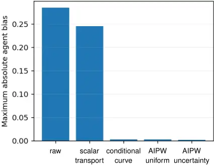
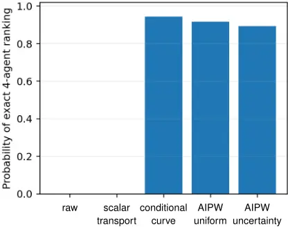

Author's accepted version of a paper accepted at the 19th International Conference on Agents and Artificial Intelligence (ICAART 2027), Valletta, Malta, 23-26 February 2027. The final version is published by SCITEPRESS: DOI to be added. This version does not use the publisher's layout.

## Transport-Safe Evaluation of LLM Agents: Trajectory-Dependent Judge Error and Anytime-Valid Auditing

Yulliwas Ameur 1,2 , Samia Bouzefrane 2 and Soumya Banerjee 2

1 Efrei Research Lab, Université Paris-Panthéon-Assas, Villejuif, France

2 CEDRIC, Conservatoire National des Arts et Métiers (Cnam), Paris, France

yulliwas.ameur@efrei.fr, samia.bouzefrane@lecnam.net, dr.soumya@ieee.org

Abstract. Large language model (LLM) agents are often ranked by an LLM judge whose error rates are measured once and reused for every agent. The corrected success rates can then be biased when the judge's errors depend on the trajectory and agents differ in the trajectories they produce for successes or failures. We derive the exact asymptotic bias and give a chain of checks from identification to simultaneous ranks. On a four-agent semi-synthetic benchmark, a scalar correction with oracle calibration has maximum bias 0.245 and mean pointwise coverage 0.016, and never recovers the full ranking (0/250 replications). Augmented inverse-probability weighting (AIPW) with a uniform or a design-aware random audit keeps the maximum bias below 0.003, with mean pointwise coverage of 0.939 and 0.950. In a 48-cell stress test, effective target support rises only from 0.209 to 0.805 as calibration grows from 600 to 4,800 labels, while audited AIPW keeps a mean absolute error of 0.018-0.020. Without calibration support, or with judge dependence within an externally justified bound, we report valid bounds or sensitivity sets and carry them into rank sets. An e-process confidence sequence stays valid, for a stable target, under predictable adaptive auditing and arbitrary stopping.

Keywords: LLM Agents, LLM-as-a-Judge, Evaluation Reliability, Measurement Error, Randomized Auditing, Partial Identification, Confidence Sequences, Leaderboard Inference.

## 1 INTRODUCTION

Agents built on large language models (LLMs) solve tasks through trajectories of actions, tool calls and outputs. 1 Expert labels are expensive, so many evaluations use a second LLM as a judge: its sensitivity and specificity are estimated once on a hand-labeled sample, and every agent's judged success rate is corrected with these two numbers.

This correction assumes that the judge's error rates are the same for every agent. A judge, however, reads trajectories, not agent names, and its errors can change with trajectory length, task family, number of tool calls, or the kind of failure. Different agents produce different trajectories, so error rates averaged over the calibration trajectories need not hold for another agent, even when the judge never sees which agent it grades.

A concrete warning sign. AgentRewardBench provides expert labels and automatic judge verdicts for web-agent trajectories (Lù et al., 2025). A prior analysis of these public outputs, not independently rerun for this paper, reports judge sensitivity falling from 0.840/0.884/0.876 in the shortest trajectory tercile to 0.182/0.364/0.477 in the long or capped tercile, for the three judges labeled AER, GPT-4o and GPT-4o-mini in that benchmark. Leave-one-agent-out scalar calibration then gives reported biases from +0.097 to -0.186. These figures motivate the problem; they are not new evidence and do not show that length alone causes the drop.

1 Text of this section drafted or edited with Claude (Anthropic, 2026); see the Acknowledgements.

Question and scope. When can a judge-based leaderboard be trusted, and what should be reported when it cannot? Our contribution is integrative: augmented inverse-probability weighting (AIPW), latent classes, confidence sequences and rank inference are not new; we connect them through the agent-specific target and state each conclusion's assumptions.

Contributions. (1) The exact limit of a transported scalar correction and when it reverses a ranking (Section 3); (2) one- and three-judge identification, bounds and sensitivity sets (Section 4); (3) randomized auditing with cross-fitted AIPW, bounded allocation and an anytime-valid e-process (Section 5); (4) rank sets with sampling, identification and cluster uncertainty (Section 6); proof sketches (Section 7) and baseline comparisons (Section 8). Artificial intelligence (AI) assistance is disclosed in the Acknowledgements.

## 2 RELATEDWORK

LLM judges and agent evaluation. LLM judges scale evaluation but show position, verbosity, selfpreference, prompt and task-complexity effects (Zheng et al., 2023; Gu et al., 2026; Thakur et al., 2025; Bavaresco et al., 2025). 1 Agent benchmarks add long horizons and tool use (Jimenez et al., 2024; Kapoor et al., 2025; Lù et al., 2025); recent work corrects noisy judge scores with sensitivity and specificity or with semiparametric estimators (Lee et al., 2025; Chen et al., 2026b), and calibration instability can reverse comparisons (Fiedler, 2026).

Misclassification and latent classes. Error rates that vary across covariates can invalidate a transported scalar correction (Edwards et al., 2023). Missing support calls for partial identification (Richardson et al., 2014; Obradovi´c, 2024); dependent LLM panels can be unidentified without external restrictions (Chen et al., 2026a). Identification without a gold standard from conditionally independent tests is classical (Dawid and Skene, 1979; Allman et al., 2009; Zhang et al., 2016); covariates need extra conditions (Ouyang and Xu, 2022), and hidden dependence can bias latent-class estimates (Albert and Dodd, 2004; Keddie et al., 2023).

Two-phase and rank inference. AIPW and optimal validation sampling are well established (Robins et al., 1994; Hahn, 1998; Tao et al., 2020). Concurrent work studies two-stage human review (Kim, 2026), best-arm identification with judges (Ao et al., 2026), and e-process monitoring (Zhou et al., 2026). Confidence sequences allow optional stopping (Howard et al., 2021; Waudby-Smith et al., 2024); rank inference needs simultaneous uncertainty (Hall and Miller, 2009; Klein et al., 2020; Mogstad et al., 2024; Al Mohamad et al., 2021).

Closest baselines. Our scalar baseline is the confusion-matrix plug-in (Lee et al., 2025) with oracle calibration, so its remaining error is transport error. Our uniform-audit baseline is the efficient-influencefunction (EIF) and prediction-powered inference (PPI) route (Chen et al., 2026b). We add the trajectoryconditional target, support and dependence diagnostics, design-aware allocation, anytime monitoring and rank propagation.

## 3 SCALAR TRANSPORT

An episode of agent a produces (X,Y, ̂ Y ): trajectory covariates X, expert success Y ∈ {0, 1} and judge verdict ̂ Y ∈ {0, 1}. 1 Agent a induces a law πa and has ability θa = Pa(Y = 1) ∈ (0, 1). We assume throughout that the judge is blind given (X,Y): Pa(̂ Y = 1 | X,Y) is the same for every agent and for the calibration law. Its trajectory-dependent sensitivity and specificity are

<!-- formula-not-decoded -->

with Youden index J(x) = s(x)+t(x)-1. A calibration law π0 with P0(Y = 1) ∈ (0,1) gives scalar averages s0 = E0{s(X) | Y = 1} and t0 = E0{t(X) | Y = 0}. The transported Rogan-Gladen estimator (Rogan and Gladen, 1978) is ̂θ RG a =(̂ pa +̂t0 -1)/(̂ s0+̂t0-1), where ̂ pa is the judge-positive rate of agent a. Let s⋆a = Ea{s(X) | Y = 1} and t ⋆ a = Ea{t(X) | Y = 0}.

Theorem 1 (Transport bias). Assume judge blindness given (X,Y), consistent estimates ̂ s0 → s0, ̂t0 → t0, ̂ pa → Pa(̂ Y = 1), and J0 = s0 +t0 -1 ̸= 0. Then ̂θ RG a →θa+Ba in probability, with

<!-- formula-not-decoded -->

The correction is consistent for agent a exactly when the numerator of (2) vanishes.

If wa,1 = dπa(· | Y = 1)/dπ0(· | Y = 1) exists, then s⋆a -s0 = Cov0{wa,1(X), s(X) | Y = 1}, and similarly for specificity: the bias couples trajectory shift with judge accuracy, not just a low average accuracy. For two agents with θa &gt; θb, the transported order reverses exactly when Bb -Ba &gt; θa -θb. More judge compute is not a generic repair: a majority of an odd number n ≥ 3 of calls, independent and identically distributed given (X,Y), pushes each trajectory-level accuracy other than 0, 1/2 and 1 further from 1/2, so the bias can grow or shrink.

## 4 IDENTIFICATION

## 4.1 One Judge and Calibration Support

Calibration records (X,Y, ̂ Y) identify s(x) and t(x) only where both classes are observed. 1 Target records identify µa(x) = Pa(̂ Y = 1 | X = x). Let O be the set of x where s(x) and t(x) are both identified and J(x) ̸= 0, and split its complement into U0 (neither curve identified, or both identified with J(x) = 0) and U1 (exactly one curve identified).

Theorem 2 (One-judge identification). Assume judge blindness given (X,Y) and Pa(X ∈ O) = 1, i.e., calibration observes both classes wherever the target puts mass and the judge is informative there. Then

<!-- formula-not-decoded -->

Without this condition, if Pa(X ∈U0) &gt; 0, θa is not nonparametrically point identified from the calibration law and agent a's own records.

For estimation, |J| ≥ jmin &gt; 0 keeps the weights in (3) bounded; near-zero calibration support gives weak identification and high variance. Let U = U0 ∪U1, ρa = Pa(X ∈ U) and νa = Ea[1{X ∈ O}{µa(X)+ t (X ) - 1}/J(X )].

Proposition 1 (Support-failure set). Under judge blindness and no further restriction on U, θa ∈ Θa = [νa,νa +ρa]. This set is sharp up to its endpoints, given the calibration law and agent a's own records, when Pa(X ∈U1) = 0; otherwise, or when other agents' records are pooled through the shared curves, it is a valid outer set. If ℓ(x) ≤ Pa(Y = 1 | X = x) ≤ u(x) on U, the endpoints become νa +Ea[1{X ∈ U}ℓ(X)] and νa +Ea[1{X ∈ U}u(X)].

In an executed four-stratum example, νa = 0.445 and ρa = 0.20, so Θa = [0.445,0.645]; the truth 0.525 lies inside, whereas naive extrapolation from short trajectories gives 0.431, outside the set.

A rich covariate is data-hungry. We take X = (length, task family, tool-call intensity) with 4×4× 3 = 48 cells and require at least five calibration labels per outcome class in a cell. The mean target mass with such support is only 0.209, 0.421, 0.643 and 0.805 for 600, 1,200, 2,400 and 4,800 calibration labels. A cellwise plug-in with pooled fallback has mean absolute error (MAE) 0.188, 0.158, 0.119 and 0.077, whereas AIPW with a 12% uniform randomized audit stays at 0.018-0.020.

## 4.2 Three Judges and Dependence

For three binary judges, at each x, let µj, c jk and T be the first, pairwise central and third central moments given X = x.

Theorem 3 (Three-judge model-based inversion). If the judges are conditionally independent given (X,Y ), each J j(x) &gt; 0, and θ(x) = Pa(Y = 1 | X = x) ∈ (0, 1) for πa-almost every x, then, with moments under Pa and v = θ(1-θ),

<!-- formula-not-decoded -->

and these moments identify θ(x) and all operating curves at x, hence θa = Eaθ(X). Two judges are generically insufficient.

Conditional independence can fail: the public-data source analysis (source-preserved, not rerun) reports within-(Y, length) dependence ψ = 0.41-0.70, including two judges that share a backbone. Let F(θ,J) be the four moments (c12,c13,c23,T) implied by independence at x, M the observed moments, and Γ a bound on the componentwise deviations |M-F(θ(x),J(x))| at the true values. We define the dependence-envelope set

<!-- formula-not-decoded -->

where J ranges over feasible values: Jj ∈ (0,1], t j = 1-µj +θJj ∈ [0,1] and s j = 1-t j +Jj ∈ [0,1], for a candidate value θ of Pa(Y = 1 | X = x). The set IΓ is a valid outer set relative to the declared envelope when every Jj(x) &gt; 0 (Section 7), and, if the envelope holds at πa-almost every x, an outer set for θa is {Eaθ(X) : θ(x) ∈ IΓ(x)}. The bound Γ is not identified from the same three-judge law: it must come from external human calibration, held-out perturbations, or a preregistered range; otherwise only the independence point and a sensitivity curve should be reported. In an executed shared-factor example, the independence point 0.502 misses the truth 0.525; a half-envelope gives [0.457,0.547] and the simulationmatched oracle envelope [0.413,0.597]. As conditional dependence grows to 0.231, label-free MAE rises from 0.0085 to 0.0343, while AIPW with a 10% randomized human audit stays between 0.0062 and 0.0096.

## 5 RANDOMIZEDHUMANAUDITING

The three-judge route needs no labels but depends on a model. 1 Randomized human auditing is less novel but stronger by design: its validity follows from a design the evaluator controls, so, when a human budget is available, we recommend it as the default and the judge panel as a sensitivity analysis.

## 5.1 Cross-Fitted AIPW

Every episode has phase-1 variables V = (X, ̂ Y). A human label is observed when R = 1, with known design probability ϕ(V) ∈ [ϕmin,1]. Let m(v) =E(Y | V = v). For episode i, fit ̂m-k(i) without its fold k(i) (folds fixed independently of R1:n) and compute

<!-- formula-not-decoded -->

If the audit indicators are drawn independently, with P(Ri = 1 | V1:n,Y1:n,R-i) = ϕ(Vi) and ϕ fixed before auditing, this estimator is exactly design-unbiased for the finite-population mean n-1 ∑iYi, hence unbiased for θa when episodes are drawn independently from πa, even when the imputation model is wrong (Section 7). In two waves, each episode belongs to one wave, fixed before any audit is drawn and independently of Y1:n, and ϕ(Vi) is its wave's audit rule evaluated at Vi. Second-wave summands are unbiased given the pilot if second-wave audits are drawn independently given it; pilot summands stay unbiased if their imputations use no second-wave audit data. Under positivity and L2 consistency of ̂m, its influence function is m(V)-θ+R{Y -m(V)}/ϕ(V), and it attains the semiparametric efficiency bound for the given design in the model that leaves the law of (V,Y) unrestricted (Robins et al., 1994; Hahn, 1998).

## 5.2 Positivity-Constrained Allocation

Write σ 2 (v) = m(v){1-m(v)}. Minimizing the asymptotic variance under a mean audit budget gives the bounded Karush-Kuhn-Tucker (KKT) rule

<!-- formula-not-decoded -->

where λ⋆ meets any budget from ϕmin up to ϕmin +(1-ϕmin)P{σ(V) &gt; 0} (attained when σ is bounded away from 0 on {σ &gt; 0}, e.g., finitely many strata); in the interior it is Neyman allocation, ϕ ∝ σ. Since σ is unknown, a randomized pilot wave estimates it and a second wave applies (7). With finitely many strata, the two-wave rule converges to the oracle allocation as the pilot grows while its fraction vanishes. Over 500 replications, the variance ratio to the oracle falls from 1.076 at 20,000 episodes to 1.038 at 10 5 and 1.018 at 5×10 5 , while uniform auditing stays at 1.077.

## 5.3 Anytime-ValidMonitoring

Audits are often inspected repeatedly and stopped when an interval looks decisive. Fixed-time Wald intervals lose their coverage when they are recomputed and checked at every look. Let Ft =σ(Vi,Ri,RiYi : i ≤ t) and

<!-- formula-not-decoded -->

where ̂mt-1(·) ∈ [0,1] and the audit rule ϕt(·) are chosen from Ft-1 and evaluated at the new Vt , and P(Rt = 1 | Ft-1,Vt ,Yt ) = ϕt (Vt ). For a finite grid Λ ⊂ (0, ϕmin) fixed before monitoring, define the hedged e-process

<!-- formula-not-decoded -->

and Ct = {θ ∈ [0, 1] : Et (θ) &lt; 1/α} (Howard et al., 2021; Waudby-Smith et al., 2024).

Theorem 4 (Anytime-valid audit). Assume design randomization as above, past-measurable audit rules and imputations, known ϕt ≥ ϕmin &gt; 0, binary outcomes, and a stable target E(Yt | Ft-1) = θ0. Then

<!-- formula-not-decoded -->

The guarantee is finite-sample and holds under adaptive auditing, repeated inspection and arbitrary stopping.

The stable target holds for one frozen agent on independently drawn tasks, not for clustered tasks, sampling without replacement from a small benchmark, agent updates, or mixed agents. For K agents, level α/K per sequence gives simultaneous coverage. Across 200 streams monitored after every episode up to t = 3,000, repeated nominal Wald intervals jointly cover only 0.535 (Wilson Monte-Carlo 95% interval [0.466, 0.603]), whereas the confidence sequence covers 0.995 ([0.972, 0.999]). The price is width: at the final look, the confidence sequence was on average wider than the Wald interval.

## 6 RANK-VALID LEADERBOARDS

Let K agents have abilities θa and competition ranks ra = 1+#{b : θb &gt; θa}, so tied agents share a rank. 1 Pairwise tests whose probability of any false directional declaration is at most α declare only the comparisons that the data support, and give the rank set

<!-- formula-not-decoded -->

When abilities are only partially identified, with simultaneous outer intervals Da = [ℓa, ua], the identificationrobust set is

<!-- formula-not-decoded -->

which certifies only orderings that hold for every compatible ability vector. Both sets contain all true ranks with probability at least 1-α (Section 7). With an alternating interval-center displacement of 0.025, 1,000 simulations give simultaneous coverage 1.000 ([0.996,1.000]) for (12), but only 0.037 ([0.027,0.051]) for rankings built from interval midpoints, whose exact recovery is 0/1,000.

Tasks from one software repository need not be independent: with 40 independent repositories, 10 tasks each and eight truly tied systems, treating tasks as independent gives a familywise false split rate of 0.188 ([0.152,0.229]) and simultaneous coverage 0.813. Repository-cluster Holm reduces false splits to 0.035 ([0.021, 0.058]) and restores coverage to 0.965; a cluster wild-bootstrap Romano-Wolf stepdown keeps null coverage at 0.980.

## Algorithm 1: Transport-safe agent evaluation.

Input: agents, task population, judge outputs, optional calibration, audit budget, positivity floor ϕmin.

Fix the target task population and keep task-level outcomes;

If an audit budget exists, run a randomized pilot audit on a fixed subset, drawn independently with known probabilities

## ≥ ϕmin;

Diagnose operating curves, J ̸= 0 and support from calibration and pilot labels; if point identification is justified (Theorem 2, or the audit) then

use the design-based route if audited, else the conditional route;

else report sets (Proposition 1, or (5) with Jj &gt; 0 and an externally justified Γ) and carry simultaneous intervals for them into (12); for a judge panel without a justified Γ, report the independence point and a sensitivity curve, and certify no ordering;

If audited, fit cross-fitted outcome models (pilot imputations use pilot labels only), learn (7) from the pilot and draw the second wave independently among the episodes outside the pilot subset (Section 5);

If audited, for a stable target (each agent frozen, tasks drawn independently), update each agent's confidence sequence at level α/K after every episode, audited or not, with predictable ̂mt-1 ∈ [0,1] and audit rules, known ϕt ≥ ϕmin, and a finite grid Λ ⊂ (0, ϕmin) fixed in advance (Theorem 4);

Cluster comparisons at the task-generating unit with directional familywise control;

Output: simultaneous ability intervals and rank sets, not point scores alone.

## Scalar transport leaves a large bias

Conditional and audited estimators recover the order

Figure 1: Four-agent benchmark, 250 replications, same episodes for all procedures. Left: maximum absolute agent bias. Right: probability of the exact ranking. "Raw" is the uncorrected judge rate; "scalar transport" is the oracle-calibrated scalar plug-in (Lee et al., 2025); "conditional curve" is the conditional oracle of Table 1; "AIPW uniform" is the uniform-audit EIF/PPI baseline (Chen et al., 2026b); "AIPW uncertainty" is design-aware AIPW.

Table 1: Main results on transport and identification (other results in Sections 5-6). Nominal mean pointwise coverage: 0.95. Brackets: Wilson 95% intervals for proportions (agent-replications treated as independent); MC95 (Monte-Carlo 95%) intervals for MAE; not task-population intervals.

| Question                                       | Compared procedures                                                                                                  | Main result                                                                                                                                                                                                                                                                                                                                                                                    |
| ---------------------------------------------- | -------------------------------------------------------------------------------------------------------------------- | ---------------------------------------------------------------------------------------------------------------------------------------------------------------------------------------------------------------------------------------------------------------------------------------------------------------------------------------------------------------------------------------------- |
| Does scalar calibration transport?             | Scalar plug-in (Lee et al., 2025); conditional oracle; uniform-audit EIF/PPI (Chen et al., 2026b); design-aware AIPW | Scalar: MAE 0.168 (MC95 [0.163, 0.173]), maximum bias 0.245, mean pointwise coverage 0.016 [0.010,0.026], exact full ranking 0/250. Conditional oracle, uniform-audit AIPW, design-aware AIPW: MAE 0.018 [0.017, 0.019], 0.023 [0.022,0.024], 0.021 [0.020,0.022]; coverage 0.939, 0.939, 0.950; maximum bias below 0.003 for both audited estimators; agent-wise bias intervals include zero. |
| Does rich X make point correction data-hungry? | 48-cell plug-in with pooled fallback vs. 12% randomized-audit AIPW                                                   | Effective support 0.209 to 0.805 for calibration n = 600 to 4,800; plug-in MAE 0.188 to 0.077; AIPW 0.018-0.020.                                                                                                                                                                                                                                                                               |
| Can judge panels replace human labels?         | Three-judge moments under shared dependence vs. 10% randomized audit                                                 | Label-free MAE rises to 0.0343; AIPW stays 0.0062-0.0096. Dependence sets cover the truth where the independence point fails.                                                                                                                                                                                                                                                                  |

## 7 PROOF SKETCHES

The proof sketches below were drafted with Claude (Anthropic, 2026) and checked by the authors. 1

Theorem 1. By blindness, Pa(̂ Y = 1 | Y = 1) = Ea{s(X) | Y = 1} = s⋆a and Pa(̂ Y = 0 | Y = 0) = t ⋆ a , so pa =Pa(̂ Y = 1) = θas⋆a +(1-θa)(1-t ⋆ a ). Since J0 ̸= 0, the continuous mapping theorem gives ̂θ RG a → (pa+t0-1)/J0. Subtracting θa =θaJ0/J0 from this limit leaves {θa(s⋆a-s0)+(1-θa)(t0-t ⋆ a )}/J0 = Ba. The covariance form follows from E0{wa,1(X) | Y = 1} = 1. The reversal condition is (θa +Ba)-(θb + Bb) &lt; 0.

Theorem 2. Let qa(x) = Pa(Y = 1 | X = x). By blindness, µa = qas+(1-qa)(1-t), so qa = (µa +t -1)/J on O, where both curves are identified; since Pa(X ∈ O) = 1, averaging over πa gives (3). Non-identification follows from Proposition 1: on U0 every qa(x) ∈ [0,1] is compatible with the data, so the set has width at least Pa(X ∈ U0) &gt; 0.

Proposition 1. θa = νa +Ea[1{X ∈ U}qa(X)] and qa ∈ [0,1], which gives validity. On U0, any qa(x) ∈ [0,1] is compatible with the observed µa(x): take s(x) = µa(x) and t(x) = 1-µa(x); when both curves are identified with J(x) = 0, this is the true pair, since then µa(x) = s(x). Hence qa ≡ 0 and qa ≡ 1 on U attain both endpoints when Pa(X ∈ U1) = 0, and mixtures attain every value between them. On U1 the known curve can restrict qa(x) (with t known, qa = (µa+t -1)/(s+t -1) for free s), so the set is then outer. Pooling agents can also shrink it: by blindness, µb(x) = 0 and µc(x) = 1 at x ∈U0 force qa(x) ∈ {µa(x), 1-µa(x)}. With bounds, replace 0 and 1 by ℓ and u.

Theorem 3. Fix x. Conditional independence gives ̂ Yj -µj = Jj(Y -θ)+εj, with E(εj | Y) = 0 and ε1, ε2, ε3 independent given Y . Terms containing any ε j have zero mean, so c jk = JjJk Var(Y) = vJjJk and T = J1J2J3 E(Y -θ)3 = v(1-2θ)J1J2J3. With r = T 2/(c12c13c23) = (1-2θ)2/v = (1-4v)/v, we get v = 1/(r+4); since v &gt; 0 and Jj &gt; 0, the sign of T places θ on the correct side of 1/2 (T = 0 gives θ = 1/2). Then J 2 1 = c12c13/(vc23), similarly for J2,J3, and µj = 1-t j +θJj gives t j and s j. Two judges give three moments (µ1,µ2,c12) for five unknowns.

Envelope set. Assume Jj &gt; 0 as in Theorem 3. The true (θ,J) is feasible; if its deviation is within Γ, then θ ∈ IΓ. The converse can fail: compatibility with the full judge law p also needs some g : {0,1}3 → [0, 1] with ∑h p(h)g(h) = θ and ∑h p(h)g(h)(h j - µ j ) = θ(1 - θ)J j .

AIPW unbiasedness and allocation. Given (V1:n,Y1:n) and the other folds, E{Ri/ϕ(Vi)} = 1, so each summand of (6) has expectation Yi: the imputation error cancels for any ̂m not using episode i's label. For (7), the asymptotic variance is Var{m(V)}+E{σ 2 (V)/ϕ(V)}; by convexity of σ 2/ϕ, the Lagrangian under a fixed E{ϕ} gives λσ clipped to [ϕmin, 1]; λ⋆ exists because λ ↦→E{ϕ⋆ (V)} is continuous and nondecreasing, equals ϕmin at λ = 0 and tends to ϕmin +(1-ϕmin)P{σ(V) &gt; 0}. In two waves, conditioning also on the pilot wave fixes the second-wave ϕ, so the same argument applies to second-wave summands; pilot summands are covered by the first argument, since their imputations use only pilot audits. With finitely many strata, consistent pilot estimates ̂σs and continuity of σ ↦→ϕ⋆ (ϕ⋆ is unique even where λ⋆ is not) give convergence to ϕ⋆ .

Theorem 4. Conditioning first on (Ft-1,Vt ,Yt ) gives E{Wt (θ0) | Ft-1,Vt ,Yt } = Yt -θ0, so E{Wt (θ0) | Ft-1} = 0 by the stable-target condition. Since ̂mt-1,Yt , θ ∈ [0, 1], |Wt | ≤ 1/ϕt ≤ 1/ϕmin; hence 1±λWt &gt; 0 for λ &lt; ϕmin. Each product in (9) is a nonnegative martingale starting at 1, and so is their average Et (θ0). Ville's inequality (Howard et al., 2021) gives P{∃t : Et(θ0) ≥ 1/α} ≤ α, which is (10); it holds at any stopping time.

Rank sets. If no false direction is declared (a strict order between tied agents counts as false), 1+ #{b ≻ a} ≤ ra ≤ K-#{a ≻ b}; the familywise guarantee gives probability at least 1-α. For (12), ℓb &gt; ua implies θb &gt; θa for every ability vector in the intervals, so P(ra ∈ S ID a ∀a) ≥P(θb ∈Db ∀b) ≥1-α.

## 8 EVIDENCE AND EXAMPLE

Table 1 summarizes the main tests. 1 Newly executed: all simulation studies, including the four-agent benchmark (Figure 1). Source-preserved: the AgentRewardBench operating curves and a historical rank audit of 134 SWE-bench Verified systems (not publicly released), which need an immutable snapshot before they can be called independently rerun.

Worked example: quality and cost. We use two separate simulations. Rich trajectories (48 cells). With 600 calibration labels, cells with enough labels hold on average only 20.9% of the target mass, and the per-cell plug-in (pooled fallback) has mean absolute error 0.188; with 4,800 labels it is still 0.077. Labeling a uniform random 12% of the target episodes and using AIPW gives 0.018-0.020 at every size; compared with labeling everything by hand, only 12% of the target episodes (in expectation) need a human label. Label counts are not compared, as the number of target episodes is not reported here. Four agents. The scalar shortcut never recovers the true ranking in 250 replications, whereas the audited estimators recover it with high probability (Figure 1, right) and have mean pointwise coverage close to the nominal 0.95 (0.939-0.950). Each e-process update costs O(|Λ|) per grid value of θ, plus refitting ̂m.

## 9 DISCUSSION

Assumptions. Adding judges does not repair missing calibration support except under a model: 1 three conditionally independent judges with Jj &gt; 0 and 0 &lt; Pa(Y = 1 | X) &lt; 1 give a model-based point, and, still with Jj &gt; 0, a justified external envelope gives only a set. A randomized audit needs no correct judge model, but needs independently drawn audits with known inclusion probabilities, positivity, imputations that never use the episode's own label, and valid human labels; unbiasedness for θa also assumes independently drawn episodes, and monitoring needs predictable rules and a stable target.

Limitations. The main results are semi-synthetic; real agent data with live LLM judges is still needed. The public-data analyses are not rerun; their judge settings (temperature, top-p, seed) are available only to the extent documented upstream. A paired intervention on trajectory renderings is preregistered and powered but not run, so no causal effect of length is claimed. Expert labels are treated as the reference. The rich-X study is discretized; continuous high-dimensional nuisance learning and ordinal or multi-objective quality remain open. Envelope sets need a defensible external envelope, and Monte-Carlo intervals measure simulation precision, not external validity. Rank inference targets a task superpopulation; a fixed benchmark's descriptive scores are not random once all outcomes are observed.

## 10 CONCLUSION

A judge's error rates can depend on the trajectories it reads, so they cannot in general be carried from one agent to another. 1 We gave the exact limit of this error and a protocol (Algorithm 1) that avoids it under stated design assumptions: correct only where calibration covers the target and the judge is informative, otherwise report a set; audit a random sample with known probabilities; monitor with a confidence sequence; and report rank sets rather than a single order. The next step is to run this protocol on real agent evaluations with live LLM judges, starting with the preregistered test of trajectory length.

## ACKNOWLEDGEMENTS

- AI Tools: ChatGPT (OpenAI, 2026) assisted the submitted version; Claude (Anthropic, 2026) drafted or edited all sections of this version, including the proofs. The authors checked every source, statement and number; no data or results were AI-generated.

## References

- Al Mohamad, D., van Zwet, E., Solari, A., and Goeman, J. (2021). Simultaneous confidence intervals for ranks using the partitioning principle. Electronic Journal of Statistics, 15(1):2608-2646.
- Albert, P. S. and Dodd, L. E. (2004). A cautionary note on the robustness of latent class models for estimating diagnostic error without a gold standard. Biometrics, 60(2):427-435.
- Allman, E. S., Matias, C., and Rhodes, J. A. (2009). Identifiability of parameters in latent structure models with many observed variables. The Annals of Statistics, 37(6A):3099-3132.
- Anthropic (2026). Claude. https://claude.ai/. Accessed 14 November 2026.
- Ao, R., Chen, H., Gao, S., Li, H., and Simchi-Levi, D. (2026). Best arm identification with LLM judges and limited human. arXiv preprint arXiv:2601.21471v1.
- Bavaresco, A., Bernardi, R., Bertolazzi, L., Elliott, D., Fernández, R., Gatt, A., Ghaleb, E., Giulianelli, M., Hanna, M., Koller, A., Martins, A., Mondorf, P., Neplenbroek, V., Pezzelle, S., Plank, B., Schlangen, D., Suglia, A., Surikuchi, A. K., Takmaz, E., and Testoni, A. (2025). LLMs instead of human judges? A large scale empirical study across 20 NLP evaluation tasks. In Proceedings of the 63rd Annual Meeting of the Association for Computational Linguistics (Volume 2: Short Papers), pages 238-255.
- Chen, X., Rambachan, A., and Tamer, E. (2026a). Partial identification from LLM prompts. arXiv preprint arXiv:2606.15031.
- Chen, Y. T., Lu, S., Li, S., Guo, M., and Li, S. (2026b). Efficient inference for noisy LLM-as-a-judge evaluation. arXiv preprint arXiv:2601.05420.
- Dawid, A. P. and Skene, A. M. (1979). Maximum likelihood estimation of observer error-rates using the EM algorithm. Journal of the Royal Statistical Society: Series C (Applied Statistics), 28(1):20-28.
- Edwards, J. K., Cole, S. R., Shook-Sa, B. E., Zivich, P. N., Zhang, N., and Lesko, C. R. (2023). When does differential outcome misclassification matter for estimating prevalence? Epidemiology, 34(2):192-200.
- Fiedler, J. (2026). Bias and uncertainty in LLM-as-a-judge estimation. arXiv preprint arXiv:2605.06939.
- Gu, J., Jiang, X., Shi, Z., Tan, H., Zhai, X., Xu, C., Li, W., Shen, Y., Ma, S., Liu, H., Wang, S., Zhang, K., Lin, Z., Zhang, B., Ni, L. M.-S., Gao, W., Wang, Y., and Guo, J. (2026). A survey on LLM-as-a-judge. The Innovation, 7(6):101253.
- Hahn, J. (1998). On the role of the propensity score in efficient semiparametric estimation of average treatment effects. Econometrica, 66(2):315-331.
- Hall, P. and Miller, H. (2009). Using the bootstrap to quantify the authority of an empirical ranking. The Annals of Statistics, 37(6B):3929-3959.
- Howard, S. R., Ramdas, A., McAuliffe, J., and Sekhon, J. (2021). Time-uniform, nonparametric, nonasymptotic confidence sequences. The Annals of Statistics, 49(2):1055-1080.
- Jimenez, C. E., Yang, J., Wettig, A., Yao, S., Pei, K., Press, O., and Narasimhan, K. (2024). SWE-bench: Can language models resolve real-world GitHub issues? In International Conference on Learning Representations.
- Kapoor, S., Stroebl, B., Siegel, Z. S., Nadgir, N., and Narayanan, A. (2025). AI agents that matter. Transactions on Machine Learning Research.

- Keddie, S. H., Baerenbold, O., Keogh, R. H., and Bradley, J. (2023). Estimating sensitivity and specificity of diagnostic tests using latent class models that account for conditional dependence between tests: A simulation study. BMC Medical Research Methodology, 23(1):58.
- Kim, J. P. (2026). Augmenting human evaluation with LLM judges: How many human reviews do you need? arXiv preprint arXiv:2605.16354.
- Klein, M., Wright, T., and Wieczorek, J. (2020). A joint confidence region for an overall ranking of populations. Journal of the Royal Statistical Society: Series C (Applied Statistics), 69(3):589-606.
- Lee, C., Zeng, T., Jeong, J., Sohn, J.-y., and Lee, K. (2025). How to correctly report LLM-as-a-judge evaluations. arXiv preprint arXiv:2511.21140.
- Lù, X. H., Kazemnejad, A., Meade, N., Patel, A., Shin, D., Zambrano, A., Sta´nczak, K., Shaw, P., Pal, C. J., and Reddy, S. (2025). AgentRewardBench: Evaluating automatic evaluations of web agent trajectories. In Second Conference on Language Modeling.
- Mogstad, M., Romano, J. P., Shaikh, A. M., and Wilhelm, D. (2024). Inference for ranks with applications to mobility across neighbourhoods and academic achievement across countries. The Review of Economic Studies, 91(1):476-518.
- Obradovi´c, F. (2024). Measuring diagnostic test performance using imperfect reference tests: A partial identification approach. Journal of Econometrics, 244(1):105842.
- OpenAI (2026). ChatGPT. https://chatgpt.com/. Accessed 22 August 2026.
- Ouyang, J. and Xu, G. (2022). Identifiability of latent class models with covariates. Psychometrika, 87(4):13431360.
- Richardson, A., Hudgens, M. G., Gilbert, P. B., and Fine, J. P. (2014). Nonparametric bounds and sensitivity analysis of treatment effects. Statistical Science, 29(4):596-618.
- Robins, J. M., Rotnitzky, A., and Zhao, L. P. (1994). Estimation of regression coefficients when some regressors are not always observed. Journal of the American Statistical Association, 89(427):846-866.
- Rogan, W. J. and Gladen, B. (1978). Estimating prevalence from the results of a screening test. American Journal of Epidemiology, 107(1):71-76.
- Tao, R., Zeng, D., and Lin, D.-Y. (2020). Optimal designs of two-phase studies. Journal of the American Statistical Association, 115(532):1946-1959.
- Thakur, A. S., Choudhary, K., Ramayapally, V. S., Vaidyanathan, S., and Hupkes, D. (2025). Judging the judges: Evaluating alignment and vulnerabilities in LLMs-as-judges. In Proceedings of the Fourth Workshop on Generation, Evaluation and Metrics, pages 404-430.
- Waudby-Smith, I., Arbour, D., Sinha, R., Kennedy, E. H., and Ramdas, A. (2024). Time-uniform central limit theory and asymptotic confidence sequences. The Annals of Statistics, 52(6):2613-2640.
- Zhang, Y., Chen, X., Zhou, D., and Jordan, M. I. (2016). Spectral methods meet EM: A provably optimal algorithm for crowdsourcing. Journal of Machine Learning Research, 17(102):1-44.
- Zheng, L., Chiang, W.-L., Sheng, Y., Zhuang, S., Wu, Z., Zhuang, Y., Lin, Z., Li, Z., Li, D., Xing, E. P., Zhang, H., Gonzalez, J. E., and Stoica, I. (2023). Judging LLM-as-a-judge with MT-Bench and Chatbot Arena. In Advances in Neural Information Processing Systems, volume 36, pages 46595-46623.
- Zhou, Z., Ye, Z., Chen, Z., Li, B., and Liu, F. (2026). CELEUS: Certifiable and efficient LLM evaluation via e-processes. arXiv preprint arXiv:2606.20820.
