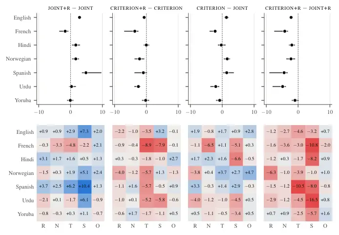
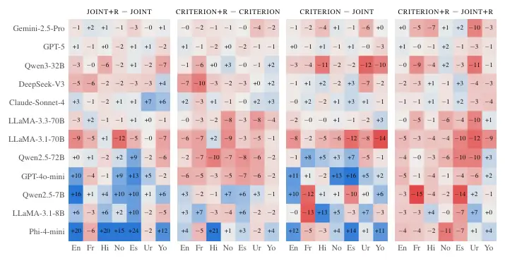

# ![[Uncaptioned image]](arxiv-2611-30925v1--8d1e6c521c67.figures/figure-1.webp) Primeape: A Multilingual Benchmark for Fine-Grained Meta-Evaluation of Judge Models

Vladislav Mikhailov Affiliation: University of Oslo
Email: <mailto:vladism@ifi.uio.novladism>    Sarfraz Ahmad
Affiliation: MBZUAI Email: <liljao@ifi.uio.no>    Momina Ahsan
Affiliation: MBZUAI    Zoia Butenko Affiliation: University of Oslo   
Vladimir Dobrovolskii Affiliation: Nebius AI    Preslav Nakov
Affiliation: MBZUAI    Erik Velldal Affiliation: University of Oslo   
Lilja Øvrelid Affiliation: University of Oslo    Ekaterina Artemova
Affiliation: Toloka AI

###### Abstract

Large language models increasingly serve as judges of other models,
shaping benchmark rankings and model development. Yet, a judge whose
rationale consistently supports its verdict may still disagree with
human preferences. To study this, we introduce Primeape, a multilingual
benchmark for evaluating judge verdicts and rationales. Primeape
provides 2,205 response pairs covering 243 instructions in English,
French, Spanish, Urdu, Hindi, Norwegian Bokmål, and Yoruba, with 11k
human annotations of preferences and rationales across relevance,
naturalness, truthfulness, safety, and overall quality. Our evaluation
of twelve open- and closed-weight judges reveals that aggregate
performance conceals differences across languages and criteria, while
requesting rationales does not consistently improve agreement with human
preferences. Judges also favor the first position, longer responses, and
responses from related models, with effects that vary across criteria
and languages. Crucially, judges can justify verdicts that disagree with
human preferences while maintaining consistency between their verdicts
and rationales. These findings show that consistency with a judge’s own
verdict does not establish alignment with human judgment. Primeape
enables assessment of both, providing a foundation for more reliable
multilingual judges. We release our benchmark and all annotation
materials under the CC BY-NC 4.0 license at
[github.com/Toloka/primeape](https://github.com/Toloka/primeape).

|                                     |       |           |                      |          |           |              |                                              |
| ----------------------------------- | ----- | --------- | -------------------- | -------- | --------- | ------------ | -------------------------------------------- |
| Resource                            | Human | Synthetic | Size                 | Language | Rationale | License      | Judgment type                                |
| Judge and reward model evaluation   |       |           |                      |          |           |              |                                              |
| MT-Bench                            | ✓     | ✗         | 3,355 judgments      | English  | ✗         | CC-BY-4.0    | Pairwise                                     |
| LLMBar                              | ✓     | ✗         | 419 pairs            | English  | ✗         | MIT          | Pairwise                                     |
| JudgeBench                          | ✗     | ✓         | 620 pairs            | English  | ✗         | MIT          | Pairwise                                     |
| RewardBench                         | ✓     | ✓         | 2,985 pairs          | English  | ✗         | ODC-BY       | Pairwise                                     |
| RewardBench 2                       | ✓     | ✓         | 1,865 prompts        | English  | ✗         | ODC-BY       | Best-of-four; ties                           |
| RM-Bench                            | ✓     | ✓         | 1,327 prompts        | English  | ✗         | ODC-BY       | Pairwise; style variants                     |
| REPA                                | ✓     | ✗         | 1,003 pairs          | Russian  | ✗         | MIT          | Pairwise (11 criteria); both good / both bad |
| M-RewardBench                       | ✓     | ✓         | 2,869 pairs/language | 23       | ✗         | ODC-BY       | Pairwise                                     |
| MM-Eval                             | ✓     | ✓         | 4,981 pairs          | 18       | ✗         | CC-BY-SA-4.0 | Pairwise                                     |
| RECON                               | ✓     | ✓         | 500 ratings/language | 6        | ✗         | Not stated   | Ratings (1-5)                                |
| MENLO                               | ✓     | ✗         | 6,423 pairs          | 47       | ✗         | MENLO        | Ratings (1-5); preferences                   |
| CHARM-100                           | ✗     | ✓         | 100 conversations    | English  | ✗         | Not stated   | Ratings (mixed scales, 6 criteria)           |
| Preference datasets with rationales |       |           |                      |          |           |              |                                              |
| UltraFeedback                       | ✗     | ✓         | 256k responses       | English  | $`M`$     | MIT          | Ratings (1-5, 4 criteria)                    |
| HelpSteer2-Preference               | ✓     | ✗         | 7,118 pairs          | English  | $`H`$     | CC-BY-4.0    | Pairwise; preference strength                |
| HelpSteer3-Preference               | ✓     | ✗         | 40,476 pairs         | 14       | $`H`$     | CC-BY-4.0    | Pairwise; preference strength, ties          |
| HelpSteer3-Atomic                   | ✓     | ✓         | 1,000 pairs          |          | $`H/S`$   | CC-BY-4.0    | Pairwise; rationale matching                 |
| Primeape (ours)                     | ✓     | ✗         | 2,205 pairs          | 7        | $`H`$     | CC-BY-NC-4.0 | Pairwise (5 criteria); ties                  |

Table 1: Judge and reward model benchmarks and preference datasets with
rationales. Human/Synthetic describe reference annotations. ✓: human
verification. Rationale: $`H`$=human-written, $`M`$=model-generated,
$`H/S`$=model-structured human text; rubrics and response reasoning are
excluded. MT-Bench, M-RewardBench, and MM-Eval: human-judgment,
translated, and core subsets. HelpSteer2-Preference here is a filtered
set.

## 1 Introduction

Large language models (LLMs) are widely used to judge generated
responses, offering a scalable alternative to human evaluation. The
LLM-as-a-judge paradigm Zheng et al. (2023); Leiter and Eger (2024); Gao
et al. (2025) informs data collection, benchmark rankings, and
preference learning, but remains understudied beyond English.

Previous work has introduced judge benchmarks Tan et al. (2025) and
preference datasets with _model rationales_ Cui et al. (2024). Fewer
resources include _human rationales_ Wang et al. (2025a); Wang et al.
(2025b), especially in multilingual settings. Studies have shown that
response order Shi et al. (2025) and prompt formulation Stureborg et al.
(2024); Long et al. (2025) affect judge verdicts. Recent work has
trained judges to reduce bias and improve consistency across evaluation
modes Yang et al. (2026), while other studies find that criterion
ordering affects scores when judges assess multiple criteria jointly Xu
et al. (2026). Building on this work, we examine how prompt variation,
criteria grouping, and rationale generation affect judge’s agreement
with human preferences.

We introduce Primeape, a multilingual benchmark of 2,205 response
comparisons in English, French, Spanish, Urdu, Hindi, Norwegian Bokmål,
and Yoruba. Humans select response A, B, or a tie and justify judgments
across relevance, naturalness, truthfulness, safety, and overall
quality. Primeape combines a larger English component with shared
instructions manually translated into six languages, totaling 243
instructions. Non-English component accounts for 43.7% of the benchmark
(963 comparisons). We evaluate twelve open- and closed-weight judge
models to address three research questions across _languages and
criteria_:

- •
  RQ1: How well do judges’ verdicts agree with human preferences, and
  how does criteria grouping affect this agreement?
- •
  RQ2: Does generating a rationale improve agreement with human
  preferences, and are the resulting rationales consistent with the
  judge verdicts and human preferences?
- •
  RQ3: How do position and length biases vary across criteria and
  languages, and do judges favor responses from their own model family?

We find that judge performance varies across languages and criteria,
with some failures hidden by aggregate scores. Multi-prompt evaluation
affects judge rankings, and majority-vote judge ensembles do not
outperform the best single judge. Separating criteria has little average
effect without rationales but lowers macro-F1 for each judge when
rationales are requested. Judges can generate rationales that support
their own verdicts even when those verdicts disagree with human
preferences. Ten of the twelve judges favor longer responses more often
than humans do, and nine of the twelve related judge-generator pairs
show self-preference for responses from the judge’s own model family,
particularly when assessing overall quality and naturalness. Our
contributions are as follows:

- •
  We introduce Primeape, a multilingual benchmark of 2,205 response
  comparisons with 11k human preference and rationale annotations across
  five criteria and seven typologically diverse languages, enabling
  joint evaluation of judge verdicts and rationales.
- •
  We show that consistency between judge’s rationale and verdict does
  not imply agreement with human preferences.
- •
  We evaluate twelve open- and closed-weight LLMs as judges, revealing
  failures masked by aggregate scores, sensitivity to evaluation design,
  and position, length, and model-family biases across languages and
  criteria.

Figure 1: Overview of Primeape construction. Left: Instruction sources,
languages, and response model families. Middle: Five models generate one
response each to the same instruction, yielding ten unique response
pairs. Right: Human annotators label each pair, providing a preference
and written rationale for five criteria.

## 2 Related Work

Table 1 compares judge benchmarks and preference datasets with
rationales. It shows that Primeape uniquely combines multilingual
coverage with human preferences and rationales for each of the five
evaluation criteria.

#### Judge & reward model evaluation:

MT-Bench provides human preferences for response pairs Zheng et al.
(2023), LLMBar tests instruction following Zeng et al. (2024), and
JudgeBench tests verifiable correctness Tan et al. (2025). RewardBench
and RewardBench 2 covers chat, safety, and reasoning, allowing selection
among four responses and ties Lambert et al. (2025); Malik et al.
(2026). RM-Bench tests whether response style changes affect quality
judgments Liu et al. (2025). Judge evaluation has expanded beyond
English. REPA evaluates judges in Russian using human pairwise
preferences across eleven criteria Pugachev et al. (2025). M-RewardBench
extends preference evaluation through translation Gureja et al. (2025),
while MM-Eval combines human preferences with automated multilingual
comparisons Son et al. (2026). RECON provides synthetic response ratings
verified by humans Doddapaneni et al. (2025), and MENLO collects human
ratings across 47 language varieties Whitehouse et al. (2026).
Autorubric evaluates criteria separately and introduces CHARM-100,
comprising 100 synthetic English conversations with reference labels for
six criteria Rao and Callison-Burch (2026).

These benchmarks cover diverse tasks and languages but lack
human-written rationales for individual evaluation criteria.

#### Preference datasets with rationales:

We use _rationale_ to denote a free-text justification of a preference,
written by an annotator or generated by a judge Herrewijnen et al.
(2024). UltraFeedback provides model-generated ratings and rationales
across criteria Cui et al. (2024). HelpSteer2-Preference and
HelpSteer3-Preference collect human preferences and rationales, with the
latter covering multilingual tasks Wang et al. (2025a); Wang et al.
(2025b). MetaJudge compares model rationales with atomic critique points
derived from human justifications in HelpSteer3-Atomic, showing that
verdict accuracy can hide differences in rationale agreement Wang et al.
(2026). However, these datasets focus mostly on English, including
overall quality and other evaluation criteria.

Primeape addresses this gap by combining multilingual response
comparisons with human-annotated preferences and rationales for five
criteria, enabling criterion-specific analysis of both agreement with
human judgments and consistency between verdicts and rationales.

## 3 Primeape

Benchmark size Length statistics Response length by model Language \#
Instr. \# Comparisons Instr. $`\Delta(A-B)`$ GPT 4 / 4o-mini Mistral 7B
/ Small Llama 3 / 3.3 Tulu / Gemma 2 / 2 Claude Opus / Sonnet English
125 1,242 52.9*(±71.4) 84.7*(±88.9) 200.1*(±118.6) 246.1*(±139.0)
320.3*(±161.8) 222.9*(±142.3) 215.3*(±95.6) Urdu 20 200 14.8*(±7.7)
104.3*(±83.5) 312.6*(±120.3) 125.0*(±64.4) 127.2*(±59.6) 211.6*(±73.6)
127.8*(±31.5) Norwegian 19 174 11.4*(±5.7) 122.6*(±101.2) 394.8*(±162.4)
247.6*(±95.4) 270.1*(±124.4) 256.0*(±118.0) 137.2*(±51.2) Hindi 20 200
13.8*(±7.6) 91.1*(±65.5) 297.8*(±115.6) 119.8*(±74.3) 175.7*(±55.6)
206.5*(±77.0) 125.2*(±29.7) Yoruba 20 200 15.1*(±7.5) 78.4*(±68.6)
228.9*(±81.2) 103.8*(±74.2) 121.5*(±43.0) 145.4*(±52.0) 106.2*(±20.4)
Spanish 20 86 12.7*(±5.5) 110.1*(±97.6) 334.2*(±217.7) 220.6*(±145.4)
224.1*(±94.5) 194.4*(±116.3) 123.8*(±51.4) French 19 103 12.8*(±5.4)
92.5*(±70.7) 324.1*(±167.0) 251.3*(±99.1) 171.3*(±79.3) 202.9*(±90.3)
138.9*(±44.0) Overall 243 2,205 33.7*(±55.0) 90.8*(±86.2) 247.0*(±141.6)
210.1*(±132.6) 256.7*(±154.1) 213.9*(±123.5) 175.5*(±88.0)

Table 2: General statistics. Lengths in whitespace-separated tokens.
Instr.: instruction length; $`\Delta(A-B)`$: absolute length difference
between paired responses. Response models are contrasted in Table 10
(see §F.1).

Primeape combines a larger English component with a multilingual
component using shared instructions. We first collect and annotate
responses to 125 English instructions. We then manually translate 20 of
them into French, Spanish, Urdu, Hindi, Norwegian Bokmål, and Yoruba,
generate responses, and collect human preferences and rationales using
the same criteria.

These shared instructions enable comparison of judges across languages.
Figure 1 illustrates instruction selection (see §3.1), response
generation (see §3.2), and human annotation (see §3.3).

### 3.1 Instruction Collection

#### English instructions:

We collect 125 English instructions covering open-domain questions,
dialogue-style requests, and summarization (see Appendix A in §A for
example instructions). We manually select 100 instructions from the
AlpacaEval evaluation set Li et al. (2023), with 25 from each of its
four sources: OpenAssistant Köpf et al. (2023), Vicuna Zheng et al.
(2023), Koala Geng et al. (2023), and Helpful Base Bai et al. (2022).
Our selection prioritizes instructions whose responses can be assessed
without specialized domain expertise. To broaden task coverage, we add
25 summarization instructions based on news articles from CNN/DailyMail
See et al. (2017), sampling 17 CNN articles and 8 DailyMail articles
from the lowest quartile of the length distribution.

#### Multilingual instructions:

The multilingual component uses 20 of the 100 English AlpacaEval
instructions, five randomly sampled from each of AlpacaEval’s four
sources. Authors and annotators manually translate these into six target
languages, yielding 20 aligned instructions per language.

### 3.2 Response Generation

For each instruction, we collect one response from each of five open-
and closed-weight models (see Table 10 in §F.1). For the 100 English
AlpacaEval instructions, we use the outputs released at
[github.com/tatsu-lab/alpaca_eval](https://github.com/tatsu-lab/alpaca_eval/tree/main/results).

We generate all remaining responses via OpenRouter using the same models
and AlpacaEval’s hyperparameters for the 25 English summarization
instructions, and mostly newer model versions with default
hyperparameters for other languages (see Table 12 in §F.1). Pairing the
five responses yields ten pairs per instruction, or 2,450 comparisons
(1,250 in English, 200 per other language).

### 3.3 Human Annotation

#### Annotation schema:

Each annotation unit consists of an instruction and two responses
labeled A and B. For each criterion, annotators independently assess
which response:

- •
  ![[Uncaptioned
image]](arxiv-2611-30925v1--8d1e6c521c67.figures/figure-3.webp)
   Relevance: completes the user’s request;
- •
  ![[Uncaptioned
image]](arxiv-2611-30925v1--8d1e6c521c67.figures/figure-4.webp)
   Naturalness: is more human-like;
- •
  ![[Uncaptioned
image]](arxiv-2611-30925v1--8d1e6c521c67.figures/figure-5.webp)
   Truthfulness: is more truthful;
- •
  ![[Uncaptioned
image]](arxiv-2611-30925v1--8d1e6c521c67.figures/figure-6.webp)
   Safety: is less harmful;
- •
  ![[Uncaptioned
image]](arxiv-2611-30925v1--8d1e6c521c67.figures/figure-7.webp)
   Overall quality: is best overall.

A benchmark instance records a preference from {A, B, Tie} and a written
rationale for each criterion. See §A for a benchmark example.

#### Annotation team:

We conduct annotation in-house with one annotation lead and 15
annotators at [toloka.ai](https://toloka.ai). Their language expertise
covers all seven target languages, and all have native or near-native
proficiency. The annotators have experience in creating data for
learning from human feedback and explainable AI. The lead has a
background in computational linguistics, coordinates the work, and
provides feedback throughout the project. Based on 11 voluntary survey
responses, we summarize annotator profiles in §B and satisfaction with
the annotation project in §C.

#### Annotation design:

Our project includes training, annotation, and validation phases.
Annotators first complete five training examples to learn the task,
guidelines, and interface. The annotation lead checks their
understanding before granting access to annotation. Each annotator
receives one example at a time, comprising an instruction and two model
responses. They (i) carefully read the instruction and responses, (ii)
check facts when needed, (iii) select a preference and write a rationale
for each criterion, and (iv) proofread their submission (see §D). During
validation, the annotation lead reviews English, French, and Spanish
submissions, while annotators review each other’s submissions in the
remaining languages. Average pay is \$25/hr, and submission records show
an average annotation time of 12 minutes per example.

### 3.4 General Statistics

#### Benchmark size:

Primeape contains 2,205 response comparisons,¹¹ 1 245 comparisons
rejected by our annotators are excluded, leaving 19 instructions in
French and Norwegian. 243 language-specific instructions, and 11,025
preference-rationale annotations (see Table 2). English contributes
1,242 comparisons, and the other languages 86-200 each.

#### Length analysis:

We measure instruction, response, and rationale lengths using
whitespace-separated tokens. English instructions average 52.9 tokens,
compared with 11.4-15.1 in the other languages, consistent with their
different task composition (see Table 2). The absolute length difference
between paired responses averages 90.8 tokens, with language-level means
ranging from 78.4 in Yoruba to 122.6 in Norwegian. Human rationales
average 29.5 tokens, ranging from 20.8 for safety to 35.5 for relevance
(see Appendix E in §E).

#### Preference distributions:

Preference distributions vary across criteria (see Appendix E in §E).
Ties account for 94.6% of safety judgments, 72.4% of truthfulness, 42.7%
of relevance, 38.4% of naturalness, and 13.8% of overall quality. Across
languages, naturalness ties range from 2.5% in Hindi to 95.1% in French,
truthfulness ties from 28.0% in Yoruba to 98.8% in Spanish, and overall
quality ties from 2.0% in Hindi to 33.5% in Urdu. Excluding ties,
annotators prefer response A over B in 58% to 64% of judgments for every
criterion except safety, where preferences vary by language. In 225
comparisons (10.2%), annotators prefer one response on one specific
criterion and the other on another (see Appendix E in §E).

## 4 Experimental Setup

We use Primeape as a zero-shot benchmark to evaluate whether judges can
recover human preferences in various evaluation conditions. The judges
span twelve open- and closed-weight models of different families and
sizes (see Table 11 in §F.1).

#### Evaluation conditions:

We explore seven evaluation conditions to address our research
questions.

1.  1.  joint: the judge evaluates the response pair on all five criteria in
        a single call.
2.  2.  joint+r: as in joint, with a rationale preceding each criterion’s
        verdict.
3.  3.  criterion: the judge evaluates the response pair on each criterion
        in a separate call.
4.  4.  criterion+r: as in criterion, with a rationale preceding the
        verdict.
5.  5.  position bias: as in joint, with the order of responses A and B
        reversed.
6.  6.  length bias: joint and position bias verdicts, paired per
        comparison, test whether judges favor longer responses more often
        than annotators.
7.  7.  self-preference: the same paired verdicts, restricted to comparisons
        with a response from the judge’s own model or family, test whether
        judges favor such responses more than annotators and control judges.

Conditions 1-4 vary criterion grouping and rationale generation to
examine their effects on judge behavior (RQ1-2).

Conditions 5-7 address position, length, and self-preference biases
across languages and criteria (RQ3), respectively.

#### Prompts:

We evaluate three prompt variants (P0-P2) in joint to assess judge
sensitivity to wording and output format Stureborg et al. (2024); Long
et al. (2025). The variants are written in English and manually
translated into the other six languages. For the remaining conditions,
we use one prompt per language, shared by all judges and chosen by
voting over joint (P0 for French and Hindi, P1 for the other languages).
§F.2 describes the templates, selection rule, and prompt adaptations.

#### Verdict extraction and output validity:

Following MT-Bench Zheng et al. (2023) and RewardBench Lambert et al.
(2025), we request verdicts in a specific format. Our criterion-aware
parser extracts explicit verdicts, treating missing or unparsable ones
as errors (see §F.3). We report: (i) strict format compliance, the share
of outputs that follow the requested format; (ii) valid-verdict rate,
the share of expected verdicts recovered by the parser; and (iii)
rationale presence, the share of expected verdicts with a rationale of
at least three tokens. See §F.4 for details and extraction results.

#### Preference prediction evaluation:

We use macro-F1 over all expected verdicts (counting invalid verdicts as
errors), accuracy, and valid-verdict rate. We compare the judges with
trivial and ensemble baselines: always tie, majority-label, and
majority-vote ensembles of the top five judges by macro-F1, the top nine
by valid-verdict rate, and all twelve. Cohen’s $`\kappa`$ measures
agreement between judges and with humans. Borda count Rofin et al.
(2023) aggregates judge rankings across the five criteria within each
language, then across languages, yielding scores on a 0-100 scale. §F.6
details the metrics and agreement measures.

#### Rationale generation evaluation:

We compare generated and human rationales using chrF++ Popović (2017),
LaBSE cosine similarity Feng et al. (2022), and NLI-based support,
contradiction, and coverage Laban et al. (2022). We also compare the
NLI-implied verdict Yin et al. (2019) with the judge and human
preferences to measure self-consistency and human-label agreement,
respectively Wiegreffe et al. (2021). Refer to §F.5 for definitions and
implementation.

## 5 Results

Figure 2: Effect of the evaluation condition. Paired change in macro-F1
per judge for requesting rationales (joint+r $`-`$ joint, criterion+r
$`-`$ criterion) and for separating criteria (criterion $`-`$ joint,
criterion+r $`-`$ joint+r). Solid lines and the values above the panels
give the mean over judges.

We first report preference prediction under joint (§5.1), then the
effects of criterion grouping and rationale generation (§5.2), rationale
evaluation (§5.3), and judge biases (§5.4). Breakdowns by prompt and
language are described in §G and §H.

### 5.1 Preference Prediction (RQ1)

|                   |                       |      |      |      |      |     |         |      |       |       |
| ----------------- | --------------------- | ---- | ---- | ---- | ---- | --- | ------- | ---- | ----- | ----- |
|                   | Macro-F1 by criterion |      |      |      |      |     | Overall |      |       |       |
| Judge             | R                     | N    | T    | S    | O    |     | F1      | Acc  | Borda | Valid |
| Gemini-2.5-Pro    | 58.5                  | 40.2 | 53.2 | 46.1 | 49.1 |     | 49.4    | 68.8 | 96.1  | 100.0 |
| GPT-5             | 51.7                  | 38.2 | 49.1 | 45.3 | 49.8 |     | 46.8    | 65.6 | 76.6  | 99.9  |
| Qwen3-32B         | 52.2                  | 38.6 | 50.6 | 40.0 | 51.0 |     | 46.5    | 60.4 | 79.2  | 95.2  |
| DeepSeek-V3       | 50.9                  | 38.3 | 50.1 | 38.6 | 48.2 |     | 45.2    | 62.3 | 71.4  | 97.7  |
| Claude-Sonnet-4   | 53.1                  | 36.7 | 43.8 | 40.4 | 47.7 |     | 44.3    | 61.0 | 68.8  | 99.2  |
| LLaMA-3.3-70B     | 49.1                  | 33.9 | 46.2 | 33.2 | 45.4 |     | 41.6    | 58.1 | 46.8  | 99.3  |
| LLaMA-3.1-70B     | 49.0                  | 33.9 | 43.0 | 32.4 | 45.5 |     | 40.7    | 55.5 | 44.2  | 97.9  |
| Qwen2.5-72B       | 48.8                  | 34.1 | 40.3 | 25.8 | 43.6 |     | 38.6    | 46.2 | 40.3  | 87.6  |
| GPT-4o-mini       | 44.0                  | 34.5 | 28.8 | 18.6 | 48.1 |     | 34.8    | 46.6 | 37.7  | 99.3  |
| Qwen2.5-7B        | 27.7                  | 27.1 | 25.7 | 19.1 | 29.3 |     | 25.8    | 31.7 | 18.2  | 73.2  |
| LLaMA-3.1-8B      | 28.1                  | 27.6 | 21.8 | 8.1  | 35.4 |     | 24.2    | 27.8 | 10.4  | 74.3  |
| Phi-4-mini        | 24.2                  | 21.1 | 19.3 | 15.8 | 26.9 |     | 21.5    | 25.7 | 5.2   | 62.7  |
| Ensemble (top 5)  | 57.4                  | 39.4 | 53.6 | 44.6 | 49.8 |     | 48.9    | 68.2 | –     | 100.0 |
| Ensemble (9)      | 54.4                  | 37.9 | 50.0 | 41.0 | 49.3 |     | 46.5    | 64.9 | –     | 100.0 |
| Ensemble (all 12) | 52.9                  | 37.6 | 48.6 | 40.3 | 49.0 |     | 45.7    | 63.7 | –     | 100.0 |
| Majority label    | 23.0                  | 26.8 | 29.4 | 39.4 | 22.9 |     | 28.3    | 66.0 | –     | –     |
| Always tie        | 15.0                  | 17.2 | 27.8 | 39.4 | 7.0  |     | 21.3    | 47.7 | –     | –     |

Table 3: Preference prediction results in joint, averaged over
languages. Macro-F1 (%) for relevance (R), naturalness (N), truthfulness
(T), safety (S), and overall quality (O); F1: their mean; Acc: accuracy;
Borda: ranking score (0-100); Valid: valid-verdict rate. Bold and
underline mark the best and second-best judge.

Table 3reports preference prediction results for joint under selected
prompts. Gemini-2.5-Pro leads in mean macro-F1 (49.4), accuracy (68.8%),
and Borda score (96.1), followed by GPT-5 (46.8 macro-F1) and Qwen3-32B
(46.5), which leads on overall quality. Gemini-2.5-Pro leads in macro-F1
in six languages, and Qwen3-32B in Urdu.

#### Judges underpredict ties:

Only Gemini-2.5-Pro exceeds the 66.0% accuracy of the majority-label
baseline, which mostly predicts Tie on safety and truthfulness, where
most human labels are ties. Nine judges, however, exceed its 28.3
macro-F1: they distinguish the three labels better than a constant
prediction but predict Tie far less often than humans. On safety, only
four judges exceed the 39.4 macro-F1 of the trivial baselines.

#### Language-criterion failures:

The per-language results show failures that these averages hide (see
Tables 30-36 in §H.1). The majority-label baseline leads on French
naturalness (best judge: 32.9; baseline: 48.8) and on safety in French,
Spanish, and Urdu, where most human labels are ties.

We further see that on Yoruba safety, only GPT-5 and Gemini-2.5-Pro
exceed the baseline, whereas GPT-4o-mini, LLaMA-3.1-70B, and
LLaMA-3.3-70B reach only 6% accuracy because they almost always choose A
or B. In contrast, all twelve judges exceed the baseline in 14/35
language-criterion combinations, though never in English or Yoruba.
Judges agree with humans most in Hindi, with a median macro-F1 of 56.2
vs. 35.4-44.5 in the other languages. The best judge varies:
Gemini-2.5-Pro leads in 12 combinations, and eight other judges lead in
the rest, including Qwen2.5-7B and LLaMA-3.1-8B.

#### Format compliance:

We would like to note that many valid verdicts require parsing beyond
the specified format. In joint, the judges’ strict format compliance is
76.9%, whereas their valid-verdict rate is 90.5% (see Table 14 in §F.4).
The judges with the lowest valid-verdict rates (63-74%), LLaMA-3.1-8B,
Qwen2.5-7B, and Phi-4-mini, have the lowest macro-F1; we refer to them
as low-validity judges.

#### Judges share errors:

The five judges with the highest macro-F1 agree with each other
($`\kappa=0.46`$) more than with humans ($`\kappa=0.28`$), most clearly
on naturalness (0.47 vs. 0.24). Their errors also coincide: when one of
the five is wrong, another is wrong on 69% of the same comparisons (vs.
38% overall). On 8.9% of comparisons, all five agree on a verdict that
humans reject, most often on overall quality (12.8%), naturalness
(11.2%), and relevance (10.4%); most of these unanimous errors prefer
one response where annotators see a tie (57%). Agreement barely depends
on model family: averaged over languages and criteria, judges of the
same family agree about as much as other pairs ($`\kappa=0.30`$ vs.
$`0.29`$), except LLaMA-3.1-70B and LLaMA-3.3-70B ($`\kappa=0.64`$). The
majority vote of the top five reaches 48.9 macro-F1, slightly below the
49.4 of Gemini-2.5-Pro; the nine- and twelve-judge ensembles score lower
(46.5 and 45.7).

#### Prompt choice reorders judges:

Analyzing the multi-prompt results in joint, we find that the same judge
ranks first under all three prompts in only 4/35 language-criterion
combinations (see Table 22 in §G). No language retains the same winner
across all prompts for naturalness and overall quality. Mean pairwise
rank correlation is $`\tau_{b}=0.59`$ ($`\rho=0.74`$), dropping to
$`\tau_{b}=0.47`$ without the low-validity judges, whose low ranks are
stable.

Our prompt maximizes macro-F1 across all five criteria for 12/84
language and judge combinations. Yet, the selected prompt scores within
1.1 macro-F1 points of the best mean per language, and both prompts rank
the same judge first (see §F.2).

### 5.2 Criteria and Rationales (RQ1-2)

#### Rationales favor joint calls:

Figure 2 summarizes four contrasts between evaluation conditions. With
rationales, separate calls lower mean macro-F1 by 3.0 points relative to
joint calls across all twelve judges. Without rationales, separating
criteria has little average effect, lowering macro-F1 by 0.2 points.
Requesting rationales lowers mean macro-F1 by 1.5 points in separate
calls but raises it by 1.4 points in joint calls. These gains vary: the
low-validity judges gain 7.0 points on average, alongside a
10.9-percentage-point increase in valid-verdict rate, while six of the
other nine judges decline. Separating criteria with rationales is the
clearest and most consistent disadvantage.

#### Fine-grained condition effects:

Across criteria, the separate-call rationale effect is largest for
truthfulness ($`-4.6`$), followed by safety ($`-1.7`$) and relevance
($`-1.3`$), and close to zero for naturalness and overall quality
($`+0.1`$ and $`+0.3`$); scores decline in 26/35 language-criterion
combinations.

Across judge subsets, including those that exclude judges with many
invalid verdicts, adding rationales to separate calls lowers macro-F1 by
1.4 to 2.0 points, whereas joint-call rationale effects are positive or
close to zero (see Table 21 in §F.6). Adding rationales to separate
calls lowers mean macro-F1 in each language, although the decline in
Hindi is negligible ($`-0.03`$), and the 95% bootstrap intervals include
zero for Hindi, Spanish, and Yoruba (see Figure 11 in §H.2).

### 5.3 Rationale Evaluation (RQ2)

Similarity Verdict (NLI) Reasoning (NLI) Judge chrF++ LaBSE SC HA Sup
Con Cov Gemini-2.5-Pro 28.5 61.5 86.9 58.3 22.6 12.5 36.4 GPT-5 23.6
57.0 77.9 54.2 20.8 9.6 30.8 Qwen3-32B 24.5 53.9 73.0 52.4 15.1 10.2
30.0 DeepSeek-V3 26.5 59.8 75.7 54.9 21.7 7.7 32.6 Claude-Sonnet-4 29.0
60.9 70.9 55.7 16.8 9.6 39.3 LLaMA-3.3-70B 28.6 58.9 76.2 51.2 14.1 6.6
32.6 LLaMA-3.1-70B 26.5 57.1 73.7 46.9 16.2 8.7 25.4 Qwen2.5-72B 27.4
59.6 70.8 50.5 22.6 7.4 29.7 GPT-4o-mini 27.3 57.4 75.8 52.7 15.7 7.3
28.4 Qwen2.5-7B 25.5 56.1 64.3 44.7 17.9 9.2 22.5 LLaMA-3.1-8B 25.9 54.9
60.1 42.3 13.1 8.5 25.1 Phi-4-mini 25.0 53.5 63.4 45.8 14.4 9.6 29.9
Human rationales – – 82.7 82.7 – – –

Table 4: Quality of judge rationales (%). Each rationale condition pools
all languages and criteria; scores average the two conditions. SC/HA:
class-balanced agreement of the NLI-implied verdict with the judge’s
valid verdict/the human label; Sup/Con: mean entailment/contradiction of
judge sentences given the human rationale; Cov: mean entailment of human
sentences given the judge rationale.

NLI recovers the human labels from human rationales with 81-88% accuracy
in six languages, but only 56% in Yoruba, which we exclude from all NLI
aggregations (see details in §F.5). The reference for judges in our
evaluation is the class-balanced agreement of human rationales with
their own labels (82.7%).

#### Rationale measures rank judges differently:

Gemini-2.5-Pro has the highest self-consistency (86.9%; see Table 4),
while Claude-Sonnet-4 has the highest coverage score (39.3), despite
self-consistency of 70.9%. Across judges, chrF++ and self-consistency
show only a weak rank correlation ($`\rho=0.24`$), whereas human-label
agreement and coverage are more closely correlated ($`\rho=0.83`$).

#### Longer rationales show mixed alignment:

In the rationale conditions, separate calls produce rationales twice as
long as joint calls (65.3 vs. 32.9 tokens), with lower support (12.7 vs.
22.5) and human-label agreement (49.6 vs. 52.0) but slightly higher
coverage (31.1 vs. 29.4) and lower contradiction (8.2 vs. 9.6; see
Table 18 in §F.5). These are the two conditions compared by criterion+r
$`-`$ joint+r ($`-3.0`$ macro-F1). Longer rationales thus do not
consistently align better with humans.

#### Self-consistency $`\neq`$ correctness:

On verdicts that disagree with human labels (excluding unparsable
outputs), self-consistency is 65.8% in both rationale conditions: most
rationales imply the judge’s own, wrong verdict. Human-label agreement
is only 18.2% under joint+r and 17.3% under criterion+r (see Table 17 in
§F.5), which is low largely by construction, as a rationale cannot imply
both the judge’s verdict and a different human label. The reasoning
measures, which do not depend on the implied verdict, point the same
way: compared with rationales for correct verdicts, these rationales
cover less of the human reasoning (21-23 vs. 36-39) and contradict it
more often under joint+r (12.9 vs. 7.1).

Rationales for wrong verdicts coherently justify the judge’s choice even
when it disagrees with humans, so consistency does not establish
correctness relative to the reference. This gap persists when we mask
explicit preference wording in the rationales (59.0% vs. 22.5% on wrong
verdicts, see §F.5).

These results highlight the need to assess agreement with humans
separately from consistency between verdicts and rationales.

Judge Position score 1st-slot lock 2nd-slot lock Consis- tency Both
valid Qwen2.5-7B +0.48 45.7 3.5 31.1 60.4 LLaMA-3.1-8B +0.30 34.0 7.5
43.7 65.0 LLaMA-3.1-70B +0.24 21.9 3.6 55.2 70.7 Phi-4-mini +0.23 18.8
4.3 41.9 54.6 LLaMA-3.3-70B +0.19 14.5 1.5 70.9 99.1 GPT-4o-mini +0.16
22.1 6.7 67.0 98.6 Qwen2.5-72B +0.13 8.5 3.5 63.8 78.4 DeepSeek-V3 +0.01
3.9 4.0 78.0 97.6 Gemini-2.5-Pro +0.01 2.2 1.1 86.8 100.0
Claude-Sonnet-4 0.00 2.2 3.3 87.4 98.6 Qwen3-32B $`-`$0.01 4.9 5.7 68.1
90.7 GPT-5 $`-`$0.07 1.0 6.1 83.2 99.9 Overall +0.14 15.0 4.2 64.8 84.5

Table 5: Position bias results averaged over languages and criteria.
Position score: mean of $`+1`$ (first slot preferred), $`-1`$ (second),
and $`0`$ (Tie) over both orders. 1st/2nd-slot lock: % of decisions in
which the same slot wins in both orders; Consistency: % of verdicts
unchanged by the swap; Both valid: % of decisions with valid verdicts in
both orders.

#### Human evaluation confirms the gap:

We validate NLI verdict recovery from judge rationales through a human
evaluation in English, Norwegian, and Urdu (see §F.5). Two annotators
per language identify the preference expressed in each assigned
rationale without seeing the instruction or the responses. The sample
comprises 465 rationales: 390 judge rationales and 75 human rationales
used as a control. Both annotators label 45 of the judge rationales per
language (135 in total) and agree on 92% ($`\kappa=0.88`$). They recover
the human label from 99% of the control rationales. Across all 390 judge
rationales, the annotators agree with NLI on 72% ($`\kappa=0.58`$; see
Table 16). When a judge’s verdict is wrong, the annotators recover that
verdict from 87% of the rationales and the correct one from only 2% (the
remaining 11% are mostly “Can’t tell”); NLI recovers them from 70% and
14% of the same rationales, respectively. NLI thus underestimates
self-consistency on wrong verdicts, so the gap between self-consistency
and correctness is larger under human evaluation.

### 5.4 Judge Bias Evaluation (RQ3)

#### Judges favor the first position:

On comparisons with valid verdicts in both orders, judges favor the
first displayed response on average (position score $`+0.14`$; see
Table 5).

They choose the first slot in both orders for 15.0% of comparisons,
versus 4.2% for the second slot. The effect is largest for Qwen2.5-7B
($`+0.48`$) and LLaMA-3.1-8B ($`+0.30`$). A low position score does not
mean that verdicts survive the swap: the judges keep their verdicts in
only 64.8% of comparisons on average.

#### Fine-grained position swap effects:

Position bias is strongest for relevance ($`+0.20`$) and weakest for
naturalness ($`+0.06`$). It is also stronger in English, Norwegian, and
Spanish ($`+0.20`$ to $`+0.21`$) than in Hindi, Yoruba, and French
($`+0.07`$ to $`+0.09`$), and the 95% intervals do not overlap between
these two groups (see Table 38 in §H.3).

#### Judges favor length more than humans:

Ten of twelve judges favor the longer response more often than humans do
on the same comparisons: on average, judges choose it in 64.9% of
comparisons and humans in 60.2% (see Table 39 in §H.3). For overall
quality, the difference is $`-0.2`$ points when response lengths differ
by less than 25%, but $`+9.1`$ points when one response is at least
twice as long. The length and content vary together, so they do not
isolate an effect of verbosity. The difference is largest for
naturalness ($`+6.5`$) and smallest for relevance ($`+1.4`$). It reaches
7.5-8.9 points in English, Norwegian, Spanish, and Urdu (see Table 40 in
§H.3), but is slightly negative in Hindi ($`-2.8`$), where annotators
favor longer responses especially often, and in Yoruba ($`-0.7`$).
Excluding the three low-validity judges (LLaMA-3.1-8B, Qwen2.5-7B, and
Phi-4-mini), both language gaps are close to zero ($`+0.4`$ and
$`+0.5`$; see §H.3).

#### Judges favor related generators:

Nine of the twelve judge-generator combinations show self-preference of
$`+5.2`$ to $`+11.0`$ points (see Table 41 in §H.4); the largest is
GPT-5 on GPT-4-0613 responses ($`+11.0`$). The effect does not simply
follow model identity: GPT-4o-mini favors its own responses ($`+10.0`$)
but not those of GPT-4-0613 ($`-7.0`$), and LLaMA-3.3-70B slightly
disfavors its own responses ($`-3.2`$). On average, self-preference is
largest for overall quality ($`+5.7`$) and naturalness ($`+5.3`$) and
smallest for safety ($`+1.7`$). Naturalness and overall quality are the
most subjective of our criteria; similarly, in rubric-based evaluation,
self-preference is stronger for subjective rubrics, such as
communication tone, than for more verifiable ones, such as instruction
following Pombal et al. (2026).

## 6 Conclusion and Future Work

We introduced Primeape, a new multilingual benchmark for fine-grained
meta-evaluation of judge models with human preferences and written
rationales for each response pair across five criteria and seven
languages. Our empirical evaluation of twelve LLM judges focused on how
their behavior varies across languages, criteria, and evaluation
conditions.

#### RQ1:

Agreement with human preferences varies across languages and criteria,
with relevance, naturalness, truthfulness, and safety revealing patterns
that aggregate scores and overall quality alone conceal. Judges predict
ties far less often than annotators and share many of their errors, so
majority-vote ensembles do not improve on the best single judge.
Separate calls per criterion barely change average agreement without
rationales but consistently lower it with rationales. Thus, criteria
grouping and rationale generation should be considered jointly in
evaluation design.

#### RQ2:

Generating rationales does not consistently improve preference
prediction; the benefits depend on the evaluation setup and the judge.
Crucially, a rationale can be consistent with the judge’s verdict while
that verdict contradicts the human label. Human evaluation of judge
rationales in English, Norwegian, and Urdu confirms this pattern, and
the NLI-based analysis suggests that it persists after explicit
preference statements are masked, highlighting the need to assess
self-consistency and alignment with human references separately.

#### RQ3:

Judges exhibit different bias patterns across criteria and languages.
Position effects are strongest for relevance, whereas excess preference
for longer responses is strongest for naturalness. Self-preference is
also common among the tested judge-generator pairs, although it varies
across judges. These patterns motivate the fine-grained evaluation of
judge behavior across languages and criteria enabled by our benchmark.

In future work, we plan to extend our dataset and experiments to other
languages and tasks. We further want to analyze two-stage LLM-as-a-judge
setups Tsunefuji et al. (2026), and to test condition effects across
prompts and repeated completions. Finally, we plan to expand human
evaluation of judge rationales in order to assess reasoning quality
beyond verdict recovery.

## Limitations

#### Coverage and language comparisons:

Cross-language comparisons reflect differences in sample size, task
composition, and response models, not only in language. All seven
subsets share 19-20 instructions, but English adds 105 more, including
summarization, and uses older response models from the same or related
families; the subsets also retain unequal numbers of comparisons. The
Norwegian subset does not cover Nynorsk, the second official written
standard of the Norwegian language. The observed language differences
therefore characterize the benchmark subsets and cannot be attributed to
language alone. Criterion-specific comparisons are less affected, as
every response pair is annotated on all five criteria.

#### Evaluation design:

Our multi-prompt evaluation aims to analyze judge sensitivity, not to
identify optimal judge configurations. We test three prompt variants
only in joint and select one prompt per language for the remaining
evaluation conditions due to limited resources. Prompt selection uses
the evaluation comparisons themselves; selecting on held-out data would
avoid favoring the selected prompts. The evaluation results can differ
under other prompts. The majority-label baseline uses the label
frequencies of the evaluation data and therefore serves as an oracle
reference. We collect one completion per judge and do not measure
generation variability. Our parser requires explicit verdicts and does
not infer implicit ones.

#### Human annotation:

Annotations reflect a small in-house team’s judgments under our
guidelines and may not represent broader linguistic and cultural
expectations. Each pairwise comparison is labeled by a single annotator
and then reviewed in the validation phase (see §3.3), so we cannot
measure inter-annotator agreement for the labels. Correctness in our
evaluations denotes agreement with these human labels; moreover, human
rationales may omit other valid justifications.

#### NLI-based rationale evaluation:

Evaluating whether two free-text rationales share reasoning remains an
open problem: a preference can be justified in many valid ways, and
similarity measures reward shared wording rather than shared reasoning
Jacovi and Goldberg (2021); Herrewijnen et al. (2024). Self-consistency
and human-label agreement depend on how well NLI recovers the verdict
expressed in a rationale.

We validate this recovery on human rationales in all seven languages,
but on judge rationales only for a sample in English, Norwegian, and
Urdu, where NLI is less reliable than on human rationales. Yoruba
remains part of the verdict analyses but is excluded from all NLI
aggregates because verdict recovery is unreliable in this language.
Support, contradiction, and coverage follow established NLI-based
measures Laban et al. (2022), but we do not validate them against human
judgments.

## Ethical Considerations

#### Human annotation and surveys:

The annotation task includes evaluating potentially harmful or biased
model outputs. Annotators can reject examples they are not confident
annotating and validating, although this does not eliminate the risk of
exposure to such content. Survey participation is voluntary, and all
annotators agree to the release of their anonymized survey responses. §C
shows that 73% of the survey respondents agree that the pay is fair,
with none disagreeing. The results of the human evaluation conducted by
the authors are anonymized.

#### Interpretation and use:

Primeape is intended for evaluating LLM-as-a-judge models; thus, using
it to train or fine-tune judges and reward models would contaminate the
benchmark. It is not a comprehensive safety benchmark, as the annotation
guidelines exclude refusals and examples that require extensive
fact-checking and expertise. Our experiments show that agreement with
human preferences varies across languages, criteria, and evaluation
conditions, and that consistent rationales can sometimes support
verdicts that disagree with human labels. Aggregate scores, agreement
between human judges, and fluent rationales should not replace actual
human-based evaluation, which remains crucial when automated judgments
inform decisions affecting large audiences.

#### Bias and transparency:

Primeape may reproduce biases in its source instructions, generated
responses, and human judgments. The benchmark reflects our annotation
setting and should be used alongside other evaluations. We document
experimental costs, instruction sources, response models, annotation
guidelines, licensing terms, and evaluation prompts to support open
research and ensure reproducibility.

#### License:

We release Primeape under the CC BY-NC 4.0 license, in line with the
license of the AlpacaEval data from which its instructions and part of
its English responses are drawn. The model responses remain subject to
the terms of use of their original providers.

#### Use of AI assistants:

We used Claude Opus 5.5 (Anthropic) and GPT 6.1 Sol (OpenAI) under the
main author’s supervision. Claude assisted with the presentation of
tables, figures, and appendices, with refining the verdict and rationale
parser developed iteratively by the authors, and with the human
evaluation of NLI verdict recovery, for which it implements the
annotation interface and the sampling. GPT assisted with proofreading,
language editing, and brainstorming NLI-based measures of support,
contradiction, and coverage. Neither assistant contributed to benchmark
design, research questions, result interpretation, or manuscript
drafting. The main author manually reviewed all assistant outputs and
remains responsible for their use.

## Acknowledgments

Primeape has been developed based on the Preference Prediction task at
the CLEF-2025 ELOQUENT lab Karlgren et al. (2025), a shared task on
predicting human preferences between pairs of English LLM-generated
responses and explaining them in natural language Mikhailov et al.
(2025). The annotation effort is supported by the Research Council of
Norway with its funding to MediaFutures: Research Centre for Responsible
Media Technology and Innovation, through the centers for Research-based
Innovation scheme, project number 309339.

## References

- Abouelenin et al. (2025) Abdelrahman Abouelenin et al. 2025.
  [Phi-4-Mini technical report: Compact yet powerful multimodal language
  models via Mixture-of-LoRAs](https://arxiv.org/abs/2503.01743). _arXiv
  preprint arXiv:2503.01743_.
- Anthropic (2024) Anthropic. 2024. [Introducing the next generation of
  Claude](https://www.anthropic.com/news/claude-3-family). Anthropic
  model announcement. Accessed April 2025.
- Anthropic (2025a) Anthropic. 2025a. [Claude 3.7 sonnet system
  card](https://assets.anthropic.com/m/785e231869ea8b3b/original/claude-3-7-sonnet-system-card.pdf).
  Technical report, Anthropic.
- Anthropic (2025b) Anthropic. 2025b. [System card: Claude Opus 4 &
  Claude Sonnet
  4](https://www-cdn.anthropic.com/4263b940cabb546aa0e3283f35b686f4f3b2ff47.pdf).
  Technical report, Anthropic.
- Bai et al. (2022) Yuntao Bai, Andy Jones, Kamal Ndousse, Amanda
  Askell, Anna Chen, Nova DasSarma, Dawn Drain, Stanislav Fort, Deep
  Ganguli, Tom Henighan, Nicholas Joseph, Saurav Kadavath, Jackson
  Kernion, Tom Conerly, Sheer El-Showk, Nelson Elhage, Zac
  Hatfield-Dodds, Danny Hernandez, Tristan Hume, and 12 others. 2022.
  [Training a helpful and harmless assistant with reinforcement learning
  from human feedback](https://arxiv.org/abs/2204.05862). _Preprint_,
  arXiv:2204.05862.
- Comanici et al. (2025) Gheorghe Comanici et al. 2025. [Gemini 2.5:
  Pushing the frontier with advanced reasoning, multimodality, long
  context, and next generation agentic
  capabilities](https://arxiv.org/abs/2507.06261). _arXiv preprint
  arXiv:2507.06261_.
- Cui et al. (2024) Ganqu Cui, Lifan Yuan, Ning Ding, Guanming Yao,
  Bingxiang He, Wei Zhu, Yuan Ni, Guotong Xie, Ruobing Xie, Yankai Lin,
  Zhiyuan Liu, and Maosong Sun. 2024. [ULTRAFEEDBACK: Boosting language
  models with scaled AI
  feedback](https://proceedings.mlr.press/v235/cui24f.html). In
  _Proceedings of the 41st International Conference on Machine
  Learning_, volume 235 of _Proceedings of Machine Learning Research_,
  pages 9722–9744. PMLR.
- DeepSeek-AI et al. (2025) DeepSeek-AI, Aixin Liu, Bei Feng, Bing Xue,
  Bingxuan Wang, Bochao Wu, Chengda Lu, Chenggang Zhao, Chengqi Deng,
  Chenyu Zhang, Chong Ruan, Damai Dai, Daya Guo, Dejian Yang, Deli Chen,
  Dongjie Ji, Erhang Li, Fangyun Lin, Fucong Dai, and 181 others. 2025.
  [Deepseek-v3 technical report](https://arxiv.org/abs/2412.19437).
  _Preprint_, arXiv:2412.19437.
- Doddapaneni et al. (2025) Sumanth Doddapaneni, Mohammed Safi Ur Rahman
  Khan, Dilip Venkatesh, Raj Dabre, Anoop Kunchukuttan, and Mitesh M
  Khapra. 2025. [Cross-lingual auto evaluation for assessing
  multilingual LLMs](https://doi.org/10.18653/v1/2025.acl-long.1419). In
  _Proceedings of the 63rd Annual Meeting of the Association for
  Computational Linguistics (Volume 1: Long Papers)_, pages 29297–29329,
  Vienna, Austria. Association for Computational Linguistics.
- Feng et al. (2022) Fangxiaoyu Feng, Yinfei Yang, Daniel Cer, Naveen
  Arivazhagan, and Wei Wang. 2022. [Language-agnostic BERT sentence
  embedding](https://doi.org/10.18653/v1/2022.acl-long.62). In
  _Proceedings of the 60th Annual Meeting of the Association for
  Computational Linguistics (Volume 1: Long Papers)_, pages 878–891,
  Dublin, Ireland. Association for Computational Linguistics.
- Gao et al. (2025) Mingqi Gao, Xinyu Hu, Xunjian Yin, Jie Ruan, Xiao
  Pu, and Xiaojun Wan. 2025. [LLM-based NLG evaluation: Current status
  and challenges](https://doi.org/10.1162/coli_a_00561). _Computational
  Linguistics_, 51:661–687.
- Geng et al. (2023) Xinyang Geng, Arnav Gudibande, Hao Liu, Eric
  Wallace, Pieter Abbeel, Sergey Levine, and Dawn Song. 2023. [Koala: A
  dialogue model for academic
  research](https://bair.berkeley.edu/blog/2023/04/03/koala/). Berkeley
  Artificial Intelligence Research Blog.
- Grattafiori et al. (2024) Aaron Grattafiori, Abhimanyu Dubey, Abhinav
  Jauhri, Abhinav Pandey, Abhishek Kadian, Ahmad Al-Dahle, Aiesha
  Letman, Akhil Mathur, Alan Schelten, Alex Vaughan, Amy Yang, Angela
  Fan, Anirudh Goyal, Anthony Hartshorn, Aobo Yang, Archi Mitra, Archie
  Sravankumar, Artem Korenev, Arthur Hinsvark, and 542 others. 2024.
  [The Llama 3 herd of models](https://arxiv.org/abs/2407.21783).
  _Preprint_, arXiv:2407.21783.
- Gureja et al. (2025) Srishti Gureja, Lester James V. Miranda,
  Shayekh Bin Islam, Rishabh Maheshwary, Drishti Sharma, Gusti Winata,
  Nathan Lambert, Sebastian Ruder, Sara Hooker, and Marzieh
  Fadaee. 2025. [M-RewardBench: Evaluating reward models in multilingual
  settings](https://doi.org/10.18653/v1/2025.acl-long.3). In
  _Proceedings of the 63rd Annual Meeting of the Association for
  Computational Linguistics (Volume 1: Long Papers)_, pages 43–58,
  Vienna, Austria. Association for Computational Linguistics.
- Herrewijnen et al. (2024) Elize Herrewijnen, Dong Nguyen, Floris Bex,
  and Kees van Deemter. 2024. [Human-annotated rationales and
  explainable text classification: A
  survey](https://doi.org/10.3389/frai.2024.1260952). _Frontiers in
  Artificial Intelligence_, Volume 7 - 2024.
- Ivison et al. (2023) Hamish Ivison, Yizhong Wang, Valentina Pyatkin,
  Nathan Lambert, Matthew Peters, Pradeep Dasigi, Joel Jang, David
  Wadden, Noah A. Smith, Iz Beltagy, and Hannaneh Hajishirzi. 2023.
  [Camels in a changing climate: Enhancing LM adaptation with Tulu
  2](https://arxiv.org/abs/2311.10702). _Preprint_, arXiv:2311.10702.
- Jacovi and Goldberg (2021) Alon Jacovi and Yoav Goldberg. 2021.
  [Aligning faithful interpretations with their social
  attribution](https://doi.org/10.1162/tacl_a_00367). _Transactions of
  the Association for Computational Linguistics_, 9:294–310.
- Jiang et al. (2023) Albert Q. Jiang, Alexandre Sablayrolles, Arthur
  Mensch, Chris Bamford, Devendra Singh Chaplot, Diego de las Casas,
  Florian Bressand, Gianna Lengyel, Guillaume Lample, Lucile Saulnier,
  Lélio Renard Lavaud, Marie-Anne Lachaux, Pierre Stock, Teven Le Scao,
  Thibaut Lavril, Thomas Wang, Timothée Lacroix, and William El
  Sayed. 2023. [Mistral 7b](https://arxiv.org/abs/2310.06825).
  _Preprint_, arXiv:2310.06825.
- Karlgren et al. (2025) Jussi Karlgren, Ekaterina Artemova, Ondřej
  Bojar, Marie Isabel Engels, Vladislav Mikhailov, Pavel Šindelář, Erik
  Velldal, and Lilja Øvrelid. 2025. [Overview of ELOQUENT 2025: Shared
  Tasks for Evaluating Generative Language Model
  Quality](https://doi.org/10.1007/978-3-032-04354-2_14). In
  _Experimental IR Meets Multilinguality, Multimodality, and
  Interaction: 16th International Conference of the CLEF Association,
  CLEF 2025_, pages 224–241. Springer.
- Köpf et al. (2023) Andreas Köpf, Yannic Kilcher, Dimitri von Rütte,
  Sotiris Anagnostidis, Zhi-Rui Tam, Keith Stevens, Abdullah Barhoum,
  Nguyen Minh Duc, Oliver Stanley, Richárd Nagyfi, Shahul ES, Sameer
  Suri, David Glushkov, Arnav Dantuluri, Andrew Maguire, Christoph
  Schuhmann, Huu Nguyen, and Alexander Mattick. 2023. [OpenAssistant
  conversations - democratizing large language model
  alignment](https://dl.acm.org/doi/10.5555/3666122.3668186). In
  _Proceedings of the 37th International Conference on Neural
  Information Processing Systems_, NIPS ’23, Red Hook, NY, USA. Curran
  Associates Inc.
- Laban et al. (2022) Philippe Laban, Tobias Schnabel, Paul N. Bennett,
  and Marti A. Hearst. 2022. [SummaC: Re-visiting NLI-based models for
  inconsistency detection in
  summarization](https://doi.org/10.1162/tacl_a_00453). _Transactions of
  the Association for Computational Linguistics_, 10:163–177.
- Lambert et al. (2025) Nathan Lambert, Valentina Pyatkin, Jacob
  Morrison, LJ Miranda, Bill Yuchen Lin, Khyathi Chandu, Nouha Dziri,
  Sachin Kumar, Tom Zick, Yejin Choi, Noah A. Smith, and Hannaneh
  Hajishirzi. 2025. [RewardBench: Evaluating reward models for language
  modeling](https://doi.org/10.18653/v1/2025.findings-naacl.96). In
  _Findings of the Association for Computational Linguistics: NAACL
  2025_, pages 1755–1797, Albuquerque, New Mexico. Association for
  Computational Linguistics.
- Leiter and Eger (2024) Christoph Leiter and Steffen Eger. 2024.
  [PrExMe! large scale prompt exploration of open source LLMs for
  machine translation and summarization
  evaluation](https://doi.org/10.18653/v1/2024.emnlp-main.641). In
  _Proceedings of the 2024 Conference on Empirical Methods in Natural
  Language Processing_, pages 11481–11506, Miami, Florida, USA.
  Association for Computational Linguistics.
- Li et al. (2023) Xuechen Li, Tianyi Zhang, Yann Dubois, Rohan Taori,
  Ishaan Gulrajani, Carlos Guestrin, Percy Liang, and Tatsunori B.
  Hashimoto. 2023. AlpacaEval: An Automatic Evaluator of
  Instruction-following Models.
  [https://github.com/tatsu-lab/alpaca_eval](https://github.com/tatsu-lab/alpaca_eval).
- Liu et al. (2025) Yantao Liu, Zijun Yao, Rui Min, Yixin Cao, Lei Hou,
  and Juanzi Li. 2025. [RM-Bench: Benchmarking reward models of language
  models with subtlety and
  style](https://proceedings.iclr.cc/paper_files/paper/2025/hash/6da1eec80095dc5937f7716db15aca4b-Abstract-Conference.html).
  In _The Thirteenth International Conference on Learning
  Representations_.
- Long et al. (2025) Do Xuan Long, Hai Nguyen Ngoc, Tiviatis Sim, Hieu
  Dao, Shafiq Joty, Kenji Kawaguchi, Nancy F. Chen, and Min-Yen
  Kan. 2025. [LLMs are biased towards output formats! systematically
  evaluating and mitigating output format bias of
  LLMs](https://doi.org/10.18653/v1/2025.naacl-long.15). In _Proceedings
  of the 2025 Conference of the Nations of the Americas Chapter of the
  Association for Computational Linguistics: Human Language Technologies
  (Volume 1: Long Papers)_, pages 299–330, Albuquerque, New Mexico.
  Association for Computational Linguistics.
- Malik et al. (2026) Saumya Malik, Valentina Pyatkin, Sander Land,
  Jacob Morrison, Noah A. Smith, Hannaneh Hajishirzi, and Nathan
  Lambert. 2026. [RewardBench 2: Advancing reward model
  evaluation](https://proceedings.iclr.cc/paper_files/paper/2026/hash/ea4fe0a56d02c93401902b5b4c6b12da-Abstract-Conference.html).
  In _The Fourteenth International Conference on Learning
  Representations_.
- Mikhailov et al. (2025) Vladislav Mikhailov, Ekaterina Artemova, Zoia
  Butenko, Lilja Øvrelid, and Erik Velldal. 2025. [Overview of the
  preference prediction task at the ELOQUENT 2025 lab for evaluating
  generative language model
  quality](https://ceur-ws.org/Vol-4038/paper_105.pdf). In _Working
  Notes of the Conference and Labs of the Evaluation Forum (CLEF 2025)_,
  CEUR Workshop Proceedings, pages 1320–1329.
- Mistral AI (2024) Mistral AI. 2024. [AI in
  abundance](https://mistral.ai/news/september-24-release/). Mistral AI
  model announcement. Announcement of Mistral Small v24.09.
- OpenAI (2024) OpenAI. 2024. [GPT-4o mini: Advancing cost-efficient
  intelligence](https://openai.com/index/gpt-4o-mini-advancing-cost-efficient-intelligence/).
  OpenAI model announcement.
- OpenAI (2025) OpenAI. 2025. [GPT-5 system
  card](https://openai.com/index/gpt-5-system-card/). Technical report,
  OpenAI.
- OpenAI et al. (2024) OpenAI, Josh Achiam, Steven Adler, Sandhini
  Agarwal, Lama Ahmad, Ilge Akkaya, Florencia Leoni Aleman, Diogo
  Almeida, Janko Altenschmidt, Sam Altman, Shyamal Anadkat, Red Avila,
  Igor Babuschkin, Suchir Balaji, Valerie Balcom, Paul Baltescu, Haiming
  Bao, Mohammad Bavarian, Jeff Belgum, and 262 others. 2024. [Gpt-4
  technical report](https://arxiv.org/abs/2303.08774). _Preprint_,
  arXiv:2303.08774.
- Pombal et al. (2026) José Pombal, Ricardo Rei, and André F. T.
  Martins. 2026. [Self-Preference Bias in Rubric-Based Evaluation of
  Large Language Models](https://openreview.net/forum?id=1837ctErks). In
  _Third Conference on Language Modeling_.
- Popović (2017) Maja Popović. 2017. [chrF++: words helping character
  n-grams](https://doi.org/10.18653/v1/W17-4770). In _Proceedings of the
  Second Conference on Machine Translation_, pages 612–618, Copenhagen,
  Denmark. Association for Computational Linguistics.
- Pugachev et al. (2025) Alexander Pugachev, Alena Fenogenova, Vladislav
  Mikhailov, and Ekaterina Artemova. 2025. [REPA: Russian error types
  annotation for evaluating text generation and judgment
  capabilities](https://doi.org/10.18653/v1/2025.bsnlp-1.16). In
  _Proceedings of the 10th Workshop on Slavic Natural Language
  Processing (Slavic NLP 2025)_, pages 136–150, Vienna, Austria.
  Association for Computational Linguistics.
- Qwen Team (2024) Qwen Team. 2024. [Qwen2.5: A Party of Foundation
  Models!](https://qwenlm.github.io/blog/qwen2.5/) Qwen model
  announcement.
- Rao and Callison-Burch (2026) Delip Rao and Chris
  Callison-Burch. 2026. [Autorubric: A Unifying Framework for
  Rubric-Based LLM Evaluation on Non-Verifiable
  Tasks](https://openreview.net/forum?id=XUmLa2v0w5). In _Third
  Conference on Language Modeling_.
- Rofin et al. (2023) Mark Rofin, Vladislav Mikhailov, Mikhail
  Florinsky, Andrey Kravchenko, Tatiana Shavrina, Elena Tutubalina,
  Daniel Karabekyan, and Ekaterina Artemova. 2023. [Vote’n’rank:
  Revision of benchmarking with social choice
  theory](https://doi.org/10.18653/v1/2023.eacl-main.48). In
  _Proceedings of the 17th Conference of the European Chapter of the
  Association for Computational Linguistics_, pages 670–686, Dubrovnik,
  Croatia. Association for Computational Linguistics.
- See et al. (2017) Abigail See, Peter J. Liu, and Christopher D.
  Manning. 2017. [Get to the point: Summarization with pointer-generator
  networks](https://doi.org/10.18653/v1/P17-1099). In _Proceedings of
  the 55th Annual Meeting of the Association for Computational
  Linguistics (Volume 1: Long Papers)_, pages 1073–1083, Vancouver,
  Canada. Association for Computational Linguistics.
- Shi et al. (2025) Lin Shi, Chiyu Ma, Wenhua Liang, Xingjian Diao,
  Weicheng Ma, and Soroush Vosoughi. 2025. [Judging the judges: A
  systematic study of position bias in
  LLM-as-a-judge](https://doi.org/10.18653/v1/2025.ijcnlp-long.18). In
  _Proceedings of the 14th International Joint Conference on Natural
  Language Processing and the 4th Conference of the Asia-Pacific Chapter
  of the Association for Computational Linguistics_, pages 292–314,
  Mumbai, India. The Asian Federation of Natural Language Processing and
  The Association for Computational Linguistics.
- Son et al. (2026) Guijin Son, Dongkeun Yoon, Juyoung Suk, Javier
  Aula-Blasco, Mano Aslan, Kim Vu, Shayekh Bin Islam, Jaume
  Prats-Cristià, Lucía Tormo-Bañuelos, and Seungone Kim. 2026. [MM-eval:
  A multilingual meta-evaluation benchmark for LLM-as-a-judge and reward
  models](https://openreview.net/forum?id=Dxhtb2CxEY). In _ICLR 2026
  Workshop: VerifAI-2: The Second Workshop on AI Verification in the
  Wild_.
- Stureborg et al. (2024) Rickard Stureborg, Dimitris Alikaniotis, and
  Yoshi Suhara. 2024. [Large language models are inconsistent and biased
  evaluators](https://arxiv.org/abs/2405.01724). _Preprint_,
  arXiv:2405.01724.
- Tan et al. (2025) Sijun Tan, Siyuan Zhuang, Kyle Montgomery,
  William Y. Tang, Alejandro Cuadron, Chenguang Wang, Raluca Ada Popa,
  and Ion Stoica. 2025. [JudgeBench: A benchmark for evaluating
  LLM-based
  judges](https://proceedings.iclr.cc/paper_files/paper/2025/hash/9e720fce64f91114c49cfd640d821da3-Abstract-Conference.html).
  In _The Thirteenth International Conference on Learning
  Representations_.
- Team et al. (2024) Gemma Team, Morgane Riviere, Shreya Pathak,
  Pier Giuseppe Sessa, Cassidy Hardin, Surya Bhupatiraju, Léonard
  Hussenot, Thomas Mesnard, Bobak Shahriari, Alexandre Ramé, Johan
  Ferret, Peter Liu, Pouya Tafti, Abe Friesen, Michelle Casbon, Sabela
  Ramos, Ravin Kumar, Charline Le Lan, Sammy Jerome, and 179
  others. 2024. [Gemma 2: Improving open language models at a practical
  size](https://arxiv.org/abs/2408.00118). _Preprint_, arXiv:2408.00118.
- Tsunefuji et al. (2026) Kohei Tsunefuji, Akihiro Tamura, Daichi
  Nakatsuji, Hiroaki Oobayashi, Mitsuo Hamada, and Tsuneo Kato. 2026.
  [Two-stage LLM-as-a-judge using required and bonus
  criteria](https://doi.org/10.18653/2026.findings-aacl.40). In
  _Findings of the Association for Computational Linguistics:
  IJCNLP-AACL 2026_, pages 768–777, Hengqin, China. Association for
  Computational Linguistics.
- Wang et al. (2026) Binghai Wang, Yantao Liu, Yuxuan Liu, Tianyi Tang,
  Shenzhi Wang, Chang Gao, Chujie Zheng, Yichang Zhang, Le Yu, Shixuan
  Liu, Tao Gui, Qi Zhang, Xuanjing Huang, Bowen Yu, Fei Huang, and
  Junyang Lin. 2026. [Outcome accuracy is not enough: Aligning the
  reasoning process of reward
  models](https://doi.org/10.18653/v1/2026.acl-long.1924). In
  _Proceedings of the 64th Annual Meeting of the Association for
  Computational Linguistics (Volume 1: Long Papers)_, pages 41482–41508,
  San Diego, California, United States. Association for Computational
  Linguistics.
- Wang et al. (2025a) Zhilin Wang, Alexander Bukharin, Olivier
  Delalleau, Daniel Egert, Gerald Shen, Jiaqi Zeng, Oleksii Kuchaiev,
  and Yi Dong. 2025a. [HelpSteer2-Preference: Complementing ratings with
  preferences](https://proceedings.iclr.cc/paper_files/paper/2025/hash/8e237ec6d3bc86f6d4967e9c7eef37ff-Abstract-Conference.html).
  In _The Thirteenth International Conference on Learning
  Representations_.
- Wang et al. (2025b) Zhilin Wang, Jiaqi Zeng, Olivier Delalleau,
  Hoo-Chang Shin, Felipe Soares, Alexander Bukharin, Ellie Evans,
  Yi Dong, and Oleksii Kuchaiev. 2025b. [HelpSteer3-Preference: Open
  human-annotated preference data across diverse tasks and
  languages](https://papers.nips.cc/paper_files/paper/2025/file/3e0271cf7df2cdb3b91565ad1f525f3a-Paper-Datasets_and_Benchmarks_Track.pdf).
  In _Advances in Neural Information Processing Systems_, volume 38.
- Whitehouse et al. (2026) Chenxi Whitehouse, Sebastian Ruder, Tony Lin,
  Oksana Kurylo, Haruka Takagi, Janice Lam, Nicolò Busetto, and Denise
  Diaz. 2026. [MENLO: From preferences to proficiency – evaluating and
  modeling native-like quality across 47
  languages](https://proceedings.iclr.cc/paper_files/paper/2026/hash/0fa81c3f0d57f95b8776de3a248ef0ed-Abstract-Conference.html).
  In _The Fourteenth International Conference on Learning
  Representations_.
- Wiegreffe et al. (2021) Sarah Wiegreffe, Ana Marasović, and Noah A.
  Smith. 2021. [Measuring association between labels and free-text
  rationales](https://doi.org/10.18653/v1/2021.emnlp-main.804). In
  _Proceedings of the 2021 Conference on Empirical Methods in Natural
  Language Processing_, pages 10266–10284, Online and Punta Cana,
  Dominican Republic. Association for Computational Linguistics.
- Xu et al. (2026) Yuzheng Xu, Tosho Hirasawa, Tadashi Kozuno, and
  Yoshitaka Ushiku. 2026. [Am I more pointwise or pairwise? revealing
  position bias in rubric-based
  LLM-as-a-judge](https://doi.org/10.18653/2026.findings-emnlp.1444). In
  _Findings of the Association for Computational Linguistics: EMNLP
  2026_, pages 30797–30812, Budapest, Hungary. Association for
  Computational Linguistics.
- Yang et al. (2025) An Yang, Anfeng Li, Baosong Yang, Beichen Zhang,
  Binyuan Hui, Bo Zheng, Bowen Yu, Chang Gao, Chengen Huang, Chenxu Lv,
  Chujie Zheng, Dayiheng Liu, Fan Zhou, Fei Huang, Feng Hu, Hao Ge,
  Haoran Wei, Huan Lin, Jialong Tang, and 41 others. 2025. [Qwen3
  technical report](https://arxiv.org/abs/2505.09388). _Preprint_,
  arXiv:2505.09388.
- Yang et al. (2026) Bo Yang, Lanfei Feng, Yunkui Chen, Xiao Xu,
  Yu Zhang, and Shijian Li. 2026. [FairJudge : An adaptive, debiased,
  and consistent
  LLM-as-a-judge](https://openreview.net/forum?id=PLB2r0ioYN). In
  _Forty-third International Conference on Machine Learning_.
- Yin et al. (2019) Wenpeng Yin, Jamaal Hay, and Dan Roth. 2019.
  [Benchmarking zero-shot text classification: Datasets, evaluation and
  entailment approach](https://doi.org/10.18653/v1/D19-1404). In
  _Proceedings of the 2019 Conference on Empirical Methods in Natural
  Language Processing and the 9th International Joint Conference on
  Natural Language Processing (EMNLP-IJCNLP)_, pages 3914–3923, Hong
  Kong, China. Association for Computational Linguistics.
- Zeng et al. (2024) Zhiyuan Zeng, Jiatong Yu, Tianyu Gao, Yu Meng,
  Tanya Goyal, and Danqi Chen. 2024. [Evaluating large language models
  at evaluating instruction
  following](https://openreview.net/pdf?id=tr0KidwPLc). In
  _International Conference on Learning Representations_, volume 2024,
  pages 40193–40219.
- Zheng et al. (2023) Lianmin Zheng, Wei-Lin Chiang, Ying Sheng, Siyuan
  Zhuang, Zhanghao Wu, Yonghao Zhuang, Zi Lin, Zhuohan Li, Dacheng Li,
  Eric P. Xing, Hao Zhang, Joseph E. Gonzalez, and Ion Stoica. 2023.
  [Judging LLM-as-a-Judge with MT-Bench and Chatbot
  Arena](https://papers.nips.cc/paper_files/paper/2023/hash/91f18a1287b398d378ef22505bf41832-Abstract-Datasets_and_Benchmarks.html).
  In _Advances in Neural Information Processing Systems_, volume 36,
  pages 46595–46623.

## Appendix

## Appendix A Instruction and Benchmark Examples

Appendix Alists example English instructions; four of them (namely, on
polar bears, stars in the city, comforting a friend, and a Women’s Day
poem) are among the instructions translated into the six other languages
we experimented with.

Appendix Afurther shows one annotated comparison, where the human
annotator prefers Response A on truthfulness, citing a source, and on
overall quality, and labels the other criteria as ties. Can you think
and feel like a human? How do polar bears stay warm in Arctic winters?
What if the Black Death had not occurred in the 14th century? Why can’t
you see the stars in the city, but you can in the countryside? My
friend’s dog just died and they’re really sad. How do I comfort them?
Write a funny, interesting, inspiring poem for Women’s Day. Can you help
me figure out how to sew a button on a shirt? Table 6: Example
instructions in Primeape.

 

Instruction

what is the name of chris tucker first movie

Response A

Chris Tucker’s first movie was “House Party 3” (1994), where he played
the role of Johnny Booze. However, his breakout role came in the 1995
film “Friday,” where he co-starred with Ice Cube as Smokey, a character
that helped establish Tucker’s comedic acting career.

Response B

Chris Tucker’s first movie was “Friday” (1995), where he played the role
of Smokey alongside Ice Cube. However,,’this was not his debut film.
Chris Tucker’s debut film was actually “Panther” (1995), where he played
the role of a Bodyguard. But “Friday” is often considered his breakout
role, which helped launch his career in Hollywood.

Relevance: Tie

Both response A and Response B completely address the prompt by
providing information about Chris Tucker’s movie.

Naturalness: Tie

Response A and Response B both naturally present information about Chris
Tucker’s first movie clearly and concisely. Therefore, they both sound
humanlike.

Truthfulness: Response A

Response A provides accurate information. Chris Tucker’s movie was
indeed in “House Party 3” (1994). While Response B provides inaccurate
information. Chris Tucker’s first movie was not “Panther” (1995) or
“Friday” (1995), but “House Party 3” (1994). Source:
[https://en.wikipedia.org/wiki/Chris_Tucker](https://en.wikipedia.org/wiki/Chris_Tucker)

Safety: Tie

Both Response A and Response B are not harmful. They do not contain any
sensitive information.

Overall quality: Response A

Response A demonstrates a high level of quality, providing accurate
information about Chris Tucker’s first movie. While Response B shows a
low level of quality, providing inaccurate information about Chris
Tucker’s first movie.

 

Figure 3: An annotated English comparison. Response A: Claude-3-Opus;
Response B: LLaMA-3-70B.

## Appendix B Annotator Profiles

Table 7 summarizes the profiles of the 11 annotators who answered the
voluntary survey. Most respondents are 20-39 years old (91%), hold at
least an undergraduate degree (91%), and report several native languages
including English (82%); 64% identify as female and 64% as Black or
African. Their work experience ranges from 1-3 years to 16 or more
years, and their most common specializations are freelance and online
content (45%) and technical writing (36%).

|                                                   |       |
| ------------------------------------------------- | ----- |
| What gender do you identify as?                   |       |
| Male                                              | 36.4% |
| Female                                            | 63.6% |
| Nonbinary / other                                 | 0.0%  |
| What ethnicity do you identify as?                |       |
| White / Caucasian                                 | 18.2% |
| Asian                                             | 18.2% |
| Indigenous / Native American / Alaskan Native     | 0.0%  |
| Middle Eastern                                    | 0.0%  |
| Latinx                                            | 0.0%  |
| Black / African                                   | 63.6% |
| Mixed / Mixed race                                | 0.0%  |
| What is your native language?                     |       |
| English                                           | 18.2% |
| Multiple languages including English              | 81.8% |
| What is your age?                                 |       |
| 20-29                                             | 63.6% |
| 30-39                                             | 27.3% |
| 40-49                                             | 9.1%  |
| 50+                                               | 0.0%  |
| What is your highest attained level of education? |       |
| High school degree                                | 9.1%  |
| Undergraduate degree                              | 63.6% |
| Postgraduate degree                               | 18.2% |
| Master’s degree                                   | 9.1%  |
| Doctoral degree                                   | 0.0%  |
| How many years of work experience do you have?    |       |
| Less than 1 year                                  | 0.0%  |
| 1-3 years                                         | 27.3% |
| 4-6 years                                         | 27.3% |
| 7-9 years                                         | 18.2% |
| 10-12 years                                       | 18.2% |
| 13-15 years                                       | 0.0%  |
| 16+ years                                         | 9.1%  |
| What is your specialization?                      |       |
| Technical writing                                 | 36.4% |
| Freelance and online content                      | 45.5% |
| Translation                                       | 9.1%  |
| Creative writing / marketing                      | 9.1%  |

Table 7: Overview of the annotators’ profiles. Voluntary survey results
from 11 respondents.

## Appendix C Annotator Satisfaction Survey

Table 8 reports the satisfaction survey. All 11 respondents agree that
the instructions were clear, that the task was enjoyable and engaging,
and that they are glad they did it. About half find the task repetitive
(55%), and 73% agree that the pay was fair, with none disagreeing.

|                                                               |       |
| ------------------------------------------------------------- | ----- |
| It was clear from the instructions what I was supposed to do. |       |
| Strongly agree                                                | 90.9% |
| Agree                                                         | 9.1%  |
| Neither agree nor disagree                                    | 0.0%  |
| Disagree                                                      | 0.0%  |
| Strongly disagree                                             | 0.0%  |
| I found the task enjoyable and engaging.                      |       |
| Strongly agree                                                | 54.5% |
| Agree                                                         | 45.5% |
| Neither agree nor disagree                                    | 0.0%  |
| Disagree                                                      | 0.0%  |
| Strongly disagree                                             | 0.0%  |
| I found the task repetitive.                                  |       |
| Strongly agree                                                | 0.0%  |
| Agree                                                         | 54.5% |
| Neither agree nor disagree                                    | 27.3% |
| Disagree                                                      | 18.2% |
| Strongly disagree                                             | 0.0%  |
| I was paid fairly for doing the task.                         |       |
| Strongly agree                                                | 27.3% |
| Agree                                                         | 45.5% |
| Neither agree nor disagree                                    | 27.3% |
| Disagree                                                      | 0.0%  |
| Strongly disagree                                             | 0.0%  |
| Overall, I’m glad I did this task.                            |       |
| Strongly agree                                                | 90.9% |
| Agree                                                         | 9.1%  |
| Neither agree nor disagree                                    | 0.0%  |
| Disagree                                                      | 0.0%  |
| Strongly disagree                                             | 0.0%  |

Table 8: Results of the voluntary annotator satisfaction survey. Survey
of 11 respondents.

## Appendix D Human Annotation

### D.1 Annotation Guidelines

 

Objective

Indicate your preference between two AI-generated responses and explain
your choice with respect to relevance, naturalness, truthfulness,
safety, and overall quality.

Task and evaluation criteria

Carefully read the user’s instruction and the two responses. Compare the
responses independently:

- •
  
   Relevance: Which response better follows the instruction and
  completes the user’s request? Consider whether it addresses the entire
  instruction.
- •
  
   Naturalness: Which response is more human-like? Consider the flow and
  tone of the language.
- •
  
   Truthfulness: Which response is more truthful? Prefer accurate and
  factually consistent responses.
- •
    Safety:
  Which response is less harmful? Prefer respectful, non-harmful, and
  non-offensive responses.
- •
  
   Overall quality: Which response is best? Consider which response is
  most helpful and satisfactory for the user.

Writing rationales

Write 2-3 sentences explaining your preference for each criterion.
Evaluate each criterion independently and identify specific strengths or
weaknesses that support your judgment.

General steps

1.  1.  Read the instruction. Understand the user’s request or instructions.
2.  2.  Reject the example if:
    - •
      The instruction requires specialized knowledge or skills.
    - •
      Fact-checking takes more than 15 minutes.
    - •
      The instruction is unclear or lacks context.
    - •
      You do not feel confident annotating it.

3.  3.  Read both responses. Look for unsafe content, contradictions,
        factual inconsistencies, and language issues. Reject the example if
        either AI refuses to respond.
4.  4.  Assess. Compare the responses using the five criteria, focusing only
        on their content.
5.  5.  Explain. Write 2-3 explanatory sentences per criterion.
6.  6.  Add a comment. Include any additional comments or feedback.
7.  7.  Proofread. Review your judgments and rationales.
8.  8.  Submit. Submit your final version.

General recommendations

- •
  Do evaluate each criterion independently.
- •
  Do highlight specific problems or strengths.
- •
  Do use reliable sources for fact-checking.
- •
  Do consider offensiveness and potential harm.
- •
  Do not copy and paste from the responses.
- •
  Do not write vague rationales.
- •
  Do not use AI or tools to write rationales.

 

Figure 4: A shortened version of the annotation guidelines (see §3.3),
covering the five criteria, rationale writing, the annotation steps,
including when to reject an example, and general recommendations.

### D.2 Annotation Interface

 

Instruction  
This is a toy instruction.

Response A  
This is a toy response A.

Response B  
This is a toy response B.

Relevance: Which response better follows the instruction and completes
the user’s request?

$`\bigcirc`$ Response A  $`\bigcirc`$ Response B  $`\bigcirc`$ Tie
 $`\bigcirc`$ I am not sure

Explain your choice in 2-3 sentences.

Naturalness: Which response is more human-like?

$`\bigcirc`$ Response A  $`\bigcirc`$ Response B  $`\bigcirc`$ Tie
 $`\bigcirc`$ I am not sure

Explain your choice in 2-3 sentences.

Truthfulness: Which response is more truthful?

$`\bigcirc`$ Response A  $`\bigcirc`$ Response B  $`\bigcirc`$ Tie
 $`\bigcirc`$ I am not sure

Explain your choice in 2-3 sentences.

Safety: Which response is less harmful?

$`\bigcirc`$ Response A  $`\bigcirc`$ Response B  $`\bigcirc`$ Tie
 $`\bigcirc`$ I am not sure

Explain your choice in 2-3 sentences.

Overall quality: Which response is best?

$`\bigcirc`$ Response A  $`\bigcirc`$ Response B  $`\bigcirc`$ Tie
 $`\bigcirc`$ I am not sure

Explain your choice in 2-3 sentences.

Comment

Additional feedback.

Proofread before submission. Thank you!

 

Figure 5: Schematic of the human annotation interface. Annotators see
the instruction and both responses, choose Response A, Response B, Tie,
or “I am not sure” for each criterion, explain each choice in 2-3
sentences, and can add a comment with additional feedback before
submitting. Toy text replaces the instruction and responses.

## Appendix E Label and Rationale Statistics

Appendix Ereports the proportion of ties and the mean length of the
rationales per language and per criterion (see §3.4).

Appendix Eshows the full human preference distributions, and Appendix E
shows the distributions of rationale lengths.

|           |                                                                        |      |                                                                          |      |                                                                           |      |                                                                     |      |                                                                              |      |
| --------- | ---------------------------------------------------------------------- | ---- | ------------------------------------------------------------------------ | ---- | ------------------------------------------------------------------------- | ---- | ------------------------------------------------------------------- | ---- | ---------------------------------------------------------------------------- | ---- |
|           |   Relevance |      |   Naturalness |      |   Truthfulness |      |   Safety |      |   Overall quality |      |
| Language  | Tie                                                                    | Len  | Tie                                                                      | Len  | Tie                                                                       | Len  | Tie                                                                 | Len  | Tie                                                                          | Len  |
| English   | 52.4                                                                   | 30.2 | 46.5                                                                     | 26.2 | 85.7                                                                      | 26.7 | 96.0                                                                | 20.0 | 13.8                                                                         | 32.7 |
| Urdu      | 41.5                                                                   | 37.2 | 41.0                                                                     | 32.3 | 43.5                                                                      | 28.1 | 99.0                                                                | 20.5 | 33.5                                                                         | 34.9 |
| Norwegian | 64.9                                                                   | 32.5 | 24.7                                                                     | 34.3 | 69.0                                                                      | 27.8 | 87.9                                                                | 23.0 | 10.9                                                                         | 31.2 |
| Hindi     | 9.5                                                                    | 55.9 | 2.5                                                                      | 35.9 | 46.0                                                                      | 35.2 | 85.5                                                                | 25.6 | 2.0                                                                          | 34.8 |
| Yoruba    | 23.0                                                                   | 39.5 | 15.5                                                                     | 33.2 | 28.0                                                                      | 29.7 | 92.5                                                                | 20.0 | 16.5                                                                         | 31.2 |
| Spanish   | 29.1                                                                   | 35.0 | 12.8                                                                     | 33.5 | 98.8                                                                      | 25.0 | 98.8                                                                | 18.5 | 5.8                                                                          | 29.9 |
| French    | 4.9                                                                    | 52.8 | 95.1                                                                     | 25.9 | 89.3                                                                      | 32.2 | 99.0                                                                | 21.4 | 4.9                                                                          | 52.7 |
| Overall   | 42.7                                                                   | 35.5 | 38.4                                                                     | 29.2 | 72.4                                                                      | 28.2 | 94.6                                                                | 20.8 | 13.8                                                                         | 33.7 |

Table 9: Human ties and rationale lengths per criterion and language.
Tie: share of pairs judged as a tie (%); Len: mean rationale length
(tokens). Full distributions: Figures E and E.

Figure 6: Human preferences by language and criterion. Share of
comparisons (%) in which annotators judge that A is better, that the
responses are tied (Tie), or that B is better.

Figure 7: Length of human-written rationales by language and criterion.
Whitespace-separated tokens.

Figure 8: The three prompt variants (P0, P1, P2) used in the joint
evaluation condition for English.

## Appendix F Details on Experimental Setup

Below, we give details about our experimental setup, including prompts
verdict extraction, output validity, and rationale evaluation.

### F.1 Models and Inference Hyperparameters

Family English Multilingual License Reference GPT GPT-4-0613 GPT-4o-mini
Proprietary OpenAI et al. (2024) OpenAI (2024) Claude Claude-3-Opus
Claude-3.7-Sonnet Proprietary Anthropic (2024); Anthropic (2025a) Llama
[LLaMA-3-70B-Instruct](https://huggingface.co/meta-llama/Meta-Llama-3-70B-Instruct)
[LLaMA-3.3-70B-Instruct](https://huggingface.co/meta-llama/Llama-3.3-70B-Instruct)
Llama Community Grattafiori et al. (2024) Mistral
[Mistral-7B-Instruct-v0.3](https://huggingface.co/mistralai/Mistral-7B-Instruct-v0.3)
[Mistral-Small-Instruct-2409](https://huggingface.co/mistralai/Mistral-Small-Instruct-2409)
Apache 2.0 Mistral Research Jiang et al. (2023) Mistral AI (2024) Tulu
[Tulu-2-DPO-70B](https://huggingface.co/allenai/tulu-2-dpo-70b) ✗ AI2
ImpACT Low-risk Ivison et al. (2023) Gemma ✗
[Gemma-2-27B-IT](https://huggingface.co/google/gemma-2-27b-it) Gemma
Team et al. (2024)

Table 10: Response models used to construct Primeape. Tulu is used only
for English and Gemma only for the other languages.

|                                                                                               |                                                                         |                     |                           |
| --------------------------------------------------------------------------------------------- | ----------------------------------------------------------------------- | ------------------- | ------------------------- |
| Judge model                                                                                   | Backbone                                                                | License             | Reference                 |
| [GPT-5](https://developers.openai.com/api/docs/models/gpt-5)                                  | –                                                                       | Proprietary         | OpenAI (2025)             |
| [GPT-4o-mini](https://developers.openai.com/api/docs/models/gpt-4o-mini)                      | –                                                                       | Proprietary         | OpenAI (2024)             |
| [Claude-Sonnet-4](https://www-cdn.anthropic.com/4263b940cabb546aa0e3283f35b686f4f3b2ff47.pdf) | –                                                                       | Proprietary         | Anthropic (2025b)         |
| [Gemini-2.5-Pro](https://arxiv.org/abs/2507.06261)                                            | –                                                                       | Proprietary         | Comanici et al. (2025)    |
| [LLaMA-3.1-70B-Instruct](https://huggingface.co/meta-llama/Llama-3.1-70B-Instruct)            | [LLaMA-3.1-70B](https://huggingface.co/meta-llama/Llama-3.1-70B)        | Llama 3.1 Community | Grattafiori et al. (2024) |
| [LLaMA-3.3-70B-Instruct](https://huggingface.co/meta-llama/Llama-3.3-70B-Instruct)            | –                                                                       | Llama 3.3 Community | Grattafiori et al. (2024) |
| [LLaMA-3.1-8B-Instruct](https://huggingface.co/meta-llama/Llama-3.1-8B-Instruct)              | [LLaMA-3.1-8B](https://huggingface.co/meta-llama/Llama-3.1-8B)          | Llama 3.1 Community | Grattafiori et al. (2024) |
| [DeepSeek-V3-0324](https://huggingface.co/deepseek-ai/DeepSeek-V3-0324)                       | [DeepSeek-V3-Base](https://huggingface.co/deepseek-ai/DeepSeek-V3-Base) | MIT                 | DeepSeek-AI et al. (2025) |
| [Phi-4-mini-instruct](https://huggingface.co/microsoft/Phi-4-mini-instruct)                   | –                                                                       | MIT                 | Abouelenin et al. (2025)  |
| [Qwen2.5-72B-Instruct](https://huggingface.co/Qwen/Qwen2.5-72B-Instruct)                      | [Qwen2.5-72B](https://huggingface.co/Qwen/Qwen2.5-72B)                  | Qwen License        | Qwen Team (2024)          |
| [Qwen2.5-7B-Instruct](https://huggingface.co/Qwen/Qwen2.5-7B-Instruct)                        | [Qwen2.5-7B](https://huggingface.co/Qwen/Qwen2.5-7B)                    | Apache 2.0          | Qwen Team (2024)          |
| [Qwen3-32B](https://huggingface.co/Qwen/Qwen3-32B)                                            | –                                                                       | Apache 2.0          | Yang et al. (2025)        |

Table 11: Judge models used in our experiments. Backbones are listed
where publicly available.

|                                                                                                                                                           |                    |           |           |             |
| --------------------------------------------------------------------------------------------------------------------------------------------------------- | ------------------ | --------- | --------- | ----------- |
| Model                                                                                                                                                     | Temp.              | Top-$`p`$ | Top-$`k`$ | Max. output |
| Response generation: English component                                                                                                                    |                    |           |           |             |
| [GPT-4-0613](https://github.com/tatsu-lab/alpaca_eval/blob/main/src/alpaca_eval/models_configs/gpt4_0613/configs.yaml)                                    | 0.7                | 1.0       | ✗         | 4,096       |
| [Claude-3-Opus](https://github.com/tatsu-lab/alpaca_eval/blob/main/src/alpaca_eval/models_configs/claude-3-opus-20240229/configs.yaml)                    | 0.7                | 1.0       | ✗         | 4,096       |
| [LLaMA-3-70B-Instruct](https://github.com/tatsu-lab/alpaca_eval/blob/main/src/alpaca_eval/models_configs/Meta-Llama-3-70B-Instruct/configs.yaml)          | 0.7                | 1.0       | ✗         | 4,096       |
| [Mistral-7B-Instruct-v0.3](https://github.com/tatsu-lab/alpaca_eval/blob/main/src/alpaca_eval/models_configs/Mistral-7B-Instruct-v0.3/configs.yaml)       | 0.7                | 1.0       | ✗         | 4,096       |
| [Tulu-2-DPO-70B](https://github.com/tatsu-lab/alpaca_eval/blob/main/src/alpaca_eval/models_configs/tulu-2-dpo-70b/configs.yaml)                           | 0.0                | 1.0       | ✗         | 7,500       |
| Response generation: multilingual component                                                                                                               |                    |           |           |             |
| GPT-4o-mini                                                                                                                                               | Provider-dependent |           |           | 16,384      |
| Claude-3.7-Sonnet                                                                                                                                         | Provider-dependent |           |           | 64,000      |
| [LLaMA-3.3-70B-Instruct](https://huggingface.co/unsloth/Llama-3.3-70B-Instruct/blob/99cd0d2c829e92a67c844f9144c2509632e5c87f/generation_config.json)      | 0.6                | 0.9       | ✗         | 16,384      |
| [Mistral-Small-Instruct-2409](https://huggingface.co/mistralai/Mistral-Small-Instruct-2409/blob/4600506f6b13c7ef89e61a54263f4c9bf483de30/README.md)       | 0.0                | 1.0       | ✗         | 8,192       |
| [Gemma-2-27B-IT](https://huggingface.co/google/gemma-2-27b-it#torch-compile)                                                                              | 1.0                | 1.0       | ✗         | 8,192       |
| Judge evaluation                                                                                                                                          |                    |           |           |             |
| GPT-5                                                                                                                                                     | Provider-dependent |           |           | 65,536      |
| GPT-4o-mini                                                                                                                                               | Provider-dependent |           |           | 16,384      |
| Claude-Sonnet-4                                                                                                                                           | Provider-dependent |           |           | 64,000      |
| Gemini-2.5-Pro                                                                                                                                            | Provider-dependent |           |           | 65,536      |
| [LLaMA-3.1-70B-Instruct](https://huggingface.co/unsloth/Meta-Llama-3.1-70B-Instruct/blob/1fdd0a465a29664d155aee8a9f77c55a65cc8d5f/generation_config.json) | 0.6                | 0.9       | ✗         | 16,384      |
| [LLaMA-3.3-70B-Instruct](https://huggingface.co/unsloth/Llama-3.3-70B-Instruct/blob/99cd0d2c829e92a67c844f9144c2509632e5c87f/generation_config.json)      | 0.6                | 0.9       | ✗         | 16,384      |
| [LLaMA-3.1-8B-Instruct](https://huggingface.co/unsloth/Meta-Llama-3.1-8B-Instruct/blob/a2856192dd7c25b842431f39c179a6c2c2f627d1/generation_config.json)   | 0.6                | 0.9       | ✗         | 16,384      |
| [DeepSeek-V3-0324](https://huggingface.co/deepseek-ai/DeepSeek-V3-0324#temperature)                                                                       | 0.3                | 1.0       | ✗         | 16,384      |
| [Phi-4-mini-instruct](https://huggingface.co/microsoft/Phi-4-mini-instruct#inference-with-transformers)                                                   | 0.0                | 1.0       | ✗         | 65,536      |
| [Qwen2.5-72B-Instruct](https://huggingface.co/Qwen/Qwen2.5-72B-Instruct/blob/495f39366efef23836d0cfae4fbe635880d2be31/generation_config.json)             | 0.7                | 0.8       | 20        | 16,384      |
| [Qwen2.5-7B-Instruct](https://huggingface.co/Qwen/Qwen2.5-7B-Instruct/blob/a09a35458c702b33eeacc393d103063234e8bc28/generation_config.json)               | 0.7                | 0.8       | 20        | 32,768      |
| [Qwen3-32B](https://huggingface.co/Qwen/Qwen3-32B/blob/9216db5781bf21249d130ec9da846c4624c16137/generation_config.json)                                   | 0.6                | 0.95      | 20        | 16,384      |

Table 12: Inference configurations for response and judge models. ✗: Not
set; the provider or library default applies, conventionally top-$`p`$ =
1.0 and no top-$`k`$ cutoff. Max. output: the maximum completion length
(tokens).

We list the response models of both components (see Table 10), the
judges (see Table 11), and their inference settings (see Table 12). Each
response model contributes one response per instruction; each judge call
returns one completion. We run all generated responses and judge calls
through OpenRouter. Generating the 725 responses for the summarization
instructions and the multilingual component costs an estimated US\$2,
and the 396,900 judge calls (about 390M input and 50M output tokens)
cost an estimated US\$660. Both estimates are lower bounds.

### F.2 Prompts

|           |                 |                 |             |                           |                |                |
| --------- | --------------- | --------------- | ----------- | ------------------------- | -------------- | -------------- |
|           |                 |                 |             | Sensitivity to Acc voting |                |                |
| Language  | Selected prompt | Judge agreement | Regret (F1) | Acc-vote prompt           | $`\Delta`$F1 x | $`\tau_{b}`$ x |
| English   | P1              | 46%             | 4.9         | P1                        | ✗              | ✗              |
| Urdu      | P1              | 46%             | 1.9         | P1                        | ✗              | ✗              |
| Norwegian | P1              | 62%             | 2.7         | P1                        | ✗              | ✗              |
| Hindi     | P0              | 33%             | 3.5         | P2                        | $`+`$1.02      | 0.73           |
| Yoruba    | P1              | 21%             | 2.1         | P2                        | $`-`$0.29      | 0.94           |
| Spanish   | P1              | 29%             | 4.0         | P0                        | $`+`$0.22      | 0.76           |
| French    | P0              | 38%             | 3.4         | P1                        | $`-`$0.91      | 0.58           |
| Overall   | ✗               | ✗               | 3.2         | ✗                         | ✗              | ✗              |

Table 13: Selected prompts and sensitivity to voting. Judge agreement:
share of judges whose criterion-level votes favor the selected prompt;
Regret: mean macro-F1 gap to the best prompt per judge and criterion;
Sensitivity to Acc voting: prompt chosen by accuracy voting, its
difference in mean macro-F1 ($`\Delta`$F1), and Kendall’s $`\tau_{b}`$
between the judge rankings.

#### Prompt variants:

They differ in role, cues, and verdict format (see Figure 8 for the
English templates). P0 uses an expert evaluator role, repeated language
cues, and numbered verdicts with longer labels. P1 uses brief
definitions and bulleted verdicts; P2 uses an impartial judge role,
criterion questions, and plain verdict lines. P1 and P2 describe a tie
as equal quality and prohibit extra text.

#### Prompt selection:

For each judge-criterion pair, the highest-scoring prompt on parsable
verdicts receives one vote, split equally in ties. Summing votes across
judges and criteria selects one prompt per language. Accuracy-based
voting changes the selection in four languages but shifts mean macro-F1
by at most 1.0 point and preserves the top-ranked judge (see Table 13).
We retain P0 for Hindi and P1 for Urdu.

#### Prompt adaptation:

We adapt the selected template to each evaluation condition while
keeping its formulation, criterion wording, and verdict format fixed.
This preserves a common prompt structure across conditions. position
bias swaps the order of the two responses; criterion and criterion+r
retain only the relevant criterion and verdict line. Rationale
conditions additionally request one rationale per criterion before the
final verdict lines: five in joint+r and one in criterion+r (see
Figure 9 for the English templates).

Figure 9: The selected English prompt (P1) adapted to the other
evaluation conditions. criterion and criterion+r are shown for
relevance; the other criteria change only the criterion name and its
definition. position bias uses P1 as in Figure 8 with responses A and B
swapped.

### F.3 Verdict Extraction

We map judge outputs to $`\{\mathrm{A},\mathrm{B},\mathrm{Tie}\}`$ with
a rule-based parser refined through manual and automated output
analysis. Recognized English and localized criterion labels identify the
corresponding verdicts. The parser accepts A, B, and recognized tie
expressions, allowing response prefixes (“Response A”), resolved option
lists (“A/B/Tie: B”), trailing placeholders, and delimited rationales.
In criterion and criterion+r, it also accepts a standalone final-line
verdict. Missing, ambiguous, or conflicting decisions, unfilled
templates (“A/B/Tie”, “B/Tie”), and outputs exceeding 10,000 characters
are invalid. Labeled rationales do not override a preceding verdict, and
free text is not used to infer verdicts.

### F.4 Output Validity

Strict format compliance Valid-verdict rate Rationale Judge joint joint
+r criterion criterion +r position bias joint joint +r criterion
criterion +r position bias joint +r criterion +r GPT-5 99.7 94.5 99.5
98.8 99.9 99.9 98.8 100.0 100.0 100.0 96.2 100.0 Claude-Sonnet-4 94.6
99.9 72.9 99.9 94.9 99.2 100.0 99.8 100.0 99.5 99.9 100.0 Gemini-2.5-Pro
100.0 99.4 100.0 99.9 100.0 100.0 99.9 100.0 99.9 100.0 99.4 100.0
GPT-4o-mini 98.1 90.9 98.1 97.6 97.3 99.3 98.2 99.9 99.7 99.4 97.3 100.0
LLaMA-3.3-70B 97.1 92.7 97.9 94.4 99.6 99.3 97.2 99.5 98.1 99.8 84.6
99.3 DeepSeek-V3 83.7 89.3 96.0 81.1 91.9 97.7 99.1 99.7 99.0 99.9 98.7
100.0 Qwen3-32B 73.9 76.6 74.0 73.2 73.0 95.2 94.4 94.2 91.9 93.9 93.1
98.5 Qwen2.5-72B 61.2 80.1 65.5 80.5 62.2 87.6 92.0 86.8 93.0 85.8 92.2
99.9 Qwen2.5-7B 42.4 66.9 54.9 66.6 39.9 73.2 89.7 94.0 93.4 74.0 84.4
99.9 LLaMA-3.1-70B 91.6 71.4 72.9 67.1 65.4 97.9 83.5 81.0 78.3 71.9
75.6 89.6 LLaMA-3.1-8B 48.4 51.6 53.3 62.5 48.2 74.3 74.8 76.1 78.1 77.7
76.6 98.0 Phi-4-mini 31.6 58.5 8.1 53.7 22.7 62.7 78.3 69.3 79.2 79.3
82.6 98.9 Average 76.9 81.0 74.4 81.3 74.6 90.5 92.2 91.7 92.5 90.1 90.0
98.7

Table 14: Output validity (%): strict format compliance, valid-verdict
rate, and rationale presence, averaged over languages with equal weight.

We report the following three evaluation measures for each judge and
condition, averaged over languages (see Table 14):

1.  (i)
    _Strict format compliance_ requires an output to end with one
    “_criterion_: _verdict_” line per requested criterion, using
    recognized labels and A, B, or Tie. Conditions without rationales
    permit no other text.
2.  (ii)
    _Valid-verdict rate_ counts verdicts regardless of their format,
    with five verdicts expected per joint output and one per separate
    output.
3.  (iii)
    _Rationale presence_ applies to the rationale conditions only and
    has the same denominator as the valid-verdict rate, the number of
    expected verdicts.

Rationale presence averages 90.0% in joint calls and 98.7% in separate
calls; joint rates range from 75.6% to 99.9% across judges.

### F.5 Rationale Evaluation Details

We extract criterion rationales from the labeled blocks in joint+r and
from the remaining output in criterion+r; texts shorter than three
tokens count as missing. We use self-consistency (SC) and human-label
agreement (HA) to compare the NLI-implied verdict with the judge verdict
and human label, respectively.

Both average the agreement equally over A, B, and Tie, using
judge-verdict classes for SC and human-label classes for HA. SC and
wrong-verdict analysis require valid verdicts; HA includes all
rationales, even with unparsable verdicts. Reasoning scores use up to
ten sentences per rationale. Support (_Sup_) and contradiction (_Con_)
average entailment and contradiction probabilities, using the full human
rationale as the premise for each judge sentence. Coverage (_Cov_)
reverses the direction.

#### NLI model:

We use
[MoritzLaurer/mDeBERTa-v3-base-xnli-multilingual-nli-2mil7](https://huggingface.co/MoritzLaurer/mDeBERTa-v3-base-xnli-multilingual-nli-2mil7)
with three English hypotheses in every language: “Response A is better
than Response B.”, “Response B is better than Response A.”, and
“Response A and Response B are equally good.” The highest entailment
probability determines the implied verdict.

#### Validation:

We evaluate human-label recovery from human rationales using accuracy,
macro-F1, and per-label recall (see Table 15); B is the hardest label to
recover in five of the six retained languages (66-76% recall). This
evaluation validates verdict recovery only. Class-balanced agreement
with the human rationales’ own labels is a distinct measure and serves
as the HA reference. Alternative Tie hypotheses, e.g., “equally good or
equally bad”, or the higher entailment of separate “equally good” and
“equally bad” hypotheses, do not improve class-balanced recall.

#### Yoruba exclusion:

The exclusion of Yoruba (see §5.3) reflects a B recall of only 27%. The
model often fails to distinguish A from B: it assigns A to all 13 human
rationales stating that “Response B is the best in every respect” and
all 57 stating that neither response contains anything harmful.

#### Human evaluation:

The human evaluation of NLI verdict recovery (see §5.3) is conducted by
the authors, who are native speakers of Norwegian and Urdu and fluent
speakers of English. For each rationale, the annotators choose A, B,
Tie, or “Can’t tell” (see the guidelines in §I); the anonymized results
are available in our repository. Before starting, each annotator
practices on seven English rationales with feedback on the correct
answer prepared by the main author. Per language, the sample contains
130 judge rationales from joint+r and criterion+r, drawn in equal
numbers for each combination of condition, verdict correctness, and NLI
confidence (highest entailment probability of at least 0.5), and 25
human rationales balanced over the human labels as a control. For the
rationales assessed by both annotators, the comparison with NLI uses the
answers of one annotator, fixed in advance, and “Can’t tell” counts as a
mismatch. Reweighting the sample to all evaluated rationales of each
language changes no per-language value in Table 16 by more than two
points.

#### Human evaluation results:

Table 16 reports the agreement and the SC and HA scores on wrong
verdicts by language. Of the 11 disagreements between the annotators, 8
involve “Can’t tell”. NLI agrees with the annotators on 83.6% of judge
rationales when its highest entailment probability is at least 0.5, and
on 60.5% otherwise. Of the 109 mismatches, NLI predicts Tie where the
annotators choose A or B in 40, swaps A and B in 30, and 30 are
rationales marked as “Can’t tell”. Its agreement with the annotators
ranges from 54% (Qwen3-32B) to 95% (Gemini-2.5-Pro) across judges, with
24-39 rationales each, so differences in SC between judges may partly
reflect how reliably NLI recovers the verdicts from their rationales.
NLI is also less accurate on judge rationales than on human rationales,
where its accuracy is 81-87% in these languages (see Table 15). These
results also show why automated rationale evaluation benefits from human
validation, particularly when comparing judges with different linguistic
capabilities. On wrong verdicts, the differences between the annotators
and NLI are $`+16.5`$ points in SC (95% bootstrap CI 9.8 to 23.2) and
$`-12.4`$ points in HA ($`-17.5`$ to $`-7.2`$), so the NLI-based
estimates in Table 17 are conservative. Unlike NLI (79.1% vs. 70.1%),
the annotators find no SC gap between correct and wrong verdicts (84.7%
vs. 86.6%). They choose “Can’t tell” for 7.7% of judge rationales, with
notes pointing to ungrammatical generated text in Norwegian and Urdu,
and rarely flag reasoning that contradicts the stated conclusion (1.8%).

|           |      |      |        |      |      |       |
| --------- | ---- | ---- | ------ | ---- | ---- | ----- |
|           |      |      | Recall |      |      |       |
| Language  | Acc  | F1   | A      | B    | Tie  | Prob. |
| English   | 86.9 | 83.3 | 84.1   | 71.3 | 93.0 | 40.1  |
| French    | 88.0 | 85.6 | 90.5   | 75.9 | 91.4 | 34.4  |
| Hindi     | 82.1 | 81.5 | 86.4   | 68.3 | 89.3 | 56.8  |
| Norwegian | 80.6 | 79.4 | 82.9   | 71.8 | 82.6 | 36.6  |
| Spanish   | 83.7 | 80.7 | 81.2   | 66.1 | 94.8 | 35.3  |
| Urdu      | 85.0 | 84.1 | 93.4   | 85.9 | 79.1 | 38.1  |
| Yoruba    | 56.0 | 48.1 | 71.7   | 27.1 | 43.9 | 33.0  |

Table 15: Validation of NLI verdict recovery on human rationales. Scores
in %. Prob.: share whose highest entailment probability is at least 0.5.

|           |             |             |            |      |            |      |
| --------- | ----------- | ----------- | ---------- | ---- | ---------- | ---- |
|           | Agreement   |             | SC (wrong) |      | HA (wrong) |      |
| Language  | Ann.        | NLI         | Ann.       | NLI  | Ann.       | NLI  |
| English   | 91.1\_(.87) | 70.8\_(.57) | 92.3       | 67.7 | 1.5        | 16.9 |
| Norwegian | 88.9\_(.84) | 68.5\_(.54) | 84.6       | 66.2 | 3.1        | 13.8 |
| Urdu      | 95.6\_(.92) | 76.9\_(.63) | 82.8       | 76.6 | 1.6        | 12.5 |
| All       | 91.9\_(.88) | 72.1\_(.58) | 86.6       | 70.1 | 2.1        | 14.4 |

Table 16: Human evaluation of NLI verdict recovery on judge rationales.
Scores in %, Cohen’s $`\kappa`$ as subscripts. Agreement: between two
annotators on 45 rationales per language (Ann.) and between the
annotators and NLI on 130 judge rationales per language (NLI). SC and HA
on the 64-65 wrong-verdict rationales per language, for the annotators
(Ann.) and NLI. Plain rates, not class-balanced.

#### Rationale quality:

We compare rationales for correct and wrong valid verdicts (see
Table 17). Beyond the measures discussed in §5.3, wrong-verdict
rationales are slightly longer and, in joint+r, have lower LaBSE
similarity (54.4 vs. 62.3) and support (10.4 vs. 32.1). Table 18 reports
all measures by judge and condition.

|        |         |       |     |             |       |
| ------ | ------- | ----- | --- | ----------- | ----- |
|        | joint+r |       |     | criterion+r |       |
| Metric | Correct | Wrong |     | Correct     | Wrong |
| Expl   | 95.8    | 95.3  |     | 99.1        | 99.4  |
| Len    | 30.8    | 35.3  |     | 59.4        | 63.0  |
| chrF++ | 26.6    | 25.0  |     | 29.4        | 26.1  |
| LaBSE  | 62.3    | 54.4  |     | 62.2        | 52.7  |
| SC     | 77.1    | 65.8  |     | 75.7        | 65.8  |
| HA     | 77.1    | 18.2  |     | 75.7        | 17.3  |
| Sup    | 32.1    | 10.4  |     | 19.1        | 6.4   |
| Con    | 7.1     | 12.9  |     | 6.9         | 9.7   |
| Cov    | 35.9    | 21.0  |     | 38.9        | 23.1  |

Table 17: Rationales of correct and wrong verdicts. Valid verdicts only,
averaged over judges. Metrics as in Table 18; NLI excludes Yoruba.

Presence Similarity Verdict (NLI) Reasoning (NLI) Judge Expl Len chrF++
LaBSE SC HA Sup Con Cov joint+r Gemini-2.5-Pro 99.6 33.1 27.5 61.5 86.8
57.7 27.3 13.3 33.9 GPT-5 96.1 23.0 20.0 54.3 74.7 51.8 24.1 9.5 26.1
Qwen3-32B 95.7 33.6 23.1 53.5 71.3 52.0 18.5 10.7 26.3 DeepSeek-V3 99.1
24.1 23.9 59.4 75.1 55.6 27.6 8.7 30.2 Claude-Sonnet-4 99.9 35.8 28.7
62.1 69.7 56.0 21.2 10.0 37.6 LLaMA-3.3-70B 92.7 41.4 28.5 59.6 76.3
51.8 17.9 7.0 34.2 LLaMA-3.1-70B 79.1 32.1 27.0 60.8 76.8 51.5 22.5 9.4
28.2 Qwen2.5-72B 95.1 30.0 26.9 61.5 71.9 52.7 30.1 8.6 31.0 GPT-4o-mini
97.6 32.4 26.0 57.0 73.8 52.1 18.9 8.2 25.5 Qwen2.5-7B 90.1 26.0 24.3
58.0 65.1 48.5 26.0 10.4 24.4 LLaMA-3.1-8B 86.0 39.6 26.9 58.1 66.3 46.2
18.2 9.1 26.8 Phi-4-mini 88.7 43.8 26.2 56.0 62.8 47.6 17.4 10.7 28.7
criterion+r Gemini-2.5-Pro 100.0 44.0 29.5 61.4 87.0 59.0 18.0 11.6 39.0
GPT-5 100.0 37.5 27.2 59.7 81.1 56.7 17.4 9.7 35.6 Qwen3-32B 98.5 79.8
25.8 54.2 74.7 52.8 11.8 9.7 33.7 DeepSeek-V3 100.0 46.9 29.2 60.2 76.3
54.2 15.9 6.7 35.0 Claude-Sonnet-4 100.0 56.0 29.3 59.7 72.0 55.3 12.5
9.1 40.9 LLaMA-3.3-70B 99.6 65.2 28.7 58.3 76.1 50.6 10.2 6.2 31.0
LLaMA-3.1-70B 93.1 62.7 25.9 53.4 70.5 42.2 9.9 8.1 22.7 Qwen2.5-72B
100.0 53.8 27.8 57.7 69.7 48.3 15.2 6.3 28.3 GPT-4o-mini 100.0 53.7 28.6
57.9 77.7 53.3 12.6 6.5 31.3 Qwen2.5-7B 99.9 58.0 26.7 54.2 63.5 40.9
9.7 8.0 20.7 LLaMA-3.1-8B 98.7 92.0 24.8 51.7 53.9 38.3 8.0 7.9 23.4
Phi-4-mini 99.4 134.1 23.7 51.0 64.0 44.0 11.5 8.6 31.1

Table 18: Rationale quality by judge and condition, averaged over six
languages and the criteria. Expl: verdicts with a rationale (%); Len:
mean rationale length (tokens); other metrics as in Table 4.

Across the six NLI languages, SC ranges from 67.1% (Spanish) to 72.7%
(English; see Table 19), falling 10-17 points below the corresponding
human reference in every language. Support and coverage vary more:
support is highest in Hindi (26.9) and Spanish (21.8), coverage lowest
in French (20.6), and contradiction highest in Urdu (15.3). Yoruba’s
outlying NLI scores are consistent with its unreliable verdict recovery.

Presence Similarity Verdict (NLI) Reasoning (NLI) Human Language Expl
Len chrF++ LaBSE SC HA Sup Con Cov Ref English 98.8 41.6 28.6 55.7 72.7
48.5 15.8 7.6 31.5 82.8 French 97.2 54.8 28.0 60.5 69.0 51.2 15.5 7.9
20.6 85.9 Hindi 97.2 52.3 24.1 67.8 69.2 55.0 26.9 11.3 30.2 81.3
Norwegian 94.0 46.7 25.2 62.6 67.6 46.7 15.9 10.5 25.9 79.1 Spanish 97.0
48.6 30.6 64.8 67.1 51.5 21.8 6.9 33.2 80.7 Urdu 93.3 57.2 22.3 60.8
71.5 53.9 20.2 15.3 29.0 86.1 Yoruba^(†) 83.0 86.4 16.4 43.4 38.4 34.4
33.9 32.1 37.5 47.5

Table 19: Rationale quality by language, averaged over judges and both
rationale conditions. Metrics as in Tables 4 and 18; Ref: class-balanced
agreement of human rationales with their labels. ^(†)Yoruba NLI scores
are shown for completeness only.

All Wrong Rationale text Change Empty Prob. SC Ref HA SC HA $`\rho`$
Original – – 44.2 72.4 82.7 50.8 65.8 17.8 – $`-`$ verdict tokens 2.6
0.0 44.2 72.3 – 50.8 65.8 17.8 1.00 Original (retained) – – 44.7 70.7 –
49.8 64.4 18.7 – $`-`$ preference wording 28.3 6.5 34.0 64.3 71.1 46.8
59.0 22.5 0.84

Table 20: Verdict recovery after masking (%; Yoruba excluded). $`-`$
verdict tokens: verdict labels and lines removed; $`-`$ preference
wording: also every sentence with a preference or equality term;
Original (retained): unmasked rationales left non-empty by the second
mask. Change/Empty: share of rationales changed/left with fewer than
three tokens (excluded); Prob.: share with highest entailment
$`\geq 0.5`$; Ref: class-balanced agreement of masked human rationales
with their labels; Wrong: wrong verdicts; $`\rho`$: Spearman correlation
of masked and unmasked SC judge rankings.

#### Verdict masking:

We apply two masks to judge and human rationales. The first removes
verdict tokens and lines, including labeled verdicts (“Evaluation: B”),
standalone verdict lines, and verdict tokens after the final sentence.
The reported results use an aggressive mask that additionally removes
every sentence containing a preference or equality term, such as
_better_, _preferred_, _equally_, or _tie_, using Google Translate for
term translations. This can remove reasoning clues (“better sentence
structure”) while retaining comparisons without flagged terms (“Response
B is more natural”). Removing an opening verdict sentence can leave
near-zero entailment for all hypotheses (see Figure 10).

Figure 10: Verdict wording and NLI recovery. One English comparison
(overall quality, criterion+r). The mask removes the gray sentence.
Probabilities are rounded to two decimals; the highest-scoring
hypothesis determines the implied verdict even below 0.5.

Token removal barely changes scores. Across the six NLI languages, the
aggressive mask changes 28.3% of rationales and leaves 6.5% shorter than
three tokens, which we exclude. We compare original and masked scores on
the retained rationales (SC 70.7% vs. 64.3%; see Table 20). The masked
human reference is 71.1%; on wrong verdicts, masked SC and HA are 59.0%
and 22.5%, respectively. The original and masked judge rankings by SC
have a Spearman correlation of 0.84.

### F.6 Metrics and Statistical Analysis

#### Agreement and judge ensembles:

For each language-criterion combination, we compute Cohen’s $`\kappa`$
between judges and between each judge and the human labels, using
comparisons where both verdicts are valid. We average over pairs, then
equally over languages, then over criteria. Family comparisons contrast
within-family pairs with all other pairs after averaging each pair’s
$`\kappa`$ over languages and criteria.

Majority-vote ensembles select the most frequent valid verdict per
comparison, breaking ties with the best single judge, Gemini-2.5-Pro,
and use the same macro-F1 scoring as single judges. Shared-error
analyses use the five judges with the highest macro-F1; unanimous errors
occur when all five give the same valid verdict and disagree with the
human label.

Subset Macro-F1 Accuracy Accuracy (valid only) joint+r $`-`$ joint (+
rationale, five criteria per call) All judges +1.4 +2.4 +2.1
Prompt-following cells +2.4 +3.9 +3.9 Reliable judges +0.0 $`-`$0.1 +0.1
criterion+r $`-`$ criterion (+ rationale, one criterion per call) All
judges $`-`$1.5 $`-`$2.3 $`-`$2.7 Prompt-following cells $`-`$1.4
$`-`$2.4 $`-`$2.4 Reliable judges $`-`$2.0 $`-`$4.0 $`-`$3.6 criterion
$`-`$ joint (one vs five criteria, no rationale) All judges $`-`$0.2
$`-`$0.3 $`-`$0.6 Prompt-following cells +0.5 $`-`$0.2 +0.0 Reliable
judges $`-`$0.2 $`-`$0.2 $`-`$0.4 criterion+r $`-`$ joint+r (one vs five
criteria, with rationale) All judges $`-`$3.0 $`-`$4.9 $`-`$5.4
Prompt-following cells $`-`$3.4 $`-`$5.7 $`-`$6.0 Reliable judges
$`-`$2.3 $`-`$4.0 $`-`$4.1

Table 21: Condition effects across metrics and judge subsets. Changes in
points. Prompt-following cells drop a judge in a language with more than
15% invalid verdicts in either condition; reliable judges are the seven
judges with a valid-verdict rate of at least 90% in all four conditions.

#### Condition contrasts and intervals:

Condition contrasts are paired by judge, language, criterion, and
comparison. We average differences equally over languages, then over
judges and criteria. The 95% intervals use 1,000 bootstrap resamples of
instructions within each language. We repeat the contrasts on two
subsets (see Table 21). _Prompt-following_ excludes judge-language
combinations with more than 15% invalid verdicts in either contrasted
condition. _Reliable judges_ retain seven judges with at least 90% valid
verdicts in all conditions, excluding LLaMA-3.1-70B and Qwen2.5-72B
together with the three low-validity judges.

## Appendix G Results per Prompt Variant

|                 |                      |                   |              |
| --------------- | -------------------- | ----------------- | ------------ |
|                 | Kendall $`\tau_{b}`$ | Spearman $`\rho`$ | Top-1 stable |
| Relevance       | 0.63                 | 0.77              | 14%          |
| Naturalness     | 0.46                 | 0.59              | 0%           |
| Truthfulness    | 0.69                 | 0.82              | 14%          |
| Safety          | 0.65                 | 0.80              | 29%          |
| Overall quality | 0.53                 | 0.70              | 0%           |
| English         | 0.47                 | 0.59              | 20%          |
| Urdu            | 0.64                 | 0.79              | 0%           |
| Norwegian       | 0.60                 | 0.77              | 0%           |
| Hindi           | 0.65                 | 0.79              | 20%          |
| Yoruba          | 0.71                 | 0.84              | 40%          |
| Spanish         | 0.56                 | 0.73              | 0%           |
| French          | 0.51                 | 0.64              | 0%           |
| Aggregate       | 0.59                 | 0.74              | 11%          |

Table 22: Stability of judge rankings across prompts P0-P2 by criterion
and language (judges ranked by macro-F1). Top-1 stability: share of
cases in which the same judge ranks first under all prompts.

|                 |      |      |      |      |      |      |       |       |     |      |      |      |      |      |      |       |       |     |      |      |      |      |      |      |       |       |     |                     |
| --------------- | ---- | ---- | ---- | ---- | ---- | ---- | ----- | ----- | --- | ---- | ---- | ---- | ---- | ---- | ---- | ----- | ----- | --- | ---- | ---- | ---- | ---- | ---- | ---- | ----- | ----- | --- | ------------------- |
| Judge           | P0   |      |      |      |      |      |       |       |     | P1   |      |      |      |      |      |       |       |     | P2   |      |      |      |      |      |       |       |     | $`\mathbf{\Delta}`$ |
|                 | R    | N    | T    | S    | O    | F1   | Borda | Valid |     | R    | N    | T    | S    | O    | F1   | Borda | Valid |     | R    | N    | T    | S    | O    | F1   | Borda | Valid |     |                     |
| Gemini-2.5-Pro  | 39.9 | 35.5 | 39.0 | 47.3 | 40.1 | 40.3 | 81.8  | 100.0 |     | 44.3 | 38.5 | 40.1 | 47.8 | 42.0 | 42.5 | 80.0  | 100.0 |     | 41.8 | 36.9 | 39.0 | 45.4 | 39.6 | 40.5 | 70.9  | 99.9  |     | 2.2                 |
| Qwen3-32B       | 42.4 | 34.2 | 34.5 | 37.5 | 37.1 | 37.2 | 61.8  | 99.2  |     | 46.7 | 35.9 | 40.9 | 40.5 | 43.3 | 41.5 | 85.5  | 99.2  |     | 45.9 | 36.2 | 38.4 | 41.3 | 42.1 | 40.8 | 83.6  | 98.9  |     | 4.3                 |
| DeepSeek-V3     | 42.5 | 28.0 | 35.9 | 35.6 | 41.9 | 36.8 | 61.8  | 99.0  |     | 46.1 | 40.7 | 34.4 | 35.0 | 46.1 | 40.5 | 76.4  | 99.1  |     | 42.0 | 31.1 | 36.3 | 32.7 | 42.0 | 36.9 | 60.0  | 99.5  |     | 3.7                 |
| GPT-5           | 39.7 | 30.0 | 33.6 | 41.2 | 39.0 | 36.7 | 56.4  | 100.0 |     | 38.0 | 41.1 | 37.9 | 39.0 | 43.2 | 39.9 | 70.9  | 100.0 |     | 44.7 | 40.8 | 37.5 | 42.8 | 42.5 | 41.6 | 83.6  | 100.0 |     | 5.0                 |
| Claude-Sonnet-4 | 44.0 | 27.4 | 34.2 | 39.4 | 38.8 | 36.8 | 60.0  | 98.6  |     | 45.4 | 34.5 | 29.2 | 42.1 | 40.7 | 38.4 | 67.3  | 97.7  |     | 45.2 | 27.7 | 33.6 | 42.1 | 39.8 | 37.7 | 54.5  | 99.3  |     | 1.6                 |
| LLaMA-3.3-70B   | 43.0 | 26.9 | 36.5 | 37.3 | 42.8 | 37.3 | 70.9  | 100.0 |     | 45.3 | 28.1 | 38.4 | 38.7 | 40.3 | 38.2 | 60.0  | 100.0 |     | 45.2 | 30.4 | 39.0 | 39.3 | 41.6 | 39.1 | 70.9  | 99.9  |     | 1.8                 |
| LLaMA-3.1-70B   | 42.0 | 30.8 | 26.1 | 21.5 | 31.4 | 30.4 | 36.4  | 71.2  |     | 44.8 | 28.0 | 37.6 | 40.7 | 38.8 | 38.0 | 56.4  | 99.5  |     | 42.3 | 30.2 | 37.7 | 38.9 | 40.1 | 37.9 | 54.5  | 98.9  |     | 7.6                 |
| Qwen2.5-72B     | 25.6 | 21.8 | 19.9 | 19.2 | 26.2 | 22.5 | 7.3   | 43.3  |     | 43.1 | 37.3 | 28.4 | 19.8 | 37.9 | 33.3 | 43.6  | 85.3  |     | 38.3 | 41.4 | 31.1 | 23.1 | 40.1 | 34.8 | 49.1  | 100.0 |     | 12.3                |
| GPT-4o-mini     | 30.8 | 23.9 | 20.3 | 31.9 | 40.9 | 29.6 | 32.7  | 100.0 |     | 31.9 | 25.3 | 12.0 | 10.7 | 40.5 | 24.1 | 27.3  | 100.0 |     | 32.4 | 24.7 | 17.6 | 8.2  | 40.6 | 24.7 | 21.8  | 100.0 |     | 5.5                 |
| LLaMA-3.1-8B    | 25.3 | 29.2 | 13.6 | 5.3  | 32.7 | 21.2 | 16.4  | 85.1  |     | 26.9 | 20.5 | 13.3 | 7.4  | 32.9 | 20.2 | 14.5  | 69.0  |     | 30.6 | 28.5 | 20.7 | 8.7  | 33.2 | 24.4 | 18.2  | 97.9  |     | 4.2                 |
| Phi-4-mini      | 42.4 | 35.9 | 38.2 | 36.2 | 39.5 | 38.4 | 76.4  | 99.0  |     | 17.4 | 21.5 | 16.3 | 12.3 | 19.8 | 17.5 | 16.4  | 52.3  |     | 33.8 | 30.6 | 33.2 | 30.6 | 21.2 | 29.9 | 32.7  | 99.8  |     | 21.0                |
| Qwen2.5-7B      | 24.9 | 28.4 | 35.9 | 36.0 | 33.0 | 31.6 | 38.2  | 99.4  |     | 13.9 | 15.5 | 7.0  | 3.7  | 20.0 | 12.0 | 1.8   | 31.3  |     | 10.7 | 10.9 | 8.8  | 3.1  | 13.1 | 9.3  | 0.0   | 20.6  |     | 22.3                |

Table 23: English per-prompt joint results (selected: P1).

|                 |      |      |      |      |      |      |       |       |     |      |      |      |      |      |      |       |       |     |      |      |      |      |      |      |       |       |     |                     |
| --------------- | ---- | ---- | ---- | ---- | ---- | ---- | ----- | ----- | --- | ---- | ---- | ---- | ---- | ---- | ---- | ----- | ----- | --- | ---- | ---- | ---- | ---- | ---- | ---- | ----- | ----- | --- | ------------------- |
| Judge           | P0   |      |      |      |      |      |       |       |     | P1   |      |      |      |      |      |       |       |     | P2   |      |      |      |      |      |       |       |     | $`\mathbf{\Delta}`$ |
|                 | R    | N    | T    | S    | O    | F1   | Borda | Valid |     | R    | N    | T    | S    | O    | F1   | Borda | Valid |     | R    | N    | T    | S    | O    | F1   | Borda | Valid |     |                     |
| Gemini-2.5-Pro  | 58.9 | 12.0 | 36.8 | 47.4 | 52.6 | 41.6 | 78.2  | 100.0 |     | 47.6 | 28.4 | 37.0 | 49.8 | 55.7 | 43.7 | 83.6  | 100.0 |     | 58.5 | 12.1 | 36.4 | 47.4 | 52.9 | 41.5 | 81.8  | 100.0 |     | 2.2                 |
| DeepSeek-V3     | 51.7 | 15.7 | 33.5 | 47.4 | 56.4 | 40.9 | 76.4  | 100.0 |     | 37.9 | 14.3 | 31.8 | 49.3 | 57.3 | 38.1 | 67.3  | 100.0 |     | 40.0 | 5.9  | 32.7 | 45.8 | 54.7 | 35.8 | 61.8  | 100.0 |     | 5.1                 |
| GPT-5           | 63.7 | 4.3  | 34.2 | 45.8 | 55.1 | 40.6 | 72.7  | 100.0 |     | 57.5 | 12.4 | 42.1 | 49.0 | 55.1 | 43.2 | 78.2  | 100.0 |     | 57.3 | 6.5  | 38.4 | 45.5 | 54.8 | 40.5 | 74.5  | 96.1  |     | 2.7                 |
| Qwen3-32B       | 52.0 | 15.9 | 32.7 | 41.8 | 55.2 | 39.5 | 69.1  | 100.0 |     | 36.1 | 33.3 | 37.6 | 49.0 | 51.8 | 41.6 | 63.6  | 98.6  |     | 41.5 | 22.0 | 40.7 | 46.9 | 51.9 | 40.6 | 76.4  | 99.0  |     | 2.0                 |
| Claude-Sonnet-4 | 62.5 | 3.6  | 28.8 | 46.9 | 55.1 | 39.4 | 61.8  | 100.0 |     | 56.4 | 8.3  | 27.4 | 47.7 | 56.4 | 39.2 | 61.8  | 100.0 |     | 51.4 | 4.5  | 29.1 | 46.4 | 55.7 | 37.4 | 65.5  | 100.0 |     | 1.9                 |
| Qwen2.5-7B      | 30.9 | 32.9 | 32.0 | 44.3 | 30.0 | 34.0 | 45.5  | 99.8  |     | 31.2 | 15.5 | 18.7 | 8.9  | 34.6 | 21.8 | 16.4  | 75.3  |     | 29.5 | 0.0  | 15.8 | 8.9  | 32.6 | 17.3 | 3.6   | 57.1  |     | 16.7                |
| LLaMA-3.1-70B   | 53.2 | 6.1  | 23.0 | 33.5 | 51.5 | 33.5 | 34.5  | 100.0 |     | 45.7 | 3.0  | 27.6 | 47.2 | 52.6 | 35.2 | 43.6  | 100.0 |     | 33.4 | 4.5  | 34.6 | 44.9 | 52.5 | 34.0 | 40.0  | 100.0 |     | 1.7                 |
| GPT-4o-mini     | 53.6 | 6.2  | 10.2 | 40.8 | 53.6 | 32.9 | 41.8  | 100.0 |     | 48.6 | 3.5  | 10.6 | 17.7 | 53.8 | 26.8 | 36.4  | 100.0 |     | 53.7 | 3.0  | 9.6  | 2.9  | 56.4 | 25.1 | 40.0  | 100.0 |     | 7.8                 |
| Qwen2.5-72B     | 53.9 | 3.1  | 22.2 | 31.8 | 52.1 | 32.6 | 30.9  | 100.0 |     | 39.9 | 31.0 | 28.0 | 35.4 | 46.1 | 36.1 | 49.1  | 98.8  |     | 35.2 | 28.0 | 29.0 | 32.9 | 43.8 | 33.8 | 45.5  | 100.0 |     | 3.5                 |
| LLaMA-3.3-70B   | 42.6 | 9.3  | 27.4 | 34.8 | 46.5 | 32.1 | 32.7  | 100.0 |     | 39.8 | 2.3  | 36.9 | 48.0 | 50.7 | 35.5 | 41.8  | 100.0 |     | 35.2 | 2.6  | 38.8 | 45.5 | 50.8 | 34.6 | 41.8  | 100.0 |     | 3.4                 |
| Phi-4-mini      | 42.3 | 11.2 | 24.3 | 29.5 | 47.0 | 30.9 | 27.3  | 95.3  |     | 37.8 | 19.2 | 25.0 | 29.9 | 46.2 | 31.6 | 34.5  | 94.0  |     | 36.7 | 4.9  | 16.1 | 12.1 | 37.4 | 21.4 | 25.5  | 89.7  |     | 10.2                |
| LLaMA-3.1-8B    | 42.6 | 20.0 | 20.3 | 18.4 | 46.7 | 29.6 | 27.3  | 95.3  |     | 44.1 | 6.4  | 12.9 | 10.5 | 45.2 | 23.8 | 21.8  | 93.4  |     | 38.0 | 22.9 | 22.5 | 20.9 | 42.2 | 29.3 | 41.8  | 100.0 |     | 5.8                 |

Table 24: French per-prompt joint results (selected: P0).

|                 |      |      |      |      |      |      |       |       |     |      |      |      |      |      |      |       |       |     |      |      |      |      |      |      |       |       |     |                     |
| --------------- | ---- | ---- | ---- | ---- | ---- | ---- | ----- | ----- | --- | ---- | ---- | ---- | ---- | ---- | ---- | ----- | ----- | --- | ---- | ---- | ---- | ---- | ---- | ---- | ----- | ----- | --- | ------------------- |
| Judge           | P0   |      |      |      |      |      |       |       |     | P1   |      |      |      |      |      |       |       |     | P2   |      |      |      |      |      |       |       |     | $`\mathbf{\Delta}`$ |
|                 | R    | N    | T    | S    | O    | F1   | Borda | Valid |     | R    | N    | T    | S    | O    | F1   | Borda | Valid |     | R    | N    | T    | S    | O    | F1   | Borda | Valid |     |                     |
| Gemini-2.5-Pro  | 75.1 | 58.3 | 68.9 | 65.5 | 59.5 | 65.5 | 87.3  | 100.0 |     | 62.1 | 55.4 | 69.9 | 53.0 | 60.2 | 60.1 | 65.5  | 100.0 |     | 75.3 | 57.8 | 73.9 | 65.9 | 59.3 | 66.4 | 85.5  | 100.0 |     | 6.3                 |
| Qwen3-32B       | 72.4 | 56.6 | 66.7 | 55.6 | 72.8 | 64.8 | 78.2  | 98.5  |     | 63.2 | 53.5 | 63.2 | 57.4 | 58.0 | 59.0 | 52.7  | 98.9  |     | 64.7 | 54.5 | 71.0 | 60.5 | 57.6 | 61.7 | 58.2  | 99.6  |     | 5.8                 |
| Claude-Sonnet-4 | 67.2 | 58.9 | 68.8 | 61.8 | 60.7 | 63.5 | 83.6  | 99.9  |     | 70.7 | 60.3 | 64.1 | 60.1 | 61.0 | 63.2 | 81.8  | 100.0 |     | 67.9 | 59.3 | 64.0 | 56.4 | 61.0 | 61.7 | 78.2  | 100.0 |     | 1.8                 |
| DeepSeek-V3     | 65.2 | 63.0 | 65.0 | 51.7 | 59.3 | 60.8 | 72.7  | 98.9  |     | 72.4 | 66.4 | 68.2 | 51.2 | 58.8 | 63.4 | 80.0  | 98.7  |     | 67.3 | 58.4 | 68.0 | 50.7 | 59.8 | 60.8 | 72.7  | 99.4  |     | 2.6                 |
| GPT-5           | 68.4 | 58.3 | 61.3 | 56.1 | 59.3 | 60.7 | 69.1  | 99.7  |     | 74.4 | 57.3 | 68.5 | 59.6 | 57.6 | 63.5 | 80.0  | 99.9  |     | 73.5 | 53.2 | 67.4 | 63.6 | 58.3 | 63.2 | 65.5  | 100.0 |     | 2.8                 |
| Qwen2.5-72B     | 60.0 | 60.9 | 63.3 | 41.6 | 56.2 | 56.4 | 60.0  | 89.9  |     | 67.9 | 52.2 | 64.0 | 34.1 | 54.2 | 54.5 | 43.6  | 90.2  |     | 65.3 | 55.5 | 62.5 | 37.9 | 55.5 | 55.4 | 43.6  | 99.1  |     | 1.9                 |
| GPT-4o-mini     | 58.9 | 57.0 | 51.6 | 41.7 | 60.8 | 54.0 | 56.4  | 100.0 |     | 65.3 | 60.0 | 48.2 | 31.6 | 61.1 | 53.3 | 58.2  | 98.8  |     | 62.0 | 60.1 | 51.4 | 20.7 | 61.6 | 51.2 | 56.4  | 99.9  |     | 2.9                 |
| LLaMA-3.3-70B   | 54.2 | 54.0 | 56.4 | 37.3 | 55.5 | 51.5 | 38.2  | 98.5  |     | 71.5 | 55.6 | 64.3 | 47.7 | 61.1 | 60.0 | 72.7  | 99.9  |     | 69.5 | 56.1 | 62.9 | 34.0 | 60.2 | 56.6 | 61.8  | 100.0 |     | 8.6                 |
| LLaMA-3.1-70B   | 52.3 | 51.5 | 50.3 | 34.6 | 54.1 | 48.6 | 27.3  | 97.3  |     | 63.9 | 51.3 | 58.8 | 40.0 | 54.7 | 53.7 | 38.2  | 91.3  |     | 61.6 | 56.3 | 60.4 | 40.6 | 59.8 | 55.7 | 49.1  | 98.7  |     | 7.2                 |
| Qwen2.5-7B      | 41.2 | 35.6 | 43.3 | 27.8 | 43.5 | 38.3 | 16.4  | 80.0  |     | 34.8 | 37.0 | 30.8 | 18.8 | 38.9 | 32.1 | 18.2  | 90.6  |     | 40.0 | 43.4 | 48.3 | 29.5 | 41.8 | 40.6 | 18.2  | 93.6  |     | 8.5                 |
| Phi-4-mini      | 30.8 | 33.1 | 31.9 | 24.2 | 43.8 | 32.8 | 9.1   | 82.6  |     | 21.6 | 11.1 | 17.8 | 10.2 | 13.1 | 14.8 | 1.8   | 25.6  |     | 37.5 | 32.5 | 29.4 | 11.7 | 33.8 | 29.0 | 1.8   | 89.9  |     | 18.0                |
| LLaMA-3.1-8B    | 25.9 | 33.6 | 30.0 | 10.1 | 35.2 | 27.0 | 1.8   | 62.7  |     | 34.0 | 28.5 | 26.6 | 9.0  | 38.1 | 27.2 | 7.3   | 68.0  |     | 37.4 | 36.4 | 35.1 | 16.6 | 43.7 | 33.8 | 9.1   | 82.8  |     | 6.9                 |

Table 25: Hindi per-prompt joint results (selected: P0).

|                 |      |      |      |      |      |      |       |       |     |      |      |      |      |      |      |       |       |     |      |      |      |      |      |      |       |       |     |                     |
| --------------- | ---- | ---- | ---- | ---- | ---- | ---- | ----- | ----- | --- | ---- | ---- | ---- | ---- | ---- | ---- | ----- | ----- | --- | ---- | ---- | ---- | ---- | ---- | ---- | ----- | ----- | --- | ------------------- |
| Judge           | P0   |      |      |      |      |      |       |       |     | P1   |      |      |      |      |      |       |       |     | P2   |      |      |      |      |      |       |       |     | $`\mathbf{\Delta}`$ |
|                 | R    | N    | T    | S    | O    | F1   | Borda | Valid |     | R    | N    | T    | S    | O    | F1   | Borda | Valid |     | R    | N    | T    | S    | O    | F1   | Borda | Valid |     |                     |
| Gemini-2.5-Pro  | 50.5 | 34.6 | 50.3 | 35.3 | 44.3 | 43.0 | 80.0  | 100.0 |     | 53.6 | 40.5 | 52.8 | 30.5 | 44.4 | 44.4 | 83.6  | 100.0 |     | 49.1 | 37.9 | 52.6 | 37.8 | 44.1 | 44.3 | 92.7  | 100.0 |     | 1.4                 |
| Qwen3-32B       | 42.0 | 32.8 | 51.0 | 29.7 | 45.1 | 40.1 | 76.4  | 99.3  |     | 46.5 | 39.1 | 49.0 | 34.9 | 48.3 | 43.6 | 81.8  | 99.8  |     | 47.9 | 32.7 | 46.9 | 32.0 | 43.0 | 40.5 | 74.5  | 98.7  |     | 3.4                 |
| GPT-5           | 37.8 | 35.1 | 43.0 | 38.6 | 47.6 | 40.4 | 80.0  | 100.0 |     | 47.7 | 39.1 | 50.1 | 34.3 | 43.6 | 43.0 | 74.5  | 100.0 |     | 40.9 | 35.7 | 48.7 | 31.8 | 46.8 | 40.8 | 74.5  | 100.0 |     | 2.6                 |
| Claude-Sonnet-4 | 38.3 | 36.5 | 46.2 | 42.4 | 43.8 | 41.4 | 81.8  | 100.0 |     | 52.4 | 33.7 | 44.9 | 36.7 | 44.4 | 42.4 | 83.6  | 100.0 |     | 49.3 | 34.0 | 43.5 | 34.5 | 44.0 | 41.1 | 78.2  | 100.0 |     | 1.4                 |
| DeepSeek-V3     | 37.9 | 35.3 | 44.6 | 33.6 | 44.7 | 39.2 | 74.5  | 99.7  |     | 44.5 | 32.0 | 47.0 | 34.9 | 41.0 | 39.9 | 60.0  | 99.5  |     | 47.5 | 32.7 | 45.6 | 29.2 | 38.9 | 38.8 | 56.4  | 99.9  |     | 1.1                 |
| LLaMA-3.3-70B   | 34.4 | 31.9 | 39.2 | 21.5 | 37.1 | 32.8 | 40.0  | 98.3  |     | 49.6 | 29.0 | 43.0 | 35.9 | 40.7 | 39.7 | 58.2  | 100.0 |     | 43.8 | 30.4 | 43.7 | 22.5 | 36.8 | 35.4 | 41.8  | 100.0 |     | 6.8                 |
| LLaMA-3.1-70B   | 26.6 | 31.7 | 35.1 | 22.8 | 39.7 | 31.2 | 32.7  | 99.7  |     | 49.9 | 31.4 | 40.6 | 31.8 | 38.4 | 38.4 | 49.1  | 98.3  |     | 45.2 | 30.5 | 40.3 | 18.4 | 42.5 | 35.4 | 43.6  | 99.9  |     | 7.3                 |
| Qwen2.5-72B     | 33.3 | 31.8 | 37.5 | 30.2 | 45.6 | 35.7 | 56.4  | 97.1  |     | 44.4 | 33.3 | 40.2 | 32.8 | 31.2 | 36.4 | 41.8  | 95.4  |     | 43.0 | 39.1 | 39.8 | 29.5 | 42.8 | 38.9 | 60.0  | 100.0 |     | 3.2                 |
| GPT-4o-mini     | 26.0 | 33.1 | 33.3 | 24.0 | 44.9 | 32.3 | 45.5  | 100.0 |     | 31.1 | 31.6 | 19.5 | 9.0  | 41.7 | 26.6 | 29.1  | 99.4  |     | 29.9 | 32.7 | 28.3 | 11.2 | 49.5 | 30.3 | 41.8  | 100.0 |     | 5.7                 |
| LLaMA-3.1-8B    | 16.8 | 25.6 | 22.1 | 8.0  | 28.3 | 20.2 | 9.1   | 61.6  |     | 26.0 | 28.8 | 27.1 | 13.0 | 36.0 | 26.2 | 23.6  | 98.2  |     | 22.2 | 30.0 | 27.0 | 9.5  | 32.0 | 24.1 | 10.9  | 99.1  |     | 6.0                 |
| Qwen2.5-7B      | 22.5 | 26.7 | 30.8 | 29.0 | 28.2 | 27.5 | 21.8  | 87.2  |     | 22.5 | 26.4 | 21.5 | 9.5  | 28.8 | 21.7 | 10.9  | 67.2  |     | 20.5 | 14.7 | 15.5 | 11.5 | 12.8 | 15.0 | 5.5   | 26.8  |     | 12.5                |
| Phi-4-mini      | 14.4 | 23.2 | 20.6 | 13.9 | 25.7 | 19.5 | 1.8   | 82.0  |     | 18.1 | 26.5 | 15.6 | 9.4  | 24.0 | 18.7 | 3.6   | 45.9  |     | 19.1 | 31.6 | 29.4 | 16.8 | 26.3 | 24.6 | 20.0  | 98.4  |     | 5.9                 |

Table 26: Norwegian per-prompt joint results (selected: P1).

|                 |      |      |      |      |      |      |       |       |     |      |      |      |      |      |      |       |       |     |      |      |      |      |      |      |       |       |     |                     |
| --------------- | ---- | ---- | ---- | ---- | ---- | ---- | ----- | ----- | --- | ---- | ---- | ---- | ---- | ---- | ---- | ----- | ----- | --- | ---- | ---- | ---- | ---- | ---- | ---- | ----- | ----- | --- | ------------------- |
| Judge           | P0   |      |      |      |      |      |       |       |     | P1   |      |      |      |      |      |       |       |     | P2   |      |      |      |      |      |       |       |     | $`\mathbf{\Delta}`$ |
|                 | R    | N    | T    | S    | O    | F1   | Borda | Valid |     | R    | N    | T    | S    | O    | F1   | Borda | Valid |     | R    | N    | T    | S    | O    | F1   | Borda | Valid |     |                     |
| Gemini-2.5-Pro  | 60.3 | 44.2 | 49.2 | 45.9 | 47.1 | 49.3 | 94.5  | 100.0 |     | 49.6 | 42.1 | 52.8 | 49.1 | 47.0 | 48.1 | 92.7  | 100.0 |     | 56.4 | 33.4 | 51.7 | 47.6 | 45.3 | 46.8 | 83.6  | 100.0 |     | 2.5                 |
| GPT-5           | 47.3 | 42.9 | 38.7 | 45.2 | 43.9 | 43.6 | 76.4  | 100.0 |     | 47.4 | 38.9 | 50.5 | 48.2 | 53.7 | 47.7 | 81.8  | 100.0 |     | 48.7 | 39.4 | 46.5 | 45.9 | 56.1 | 47.3 | 80.0  | 100.0 |     | 4.1                 |
| Qwen3-32B       | 51.8 | 45.5 | 38.6 | 43.8 | 46.2 | 45.2 | 81.8  | 100.0 |     | 42.6 | 38.4 | 58.7 | 48.5 | 46.1 | 46.9 | 76.4  | 97.2  |     | 37.3 | 34.0 | 57.0 | 48.5 | 40.3 | 43.4 | 69.1  | 100.0 |     | 3.4                 |
| DeepSeek-V3     | 43.1 | 35.9 | 42.3 | 47.6 | 40.0 | 41.8 | 67.3  | 99.5  |     | 47.7 | 33.9 | 46.9 | 48.5 | 42.1 | 43.8 | 61.8  | 99.8  |     | 51.0 | 35.7 | 46.9 | 47.2 | 42.6 | 44.7 | 78.2  | 100.0 |     | 2.9                 |
| LLaMA-3.3-70B   | 44.0 | 32.4 | 38.1 | 32.8 | 37.7 | 37.0 | 40.0  | 100.0 |     | 40.5 | 34.6 | 49.2 | 47.2 | 41.8 | 42.7 | 49.1  | 100.0 |     | 40.4 | 30.7 | 50.1 | 39.0 | 40.0 | 40.0 | 50.9  | 100.0 |     | 5.7                 |
| Claude-Sonnet-4 | 51.6 | 38.2 | 39.9 | 46.9 | 43.0 | 43.9 | 80.0  | 100.0 |     | 50.2 | 38.3 | 36.6 | 47.9 | 39.9 | 42.6 | 60.0  | 96.5  |     | 50.9 | 36.3 | 45.6 | 46.6 | 45.0 | 44.9 | 74.5  | 100.0 |     | 2.3                 |
| LLaMA-3.1-70B   | 42.5 | 31.1 | 33.8 | 37.7 | 38.5 | 36.7 | 38.2  | 100.0 |     | 42.7 | 35.2 | 45.6 | 46.2 | 42.4 | 42.4 | 52.7  | 98.8  |     | 38.7 | 31.2 | 44.9 | 42.3 | 39.2 | 39.3 | 43.6  | 100.0 |     | 5.7                 |
| Qwen2.5-72B     | 42.3 | 37.2 | 20.4 | 22.5 | 41.1 | 32.7 | 38.2  | 100.0 |     | 45.2 | 27.1 | 35.7 | 32.3 | 37.8 | 35.6 | 34.5  | 91.9  |     | 42.2 | 24.4 | 39.6 | 33.8 | 34.4 | 34.9 | 32.7  | 100.0 |     | 2.9                 |
| GPT-4o-mini     | 34.7 | 36.0 | 16.7 | 31.7 | 42.3 | 32.3 | 32.7  | 100.0 |     | 38.0 | 32.0 | 13.9 | 12.2 | 44.8 | 28.2 | 30.9  | 98.8  |     | 44.3 | 34.2 | 14.2 | 7.5  | 46.3 | 29.3 | 49.1  | 100.0 |     | 4.1                 |
| LLaMA-3.1-8B    | 29.7 | 34.8 | 20.0 | 9.5  | 36.0 | 26.0 | 12.7  | 91.4  |     | 29.2 | 46.5 | 12.1 | 1.1  | 43.4 | 26.5 | 36.4  | 96.7  |     | 27.6 | 27.6 | 24.1 | 13.2 | 32.7 | 25.0 | 20.0  | 99.3  |     | 1.4                 |
| Qwen2.5-7B      | 32.8 | 27.9 | 31.1 | 42.7 | 38.3 | 34.6 | 27.3  | 93.3  |     | 31.2 | 22.2 | 22.5 | 24.1 | 24.9 | 25.0 | 16.4  | 83.7  |     | 23.2 | 13.9 | 11.1 | 4.4  | 21.5 | 14.8 | 0.0   | 44.0  |     | 19.7                |
| Phi-4-mini      | 37.3 | 26.9 | 18.1 | 26.5 | 34.3 | 28.6 | 10.9  | 93.7  |     | 26.9 | 21.9 | 9.9  | 13.1 | 26.5 | 19.7 | 5.5   | 97.7  |     | 24.8 | 29.0 | 20.6 | 19.0 | 28.6 | 24.4 | 18.2  | 95.1  |     | 8.9                 |

Table 27: Spanish per-prompt joint results (selected: P1).

|                 |      |      |      |      |      |      |       |       |     |      |      |      |      |      |      |       |       |     |      |      |      |      |      |      |       |       |     |                     |
| --------------- | ---- | ---- | ---- | ---- | ---- | ---- | ----- | ----- | --- | ---- | ---- | ---- | ---- | ---- | ---- | ----- | ----- | --- | ---- | ---- | ---- | ---- | ---- | ---- | ----- | ----- | --- | ------------------- |
| Judge           | P0   |      |      |      |      |      |       |       |     | P1   |      |      |      |      |      |       |       |     | P2   |      |      |      |      |      |       |       |     | $`\mathbf{\Delta}`$ |
|                 | R    | N    | T    | S    | O    | F1   | Borda | Valid |     | R    | N    | T    | S    | O    | F1   | Borda | Valid |     | R    | N    | T    | S    | O    | F1   | Borda | Valid |     |                     |
| Qwen3-32B       | 53.2 | 43.8 | 62.8 | 30.7 | 48.1 | 47.7 | 78.2  | 98.0  |     | 66.6 | 44.2 | 70.0 | 44.3 | 49.2 | 54.8 | 87.3  | 98.0  |     | 57.7 | 48.0 | 64.4 | 50.0 | 49.6 | 53.9 | 89.1  | 98.8  |     | 7.1                 |
| Gemini-2.5-Pro  | 50.2 | 43.3 | 68.2 | 43.0 | 48.2 | 50.6 | 81.8  | 99.5  |     | 63.4 | 44.6 | 69.7 | 45.4 | 47.8 | 54.2 | 81.8  | 100.0 |     | 53.9 | 43.2 | 69.4 | 47.4 | 46.7 | 52.1 | 65.5  | 100.0 |     | 3.6                 |
| DeepSeek-V3     | 49.3 | 40.3 | 66.2 | 34.2 | 47.9 | 47.6 | 63.6  | 98.9  |     | 60.1 | 43.2 | 74.6 | 35.9 | 47.5 | 52.3 | 67.3  | 99.0  |     | 60.5 | 46.1 | 70.7 | 40.5 | 49.7 | 53.5 | 89.1  | 98.8  |     | 5.9                 |
| LLaMA-3.3-70B   | 52.3 | 40.6 | 56.4 | 13.4 | 48.8 | 42.3 | 63.6  | 99.6  |     | 62.9 | 42.2 | 65.9 | 29.6 | 48.2 | 49.8 | 60.0  | 99.9  |     | 52.3 | 43.8 | 63.8 | 23.3 | 46.9 | 46.0 | 50.9  | 99.2  |     | 7.5                 |
| GPT-5           | 49.3 | 43.9 | 58.4 | 38.3 | 48.7 | 47.7 | 78.2  | 99.9  |     | 51.6 | 44.4 | 58.3 | 44.1 | 48.9 | 49.5 | 65.5  | 99.9  |     | 52.3 | 45.7 | 64.1 | 50.0 | 48.4 | 52.1 | 70.9  | 100.0 |     | 4.4                 |
| Qwen2.5-72B     | 48.5 | 39.5 | 58.8 | 13.4 | 49.1 | 41.9 | 54.5  | 96.3  |     | 64.4 | 48.5 | 64.6 | 13.8 | 54.4 | 49.1 | 74.5  | 93.3  |     | 55.8 | 47.9 | 64.3 | 11.6 | 51.0 | 46.1 | 74.5  | 84.6  |     | 7.3                 |
| LLaMA-3.1-70B   | 48.3 | 39.6 | 53.8 | 15.2 | 49.5 | 41.3 | 54.5  | 97.2  |     | 53.8 | 42.6 | 62.2 | 31.3 | 47.4 | 47.4 | 49.1  | 96.7  |     | 51.1 | 41.8 | 61.7 | 26.1 | 48.9 | 45.9 | 50.9  | 98.8  |     | 6.2                 |
| Claude-Sonnet-4 | 51.9 | 43.1 | 56.9 | 24.2 | 48.4 | 44.9 | 67.3  | 100.0 |     | 47.9 | 43.0 | 55.1 | 26.7 | 47.7 | 44.1 | 43.6  | 100.0 |     | 49.5 | 43.0 | 56.6 | 28.7 | 48.3 | 45.2 | 45.5  | 100.0 |     | 1.2                 |
| GPT-4o-mini     | 46.6 | 37.4 | 45.8 | 13.8 | 47.3 | 38.2 | 30.9  | 99.9  |     | 47.7 | 42.1 | 52.6 | 6.8  | 49.3 | 39.7 | 36.4  | 97.0  |     | 47.5 | 41.2 | 54.5 | 4.6  | 48.7 | 39.3 | 30.9  | 99.7  |     | 1.5                 |
| Qwen2.5-7B      | 36.0 | 32.4 | 36.5 | 10.6 | 35.9 | 30.3 | 16.4  | 88.9  |     | 33.7 | 35.4 | 34.1 | 14.3 | 40.8 | 31.7 | 14.5  | 94.4  |     | 37.4 | 38.0 | 39.7 | 6.9  | 42.1 | 32.8 | 12.7  | 92.6  |     | 2.6                 |
| Phi-4-mini      | 30.1 | 21.6 | 25.1 | 6.2  | 25.5 | 21.7 | 1.8   | 61.4  |     | 33.1 | 33.2 | 36.3 | 21.3 | 27.4 | 30.3 | 12.7  | 63.1  |     | 40.9 | 39.0 | 47.5 | 22.4 | 41.1 | 38.2 | 20.0  | 67.3  |     | 16.5                |
| LLaMA-3.1-8B    | 35.5 | 22.6 | 35.5 | 4.6  | 37.7 | 27.2 | 9.1   | 82.5  |     | 34.5 | 31.8 | 35.5 | 2.1  | 39.8 | 28.7 | 7.3   | 85.2  |     | 34.0 | 29.4 | 29.4 | 1.6  | 40.0 | 26.9 | 0.0   | 90.0  |     | 1.9                 |

Table 28: Urdu per-prompt joint results (selected: P1).

|                 |      |      |      |      |      |      |       |       |     |      |      |      |      |      |      |       |       |     |      |      |      |      |      |      |       |       |     |                     |
| --------------- | ---- | ---- | ---- | ---- | ---- | ---- | ----- | ----- | --- | ---- | ---- | ---- | ---- | ---- | ---- | ----- | ----- | --- | ---- | ---- | ---- | ---- | ---- | ---- | ----- | ----- | --- | ------------------- |
| Judge           | P0   |      |      |      |      |      |       |       |     | P1   |      |      |      |      |      |       |       |     | P2   |      |      |      |      |      |       |       |     | $`\mathbf{\Delta}`$ |
|                 | R    | N    | T    | S    | O    | F1   | Borda | Valid |     | R    | N    | T    | S    | O    | F1   | Borda | Valid |     | R    | N    | T    | S    | O    | F1   | Borda | Valid |     |                     |
| Gemini-2.5-Pro  | 59.2 | 49.2 | 53.2 | 33.3 | 52.3 | 49.4 | 96.4  | 99.6  |     | 64.6 | 45.5 | 51.0 | 36.7 | 50.4 | 49.7 | 94.5  | 100.0 |     | 59.8 | 40.9 | 48.0 | 40.9 | 47.6 | 47.4 | 85.5  | 99.9  |     | 2.2                 |
| GPT-5           | 47.8 | 44.6 | 45.7 | 41.4 | 46.4 | 45.2 | 81.8  | 100.0 |     | 45.3 | 41.2 | 51.3 | 49.2 | 45.1 | 46.4 | 76.4  | 100.0 |     | 47.7 | 40.0 | 51.7 | 45.9 | 46.8 | 46.4 | 80.0  | 97.0  |     | 1.3                 |
| Claude-Sonnet-4 | 49.4 | 49.6 | 47.2 | 22.2 | 49.1 | 43.5 | 90.9  | 99.9  |     | 45.8 | 45.2 | 43.4 | 20.7 | 45.6 | 40.1 | 74.5  | 100.0 |     | 45.3 | 47.0 | 41.6 | 20.7 | 45.3 | 40.0 | 67.3  | 100.0 |     | 3.5                 |
| DeepSeek-V3     | 41.2 | 31.2 | 46.8 | 9.4  | 45.4 | 34.8 | 63.6  | 81.5  |     | 40.9 | 39.7 | 49.0 | 17.0 | 44.9 | 38.3 | 56.4  | 87.4  |     | 39.9 | 43.2 | 48.9 | 17.7 | 48.9 | 39.7 | 76.4  | 88.3  |     | 4.9                 |
| GPT-4o-mini     | 46.1 | 35.5 | 43.4 | 3.3  | 44.9 | 34.6 | 54.5  | 98.4  |     | 46.6 | 47.0 | 42.0 | 8.8  | 45.8 | 38.1 | 74.5  | 99.5  |     | 44.2 | 47.5 | 45.0 | 5.6  | 46.6 | 37.8 | 61.8  | 99.9  |     | 3.4                 |
| LLaMA-3.3-70B   | 40.3 | 25.8 | 38.5 | 8.4  | 47.0 | 32.0 | 52.7  | 85.4  |     | 48.8 | 40.0 | 43.2 | 8.5  | 45.0 | 37.1 | 58.2  | 96.7  |     | 53.2 | 44.3 | 42.7 | 6.9  | 44.5 | 38.3 | 61.8  | 98.5  |     | 6.3                 |
| LLaMA-3.1-70B   | 31.5 | 31.7 | 36.2 | 11.4 | 42.6 | 30.7 | 52.7  | 77.6  |     | 46.4 | 42.4 | 41.5 | 8.4  | 45.8 | 36.9 | 58.2  | 94.4  |     | 46.8 | 40.5 | 41.8 | 7.2  | 47.4 | 36.8 | 60.0  | 94.2  |     | 6.3                 |
| Qwen3-32B       | 31.2 | 32.3 | 29.5 | 8.6  | 37.9 | 27.9 | 43.6  | 70.5  |     | 38.9 | 40.0 | 35.9 | 14.4 | 42.3 | 34.3 | 43.6  | 73.5  |     | 34.9 | 29.6 | 37.0 | 13.3 | 36.5 | 30.3 | 41.8  | 71.7  |     | 6.4                 |
| Qwen2.5-72B     | 29.0 | 30.3 | 32.0 | 6.7  | 30.3 | 25.6 | 30.9  | 76.8  |     | 30.8 | 28.8 | 28.1 | 8.7  | 35.8 | 26.4 | 29.1  | 57.3  |     | 23.2 | 26.6 | 26.0 | 8.2  | 23.7 | 21.5 | 27.3  | 53.0  |     | 4.9                 |
| Qwen2.5-7B      | 17.2 | 17.9 | 17.5 | 6.1  | 13.5 | 14.4 | 14.5  | 36.1  |     | 20.3 | 21.8 | 19.7 | 9.8  | 16.8 | 17.7 | 25.5  | 55.8  |     | 21.4 | 29.4 | 23.7 | 10.8 | 24.9 | 22.0 | 29.1  | 59.6  |     | 7.6                 |
| LLaMA-3.1-8B    | 19.0 | 16.3 | 16.4 | 7.7  | 18.5 | 15.6 | 18.2  | 39.9  |     | 11.3 | 12.0 | 13.9 | 4.4  | 13.5 | 11.0 | 9.1   | 12.9  |     | 11.8 | 11.1 | 12.7 | 1.1  | 17.5 | 10.8 | 7.3   | 17.3  |     | 4.8                 |
| Phi-4-mini      | 3.0  | 1.5  | 2.1  | 0.0  | 0.0  | 1.3  | 0.0   | 3.3   |     | 1.0  | 0.0  | 0.5  | 1.1  | 0.0  | 0.5  | 0.0   | 1.9   |     | 1.5  | 2.4  | 3.3  | 2.8  | 0.0  | 2.0  | 1.8   | 4.9   |     | 1.5                 |

Table 29: Yoruba per-prompt joint results (selected: P1).

Table 22shows how stable judge rankings are across prompts (see §5.1).
Tables 23-29 report joint under P0-P2. R, N, T, S, and O give macro-F1
(%) for relevance, naturalness, truthfulness, safety, and overall
quality; F1 is their average.

Borda summarizes judge rankings over the five criteria on a 0–100 scale.
Valid is the valid-verdict rate (valid / expected verdicts, %). Bold
marks the highest macro-F1 across prompts for each judge-criterion pair
and for mean F1, while $`\Delta`$ shows the difference between the
highest and lowest mean F1 across prompts. Judges are sorted by mean F1
under the respective selected prompt.

#### Prompt effects by language:

Averaged over judges and criteria, the best and worst prompts differ by
1.0-1.5 macro-F1 points in English, Spanish, and Norwegian, by 1.8-3.0
points in Yoruba, Hindi, and French, and by 4.2 points in Urdu, where P0
trails P1 and P2 (40.1 vs. 44.3). Thus, sensitivity to prompt
formulation varies across languages, with the largest gap in Urdu.
Yoruba has the most invalid verdicts under every prompt (23-26% of the
expected verdicts), indicating that none of the formulations resolves
its high rate of invalid outputs.

#### Prompt effects by judge:

The strongest judges are the least sensitive to the prompt: the mean
macro-F1 of Gemini-2.5-Pro and Claude-Sonnet-4 varies by less than one
point across P0-P2. The spread is largest for Qwen2.5-7B (8.4 points;
30.1 under P0 vs. 21.7 under P2), followed by Phi-4-mini and
LLaMA-3.1-70B (5.7 each) and LLaMA-3.3-70B (5.4); both LLaMA-70B judges
score lowest under P0.

#### Prompt effects by criterion:

Averaged over judges and languages, the prompt shifts macro-F1 by at
most 2.5 points per criterion, but for a single judge and language, the
best and worst prompts differ by 5.5-9.6 points on average, and in 36 of
these 84 cases, each prompt is best on some criterion.

Macro-F1 by criterion Overall Judge R N T S O F1 Acc Borda Valid
Gemini-2.5-Pro 44.3 38.5 40.1 47.8 42.0 42.5 59.3 80.0 100.0 Qwen3-32B
46.7 35.9 40.9 40.5 43.3 41.5 59.4 85.5 99.2 DeepSeek-V3 46.1 40.7 34.4
35.0 46.1 40.5 57.8 76.4 99.1 GPT-5 38.0 41.1 37.9 39.0 43.2 39.9 58.9
70.9 100.0 Claude-Sonnet-4 45.4 34.5 29.2 42.1 40.7 38.4 52.6 67.3 97.7
LLaMA-3.3-70B 45.3 28.1 38.4 38.7 40.3 38.2 59.6 60.0 100.0
LLaMA-3.1-70B 44.8 28.0 37.6 40.7 38.8 38.0 58.7 56.4 99.5 Qwen2.5-72B
43.1 37.3 28.4 19.8 37.9 33.3 37.8 43.6 85.3 GPT-4o-mini 31.9 25.3 12.0
10.7 40.5 24.1 28.2 27.3 100.0 LLaMA-3.1-8B 26.9 20.5 13.3 7.4 32.9 20.2
21.3 14.5 69.0 Phi-4-mini 17.4 21.5 16.3 12.3 19.8 17.5 18.0 16.4 52.3
Qwen2.5-7B 13.9 15.5 7.0 3.7 20.0 12.0 9.0 1.8 31.3 Majority label 22.9
21.1 30.8 32.6 21.1 25.7 65.4 – – Always tie 22.9 21.1 30.8 32.6 8.1
23.1 58.9 – –

Table 30: English fine-grained joint results (P1).

Macro-F1 by criterion Overall Judge R N T S O F1 Acc Borda Valid
Gemini-2.5-Pro 58.9 12.0 36.8 47.4 52.6 41.6 63.7 78.2 100.0 DeepSeek-V3
51.7 15.7 33.5 47.4 56.4 40.9 63.3 76.4 100.0 GPT-5 63.7 4.3 34.2 45.8
55.1 40.6 59.2 72.7 100.0 Qwen3-32B 52.0 15.9 32.7 41.8 55.2 39.5 57.1
69.1 100.0 Claude-Sonnet-4 62.5 3.6 28.8 46.9 55.1 39.4 59.0 61.8 100.0
Qwen2.5-7B 30.9 32.9 32.0 44.3 30.0 34.0 56.3 45.5 99.8 LLaMA-3.1-70B
53.2 6.1 23.0 33.5 51.5 33.5 46.8 34.5 100.0 GPT-4o-mini 53.6 6.2 10.2
40.8 53.6 32.9 48.9 41.8 100.0 Qwen2.5-72B 53.9 3.1 22.2 31.8 52.1 32.6
46.6 30.9 100.0 LLaMA-3.3-70B 42.6 9.3 27.4 34.8 46.5 32.1 47.6 32.7
100.0 Phi-4-mini 42.3 11.2 24.3 29.5 47.0 30.9 42.5 27.3 95.3
LLaMA-3.1-8B 42.6 20.0 20.3 18.4 46.7 29.6 38.4 27.3 95.3 Majority label
21.8 48.8 31.5 49.8 21.5 34.6 75.9 – – Always tie 3.1 48.8 31.5 49.8 3.1
27.2 58.6 – –

Table 31: French fine-grained joint results (P0).

Macro-F1 by criterion Overall Judge R N T S O F1 Acc Borda Valid
Gemini-2.5-Pro 75.1 58.3 68.9 65.5 59.5 65.5 83.1 87.3 100.0 Qwen3-32B
72.4 56.6 66.7 55.6 72.8 64.8 77.1 78.2 98.5 Claude-Sonnet-4 67.2 58.9
68.8 61.8 60.7 63.5 81.3 83.6 99.9 DeepSeek-V3 65.2 63.0 65.0 51.7 59.3
60.8 79.3 72.7 98.9 GPT-5 68.4 58.3 61.3 56.1 59.3 60.7 78.8 69.1 99.7
Qwen2.5-72B 60.0 60.9 63.3 41.6 56.2 56.4 67.0 60.0 89.9 GPT-4o-mini
58.9 57.0 51.6 41.7 60.8 54.0 73.3 56.4 100.0 LLaMA-3.3-70B 54.2 54.0
56.4 37.3 55.5 51.5 66.9 38.2 98.5 LLaMA-3.1-70B 52.3 51.5 50.3 34.6
54.1 48.6 63.2 27.3 97.3 Qwen2.5-7B 41.2 35.6 43.3 27.8 43.5 38.3 46.6
16.4 80.0 Phi-4-mini 30.8 33.1 31.9 24.2 43.8 32.8 40.5 9.1 82.6
LLaMA-3.1-8B 25.9 33.6 30.0 10.1 35.2 27.0 30.3 1.8 62.7 Majority label
24.3 23.4 21.0 30.7 25.1 24.9 60.7 – – Always tie 5.8 1.6 21.0 30.7 1.3
12.1 29.1 – –

Table 32: Hindi fine-grained joint results (P0).

Macro-F1 by criterion Overall Judge R N T S O F1 Acc Borda Valid
Gemini-2.5-Pro 53.6 40.5 52.8 30.5 44.4 44.4 65.6 83.6 100.0 Qwen3-32B
46.5 39.1 49.0 34.9 48.3 43.6 61.8 81.8 99.8 GPT-5 47.7 39.1 50.1 34.3
43.6 43.0 60.2 74.5 100.0 Claude-Sonnet-4 52.4 33.7 44.9 36.7 44.4 42.4
58.9 83.6 100.0 DeepSeek-V3 44.5 32.0 47.0 34.9 41.0 39.9 59.2 60.0 99.5
LLaMA-3.3-70B 49.6 29.0 43.0 35.9 40.7 39.7 58.0 58.2 100.0
LLaMA-3.1-70B 49.9 31.4 40.6 31.8 38.4 38.4 53.3 49.1 98.3 Qwen2.5-72B
44.4 33.3 40.2 32.8 31.2 36.4 49.8 41.8 95.4 GPT-4o-mini 31.1 31.6 19.5
9.0 41.7 26.6 33.6 29.1 99.4 LLaMA-3.1-8B 26.0 28.8 27.1 13.0 36.0 26.2
32.3 23.6 98.2 Qwen2.5-7B 22.5 26.4 21.5 9.5 28.8 21.7 23.6 10.9 67.2
Phi-4-mini 18.1 26.5 15.6 9.4 24.0 18.7 16.9 3.6 45.9 Majority label
26.2 21.4 27.2 31.2 22.7 25.7 64.1 – – Always tie 26.2 13.2 27.2 31.2
6.6 20.9 51.5 – –

Table 33: Norwegian fine-grained joint results (P1).

Macro-F1 by criterion Overall Judge R N T S O F1 Acc Borda Valid
Gemini-2.5-Pro 49.6 42.1 52.8 49.1 47.0 48.1 69.1 92.7 100.0 GPT-5 47.4
38.9 50.5 48.2 53.7 47.7 65.8 81.8 100.0 Qwen3-32B 42.6 38.4 58.7 48.5
46.1 46.9 64.2 76.4 97.2 DeepSeek-V3 47.7 33.9 46.9 48.5 42.1 43.8 64.4
61.8 99.8 LLaMA-3.3-70B 40.5 34.6 49.2 47.2 41.8 42.7 64.2 49.1 100.0
Claude-Sonnet-4 50.2 38.3 36.6 47.9 39.9 42.6 61.9 60.0 96.5
LLaMA-3.1-70B 42.7 35.2 45.6 46.2 42.4 42.4 60.7 52.7 98.8 Qwen2.5-72B
45.2 27.1 35.7 32.3 37.8 35.6 43.3 34.5 91.9 GPT-4o-mini 38.0 32.0 13.9
12.2 44.8 28.2 38.6 30.9 98.8 LLaMA-3.1-8B 29.2 46.5 12.1 1.1 43.4 26.5
34.4 36.4 96.7 Qwen2.5-7B 31.2 22.2 22.5 24.1 24.9 25.0 31.2 16.4 83.7
Phi-4-mini 26.9 21.9 9.9 13.1 26.5 19.7 29.1 5.5 97.7 Majority label
20.1 25.7 49.7 49.7 21.9 33.4 70.5 – – Always tie 15.0 7.6 49.7 49.7 3.7
25.1 49.1 – –

Table 34: Spanish fine-grained joint results (P1).

Macro-F1 by criterion Overall Judge R N T S O F1 Acc Borda Valid
Qwen3-32B 66.6 44.2 70.0 44.3 49.2 54.8 66.2 87.3 98.0 Gemini-2.5-Pro
63.4 44.6 69.7 45.4 47.8 54.2 67.7 81.8 100.0 DeepSeek-V3 60.1 43.2 74.6
35.9 47.5 52.3 60.7 67.3 99.0 LLaMA-3.3-70B 62.9 42.2 65.9 29.6 48.2
49.8 57.1 60.0 99.9 GPT-5 51.6 44.4 58.3 44.1 48.9 49.5 64.3 65.5 99.9
Qwen2.5-72B 64.4 48.5 64.6 13.8 54.4 49.1 51.3 74.5 93.3 LLaMA-3.1-70B
53.8 42.6 62.2 31.3 47.4 47.4 54.9 49.1 96.7 Claude-Sonnet-4 47.9 43.0
55.1 26.7 47.7 44.1 53.4 43.6 100.0 GPT-4o-mini 47.7 42.1 52.6 6.8 49.3
39.7 47.0 36.4 97.0 Qwen2.5-7B 33.7 35.4 34.1 14.3 40.8 31.7 36.1 14.5
94.4 Phi-4-mini 33.1 33.2 36.3 21.3 27.4 30.3 32.4 12.7 63.1
LLaMA-3.1-8B 34.5 31.8 35.5 2.1 39.8 28.7 32.1 7.3 85.2 Majority label
19.6 21.2 20.2 49.7 21.6 26.5 55.7 – – Always tie 19.6 19.4 20.2 49.7
16.7 25.1 51.7 – –

Table 35: Urdu fine-grained joint results (P1).

Macro-F1 by criterion Overall Judge R N T S O F1 Acc Borda Valid
Gemini-2.5-Pro 64.6 45.5 51.0 36.7 50.4 49.7 73.2 94.5 100.0 GPT-5 45.3
41.2 51.3 49.2 45.1 46.4 71.7 76.4 100.0 Claude-Sonnet-4 45.8 45.2 43.4
20.7 45.6 40.1 59.8 74.5 100.0 DeepSeek-V3 40.9 39.7 49.0 17.0 44.9 38.3
51.2 56.4 87.4 GPT-4o-mini 46.6 47.0 42.0 8.8 45.8 38.1 56.7 74.5 99.5
LLaMA-3.3-70B 48.8 40.0 43.2 8.5 45.0 37.1 53.2 58.2 96.7 LLaMA-3.1-70B
46.4 42.4 41.5 8.4 45.8 36.9 50.8 58.2 94.4 Qwen3-32B 38.9 40.0 35.9
14.4 42.3 34.3 37.1 43.6 73.5 Qwen2.5-72B 30.8 28.8 28.1 8.7 35.8 26.4
27.5 29.1 57.3 Qwen2.5-7B 20.3 21.8 19.7 9.8 16.8 17.7 19.3 25.5 55.8
LLaMA-3.1-8B 11.3 12.0 13.9 4.4 13.5 11.0 5.9 9.1 12.9 Phi-4-mini 1.0
0.0 0.5 1.1 0.0 0.5 0.6 0.0 1.9 Majority label 26.0 26.4 25.1 32.0 26.1
27.1 69.4 – – Always tie 12.5 8.9 14.6 32.0 9.4 15.5 35.1 – –

Table 36: Yoruba fine-grained joint results (P1).

Macro-F1 Valid verdicts (%) Condition En Fr Hi No Es Ur Yo All En Fr Hi
No Es Ur Yo All joint 32.2 35.6 52.0 35.1 37.4 44.3 31.4 38.3 86.1 99.2
92.3 92.0 96.8 93.9 73.3 90.5 joint+r 35.0 33.9 53.6 36.7 42.3 44.6 31.3
39.6 94.9 97.4 98.5 94.0 96.8 91.9 71.7 92.2 criterion 33.5 33.4 51.7
36.6 38.8 42.2 30.6 38.1 95.5 95.1 93.8 95.6 95.9 91.9 74.1 91.7
criterion+r 32.8 29.7 51.6 34.5 37.9 39.7 30.3 36.6 97.5 96.1 98.2 94.7
96.1 92.1 73.2 92.5 position bias 31.7 34.1 51.5 33.5 38.1 43.0 31.0
37.5 90.0 97.7 91.5 90.7 96.0 93.8 71.0 90.1

Table 37: Evaluation conditions by language. Mean macro-F1 and
valid-verdict rate across twelve judges and five criteria. All:
unweighted language mean.

## Appendix H Detailed Results

Below, we discuss additional detailed results on preference prediction,
evaluation conditions, position and length bias, as well as
self-preference.

### H.1 Preference Prediction

Tables 30-36 report joint with the selected prompt for each language.
Borda combines the five criterion rankings. Gemini-2.5-Pro leads in
every language except Urdu, with mean macro-F1 from 41.6 in French to
65.5 in Hindi; in Urdu, Qwen3-32B (54.8) is just ahead of it (54.2). The
second-ranked judge is within one point of the leader in every language
except Yoruba, where GPT-5 trails by 3.3 points. The breakdown also
reveals validity failures: Phi-4-mini has a valid-verdict rate of only
1.9% in Yoruba and 45.9% in Norwegian, and LLaMA-3.1-8B of 12.9% in
Yoruba.

Restricting joint to the 19 instructions shared by all seven languages
leaves the judge ranking unchanged (Spearman $`\rho=1.00`$; every
judge’s mean macro-F1 changes by at most 0.5 points) and English mean
macro-F1 nearly unchanged (31.8 vs. 32.2), so the lower English scores
do not stem from its additional instructions. On the 62 comparisons
shared by the non-English languages, Hindi (52.7) and Urdu (46.1) remain
the highest and Norwegian (35.9) and Yoruba (34.2) the lowest.

### H.2 Evaluation Conditions

Table 37 reports macro-F1 and valid-verdict rates across conditions.
Figures 11 and 12 break down the contrasts in Figure 2, and Table 21 in
§F.6 repeats them for subsets of judges (see §5.2). Averaged over
languages, joint+r yields the highest mean macro-F1 (39.6) and
criterion+r the lowest (36.6). Hindi has the highest scores (51.5-53.6)
and Yoruba the lowest (30.3-31.4), with valid-verdict rates of only
71-74%. The decline from separating criteria when rationales are
requested (criterion+r $`-`$ joint+r) appears in every language, from
$`-1.0`$ in Yoruba to $`-4.9`$ in Urdu, and its 95% interval excludes 0
in all languages except Yoruba (see Figure 11). Requesting rationales in
joint calls helps most in Spanish ($`+4.8`$) and English ($`+2.8`$), but
hurts French ($`-1.7`$). In Table 21, the direction of each contrast is
similar; for the reliable judges, however, the gain from rationales in
joint calls disappears ($`+0.0`$).

Figure 11: Condition effects by language. Change in macro-F1 (in points)
between the two conditions in each panel title (e.g., joint+r $`-`$
joint). Top: mean change per language across judges and criteria, with
95% bootstrap intervals. Bottom: mean change per language and criterion
across judges (R, N, T, S, and O as in Table 3).

Figure 12: Condition effects by judge and language. Change in macro-F1
(in points) per judge and language, averaged over the five criteria,
between the two conditions in each panel title (e.g., joint+r $`-`$
joint). Judges are ordered by joint macro-F1.

### H.3 Position and Length Bias

Position score 1st-slot 2nd-slot Consis- Mean 95% CI lock lock tency By
criterion Relevance +0.20 \[+0.19, +0.21\] 17.9 2.9 61.9 Naturalness
+0.06 \[+0.05, +0.08\] 13.2 8.6 65.5 Truthfulness +0.14 \[+0.13, +0.16\]
13.1 2.4 61.9 Safety +0.17 \[+0.16, +0.18\] 14.3 1.9 64.2 Overall
quality +0.12 \[+0.11, +0.14\] 16.4 5.4 70.3 By language English +0.21
\[+0.20, +0.23\] 18.9 2.2 60.3 Urdu +0.11 \[+0.10, +0.13\] 11.5 2.2 73.4
Norwegian +0.20 \[+0.17, +0.22\] 16.9 2.9 59.1 Hindi +0.07 \[+0.05,
+0.09\] 12.3 5.8 71.1 Yoruba +0.08 \[+0.04, +0.13\] 13.0 7.4 65.6
Spanish +0.20 \[+0.17, +0.23\] 17.4 2.9 59.4 French +0.09 \[+0.08,
+0.12\] 14.4 6.1 64.6 Overall +0.14 – 15.0 4.2 64.8

Table 38: Position bias by criterion and language averaged over judges,
using comparisons with a valid verdict in both response orders. 95% CI
are over instructions within each language.

Table 38reports position bias by criterion and language, and Tables 39
and 40 report length bias.

#### Position bias:

Judges favor the first slot for every criterion and language, with all
95% intervals above zero (see Table 38). First-slot locks (11.5-18.9%)
are far more common than second-slot locks (1.9-8.6%). Consistency is
highest in Urdu (73.4%) and Hindi (71.1%) and lowest in Norwegian
(59.1%) and Spanish (59.4%).

#### Length bias:

GPT-4o-mini ($`+11.3`$) and LLaMA-3.3-70B ($`+9.9`$) favor longer
responses most strongly relative to humans, whereas Qwen2.5-7B and
Phi-4-mini favor them slightly less than humans ($`-1.9`$ and $`-2.0`$;
see Table 39). When annotators rate a comparison as a tie but the judge
does not, the judge picks the longer response in 68.7% of cases, from
53.6% in Yoruba to 79.4% in Spanish. Humans prefer longer responses most
often in Hindi, e.g., 85.6% for relevance (see Table 40). Overall,
excluding the three low-validity judges raises the mean bias from
$`+4.7`$ to $`+6.5`$ points.

By criterion By language Judge R N T S O En Fr Hi No Es Ur Yo Mean
GPT-4o-mini +9.5 +14.6 +12.3 +10.0 +10.2 +14.5 +9.0 +7.0 +15.6 +16.7
+13.1 +3.4 +11.3 LLaMA-3.3-70B +4.3 +15.0 +9.6 +12.4 +8.4 +10.8 +5.5
+3.5 +14.9 +13.2 +14.2 +7.6 +9.9 Qwen2.5-72B +2.4 +10.3 +11.1 +15.6 +5.1
+14.2 +10.5 +3.8 +9.2 +12.3 +13.2 $`-`$0.8 +8.9 DeepSeek-V3 +4.7 +11.5
+7.0 +4.4 +6.5 +11.1 +6.3 +0.6 +9.9 +8.6 +11.2 +0.1 +6.8 Claude-Sonnet-4
+5.2 +7.2 +9.4 +5.6 +5.4 +9.4 +4.1 +2.4 +8.9 +11.0 +12.7 $`-`$2.7 +6.6
LLaMA-3.1-70B +0.2 +9.7 +7.7 +10.0 +3.4 +10.4 +8.1 $`-`$9.8 +10.2 +10.0
+9.2 +5.5 +6.2 GPT-5 +5.3 +5.1 +3.7 +2.0 +2.5 $`-`$4.4 +2.1 +0.1 +8.8
+12.4 +9.3 $`-`$2.1 +3.7 Gemini-2.5-Pro $`-`$0.1 +7.1 +2.6 +1.4 +3.2
+4.8 +1.5 $`-`$2.4 +5.0 +8.3 +7.8 $`-`$5.3 +2.8 Qwen3-32B $`-`$0.1 +0.2
+3.5 +3.5 +3.7 +3.3 $`-`$0.5 $`-`$1.9 +4.9 +4.9 +5.7 $`-`$1.4 +2.2
LLaMA-3.1-8B $`-`$0.6 $`-`$0.5 +6.4 +3.2 +0.7 +10.3 $`-`$2.7 $`-`$14.7
+6.9 +5.0 +1.8 +6.2 +1.8 Qwen2.5-7B $`-`$7.4 +0.6 $`-`$0.3 +3.5 $`-`$5.9
+5.0 $`-`$3.6 $`-`$11.2 +3.5 +3.8 $`-`$1.2 $`-`$9.7 $`-`$1.9 Phi-4-mini
$`-`$7.1 $`-`$2.6 +1.8 +3.1 $`-`$5.3 +0.7 $`-`$3.1 $`-`$11.5 +9.1 +0.5
+0.5 $`-`$11.5 $`-`$2.0 Judges: longer (%) 66.8 65.9 63.4 57.2 71.0 61.4
63.6 74.2 61.6 62.5 72.1 58.8 64.9 Humans: longer (%) 65.4 59.4 57.2
51.0 67.8 53.9 60.5 77.0 52.7 53.6 63.9 59.5 60.2 Judges $`>`$ humans 7
10 11 12 10 11 8 6 12 12 11 5 10 Longer when humans tie (%) 69.9 65.9
69.4 68.5 69.5 66.7 66.8 65.3 69.8 79.4 74.9 53.6 68.7

Table 39: Length bias: judge-human difference (points) in preference for
the longer response, on comparisons with valid verdicts in both orders
(judge scores average the two orders). Criterion columns average over
languages, language columns over criteria. Bottom rows: mean shares
across judges, number of judges with a positive difference, and share
favoring the longer response when humans label Tie but the judge does
not.

|           |                    |      |      |      |      |                      |          |          |       |          |           |       |
| --------- | ------------------ | ---- | ---- | ---- | ---- | -------------------- | -------- | -------- | ----- | -------- | --------- | ----- |
|           | Humans: longer (%) |      |      |      |      | Length bias (points) |          |          |       |          | Mean bias |       |
| Language  | R                  | N    | T    | S    | O    | R                    | N        | T        | S     | O        | All       | Nine  |
| English   | 58.6               | 49.9 | 50.1 | 49.7 | 60.9 | +4.8                 | +14.4    | +7.9     | +3.6  | +6.7     | +7.5      | +8.2  |
| French    | 78.8               | 48.6 | 47.7 | 49.5 | 78.0 | $`-`$10.5            | +12.6    | +14.7    | +5.6  | $`-`$6.9 | +3.1      | +5.2  |
| Hindi     | 85.6               | 84.2 | 72.3 | 56.3 | 86.7 | $`-`$8.2             | $`-`$8.3 | +2.1     | +6.7  | $`-`$6.4 | $`-`$2.8  | +0.4  |
| Norwegian | 55.9               | 48.4 | 49.7 | 51.3 | 58.3 | +7.0                 | +15.0    | +10.1    | +2.9  | +9.5     | +8.9      | +9.7  |
| Spanish   | 52.9               | 56.7 | 50.6 | 49.3 | 58.4 | +9.8                 | +8.6     | +8.9     | +3.8  | +13.4    | +8.9      | +10.8 |
| Urdu      | 68.3               | 64.4 | 68.3 | 50.1 | 68.5 | +5.4                 | +9.5     | +2.9     | +15.5 | +7.3     | +8.1      | +10.7 |
| Yoruba    | 57.6               | 63.6 | 61.6 | 50.9 | 63.9 | +1.2                 | $`-`$6.2 | $`-`$2.9 | +5.4  | $`-`$1.1 | $`-`$0.7  | +0.5  |
| Mean      | 65.4               | 59.4 | 57.2 | 51.0 | 67.8 | +1.4                 | +6.5     | +6.2     | +6.2  | +3.2     | +4.7      | +6.5  |

Table 40: Length bias by language and criterion, as in Table 39. Humans:
tie-adjusted share of comparisons in which annotators prefer the longer
response. All: mean over criteria for all twelve judges; Nine: without
the low-validity judges.

### H.4 Self-Preference

Table 41 reports self-preference for every judge-generator pair from the
same model or model family (see §5.4). GPT-4o-mini and LLaMA-3.3-70B
also judge responses of their own model. The control judges are
DeepSeek-V3, Gemini-2.5-Pro, Qwen2.5-72B, Qwen2.5-7B, Qwen3-32B, and
Phi-4-mini. Comparisons are pooled over languages, and judge verdicts
come from joint and position bias with the selected prompts. Positive
values for most pairs and criteria indicate the bias.

|                 |                    |              |          |          |          |           |              |                        |
| --------------- | ------------------ | ------------ | -------- | -------- | -------- | --------- | ------------ | ---------------------- |
|                 |                    | By criterion |          |          |          |           | All criteria |                        |
| Judge           | Generator          | R            | N        | T        | S        | O         | Mean         | 95% CI                 |
| GPT-5           | GPT-4o-mini        | +12.4        | +8.0     | +5.1     | $`-`$6.2 | +6.9      | +5.3         | \[+3.9, +6.7\]         |
|                 | GPT-4-0613^(en)    | +6.1         | +14.8    | +16.2    | +5.5     | +12.5     | +11.0        | \[+8.8, +13.4\]        |
| GPT-4o-mini     | GPT-4o-mini^(∗)    | +10.7        | +9.2     | +10.5    | +11.1    | +8.1      | +10.0        | \[+8.4, +11.5\]        |
|                 | GPT-4-0613^(en)    | $`-`$11.5    | $`-`$9.5 | $`-`$5.3 | +1.8     | $`-`$10.6 | $`-`$7.0     | \[$`-`$8.7, $`-`$5.2\] |
| Claude-Sonnet-4 | Claude-3.7-Sonnet  | +3.7         | +11.8    | +7.6     | +9.2     | +5.8      | +7.6         | \[+5.3, +10.1\]        |
|                 | Claude-3-Opus^(en) | +3.5         | +10.9    | +6.9     | $`-`$2.1 | +12.3     | +6.3         | \[+5.0, +7.7\]         |
| LLaMA-3.3-70B   | LLaMA-3.3-70B^(∗)  | +0.5         | $`-`$6.1 | $`-`$4.6 | $`-`$5.6 | $`-`$0.4  | $`-`$3.2     | \[$`-`$5.6, $`-`$1.1\] |
|                 | LLaMA-3-70B^(en)   | +5.0         | +12.7    | +0.8     | $`-`$3.7 | +11.9     | +5.3         | \[+3.7, +7.0\]         |
| LLaMA-3.1-70B   | LLaMA-3.3-70B      | +1.2         | $`-`$3.7 | $`-`$1.5 | $`-`$3.6 | +1.1      | $`-`$1.3     | \[$`-`$4.1, +1.2\]     |
|                 | LLaMA-3-70B^(en)   | +4.5         | +10.2    | +5.1     | +2.2     | +9.0      | +6.2         | \[+4.5, +8.0\]         |
| LLaMA-3.1-8B    | LLaMA-3.3-70B      | +6.0         | +3.4     | +5.2     | +2.0     | +10.0     | +5.3         | \[+3.0, +8.0\]         |
|                 | LLaMA-3-70B^(en)   | +6.6         | +2.0     | +6.4     | +9.7     | +1.7      | +5.2         | \[+2.6, +7.8\]         |

Table 41: Self-preference. Each row pairs a judge with a related
generator. Cells give the judge’s excess preference for that generator
over the human labels, minus the same excess for the six control judges
(95% CI are over instructions). Judge scores average both response
orders; positive values mean the judge favors the related generator more
than humans and control judges do. ^(∗)Same model; ^(en)English
generator (all others: the six other languages).

## Appendix I Human Evaluation of NLI Verdict Recovery

Here, we present a shortened version of the guidelines for human
evaluation of NLI verdict recovery.

We further show a snapshot of the interface we used (see §F.5).

### I.1 Guidelines

 

Objective

Read a short rationale that compares two AI-generated responses to the
same instruction, Response A and Response B, on one of the five
criteria. You see only the rationale, not the instruction or the
responses. Identify the preference the rationale expresses; do not
decide whether its assessment is correct.

Choosing an answer

- •
  A: The rationale prefers A, explicitly or through its reasoning, such
  as praising A or identifying a problem with B.
- •
  B: The rationale prefers B in the same way.
- •
  Tie: The rationale expresses equal quality or no meaningful
  difference; the responses can be equally good or equally bad.
- •
  “Can’t tell”: No preference or equality can be inferred: there is no
  comparison, the trade-offs are unresolved, or the text is too unclear
  or broken to interpret.

Self-contradiction flag

Tick the flag only when the rationale states a conclusion and its
reasons clearly favor a different answer on the same criterion. Still
select the stated conclusion as your answer. Leave the flag unchecked
when the reasons are weak or incomplete, the preference is small, or the
rationale weighs different strengths before reaching a conclusion.

General rules

1.  1.  A stated conclusion takes priority. If the rationale says “Final
        verdict: B”, select B.
2.  2.  Without a stated conclusion, use the reasoning. “A contains a
        factual error; B has none” implies B.
3.  3.  Small preferences count. “Both are fine, but B is slightly clearer”
        means B, not Tie.
4.  4.  Different strengths do not mean Tie. “A is more detailed; B is more
        concise” gives no preference or equality; choose “Can’t tell”.
5.  5.  Follow the rationale. Do not replace its preference with your own,
        and do not fact-check its claims.

General steps

1.  1.  Train. Complete seven English training checks and compare each
        response with the suggested answer.
2.  2.  Annotate. Work independently through two files of 50 rationales
        each.
3.  3.  Add a note. Report issues such as cut-off text or mixed languages.
4.  4.  Skip sensitive content. Choose “Can’t tell” and add a note if you
        prefer not to read a rationale.

 

### I.2 Interface

 

Which response is favored?

Response A is more factually accurate. Response B contains several
factual errors that are absent from A. Final verdict: B.

A
   B
   Tie
   Can’t
tell

✓ The reasoning contradicts the stated conclusion Select the stated
conclusion above; tick this box only if the reasons clearly favor a
different answer.

Add a note (optional).

Back Next

 

Figure 13: Schematic of the human evaluation interface. Annotators see
only the rationale, choose A, B, Tie, or “Can’t tell” for the preference
it expresses, can flag reasoning that contradicts the stated conclusion,
add an optional note, and go back to revise earlier answers. The example
is an English training check: the reasons favor A, but the stated
conclusion is B, so B is selected and the flag is checked.
