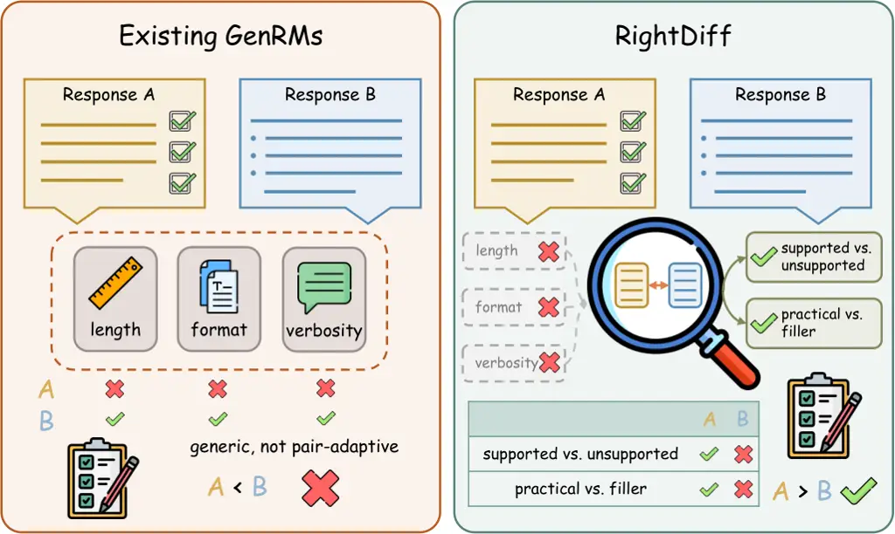
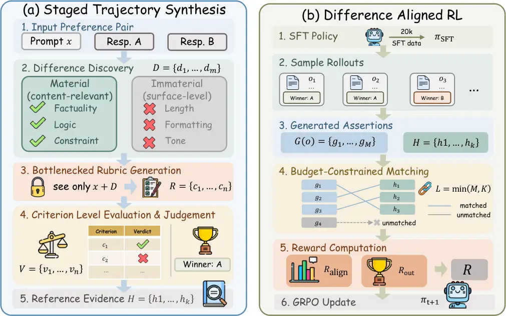

# RightDiff: Learning Generative Reward Models to Judge by the Right Differences

Qiyuan Chen ^(†)^(†)thanks:   Equal Contribution. Affiliation: Zhejiang
University Email: [chenqiyuan1012@gmail.com](mailto:)    Hongsen
Huang¹¹footnotemark: 1 Affiliation: Soochow Securities Co.,Ltd.    Jiahe
Chen Affiliation: Zhejiang University    Renjie Hua Affiliation: Soochow
Securities Co.,Ltd. Affiliation: Nanjing University    Hongxia
Xu²²footnotemark: 2 Affiliation: Zhejiang University    Chuan Ren
^(†)^(†)thanks:   Corresponding Author. Affiliation: Soochow Securities
Co.,Ltd.    Jian Wu Affiliation: Zhejiang University

###### Abstract

Generative reward models typically rely on generic query-level rubrics
or unconstrained rationales, overlooking the fact that pairwise
preference is driven by response-specific differences. Moreover,
optimizing solely for outcome correctness encourages models to exploit
superficial shortcuts such as verbosity and formatting, triggering
rationale drift. To address this, we propose RightDiff, which structures
pairwise evaluation into an evidence-grounded evaluation trajectory
executed in a single autoregressive generation. RightDiff explicitly
discovers contrastive differences between candidates, categorizes them
into material or immaterial factors, and induces pair-specific rubrics
before final adjudication. To train this process without post-hoc
rationalization, we synthesize demonstration data via response-isolated
prompts and optimize the reward model with a difference-alignment reward
regularized by budget-constrained one-to-one matching and multiplicative
gating. RightDiff achieves state-of-the-art preference modeling
performance on RewardBench and RM-Bench, surpassing all open-source
reward models and leading proprietary LLM judges. Downstream, it
provides reliable supervision for direct preference optimization on
Arena-Hard and AlpacaEval while effectively resisting length shortcuts.

## 1 Introduction

Generative reward models (GenRMs) explicitly generate evaluation
rationales or scoring criteria before predicting preferences (Zhang et
al., 2025; Mahan et al., 2024; Ye et al., 2024), providing a more
flexible and interpretable mechanism for preference assessment with
large language models (Zheng et al., 2023; Yuan et al., 2024). In
particular, rubric-based GenRMs construct evaluation criteria
conditioned on the query and then compare candidate responses
accordingly (Kim et al., 2024a; Liu et al., 2026b). However, pairwise
preference judgment is inherently relative: what distinguishes two
particular responses is often more informative than a generic set of
criteria elicited from the query alone, and the final preference may
hinge on only a few response-specific differences.



Figure 1: Finding the right differences for pairwise reward modeling.
Existing GenRMs may rely on shallow differences, while RightDiff
identifies preference-relevant differences to construct pair-specific
rubrics and reach grounded judgments.

This raises a dual problem. First, existing methods typically generate
rubrics directly from the query or exploit response pairs to construct
more discriminative criteria during training (Liu et al., 2026a; Jia et
al., 2026; Xu et al., 2026b; Liu et al., 2026c). Since the evaluation
criteria that matter for a particular comparison can often be determined
only after examining the concrete candidates, we argue that difference
discovery should be an explicit part of GenRM reasoning at inference
time (Liu et al., 2025b; Huang et al., 2026; Chen et al., 2026). Second,
finding differences is not enough: the model must find the _right_
differences. Two responses may differ in many ways, ranging from
superficial properties such as length and formatting to substantive
differences in factuality, instruction following, or reasoning quality.
Under reinforcement learning (Ouyang et al., 2022; Bai et al., 2022; Guo
et al., 2025), when optimization is dominated by final preference
correctness, salient but weakly grounded differences may become
convenient shortcuts for predicting the label (Wang et al., 2026).
Worse, in a rubric-generating GenRM, such shallow differences can be
further abstracted into seemingly plausible evaluation criteria,
yielding a correct preference on the wrong evaluation basis.

This motivates a central question: _among the many differences between
two responses, which ones should actually determine the preference?_ We
refer to these as the _right differences_, formally the
preference-relevant differences that provide valid evidence for human
judgment. Based on this view, we propose RightDiff (Figure 1), which
structures pairwise evaluation into a single autoregressive evaluation
trajectory consisting of four stages: _difference discovery_, _rubric
induction_, _criterion-level evaluation_, and _final adjudication_.
Given a query and two candidates, the model identifies their key
differences, abstracts them into a pair-specific rubric, evaluates both
responses independently under each criterion, and adjudicates the
preference from the resulting verdicts. To discourage outcome
optimization from reinforcing superficial difference shortcuts, we
further introduce _difference-alignment supervision_: an independent
evaluator assesses whether the discovered differences and the derived
rubric are consistent with human-verified reference evidence, providing
an additional training signal beyond final preference correctness (Lai
et al., 2026; Wang et al., 2026).

We systematically evaluate RightDiff across standard preference
benchmarks, including RewardBench and RM-Bench, alongside downstream
policy alignment on Arena-Hard and AlpacaEval. Experimental results show
that RightDiff achieves state-of-the-art overall performance, surpassing
all open-source reward models, including strong scalar and generative
baselines, as well as leading proprietary LLM judges. This advantage is
especially pronounced on subtle and distractor-heavy comparisons such as
RewardBench Chat-Hard and RM-Bench Chat. RightDiff also provides
reliable supervision for downstream direct preference optimization (DPO)
(Rafailov et al., 2023), significantly improving open-ended instruction
following as measured by win rates while remaining robust against
superficial length shortcuts. Further process-level evaluations and
training dynamics confirm that our method mitigates rationale drift by
anchoring decisions in verifiable evidence.

In summary, our contributions are threefold:

- •
  We formalize pairwise reward modeling around discovering
  preference-relevant differences, explicitly distinguishing material
  differences from superficial stylistic variations.
- •
  We propose RightDiff, a structured framework that unifies difference
  discovery, rubric induction, criterion-level evaluation, and final
  adjudication within a single autoregressive generation during
  inference.
- •
  We design a difference-alignment reward, regularized by
  budget-constrained one-to-one matching and multiplicative gating, that
  suppresses superficial shortcut exploitation and improves downstream
  policy alignment.



Figure 2: Overview of RightDiff. (a) Staged Data Synthesis: We construct
cold-start demonstration trajectories through four sequential, decoupled
steps. By isolating candidate responses from the rubric generator, the
model is forced to derive evaluation criteria $`\mathcal{R}`$ strictly
from discovered material differences $`\mathcal{D}`$. Verified
trajectories provide reference evidence
$`\mathcal{H}=(h_{1},\ldots,h_{K})`$ for subsequent training. (b)
Difference-Aligned Reinforcement Learning: The reward model is trained
with Group Relative Policy Optimization (GRPO) using an outcome-aligned
dual reward. A lightweight MetaJudge pairs generated claims with
reference evidence using one-to-one matching within a capacity budget
$`L=\min(M,K)`$, penalizing verbosity and vague claims. The alignment
reward $`R_{\mathrm{align}}`$ is multiplicatively gated with outcome
correctness $`R_{\mathrm{out}}`$ so that positive advantage is granted
only when the model reaches the correct judgment with evidence aligned
to the reference.

## 2 Method

RightDiff turns pairwise reward modeling into a structured, four-stage
reasoning process. Given a prompt $`x`$ and candidate responses
$`(y^{A},y^{B})`$, the model generates an evaluation trajectory
demarcated by explicit semantic tags in a single autoregressive
generation:

```math
\begin{split}\tau=\Big(&{\color[rgb]{0.1211,0.4648,0.707}\texttt{<|diff|>}}\,\mathcal{D}\,{\color[rgb]{0.1211,0.4648,0.707}\texttt{<|/diff|>}}\rightarrow\\
&{\color[rgb]{0.1719,0.6289,0.1719}\texttt{<|rubric|>}}\,\mathcal{R}\,{\color[rgb]{0.1719,0.6289,0.1719}\texttt{<|/rubric|>}}\rightarrow\\
&{\color[rgb]{1,0.4961,0.0547}\texttt{<|eval|>}}\,\mathcal{E}\,{\color[rgb]{1,0.4961,0.0547}\texttt{<|/eval|>}}\rightarrow\\
&{\color[rgb]{0.582,0.4023,0.7422}\texttt{<|judge|>}}\,\mathcal{J}\,\hat{y}\,{\color[rgb]{0.582,0.4023,0.7422}\texttt{<|/judge|>}}\Big).\end{split} \tag{1}
```

The evaluation proceeds across four sequential stages. In \<\|diff\|\>,
the model identifies concrete differences
$`\mathcal{D}=\{d_{1},\ldots,d_{n}\}`$ between $`y^{A}`$ and $`y^{B}`$,
explicitly separating material differences from immaterial surface
features. In \<\|rubric\|\>, the model converts these material
differences into an objective rubric
$`\mathcal{R}=\{c_{1},\ldots,c_{m}\}`$. In \<\|eval\|\>, the model
evaluates both responses independently under each criterion in
$`\mathcal{R}`$ to produce local verdicts
$`\mathcal{E}=\{v_{1},\ldots,v_{m}\}`$. Finally, in \<\|judge\|\>, the
model weighs these criterion-level evaluations to produce a concise
justification $`\mathcal{J}`$ and select the winning response
$`\hat{y}\in\{A,B\}`$.

As illustrated in Figure 2, our framework consists of two main training
stages. First, we synthesize cold-start demonstration trajectories using
an isolated teacher pipeline that deliberately hides candidate responses
when inducing rubrics, so that criteria are derived from the discovered
differences rather than post-hoc justifications. Second, we optimize the
model with reinforcement learning using a difference-alignment reward
that verifies whether generated differences match the reference
evidence, discouraging superficial shortcuts. Although data synthesis
decouples these steps to improve demonstration quality (Figure 2(a)),
our trained model executes the entire trajectory in Eq. (1) within a
single autoregressive generation during inference.

### 2.1 Synthesizing Training Data via Response-Isolated Prompts

When an LLM generates evaluation criteria while viewing both candidate
responses, it often constructs criteria post-hoc simply to defend an
intuitive preference. To mitigate this bias, we synthesize training
demonstrations by separating the teacher generation into four sequential
steps, as depicted in Figure 2(a). The ground-truth preference label
$`y^{\star}`$ is withheld throughout generation and used solely for
post-hoc quality filtering.

#### Step 1: Difference Discovery.

Given instruction $`x`$ and candidates $`(y^{A},y^{B})`$, the teacher
extracts a concise set of pair-specific differences
$`\mathcal{D}=\{d_{1},\ldots,d_{n}\}`$. Each difference
$`d_{i}=\langle\kappa_{i},e_{i}^{A},e_{i}^{B},\ell_{i}\rangle`$
specifies the comparative aspect $`\kappa_{i}`$, quotes supporting
textual spans $`e_{i}^{A}`$ and $`e_{i}^{B}`$, and assigns a materiality
label $`\ell_{i}\in\{\texttt{Material},\texttt{Immaterial}\}`$. A
difference is labeled as Material if it substantively influences factual
correctness, reasoning validity, or explicit constraint fulfillment.
Stylistic variations such as response length, decorative formatting, or
superficial filler are labeled as Immaterial unless specifically
requested by the prompt. The teacher is instructed not to issue
preference judgments at this step, teaching the model to acknowledge
surface variations without treating them as preference evidence.

#### Step 2: Rubric Induction with Response Isolation.

If the teacher can inspect candidate responses $`(y^{A},y^{B})`$ while
drafting criteria, it can bypass the discovered differences
$`\mathcal{D}`$ and write rules directly around salient surface
features. To block direct access to the full response texts during
rubric induction, we exclude $`(y^{A},y^{B})`$ from the rubric prompt:

```math
\mathcal{R}=\mathcal{T}_{\mathrm{rubric}}(x,\mathcal{D}), \tag{2}
```

where $`\mathcal{T}_{\mathrm{rubric}}`$ denotes the teacher’s
rubric-induction module. Because the teacher only observes prompt $`x`$
and differences $`\mathcal{D}`$, it is forced to derive criteria
$`\mathcal{R}=\{c_{1},\ldots,c_{m}\}`$ strictly by abstracting the
identified material differences. Criteria must satisfy two formal
properties: evidence traceability requires every criterion to map
directly to a material difference in $`\mathcal{D}`$, and answer
agnosticism requires criteria to describe objective requirements without
referencing candidate identities or revealing the preferred response.

#### Step 3: Criterion-Level Evaluation.

With rubric $`\mathcal{R}`$ fixed, candidate responses are reintroduced
into the evaluation prompt. The model assesses both candidates against
each criterion independently, producing local verdicts
$`\{v_{1},\ldots,v_{m}\}`$ where each verdict
$`v_{j}\in\{A,B,\texttt{Tie}\}`$ is grounded in explicit reasoning. No
criteria can be added, deleted, or modified during this step.

#### Step 4: Final Adjudication and Quality Filtering.

Finally, the teacher aggregates local verdicts into an overall
evaluation:

```math
(\mathcal{J},\hat{y})=\mathcal{T}_{\mathrm{judge}}(x,y^{A},y^{B},\mathcal{D},\mathcal{R},\mathcal{E}), \tag{3}
```

where $`\mathcal{T}_{\mathrm{judge}}`$ denotes the teacher’s
adjudication module. Instead of relying on unweighted majority voting,
the teacher resolves conflicts by weighting violation severities,
producing an integrated rationale $`\mathcal{J}`$ and final prediction
$`\hat{y}`$. We discard any trajectory where the predicted winner
disagrees with the ground-truth human label or where quoted snippets
cannot be verified verbatim in the responses. For each verified
trajectory, its material differences and corresponding criteria are
serialized into an ordered reference evidence list
$`\mathcal{H}=(h_{1},\ldots,h_{K})`$, providing supervision for
reinforcement learning. The complete prompts for the four synthesis
steps are provided in Appendix B (Figures 7–10).

### 2.2 Reinforcement Learning with Difference Alignment

Supervised fine-tuning (SFT) initializes the model with the syntax of
structured evaluation. However, optimizing solely for final preference
correctness triggers rationale drift: the model quickly learns that
superficial cues such as response length or formatting can predict the
label, prompting it to fabricate plausible-sounding rubrics to justify
those shortcuts. To anchor exploration to verified evidence, we optimize
RightDiff via GRPO (Shao et al., 2024) regularized by a
difference-alignment reward that verifies generated reasoning against
reference evidence, as shown in Figure 2(b).

#### One-to-One Matching with a Capacity Budget.

During reinforcement learning rollouts, the model produces, for each
sampled completion $`o`$, a sequence of generated difference and rubric
claims $`\mathcal{G}(o)=(g_{1},\ldots,g_{M})`$, which are compared
against reference evidence $`\mathcal{H}=(h_{1},\ldots,h_{K})`$. Here
each claim $`g_{i}`$ corresponds to either a declared difference or a
rubric criterion, so $`M`$ denotes the total number of claims.
Unconstrained semantic matching invites two common reward hacking
behaviors: the model can output a single vague statement to match
multiple reference items, or generate dozens of candidate differences to
maximize match coverage through brute-force enumeration.

To block both exploits, we introduce two structural constraints
illustrated in Figure 2(b). First, we apply a capacity budget
$`L=\min(M,K)`$ and retain only the first $`L`$ assertions:

```math
\widetilde{\mathcal{G}}(o)=(g_{1},\ldots,g_{L}). \tag{4}
```

This truncation removes any incentive to pad completions with extraneous
differences. Second, budgeted claims and reference evidence are
evaluated by a lightweight MetaJudge in a single autoregressive
generation. The MetaJudge enforces strict one-to-one matching, mapping
each generated claim $`g_{i}`$ to at most one reference item $`h_{j}`$
with semantic match score $`s_{ij}\in[0,1]`$. This matching problem is
formalized as:

```math
\sigma^{\star}=\argmax_{\sigma\in\Sigma}\sum_{(i,j)\in\sigma}s_{ij}, \tag{5}
```

where $`\Sigma`$ denotes the set of all injective matchings between
budgeted assertions and reference items.

#### Gated Reward Formulation.

The difference-alignment reward $`R_{\mathrm{align}}(o)`$ is computed as
the normalized matching score over reference count $`K`$:

```math
R_{\mathrm{align}}(o)=\frac{1}{K}\sum_{(i,j)\in\sigma^{\star}}s_{ij}. \tag{6}
```

Normalizing by $`K`$ penalizes omitted evidence, directly rewarding high
coverage of substantive preference determinants.

To integrate preference correctness with process alignment, we gate the
rewards multiplicatively:

```math
R(o)=R_{\mathrm{out}}(o)\cdot R_{\mathrm{align}}(o), \tag{7}
```

where $`R_{\mathrm{out}}(o)=\mathbbm{1}[\hat{y}=y^{\star}]`$ indicates
whether the final winner is correct. Incorrect verdicts thus receive
zero reward, and positive advantage accrues only to rollouts that reach
the correct judgment through verified, preference-relevant differences.

#### Policy Optimization via GRPO.

We optimize RightDiff with GRPO (Shao et al., 2024). For each prompt
$`x`$, the model samples $`G`$ rollouts
$`\{o_{1},\ldots,o_{G}\}\sim\pi_{\theta_{\mathrm{old}}}`$ and obtains
scalar rewards $`r_{i}=R(o_{i})`$. Relative advantages within the group
are normalized as:

```math
\widehat{A}_{i}=\frac{r_{i}-\operatorname{mean}(\{r_{1},\ldots,r_{G}\})}{\operatorname{std}(\{r_{1},\ldots,r_{G}\})+\epsilon}, \tag{8}
```

where $`\epsilon>0`$ is a small constant added for numerical stability.
The policy parameters $`\theta`$ are updated by maximizing:

```math
\mathcal{O}(\theta)=\mathbb{E}\Bigg[\frac{1}{G}\sum_{i=1}^{G}\Big(\frac{\pi_{\theta}(o_{i}\mid x)}{\pi_{\theta_{\mathrm{old}}}(o_{i}\mid x)}\widehat{A}_{i}\\
-\beta D_{\mathrm{KL}}\big(\pi_{\theta}(\cdot\mid x)\,\|\,\pi_{\mathrm{ref}}(\cdot\mid x)\big)\Big)\Bigg], \tag{9}
```

where the expectation is taken over prompts and grouped rollouts,
$`\beta`$ controls the strength of the KL regularization, and
$`\pi_{\mathrm{ref}}`$ is a frozen reference policy, which we
instantiate as the SFT checkpoint. Under pure outcome supervision, all
completions reaching the correct label receive identical rewards,
resulting in vanishing intra-group variance
($`\widehat{A}_{i}\approx 0`$). Our gated formulation restores
informative gradient variance across correct answers, reinforcing
reasoning that better matches the reference evidence while suppressing
shortcut exploration.

## 3 Experiments

We evaluate RightDiff to answer four core research questions:

- •
  RQ1 (Multi-Domain Preference Modeling): Does RightDiff excel in
  standard multi-domain preference evaluations? (§3.2)
- •
  RQ2 (Downstream Policy Alignment): Can RightDiff effectively guide
  downstream policy optimization and improve open-ended instruction
  following? (§3.3)
- •
  RQ3 (Reinforcement Learning Formulation and Constraint Ablation): How
  do the reasoning pipeline components and the difference-alignment
  reward design contribute to overall performance? (§3.4)
- •
  RQ4 (Human Consensus and Process Fidelity): Does RightDiff capture the
  consensus differences that humans actually use to form preferences on
  HelpSteer3? (§3.5)

### 3.1 Experimental Setup

#### Training Data.

We collect approximately 109K preference pairs from Skywork Reward
Preference 80K (Liu et al., 2026c), HelpSteer3 (Wang et al., 2025),
Math-DPO-10K (Lai et al., 2024), and Code-Preference-Pairs (Lai et al.,
2026), and use Qwen3.5-397B-A17B to annotate each pair with a structured
evaluation, keeping only examples whose predicted preference matches the
original label. We use 50K examples for SFT. On the remaining data, we
sample 8 judgments per pair from the SFT reward model and retain
comparisons that are answered correctly in 2–6 out of 8 judgments, i.e.,
pairs near the model’s decision boundary; from this pool we sample 5K
comparisons for reinforcement learning. A detailed description of the
four data sources is provided in Appendix A.2.

#### Implementation Details.

We use Qwen3-4B and Qwen3-8B as backbone models and fully fine-tune
both. We first perform SFT for one epoch with a learning rate of
$`1\times 10^{-5}`$ and a global batch size of 64, and then optimize
with RL for 200 steps using $`G=8`$ rollouts per prompt, a learning rate
of $`1\times 10^{-6}`$, and a maximum completion length of 4,096 tokens.
All experiments are conducted on 16 NVIDIA A100 GPUs. The full training
configuration is described in Appendix A.4.

|                             |             |           |        |         |         |          |      |      |        |         |      |
| --------------------------- | ----------- | --------- | ------ | ------- | ------- | -------- | ---- | ---- | ------ | ------- | ---- |
| Models                      | RewardBench |           |        |         |         | RM-Bench |      |      |        |         | Avg. |
|                             | Chat        | Chat-Hard | Safety | Reason. | Overall | Chat     | Math | Code | Safety | Overall |      |
| LLM-as-a-Judge              |             |           |        |         |         |          |      |      |        |         |      |
| Claude-3-5-sonnet-20240620  | 96.4        | 74.0      | 81.6   | 84.7    | 84.2    | 62.5     | 62.6 | 54.4 | 64.4   | 61.0    | 72.6 |
| Llama-3.1-70B-Instruct      | 97.2        | 70.2      | 82.8   | 86.0    | 84.0    | 64.3     | 67.3 | 47.5 | 83.0   | 65.5    | 74.8 |
| GPT-4o-0806                 | 96.1        | 76.1      | 86.6   | 88.1    | 86.7    | 67.2     | 67.5 | 63.6 | 91.7   | 72.5    | 79.6 |
| Scalar Reward Models        |             |           |        |         |         |          |      |      |        |         |      |
| SteerLM-RM-70B              | 91.3        | 80.3      | 92.8   | 90.6    | 88.8    | 56.4     | 53.0 | 49.3 | 51.2   | 52.5    | 70.7 |
| Eurus-RM-7b                 | 98.0        | 65.6      | 81.4   | 86.3    | 82.8    | 59.9     | 60.2 | 56.9 | 86.5   | 65.9    | 74.4 |
| InternLM2-7B-Reward         | 99.2        | 69.5      | 87.2   | 94.5    | 87.6    | 61.7     | 71.4 | 49.7 | 85.5   | 67.1    | 77.4 |
| ArmoRM-Llama3-8B-v0.1       | 96.9        | 76.8      | 90.5   | 97.3    | 90.4    | 67.8     | 57.5 | 53.1 | 92.4   | 67.7    | 79.1 |
| Generative Reward Models    |             |           |        |         |         |          |      |      |        |         |      |
| RubricARM-Qwen3-8B          | 90.8        | 81.0      | 59.3   | 82.2    | 78.3    | 69.8     | 69.2 | 63.4 | 62.3   | 66.2    | 72.2 |
| RubricARROW-Qwen3-8B        | 90.2        | 81.1      | 63.8   | 79.1    | 78.6    | 67.7     | 71.0 | 66.6 | 71.4   | 69.2    | 73.9 |
| RubricRM-Qwen3-8B           | 92.2        | 76.2      | 83.9   | 78.4    | 82.7    | 61.6     | 69.9 | 59.2 | 89.2   | 70.0    | 76.3 |
| RM-R1-DeepSeek-Distilled-7B | 88.9        | 66.2      | 78.4   | 87.0    | 80.1    | 64.0     | 83.9 | 56.2 | 85.3   | 72.4    | 76.3 |
| RM-R1-Qwen2.5-7B-Instruct   | 94.1        | 74.6      | 85.2   | 86.7    | 85.2    | 66.6     | 67.0 | 54.6 | 92.6   | 70.2    | 77.7 |
| FARE-Qwen3-8B               | 96.5        | 70.7      | 85.7   | 89.2    | 85.5    | 62.0     | 71.6 | 59.2 | 89.4   | 70.5    | 78.0 |
| JudgeLRM-Qwen3-8B           | 96.6        | 60.5      | 77.8   | 93.7    | 82.2    | 54.2     | 86.4 | 65.5 | 91.3   | 74.4    | 78.3 |
| Ours                        |             |           |        |         |         |          |      |      |        |         |      |
| RightDiff-Qwen3-4B          | 89.7        | 81.0      | 84.7   | 84.2    | 84.8    | 71.2     | 73.8 | 60.3 | 91.0   | 74.1    | 79.5 |
| RightDiff-Qwen3-8B          | 89.4        | 82.6      | 86.0   | 86.2    | 86.1    | 73.1     | 75.9 | 63.2 | 92.4   | 76.1    | 81.1 |

Table 1: Pairwise preference evaluation results on RewardBench and
RM-Bench across diverse domains. Bold and underlined values denote the
best and second-best results in each column, respectively (ties are all
marked). “Avg.” represents the macro-average of the overall accuracy
across the two benchmarks. RightDiff surpasses all open-source
generative and scalar reward models in terms of the overall average, and
outperforms proprietary LLM judges on both the overall average and
subtlety-focused evaluations.

#### Evaluation Benchmarks and Metrics.

We evaluate RightDiff as a pairwise reward model on two widely used
reward-modeling benchmarks: RewardBench (Lambert et al., 2025) and
RM-Bench (Liu et al., 2025a). RewardBench measures preference
discrimination across Chat, Chat-Hard, Safety, and Reasoning. RM-Bench
probes sensitivity to response content while penalizing reward models
that can be swayed by stylistic bias, and reports Chat, Math, Code, and
Safety separately. We follow the official splits and scoring rules of
each benchmark, report accuracy (%) per domain, and average the two
overall scores. Detailed benchmark descriptions and the evaluation
baselines are provided in Appendices A.1 and A.3.

### 3.2 RQ1: Multi-Domain Preference Modeling Performance

As summarized in Table 1, RightDiff achieves the best macro average
across both RewardBench and RM-Bench, surpassing all open-source reward
models, including leading scalar and generative baselines, and
outperforming proprietary LLM judges on the overall average (81.1 vs.
79.6 for the strongest proprietary judge). This advantage is
particularly evident on challenging subsets involving subtle quality
disparities and stylistic distractors, such as RewardBench Chat-Hard and
RM-Bench Chat, where RightDiff sets a new state of the art. Prior
generative reward models typically rely on generic query-level rubrics
or unconstrained critiques that are vulnerable to superficial noise. In
contrast, explicitly discovering contrastive differences enables
RightDiff to isolate decisive comparative evidence during inference. In
addition, while strong baselines frequently suffer from cross-domain
imbalances by sacrificing conversational alignment or safety for
specialized mathematical reasoning, RightDiff maintains robust and
consistent accuracy across reasoning, coding, dialogue, and safety
tasks. Notably, even our 4B variant surpasses all open-source 7B and 8B
baselines on the overall average and rivals the strongest proprietary
judge (79.5 vs. 79.6). This confirms that structuring pairwise
evaluation into explicit difference-driven reasoning introduces a strong
inductive bias, substantially reducing reliance on sheer parameter
scale.

|                            |            |            |      |      |
| -------------------------- | ---------- | ---------- | ---- | ---- |
| Model                      | Arena-Hard | AlpacaEval |      | AVG  |
|                            | WC         | WC         | LC   |      |
| GPT-4-0314                 | 50.0       | 22.1       | 35.3 | 35.8 |
| Qwen2.5-7B-Instruct        | 51.3       | 33.5       | 36.2 | 40.3 |
| \+ DPO (via Skywork-RM)    | 55.1       | 44.8       | 41.5 | 47.1 |
| \+ DPO (via ArmoRM)        | 50.8       | 37.6       | 38.1 | 42.2 |
| \+ DPO (via UltraFeedback) | 52.8       | 33.7       | 38.7 | 41.7 |
| \+ DPO (via AI Judge)      | 51.0       | 28.8       | 33.4 | 37.7 |
| \+ DPO (via RLCF)          | 54.6       | 36.2       | 37.1 | 42.6 |
| \+ DPO (via RubricRM)      | 52.9       | 47.0       | 41.3 | 47.1 |
| + DPO (via RightDiff-4B)   | 53.8       | 45.8       | 41.6 | 47.1 |
| + DPO (via RightDiff-8B)   | 56.4       | 47.1       | 42.5 | 48.7 |

Table 2: Comparison of different strategies applied to
Qwen2.5-7B-Instruct on Arena-Hard and AlpacaEval. WC denotes the win
rate (against GPT-4-0314 on Arena-Hard), and LC denotes the
length-controlled win rate on AlpacaEval. Bold and underline indicate
the best and second-best results in each column.

### 3.3 RQ2: Downstream Policy Alignment

As shown in Table 2, the discriminative superiority of RightDiff
directly translates into measurable policy improvements when used to
supervise downstream DPO (Rafailov et al., 2023). The policy model
aligned with RightDiff-8B achieves the highest overall win rates on both
Arena-Hard and AlpacaEval, outperforming all existing reward model
baselines. Moreover, the policy optimized via RightDiff achieves the top
length-controlled (LC) win rate on AlpacaEval, whereas baselines often
exploit verbosity as an easy shortcut and drop noticeably once length is
strictly controlled, indicating our resistance to such superficial bias.
Because RightDiff explicitly designates superficial length and
decorative formatting as immaterial differences during preference
adjudication, it provides optimization gradients focused on substantive
content, effectively limiting verbosity inflation in the downstream
policy. In addition, our 4B reward model delivers downstream alignment
results comparable to much larger baseline models, confirming that
difference-grounded evaluation provides stable and robust supervision
for policy post-training.

| Configuration          | RewardBench | RM-Bench | S-Corr (%) $`\downarrow`$ | Avg. \# Diff |
| ---------------------- | ----------- | -------- | ------------------------- | ------------ |
| $`\pi_{\mathrm{SFT}}`$ | 84.2        | 73.5     | 11.5                      | 3.2          |
|    + Outcome-only      | 85.4        | 71.8     | 21.6                      | 2.5          |
|    + Additive          | 85.1        | 74.0     | 10.2                      | 3.8          |
|    + $`w/o`$ Budget    | 85.8        | 75.2     | 6.8                       | 8.1          |
|    + $`w/o`$ 1-to-1    | 85.5        | 74.5     | 9.4                       | 3.5          |
| RightDiff              | 86.1        | 76.1     | 5.1                       | 3.3          |

Table 3: Ablation of reinforcement learning formulations and constraints
on Qwen3-8B. “S-Corr” denotes Spurious Correctness, and Avg. \# Diff is
the average number of generated differences per pair.

### 3.4 RQ3: Reinforcement Learning Formulation and Constraint Ablation

To see whether difference alignment reduces shortcut behavior and
whether our matching rules block reward-hacking paths, we test different
RL designs in Table 3 and track their training in Figure 3.

#### Training Dynamics and Policy Degeneration.

Training solely on final win-or-lose labels causes rationale drift. As
Figure 3 shows, both models reach similar outcome rewards, but the
alignment score of the outcome-only model steadily falls: without
rationale supervision, the model guesses from surface cues rather than
comparing responses carefully. Table 3 shows the consequence:
superficial shortcuts stay competitive on simple benchmarks but fail on
harder ones, sharply increasing spurious correctness (S-Corr), i.e.,
correct verdicts reached without reference-aligned evidence.

#### Reward Formulation and Structural Constraints.

In Table 3, the simple additive reward underperforms because the model
still receives reward for plausible commentary even when it picks the
wrong winner, leading to more ungrounded choices. In addition, removing
the budget constraint encourages the model to cheat by generating too
many differences to game the score. Dropping one-to-one matching
likewise lets broad, vague statements match multiple reference points at
the same time.

Figure 3: Training dynamics of reward optimization under different
supervision signals across 200 training steps. Solid lines denote
RightDiff and dashed lines denote the outcome-only variant without the
difference-alignment reward ($`w/o`$ $`R_{\mathrm{align}}`$). Faint
curves represent raw batch metrics, while bold curves represent smoothed
trends. While both configurations achieve comparable outcome rewards
($`R_{\mathrm{out}}`$), removing the difference-alignment reward causes
a persistent decline in $`R_{\mathrm{align}}`$, validating that pure
outcome optimization leads to rationale drift.

### 3.5 RQ4: Human Consensus and Process Fidelity

To verify whether intermediate reasoning agrees with the reconstructed
reference evidence rather than superficial shortcuts, we evaluate
process fidelity on a benchmark reconstructed from HelpSteer3, where
pairs with human annotator agreement are converted into our structured
difference-and-rubric format, with Qwen3.7-Max serving as the annotator
that produces the reference evidence. We additionally include a
zero-shot, prompt-only baseline that follows the same structured output
format (Diff-Prompted Baseline) for comparison. As shown in Table 4,
while supervised initialization establishes a grounded baseline,
optimizing solely for win-or-lose outcome labels triggers clear
rationale drift: final preference accuracy holds or slightly improves,
yet core evidence recall drops noticeably while spurious correctness
surges, confirming that pure outcome supervision encourages the model to
rely on surface correlations to guess the correct winner. Additive
rewards partially mitigate this degradation, but they still grant
positive credit to plausible statements even when the final judgment is
flawed. In contrast, RightDiff enforces multiplicative gating with
budget-constrained matching, achieving the highest overall preference
accuracy alongside the highest recall of human consensus evidence while
driving spurious correctness to the lowest level, demonstrating that its
evaluation trajectory more consistently recovers the decisive
differences humans actually use.

| Configuration                           | Accuracy (%) $`\uparrow`$ | CER (%) $`\uparrow`$ | S-Corr (%) $`\downarrow`$ |
| --------------------------------------- | ------------------------- | -------------------- | ------------------------- |
| Diff-Prompted Baseline                  | 68.2                      | 42.1                 | 27.6                      |
| $`\pi_{\mathrm{SFT}}`$ (Initialization) | 74.5                      | 68.3                 | 10.8                      |
|    + Outcome-only                       | 75.1                      | 54.1                 | 22.5                      |
|    + Additive                           | 75.8                      | 71.4                 | 9.8                       |
| RightDiff (Full RL)                     | 77.7                      | 79.6                 | 4.6                       |

Table 4: Human consensus fidelity on the reconstructed HelpSteer3
benchmark. All evaluated models output contrastive difference rationales
under the same evaluation protocol. “CER” denotes Core Evidence Recall
against verified human consensus reasons, and “S-Corr” denotes spurious
correctness.

## 4 Related Work

### 4.1 Reward Modeling and Generative Reward Models

Reward models learn evaluation signals from preference data and have
become a core component of aligning language models with human
preferences (Christiano et al., 2017; Stiennon et al., 2020; Ouyang et
al., 2022). Conventional reward models typically map a response to a
scalar score, whereas recent GenRMs formulate evaluation as language
generation, enabling models to produce critiques, rationales, or
judgments before predicting preferences (Zhang et al., 2025; Mahan et
al., 2024; Ye et al., 2024). Subsequent work further strengthens this
paradigm through inference-time reasoning or reinforcement learning (Liu
et al., 2025b; Huang et al., 2026; Chen et al., 2026), while recent
studies show that outcome accuracy alone does not guarantee faithful
evaluation and propose to explicitly supervise the correctness of
reward-model rationales (Lai et al., 2026; Wang et al., 2026). In
contrast to these approaches, which primarily improve the expressiveness
or faithfulness of general evaluation reasoning, our method explicitly
structures pairwise evaluation into _difference discovery, rubric
induction, criterion-level evaluation, and final adjudication_, and
further constrains the discovered differences and derived rubrics
through a difference-alignment reward.

### 4.2 Rubric-Based Reward Modeling

Rubric-based evaluation decomposes response quality into explicit
criteria, enabling more fine-grained and interpretable judgments (Kim et
al., 2024a; Kim et al., 2024b; Hashemi et al., 2024). Recent work
further explores automatically generated and adaptive rubrics (Liu et
al., 2026b; Gunjal et al., 2026; Zhang et al., 2026), with several
methods leveraging paired responses to construct more discriminative or
pair-specific evaluation criteria (Rezaei et al., 2025; Jia et al.,
2026; Xu et al., 2026b; Liu et al., 2026a). However, they typically
treat response contrasts merely as a means to construct or optimize
rubrics. In contrast, we train the GenRM to discover
_preference-relevant differences_ between arbitrary response pairs at
inference time; moreover, an independent evaluator (the MetaJudge)
constrains whether the discovered differences and resulting rubric are
consistent with reference evidence.

## 5 Conclusion

In this paper, we introduced RightDiff, a framework built on the premise
that pairwise preference modeling requires actively discovering the
right differences between competing responses and judging on their
basis. By structuring evaluation into difference discovery, rubric
induction, criterion-level evaluation, and final adjudication, RightDiff
makes criteria traceable to the discovered differences. Furthermore, our
difference-alignment reward effectively suppresses superficial shortcuts
and the reward hacking behaviors that exploit them. Extensive
evaluations demonstrate that RightDiff achieves state-of-the-art
preference modeling accuracy on RewardBench and RM-Bench, surpassing all
open-source reward models and leading proprietary LLM judges, exhibits
strong parameter efficiency, and delivers robust guidance for downstream
policy alignment while resisting length shortcuts.

## Limitations

While RightDiff demonstrates strong performance across diverse
preference modeling benchmarks, several directions remain to be
explored. First, our experiments primarily focus on Qwen-based backbones
at the 4B and 8B scales. Although the consistent gains across both model
sizes suggest that the proposed framework is not tied to a particular
scale, its behavior on substantially larger models or other model
families warrants further investigation. Second, our evaluation mainly
considers pairwise preference modeling and downstream DPO. Extending
difference-driven evaluation to other alignment paradigms, such as
alternative preference optimization algorithms or pointwise and listwise
evaluation settings, is an interesting direction for future work.
Finally, RightDiff generates a structured evaluation trajectory before
producing the final preference, which introduces additional decoding
overhead compared with scalar reward models. Exploring more efficient
trajectory generation or compression techniques may further improve its
practicality.

## References

- Achiam et al. (2023) J. Achiam, S. Adler, S. Agarwal, L. Ahmad, I.
  Akkaya, F. L. Aleman, D. Almeida, J. Altenschmidt, S. Altman, S.
  Anadkat, et al. Gpt-4 technical report. arXiv preprint
  arXiv:2303.08774. Cited by: §A.3.
- Anthropic (2024) A. Anthropic The claude 3 model family: opus, sonnet,
  haiku. Claude-3 Model Card. Cited by: §A.3.
- Bai et al. (2022) Y. Bai, S. Kadavath, S. Kundu, A. Askell, J.
  Kernion, A. Jones, A. Chen, A. Goldie, A. Mirhoseini, C. McKinnon, et
  al. Constitutional ai: harmlessness from ai feedback. arXiv preprint
  arXiv:2212.08073. Cited by: §1.
- Cai et al. (2024) Z. Cai, M. Cao, H. Chen, K. Chen, K. Chen, X.
  Chen, X. Chen, Z. Chen, Z. Chen, P. Chu, et al. Internlm2 technical
  report. arXiv preprint arXiv:2403.17297. Cited by: §A.3.
- Chen et al. (2025) N. Chen, Z. Hu, Q. Zou, J. Wu, Q. Wang, B. Hooi,
  and B. He Judgelrm: large reasoning models as a judge. arXiv preprint
  arXiv:2504.00050. Cited by: §A.3.
- Chen et al. (2026) X. Chen, G. Li, Z. Wang, B. Jin, C. Qian, Y.
  Wang, H. Wang, Y. Zhang, D. Zhang, T. Zhang, et al. Rm-r1: reward
  modeling as reasoning. In International Conference on Learning
  Representations, Vol. 2026, pp. 88313–88342. Cited by: §A.3, §1, §4.1.
- Christiano et al. (2017) P. F. Christiano, J. Leike, T. Brown, M.
  Martic, S. Legg, and D. Amodei Deep reinforcement learning from human
  preferences. Advances in neural information processing systems 30.
  Cited by: §4.1.
- Cui et al. (2023) G. Cui, L. Yuan, N. Ding, G. Yao, B. He, W. Zhu, Y.
  Ni, G. Xie, R. Xie, Y. Lin, et al. Ultrafeedback: boosting language
  models with scaled ai feedback. arXiv preprint arXiv:2310.01377. Cited
  by: §A.3.
- Grattafiori et al. (2024) A. Grattafiori, A. Dubey, A. Jauhri, A.
  Pandey, A. Kadian, A. Al-Dahle, A. Letman, A. Mathur, A. Schelten, A.
  Vaughan, et al. The llama 3 herd of models. arXiv preprint
  arXiv:2407.21783. Cited by: §A.3.
- Gunjal et al. (2026) A. Gunjal, A. Wang, E. Lau, V. Nath, Y. He, B.
  Liu, and S. Hendryx Rubrics as rewards: reinforcement learning beyond
  verifiable domains. In International Conference on Learning
  Representations, Vol. 2026, pp. 127924–127945. Cited by: §4.2.
- Guo et al. (2025) D. Guo, D. Yang, H. Zhang, J. Song, P. Wang, Q.
  Zhu, R. Xu, R. Zhang, S. Ma, X. Bi, et al. Deepseek-r1: incentivizing
  reasoning capability in llms via reinforcement learning. arXiv
  preprint arXiv:2501.12948. Cited by: §1.
- Hashemi et al. (2024) H. Hashemi, J. Eisner, C. Rosset, B. Van Durme,
  and C. Kedzie LLM-rubric: a multidimensional, calibrated approach to
  automated evaluation of natural language texts. In Proceedings of the
  62nd annual meeting of the association for computational linguistics
  (volume 1: Long papers), pp. 13806–13834. Cited by: §4.2.
- Huang et al. (2026) H. Huang, Y. He, H. Zhou, R. Zhang, W. Liu, W.
  Wang, J. Liu, and W. Su Think-j: learning to think for generative
  llm-as-a-judge. In Proceedings of the AAAI Conference on Artificial
  Intelligence, Vol. 40, pp. 31158–31166. Cited by: §1, §4.1.
- Hurst et al. (2024) A. Hurst, A. Lerer, A. P. Goucher, A. Perelman, A.
  Ramesh, A. Clark, A. Ostrow, A. Welihinda, A. Hayes, A. Radford, et
  al. Gpt-4o system card. arXiv preprint arXiv:2410.21276. Cited by:
  §A.3.
- Jia et al. (2026) R. Jia, Y. Yang, Y. Wu, Y. Gai, S. Tao, M. Zhou, J.
  Lin, X. Jiang, and G. Jiang Open rubric system: scaling reinforcement
  learning with pairwise adaptive rubric. arXiv preprint
  arXiv:2602.14069. Cited by: §A.3, §1, §4.2.
- Jiang et al. (2026) H. Jiang, Z. Dong, T. Liu, W. Wang, R. Xu, T.
  Yu, L. Zhang, and H. Wang RUBRIC-arrow: alternating pointwise rubric
  reward modeling for llm post-training in non-verifiable domains. arXiv
  preprint arXiv:2605.29156. Cited by: §A.3.
- Kim et al. (2024a) S. Kim, J. Shin, J. Jang, S. Longpre, H. Lee, S.
  Yun, R. Shin, S. Kim, J. Thorne, M. Seo, et al. Prometheus: inducing
  fine-grained evaluation capability in language models. In
  International Conference on Learning Representations, Vol. 2024,
  pp. 29927–29962. Cited by: §1, §4.2.
- Kim et al. (2024b) S. Kim, J. Suk, S. Longpre, B. Y. Lin, J. Shin, S.
  Welleck, G. Neubig, M. Lee, K. Lee, and M. Seo Prometheus 2: an open
  source language model specialized in evaluating other language models.
  In Proceedings of the 2024 Conference on Empirical Methods in Natural
  Language Processing, pp. 4334–4353. Cited by: §4.2.
- Lai et al. (2024) X. Lai, Z. Tian, Y. Chen, S. Yang, X. Peng, and J.
  Jia Step-dpo: step-wise preference optimization for long-chain
  reasoning of llms. arXiv preprint arXiv:2406.18629. Cited by: §A.2,
  §3.1.
- Lai et al. (2026) Y. Lai, M. Huang, H. Guo, X. Wang, H. Li, S.
  Zhan, L. Zhao, C. Yao, Y. Zhang, Q. Han, et al. R-align: enhancing
  generative reward models through rationale-centric meta-judging. arXiv
  preprint arXiv:2602.06763. Cited by: §A.2, §1, §3.1, §4.1.
- Lambert et al. (2025) N. Lambert, V. Pyatkin, J. Morrison, L.
  Miranda, B. Y. Lin, K. Chandu, N. Dziri, S. Kumar, T. Zick, Y. Choi,
  et al. Rewardbench: evaluating reward models for language modeling. In
  Findings of the Association for Computational Linguistics: NAACL 2025,
  pp. 1755–1797. Cited by: §A.1, §3.1.
- Liu et al. (2024) C. Y. Liu, L. Zeng, J. Liu, R. Yan, J. He, C.
  Wang, S. Yan, Y. Liu, and Y. Zhou Skywork-reward: bag of tricks for
  reward modeling in llms. arXiv preprint arXiv:2410.18451. Cited by:
  §A.3.
- Liu et al. (2026a) D. Liu, F. Yang, X. Wang, S. Yan, J. Chai, J.
  Li, Y. Ban, Z. Mao, W. Lin, and G. Yin CDRRM: contrast-driven rubric
  generation for reliable and interpretable reward modeling. arXiv
  preprint arXiv:2603.08035. Cited by: §1, §4.2.
- Liu et al. (2026b) T. Liu, R. Xu, T. Yu, I. Hong, C. Yang, T. Zhao,
  and H. Wang Openrubrics: towards scalable synthetic rubric generation
  for reward modeling and llm alignment. In Proceedings of the 64th
  Annual Meeting of the Association for Computational Linguistics
  (Volume 1: Long Papers), pp. 17417–17437. Cited by: §1, §4.2.
- Liu et al. (2025a) Y. Liu, Z. Yao, R. Min, Y. Cao, L. Hou, and J. Li
  Rm-bench: benchmarking reward models of language models with subtlety
  and style. In International Conference on Learning Representations,
  Vol. 2025, pp. 44323–44355. Cited by: §A.1, §3.1.
- Liu et al. (2026c) Y. Liu, L. Zeng, Y. Xiao, J. He, J. Liu, C.
  Wang, R. Yan, W. Shen, F. Zhang, J. Xu, et al. Skywork-reward-v2:
  scaling preference data curation via human-ai synergy. In
  International Conference on Learning Representations, Vol. 2026,
  pp. 133805–133838. Cited by: §A.2, §1, §3.1.
- Liu et al. (2025b) Z. Liu, P. Wang, R. Xu, S. Ma, C. Ruan, P. Li, Y.
  Liu, and Y. Wu Inference-time scaling for generalist reward modeling.
  arXiv preprint arXiv:2504.02495. Cited by: §1, §4.1.
- Mahan et al. (2024) D. Mahan, D. Van Phung, R. Rafailov, C.
  Blagden, N. Lile, L. Castricato, J. Fränken, C. Finn, and A. Albalak
  Generative reward models. arXiv preprint arXiv:2410.12832. Cited by:
  §1, §4.1.
- Ouyang et al. (2022) L. Ouyang, J. Wu, X. Jiang, D. Almeida, C.
  Wainwright, P. Mishkin, C. Zhang, S. Agarwal, K. Slama, A. Ray, et al.
  Training language models to follow instructions with human feedback.
  Advances in neural information processing systems 35, pp. 27730–27744.
  Cited by: §1, §4.1.
- Rafailov et al. (2023) R. Rafailov, A. Sharma, E. Mitchell, C. D.
  Manning, S. Ermon, and C. Finn Direct preference optimization: your
  language model is secretly a reward model. Advances in neural
  information processing systems 36, pp. 53728–53741. Cited by: §1,
  §3.3.
- Rezaei et al. (2025) M. Rezaei, R. Vacareanu, Z. Wang, C. Wang, B.
  Liu, Y. He, and A. F. Akyürek Online rubrics elicitation from pairwise
  comparisons. arXiv preprint arXiv:2510.07284. Cited by: §4.2.
- Shao et al. (2024) Z. Shao, P. Wang, Q. Zhu, R. Xu, J. Song, X. Bi, H.
  Zhang, M. Zhang, Y. Li, Y. Wu, et al. Deepseekmath: pushing the limits
  of mathematical reasoning in open language models. arXiv preprint
  arXiv:2402.03300. Cited by: §2.2, §2.2.
- Stiennon et al. (2020) N. Stiennon, L. Ouyang, J. Wu, D. Ziegler, R.
  Lowe, C. Voss, A. Radford, D. Amodei, and P. F. Christiano Learning to
  summarize with human feedback. Advances in neural information
  processing systems 33, pp. 3008–3021. Cited by: §4.1.
- Viswanathan et al. (2026) V. Viswanathan, Y. Sun, X. Kong, M. Cao, G.
  Neubig, and S. Wu Checklists are better than reward models for
  aligning language models. Advances in Neural Information Processing
  Systems 38, pp. 114728–114754. Cited by: §A.3.
- Wang et al. (2026) B. Wang, Y. Liu, Y. Liu, T. Tang, S. Wang, C.
  Gao, C. Zheng, Y. Zhang, L. Yu, S. Liu, et al. Outcome accuracy is not
  enough: aligning the reasoning process of reward models. In
  Proceedings of the 64th Annual Meeting of the Association for
  Computational Linguistics (Volume 1: Long Papers), pp. 41482–41508.
  Cited by: §1, §1, §4.1.
- Wang et al. (2024a) H. Wang, W. Xiong, T. Xie, H. Zhao, and T. Zhang
  Interpretable preferences via multi-objective reward modeling and
  mixture-of-experts. In Findings of the Association for Computational
  Linguistics: EMNLP 2024, pp. 10582–10592. Cited by: §A.3, §A.3.
- Wang et al. (2024b) Z. Wang, Y. Dong, J. Zeng, V. Adams, M. N.
  Sreedhar, D. Egert, O. Delalleau, J. Scowcroft, N. Kant, A. Swope, et
  al. Helpsteer: multi-attribute helpfulness dataset for steerlm. In
  Proceedings of the 2024 Conference of the North American Chapter of
  the Association for Computational Linguistics: Human Language
  Technologies (Volume 1: Long Papers), pp. 3371–3384. Cited by: §A.3.
- Wang et al. (2025) Z. Wang, J. Zeng, O. Delalleau, D. Egert, E.
  Evans, H. Shin, F. Soares, Y. Dong, and O. Kuchaiev HelpSteer3:
  human-annotated feedback and edit data to empower inference-time
  scaling in open-ended general-domain tasks. In Proceedings of the 63rd
  Annual Meeting of the Association for Computational Linguistics
  (Volume 1: Long Papers), pp. 25640–25662. Cited by: §A.2, §3.1.
- Xu et al. (2026a) A. Xu, X. Nguyen, Y. Zhou, C. Wu, C. Xiong, and S.
  Joty Foundational automatic evaluators: scaling multi-task generative
  evaluator training for reasoning-centric domains. In International
  Conference on Learning Representations, Vol. 2026, pp. 138259–138287.
  Cited by: §A.3.
- Xu et al. (2026b) R. Xu, T. Liu, Z. Dong, T. Yu, I. Hong, C. Yang, L.
  Zhang, T. Zhao, and H. Wang Alternating reinforcement learning for
  rubric-based reward modeling in non-verifiable llm post-training.
  arXiv preprint arXiv:2602.01511. Cited by: §1, §4.2.
- Ye et al. (2024) Z. Ye, X. Li, Q. Li, Q. Ai, Y. Zhou, W. Shen, D. Yan,
  and Y. Liu Beyond scalar reward model: learning generative judge from
  preference data. arXiv preprint arXiv:2410.03742. Cited by: §1, §4.1.
- Yuan et al. (2025) L. Yuan, G. Cui, H. Wang, N. Ding, X. Wang, B.
  Shan, Z. Liu, J. Deng, H. Chen, R. Xie, et al. Advancing llm reasoning
  generalists with preference trees. In International Conference on
  Learning Representations, Vol. 2025, pp. 24897–24919. Cited by: §A.3.
- Yuan et al. (2024) W. Yuan, R. Y. Pang, K. Cho, X. Li, S.
  Sukhbaatar, J. Xu, and J. Weston Self-rewarding language models. arXiv
  preprint arXiv:2401.10020. Cited by: §1.
- Zhang et al. (2026) J. Zhang, Z. Wang, L. Gui, S. Mysore
  Sathyendra, J. Jeong, V. Veitch, W. Wang, Y. He, B. Liu, and L. Jin
  Chasing the tail: effective rubric-based reward modeling for large
  language model post-training. In International Conference on Learning
  Representations, Vol. 2026, pp. 133430–133457. Cited by: §A.3, §A.3,
  §4.2.
- Zhang et al. (2025) L. Zhang, A. Hosseini, H. Bansal, S. M. Kazemi, A.
  Kumar, and R. Agarwal Generative verifiers: reward modeling as
  next-token prediction. In International Conference on Learning
  Representations, Vol. 2025, pp. 12476–12505. Cited by: §1, §4.1.
- Zhao et al. (2025) Y. Zhao, J. Huang, J. Hu, X. Wang, Y. Mao, D.
  Zhang, Z. Jiang, Z. Wu, B. Ai, A. Wang, et al. Swift: a scalable
  lightweight infrastructure for fine-tuning. In Proceedings of the AAAI
  Conference on Artificial Intelligence, Vol. 39, pp. 29733–29735. Cited
  by: §A.4.
- Zheng et al. (2023) L. Zheng, W. Chiang, Y. Sheng, S. Zhuang, Z.
  Wu, Y. Zhuang, Z. Lin, Z. Li, D. Li, E. Xing, et al. Judging
  llm-as-a-judge with mt-bench and chatbot arena. Advances in neural
  information processing systems 36, pp. 46595–46623. Cited by: §A.3,
  §A.3, §1.

## Appendix A Experiment Setup

### A.1 Benchmarks

We evaluate pairwise reward quality on two complementary benchmarks,
RewardBench and RM-Bench, which probe different aspects of reward
modeling.

#### RewardBench.

RewardBench (Lambert et al., 2025) is one of the first dedicated
testbeds for reward models, built as triplets that pair each instruction
with a preferred response and an inferior response drawn from real-world
conversations and post-training data. It comprises four subsets: Chat
(350), Chat-Hard (456), Safety (1,431), and Reasoning (740). Chat-Hard
emphasizes adversarial instructions where the preferred response is less
sycophantic or explicitly refuses, whereas Safety and Reasoning
aggregate contrastive pairs from moderation scenarios and math, coding,
and instruction-following sources. Following the official protocol, we
report per-subset accuracy, i.e., the fraction of triplets for which the
chosen response receives the higher reward.

#### RM-Bench.

RM-Bench (Liu et al., 2025a) targets two failure modes that RewardBench
rarely exposes: insensitivity to subtle content differences and
susceptibility to stylistic bias. Each query pairs a stronger response
containing a deliberately injected error with a weaker response that is
restyled to appear superficially more polished, so that a reward model
scores well only if it values substance over style. The benchmark covers
four domains, namely Chat (129), Math (529), Code (228), and Safety
(441). In addition, every comparison is instantiated at three difficulty
levels that control how subtly the error is introduced. We report the
official per-domain accuracy averaged over difficulty variants.

### A.2 Training Data

Training comparisons are drawn from four public preference sources that
jointly cover general conversation, mathematics, and code.

Skywork Reward Preference 80K (Liu et al., 2026c) is a large-scale
preference collection spanning chat, safety, mathematics, and code. Its
constituent sources are curated with a combination of rule-based
filtering and human verification, making it a reliable backbone for
general-domain reward model training.

HelpSteer3 (Wang et al., 2025) provides human-annotated preferences over
general, STEM-centric, and multilingual tasks, where each response pair
is accompanied by a free-form response-level rationale written by
professional annotators. Besides serving as a training source, its
official validation split is reused for the human-grounded process
evaluation in Section 3.5.

Math-DPO-10K (Lai et al., 2024) focuses on mathematical reasoning and
constructs step-level preferences by pairing correct steps of long
chain-of-thought solutions against erroneous alternatives.

Code-Preference-Pairs (Lai et al., 2026) is built by mutating seed
programs with deliberately introduced bugs; corrected and broken
versions form preference pairs, and surface artifacts such as error
comments are removed so that the preference cannot be recovered from
stylistic cues.

Following the synthesis pipeline in Section 2.1, each retained pair is
annotated by Qwen3.5-397B-A17B with the four sequential teacher
prompts—contrast, rubric induction (with the candidate responses
withheld), criterion-level evaluation, and adjudication—yielding a
difference set with materiality labels, a pair-specific rubric,
criterion-level verdicts, and a final preference; trajectories whose
predicted preference contradicts the dataset label or whose quoted spans
cannot be verified verbatim in the responses are discarded. The
resulting pool of approximately 109K pairs is partitioned into 50K
comparisons for cold-start SFT and 5K boundary comparisons for RL, where
the boundary pool consists of pairs that the SFT reward model answers
correctly in 2–6 out of 8 judgments.

### A.3 Baselines

We compare RightDiff against reward models from three families,
following the taxonomy of Table 1.

#### LLM-as-a-Judge.

This family prompts off-the-shelf LLMs to directly compare two candidate
responses without any task-specific training (Zheng et al., 2023). We
include GPT-4o-0806 (Hurst et al., 2024), Claude-3.5-Sonnet (Anthropic,
2024), and Llama-3.1-70B-Instruct (Grattafiori et al., 2024). These
judges benefit from broad world knowledge, but they apply no structured
evaluation protocol and are therefore prone to stylistic shortcuts.

#### Scalar Reward Models.

Scalar models map each response to a single score and predict the winner
by comparing scores. They are computationally cheap and often strong on
in-distribution subsets, yet provide no explicit account of why one
response is preferred. We evaluate SteerLM-RM-70B (Wang et al., 2024b),
Eurus-RM-7B (Yuan et al., 2025), InternLM2-7B-Reward (Cai et al., 2024),
and ArmoRM-Llama3-8B (Wang et al., 2024a).

#### Generative Reward Models.

Generative reward models produce free-form textual judgments before
committing to a final preference. This group includes reasoning-enhanced
RMs trained with critique- or RL-based pipelines, such as RM-R1 (Chen et
al., 2026) (evaluated in both its DeepSeek-distilled and
Qwen2.5-instruct variants), JudgeLRM (Chen et al., 2025), and FARE (Xu
et al., 2026a). It also covers rubric-based RMs, which anchor their
judgments in explicit evaluation criteria, namely RubricRM (Zhang et
al., 2026), RubricARM (Jia et al., 2026), and RUBRIC-ARROW (Jiang et
al., 2026).

#### Downstream Alignment Baselines.

For the policy optimization experiments in Section 3.3, we adopt the DPO
configuration of Viswanathan et al. (2026) and align Qwen2.5-7B-Instruct
with preferences derived from different reward sources: the implicit
reward of UltraFeedback (Cui et al., 2023), scalar RMs (Skywork-RM (Liu
et al., 2024) and ArmoRM (Wang et al., 2024a)), pointwise GPT-4o
judgments (Zheng et al., 2023), RLCF (Viswanathan et al., 2026), and the
rubric-based RubricRM (Zhang et al., 2026). We use GPT-4-0314 (Achiam et
al., 2023) as the fixed reference for win-rate computation.

### A.4 Implementation Details

Training data are synthesized by Qwen3.5-397B-A17B with the four-stage
teacher prompts of Section 2.1 (with the candidate responses withheld
during rubric induction); after filtering, we use 50K comparisons for
cold-start SFT and sample 5K boundary comparisons for reinforcement
learning. Both backbones are fully fine-tuned in bfloat16 with
ms-swift (Zhao et al., 2025), which provides the pipeline for both the
SFT and the RL stage.

The SFT stage is trained for one epoch with learning rate
$`1\times 10^{-5}`$, a cosine schedule with 3% warmup, global batch size
64, weight decay 0.1, and gradient-norm clipping at 1.0; we use
DeepSpeed ZeRO stage 1 together with FlashAttention-2 and gradient
checkpointing, with a maximum sequence length of 8,192. The RL stage
runs for 200 steps at learning rate $`1\times 10^{-6}`$ with the same
schedule and regularization settings, samples 16 independent prompts per
step with $`G=8`$ rollouts each at temperature 1.0, uses no KL
regularization, and is optimized with DeepSpeed ZeRO-3, with completions
capped at 4,096 tokens within a maximum sequence length of 8,192
(overlong completions are filtered).

The difference-alignment reward is computed by the MetaJudge,
instantiated with Qwen3.6-35B-A3B and served with vLLM, which performs
strict one-to-one matching between the budgeted claims generated in each
rollout and the reference evidence under the capacity budget
$`L=\min(M,K)`$, producing match scores normalized by the number of
reference items, $`R_{\mathrm{align}}`$; the final reward
multiplicatively gates outcome correctness with alignment,
$`R=R_{\mathrm{out}}\cdot R_{\mathrm{align}}`$.

At inference time, all models are served with vLLM and decoded greedily
(temperature 0) with a maximum of 2,048 generated tokens, with the
thinking mode disabled to match the output template used during
training. To control for position bias, each comparison is also
evaluated with the two candidate responses swapped, and we report the
average accuracy over the two orders.

## Appendix B Prompts

We present the prompts used in this work: the system and user prompts of
the RightDiff judge, which consolidates the four stages into a single
autoregressive generation; the four sequential teacher prompts
(contrast, rubric induction, criterion-level evaluation, and
adjudication) that synthesize the cold-start demonstration data; and the
prompt of the MetaJudge that produces the difference-alignment reward.


Figure 4: RightDiff judge system prompt. At inference, the model
executes the full four-stage trajectory of Section 2—difference
discovery, rubric induction, criterion-level evaluation, and
adjudication—in a single autoregressive generation.


Figure 5: Output contract of the RightDiff judge (continuation of the
system prompt). Explicit semantic tags delimit the four stages, and the
final preference is read off the closing answer tag.


Figure 6: RightDiff judge user prompt. The instruction and the two
candidate responses are filled into the placeholders.


Figure 7: Teacher Stage 1: difference discovery (Step 1 of Section 2.1).
The teacher lists pair-specific differences in both directions, with
verbatim evidence and materiality labels, and must not state a
preference.


Figure 8: Teacher Stage 2: rubric induction with response isolation
(Step 2 of Section 2.1). With the candidate responses withheld, criteria
are derived from the material differences and must satisfy evidence
traceability and answer agnosticism.


Figure 9: Teacher Stage 3: criterion-level evaluation (Step 3 of
Section 2.1). With the rubric frozen, both responses are judged under
each criterion independently, without hinting at the overall verdict.


Figure 10: Teacher Stage 4: final adjudication (Step 4 of Section 2.1).
The teacher weighs the verdicts—rather than counting them—into an
integrated rationale and the final prediction; trajectories that fail
label agreement or verbatim-quote checks are discarded.


Figure 11: MetaJudge prompt. Scores the difference-alignment reward of
Section 2.2 by measuring how well each reference item is achieved by the
generated claims; vague, verdict-only, or ungrounded critiques earn no
credit.
