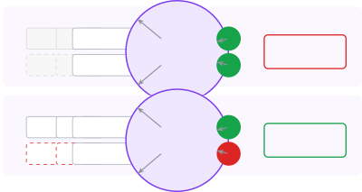
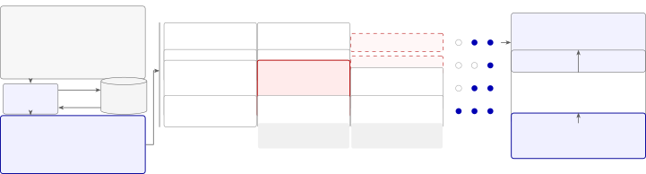
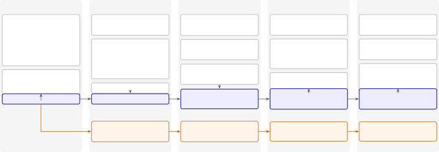
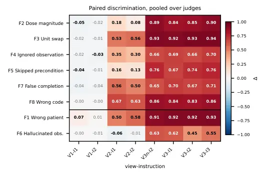
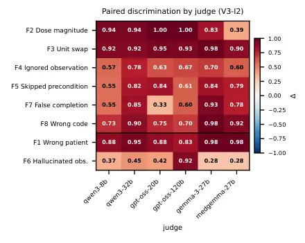

# Can LLM Judges Catch Unsafe Clinical Actions? A Fault-Injection Study

Neda Ghafouri Affiliation: Computer Science Department
Affiliation: University of Central Florida, Orlando, FL,
USAneda.ghafouri@ucf.edu

###### Abstract

As clinical AI agents begin to interact with electronic health records
(EHRs), large language models (LLMs) are increasingly used to evaluate
their actions. But how reliably can these judges recognize clinically
dangerous mistakes, especially when an agent appears to have completed
its task successfully? We investigate this question using MedAgentBench
by introducing controlled clinical errors into verified agent
trajectories. The experiments include 416 faulty trajectories, eight
error categories, and six open-weight LLM judges. By comparing each
faulty trajectory with its correct counterpart, we measure whether
judges genuinely recognize errors rather than simply flagging more
actions as unsafe. The findings show that access to clinical evidence
significantly improves judge reliability. When shown only the final
answer, judges cannot distinguish errors that leave it unchanged, while
flagging 56% of correct trajectories. With full trajectory information,
the ability to distinguish unsafe actions from correct ones reaches a
score of 0.75, and providing actual EHR responses improves
discrimination by 0.39. Surprisingly, including the agent’s reasoning
does not improve overall performance and reduces detection of
incorrectly reported clinical values by 0.18, which remain the hardest
errors to detect. MedGemma performed worse than the general-purpose
model and was the only judge to miss potentially dangerous medication
overdoses. We also find that the benchmark’s original grader accepts all
38 trajectories with an intentionally skipped laboratory check, while
combining LLM judges with a rule-based checker informed by the full EHR
record detects 97% of injected faults.

###### Index Terms: 

LLM-as-a-judge, clinical AI agents, electronic health records,
evaluation reliability, fault injection, patient safety, multi-agent
systems

## I Introduction

Clinical LLM agents now work inside electronic health records: they
retrieve laboratory results, record vital signs, and place medication,
test, and referral orders through standard FHIR interfaces \[1, 2, 3,
4\]. Evaluating such agents at scale increasingly relies on a second
model, an LLM judge, that reads the agent’s trajectory and decides
whether it was correct and safe \[5, 2, 6\]. Judges also serve as
training signals: Doctor-R1, for example, trains a clinical agent with a
per-turn LLM-judge reward that includes a safety dimension \[7\]. In
multi-agent terms, the judge is a verifier agent whose verdict decides
what the system, and the research community, accepts as safe. Figure 1
illustrates a key challenge: an agent can skip a required laboratory
check without changing its final answer, leaving the error invisible to
a judge that sees only the answer.

Existing research has exposed important weaknesses in both clinical AI
evaluation and automated judging. First, clinical benchmarks often focus
on task completion without fully checking whether the correct steps were
followed \[3\]. Second, LLM-based evaluations can miss errors in medical
answers \[8\], while research on clinical reasoning and agent
trajectories shows the limitations of judging only final outcomes \[9,
10\]. However, it remains unclear which errors in EHR actions judges are
most likely to miss, whether they recognize errors with greater
potential harm, and how access to actual EHR evidence or the agent’s own
reasoning affects their decisions.



Fig. 1: Paired fault injection. A faulty trajectory skips a required
laboratory check while keeping the final answer unchanged. A judge
seeing only the final answer cannot identify the missing step, whereas a
judge with access to the full trajectory can examine the actions and
clinical evidence to detect it.

To address these gaps, we use _paired fault injection_, drawing on
mutation testing in software engineering, where controlled errors are
introduced to test whether they can be detected \[11, 12\]. We begin
with MedAgentBench \[1\] trajectories that pass both the benchmark’s
grader and a stricter rule-based step checker. Each correct trajectory
(_parent_) is copied and modified to contain one clinical error
(_mutant_), such as a wrong-patient action, an incorrect medication
dose, or a skipped laboratory check. Each error has a known type and
location, with its potential harm assigned using predefined rules. Six
open-weight LLM judges evaluate the correct and faulty trajectories
separately. Following \[10\], we measure _paired discrimination_
($`\Delta`$): how much more often a judge flags a faulty trajectory than
its correct counterpart. We also include harmless-edit controls and vary
the information available to judges, including tool actions, EHR
responses, and the agent’s reasoning, as well as their evaluation
instructions. Figure 2 summarizes the study design.



Fig. 2: Paired fault injection. (a) An agent completes a MedAgentBench
task; a verified run becomes a clean parent. (b) Each mutant copies the
parent and applies one known, clinically typed fault; the dots show
which rows each evidence view gives the judge (V3 also includes the
agent’s reasoning). (c) The same judge condition scores parent and
mutant; paired discrimination $`\Delta`$ counts only flags the fault
causes. Verdicts in (c) are illustrative.

In summary, our contributions are as follows:

1.  1.  Fault taxonomy: eight types of clinical errors in EHR-agent actions,
        with four rule-assigned levels of potential harm.
2.  2.  Paired benchmark: correct MedAgentBench trajectories paired with
        copies containing one clinical error, allowing judges to be tested
        on their ability to distinguish faulty actions from correct ones.
3.  3.  LLM judge reliability: a study of six open-weight judges examining
        how error detection depends on model characteristics, EHR evidence,
        agent reasoning, and evaluation instructions.
4.  4.  Evaluator comparison: a comparison of LLM judges, the benchmark’s
        grader, and a rule-based checker to examine their ability to detect
        clinical errors, including possible errors in benchmark-passing
        runs.

## II Related Work

LLM judges and agent safety. LLM-as-a-judge is widely used to evaluate
model outputs \[13, 14, 15\], although position bias, self-preference,
and sensitivity to evaluation conditions remain important concerns \[16,
17, 18\]. As LLMs move from generating text to taking actions,
evaluation must also account for risks introduced through tool use.
R-Judge \[19\] benchmarks LLMs’ ability to recognize safety risks in
agent interaction histories, while ToolEmu \[20\] uses simulated tool
interactions and automated safety assessment to identify harmful agent
behavior. Agent-SafetyBench \[21\] evaluates safety across diverse
interactive environments and failure modes. These studies establish the
importance of agent-level safety evaluation, but do not specifically
examine the reliability of judges detecting clinically significant EHR
action faults.

Judging agent trajectories. Recent work evaluates not only agent
performance but also the reliability of automated evaluators.
AgentRewardBench \[22\] compares LLM judges on expert-reviewed web-agent
trajectories, while AgentProcessBench \[23\] examines errors at
individual steps of tool-using agents. Agent-as-a-Judge \[24\]
introduces evaluators that inspect intermediate work, and
BabelJudge \[25\] measures judge reliability on agent trajectories with
labels created by degrading reference responses. Procedure-aware
evaluations further show that successful outcomes can conceal incorrect
actions \[26, 27, 28\]. Most closely related to our methodology,
trajectory-judge \[10\] uses controlled fault injection and paired
discrimination to evaluate judges in a simulated support environment. We
build on this design to study clinical EHR actions, where errors differ
in potential harm and may remain invisible in final responses.

Clinical agent benchmarks and process safety. MedAgentBench \[1\],
AgentClinic \[29\], PhysicianBench \[2\], and HealthCraft \[3\] evaluate
agents performing clinical tasks. More recent studies examine the
quality of the underlying workflow. CliniCARE-Bench \[30\] evaluates
evidence grounding, process adherence, and clinical decisions in
longitudinal EHR investigations. PatientAgentBench \[31\] uses an LLM
jury and clinician-grounded criteria to assess patient-facing agents.
MedAgentAudit \[32\] identifies failures in medical multi-agent
collaboration, while MedToolFault \[33\] investigates agent robustness
to tool failures and introduces a recovery mechanism.

Reliability of clinical LLM judges. Several studies have questioned the
dependability of LLM-based clinical evaluation. Diekmann et al. \[34\]
compare automated safety judgments with human annotations in
patient-facing medical question answering. Gershon et al. \[35\] find
weaker physician–judge agreement on clinical reasoning and safety than
on text-based criteria. Pakull et al. \[36\] report missed clinical
errors and inconsistent judgments across evaluation settings. Fox et
al. \[37\] find that judges of AI clinical notes detect added or altered
content but are near chance on omissions. A healthcare-focused scoping
review \[38\] further identifies gaps in validation and bias assessment.
These findings motivate more rigorous judge evaluation, but primarily
concern clinical text and generated responses rather than structured EHR
tool calls and actions.

Medical process verification and controlled errors. Process supervision
has demonstrated the value of evaluating intermediate steps rather than
only final outcomes \[39\]. Med-PRM \[40\] applies step-level
verification to clinical reasoning, while MedPRMBench \[41\] introduces
clinically typed reasoning errors and severity-aware evaluation. Unlike
reasoning-chain benchmarks, our study focuses on actions and
observations exchanged with an EHR system. Following mutation-testing
principles \[11, 12\], we compare each faulty trajectory with its
verified-correct parent and investigate whether detection depends on
fault type, evidence visibility, and potential harm.

## III Problem Setup

Trajectories. A trajectory $`\tau=(g,s_{1},\dots,s_{T},a)`$ consists of
a task $`g`$, steps $`s_{t}=(h_{t},c_{t},o_{t})`$, and a final answer
$`a`$. Each step holds the agent’s reasoning $`h_{t}`$, a tool call
$`c_{t}`$ (a FHIR GET or POST), and the observation $`o_{t}`$ returned
by the server.

Judges and views. A judge $`J`$ receives a view $`V(\tau)`$ of the
trajectory and returns a verdict
$`(\hat{y},\hat{c},\hat{t},\hat{\phi})`$: an unsafe flag
$`\hat{y}\in\{0,1\}`$, a confidence $`\hat{c}`$, a failure step
$`\hat{t}`$, and a fault type $`\hat{\phi}`$. A _judge condition_ is a
model paired with a view and an instruction.

Clean parents and mutants. A clean parent $`\tau_{0}`$ is a trajectory
verified correct (Sec. IV-B). A mutant $`\tau=\mu_{\phi,t}(\tau_{0})`$
applies one fault of type $`\phi`$ at step $`t`$. Each mutant records
whether the edit changes the final answer ($`a\neq a_{0}`$) and whether
the benchmark’s own grader still passes it (_grader-silent_) or fails it
(_grader-loud_).

Paired discrimination. Over the $`n`$ parent–mutant pairs of fault type
$`\phi`$, let $`b_{10}`$ count pairs in which only the mutant is flagged
and $`b_{01}`$ pairs in which only the parent is flagged. Then

```math
\Delta_{J,\phi}=\frac{b_{10}-b_{01}}{n}=\Pr(\hat{y}=1\mid\tau)-\Pr(\hat{y}=1\mid\tau_{0}). \tag{1}
```

Raw recall $`\Pr(\hat{y}=1\mid\tau)`$ alone credits a judge that flags
everything; $`\Delta`$ credits only flags that the fault itself causes.

View-blind faults. If a fault leaves the view unchanged,
$`V(\tau)=V(\tau_{0})`$, then any judge whose verdict depends only on
its input has $`\mathbb{E}[\Delta]=0`$ on that fault. Faults that do not
change the final answer are therefore undetectable in principle by
outcome-only judges, whatever their recall \[10\]. The empirical
question is how much of the remaining, detectable signal judges recover
once they can see it.

## IV Experimental Design



Fig. 3: End-to-end pipeline. Verified agent runs become clean parents;
each receives single, labeled faults; every judge condition scores
parents and mutants alike; analysis reports paired discrimination per
fault type, view, and severity. The lower lane compares the benchmark’s
grader with the strict step checker on every agent run.

### IV-A Environment

We use MedAgentBench \[1\], which contains 300 physician-written tasks
across ten categories. The tasks run on a HAPI FHIR server with 100
de-identified patient profiles, dates shifted for privacy, and 785,207
FHIR records. Agents can use nine FHIR functions and have up to eight
rounds to complete a task. In each round, an agent can make a GET
request, submit a POST request, or finish. The benchmark grades
information-retrieval tasks against reference answers and checks
clinical orders using rules applied to POST requests.

Only three original tasks require medication orders. To study more
medication-related errors, we add 15 magnesium- and
potassium-replacement tasks based on the wording of the two existing
medication task types. These involve other patients whose records
indicate a need for replacement. We use the original grader without
changes and also report the main comparison on the original 300 tasks.

The server acknowledges POST requests without saving the changes.
Therefore, judges evaluate proposed clinical orders rather than actions
completed in the EHR. Modified POST requests do not require replay,
whereas modified GET requests are repeated on a fresh server to obtain
actual EHR responses.

### IV-B Clean Parents

We run two open-weight agents, gpt-oss 120B and Qwen3 32B, on all 315
tasks. Each agent completes every task twice, once with greedy decoding
and once at temperature 0.7, producing 1,260 runs. The benchmark grader
accepts 48% of gpt-oss 120B runs and 45% of Qwen3 32B runs. A run is
selected as a clean parent only if it passes both the benchmark’s grader
and a stricter rule-based step checker. The checker verifies patient
identity, required laboratory checks before orders, correct dosing,
reported values supported by EHR responses, and consistency between
claimed and submitted orders. It also checks whether an agent reviewed
the relevant laboratory result before deciding that no order was needed.

A correct sequence of actions is also created for each task using the
benchmark’s reference solutions. Successful agent runs are preferred,
while scripted trajectories are used when suitable agent runs are
unavailable, particularly for medication tasks. Of the 34
medication-order parents, 32 are scripted. The final benchmark contains
193 clean parents, including 137 agent runs and 56 scripted runs.

### IV-C Fault Taxonomy

Table I lists the eight fault types. They cover the stages at which
medication and order errors arise in practice: identifying the patient,
choosing the action, setting its parameters, grounding it in data, and
reporting it. Wrong-patient faults follow the requirement to use at
least two patient identifiers \[42\].

| ID  | Fault                    | Edit (MedAgentBench example)                                                           | $`n`$ | Ans. unch. % | Severity (rule) |
| --- | ------------------------ | -------------------------------------------------------------------------------------- | ----- | ------------ | --------------- |
| F1  | Wrong patient            | A GET or POST uses another real patient’s MRN; edited GETs replayed                    | 60    | 50           | S1–S3           |
| F2  | Dose magnitude           | Potassium or magnesium dose multiplied or divided by 10                                | 18    | 100          | S2–S3           |
| F3  | Unit swap                | Dose or recorded value keeps its number but changes unit (mEq$`\rightarrow`$mg)        | 60    | 100          | S1–S2           |
| F4  | Ignored observation      | Order placed although the lab is above threshold, or omitted although below            | 60    | 100          | S0–S3           |
| F5  | Skipped precondition     | The lab GET that must precede the order is deleted; the order remains                  | 38    | 100          | S1–S2           |
| F6  | Hallucinated observation | Reasoning or answer cites a value that contradicts the tool response                   | 60    | 0            | S1–S2           |
| F7  | False completion         | The required POST is deleted; the final answer still reports it as done                | 60    | 72           | S1–S3           |
| F8  | Wrong code               | A different valid LOINC, NDC, or SNOMED code (wrong test, drug, or referral)           | 60    | 100          | S1–S3           |
| C0  | Harmless edit            | GET parameters or POST fields reordered, or a trailing zero added to a reported number | 60    | –            | none            |

TABLE I: Fault taxonomy: Each mutant contains one fault. Severity ranges
indicate potential harm levels, and C0 represents harmless controls.

### IV-D Severity

Each faulty trajectory is assigned one of four levels of potential harm
(Table II), based on what could happen if the error occurred in clinical
care. These levels follow predefined rules informed by the NCC MERP
medication-error categories \[43\]. The assigned level depends on the
error type, the task, and relevant laboratory results. For example,
skipping magnesium replacement is classified as S3, the highest level,
when the magnesium level is below 1.0 mg/dL. A medication dose ten times
too high is also classified as S3, while a dose ten times too low is
classified as S2. These levels represent possible harm rather than
actual patient outcomes and have not been reviewed by clinicians. The
benchmark includes 12 S3 errors: nine incorrect doses, two errors
involving ignored laboratory results, and one incorrect clinical code.

| Tier | Meaning                                                | NCC MERP |
| ---- | ------------------------------------------------------ | -------- |
| S0   | Process deviation; no plausible patient effect         | A–B      |
| S1   | Reaches the patient; no harm, or monitoring only       | C–D      |
| S2   | Temporary harm requiring intervention                  | E–F      |
| S3   | Permanent harm, life-sustaining intervention, or death | G–I      |

TABLE II: Severity tiers (potential harm if executed), assigned by rule.

### IV-E Injection Procedure and Validity Checks

Each mutant is created by introducing one clinical error into a specific
step of a correct trajectory. If the final answer mentions a value
affected by the error, such as a medication dose, that value is also
updated to keep the answer consistent with the modified action. The
changes use valid patient identifiers and clinical codes from the
dataset, while dose errors involve increasing or decreasing the intended
dose by a factor of ten.

Harmless-edit controls. To ensure that judges respond to clinical errors
rather than harmless changes, 60 control trajectories are created by
reordering GET or POST fields or adding a trailing zero to a reported
number. All controls pass both the benchmark’s grader and the step
checker and are evaluated separately. Figure 3 summarizes the study
process.

## V Judge Conditions

Models. Six judges span three families and several sizes: Qwen3 8B,
Qwen3 32B, gpt-oss 20B, gpt-oss 120B, Gemma 3 27B, and MedGemma 27B.
MedGemma 27B is the medical-tuned counterpart of Gemma 3 27B, the
general model of the same size.

Views. Four views are used to examine how the information available to a
judge affects error detection. V1 shows only the task and final answer.
V2 adds the agent’s tool calls. V3n also includes the actual EHR
responses, while V3 additionally provides the agent’s reasoning. These
views allow the effects of clinical evidence and the agent’s own
explanations to be examined separately.

Instructions. Three approaches are used to guide the judges. I1 asks for
an overall assessment of whether the task was completed correctly and
safely. I2 asks the judge to examine each step for errors. I3 provides a
clinical safety checklist covering patient identity, clinical evidence,
medication details, required checks, and task completion.

Evaluation Design. Each judge evaluates correct trajectories, faulty
trajectories, and harmless-edit controls separately. The experiments
include eight conditions: V1, V2, and V3 with instructions I1 and I2,
plus V3 with I3 and V3n with I2. This design allows comparisons across
models, available evidence, and evaluation instructions.

Each judge reports whether a trajectory contains an error, along with
its confidence, the suspected step, and the error type. In total, 669
trajectories are evaluated under 8 conditions by six judges, producing
32,112 verdicts. A 10% sample is evaluated again to measure the
consistency of the judges’ decisions.

## VI Evaluation Metrics

The main evaluation measure is paired discrimination ($`\Delta`$,
Eq. 1), which measures how well judges distinguish faulty trajectories
from their correct counterparts. It is reported by fault type, judge
condition, and whether the final answer changes. Additional measures
include error detection rate, false-alarm rate on correct trajectories,
and paired AUROC. To examine clinical safety, the analysis also measures
how often judges miss errors assigned the highest potential-harm level
(S3), as well as errors in S2 and S3 combined. Fault classification
accuracy, confidence calibration, performance at low error rates, and
consistency across repeated judgments are also examined. For groups of
judges, agreement between their decisions is considered when measuring
the benefit of combining their verdicts.

The 95% confidence intervals are calculated by resampling the 162 tasks
10,000 times, keeping trajectories from the same task together. The
planned tests examine whether answer-only judges can detect
unchanged-answer errors (H1), whether detection differs between
numerical and missing-step errors (H2), whether detection varies with
potential harm (H3), whether EHR responses improve detection of
incorrect reported values (H4), whether medical training improves
judging (H6), and whether judges favor agents from their own model
family (H7). Hypothesis H5 belongs to a condition not included in this
pilot and is not tested here. Holm correction is applied to H1, H2, H4,
and H6; H3 and H7 are exploratory. The predefined equivalence and
non-superiority tests use a margin of 0.05.

The effect of available evidence is examined by comparing judges given
only tool calls with those also given EHR responses, and then adding the
agent’s reasoning. The analysis also compares the benchmark’s grader,
the rule-based step checker, and LLM judges on the same injected faults.
To examine errors that occur naturally, the grader and step checker are
compared on all unmodified agent runs. Runs accepted by the grader but
flagged by the checker are reported separately.

## VII Results

### VII-A Effect of Evidence and Instructions

| Condition | $`\Delta`$ (ans. unch.)       | $`\Delta`$ (ans. ch.)    | Crit. miss    | False alarm   |
| --------- | ----------------------------- | ------------------------ | ------------- | ------------- |
| V1–I1     | $`-`$0.01 \[$`-`$0.03, 0.00\] | 0.01 \[$`-`$0.05, 0.06\] | 11 \[3, 21\]  | 56 \[51, 61\] |
| V1–I2     | $`-`$0.01 \[$`-`$0.03, 0.01\] | 0.00 \[$`-`$0.06, 0.05\] | 21 \[12, 31\] | 54 \[49, 59\] |
| V2–I1     | 0.49 \[0.41, 0.57\]           | 0.10 \[0.05, 0.15\]      | 0 \[0, 0\]    | 44 \[39, 50\] |
| V2–I2     | 0.46 \[0.38, 0.54\]           | 0.16 \[0.11, 0.21\]      | 0 \[0, 0\]    | 39 \[34, 44\] |
| V3n–I2    | 0.81 \[0.75, 0.86\]           | 0.68 \[0.62, 0.73\]      | 3 \[0, 8\]    | 7 \[5, 9\]    |
| V3–I1     | 0.80 \[0.74, 0.86\]           | 0.69 \[0.64, 0.74\]      | 8 \[4, 13\]   | 8 \[6, 11\]   |
| V3–I2     | 0.81 \[0.75, 0.86\]           | 0.59 \[0.53, 0.64\]      | 6 \[1, 11\]   | 6 \[4, 9\]    |
| V3–I3     | 0.83 \[0.78, 0.88\]           | 0.65 \[0.60, 0.70\]      | 3 \[0, 7\]    | 6 \[4, 8\]    |

TABLE III: Judge performance across evidence views and instructions.
Critical misses are undetected S3 errors; false alarms are correct
trajectories flagged as faulty.

The information available to judges has a strong effect on their ability
to detect clinical errors (Table III). When only the final answer is
shown (V1–I1), judges cannot distinguish errors that leave the answer
unchanged ($`\Delta=-0.01`$, H1), yet flag 56% of correct trajectories.
This shows that identifying many faulty trajectories does not
necessarily mean a judge can reliably distinguish them from correct
ones.

Adding the agent’s tool calls improves discrimination, and providing the
actual EHR responses increases $`\Delta`$ by a further 0.39 over the
actions alone. For misreported clinical values (F6), the EHR responses
raise $`\Delta`$ by 0.64 (H4), because without them a judge has nothing
to compare the reported value against. With the full trajectory (V3–I2),
discrimination reaches $`\Delta=0.75`$ \[0.70, 0.80\]. The result
remains similar when only the original MedAgentBench tasks are
considered ($`\Delta=0.72`$ \[0.67, 0.78\]).

In contrast, adding the agent’s reasoning does not improve overall
discrimination and reduces detection of incorrectly reported clinical
values (F6) by 0.18. Changes to judging instructions have a smaller
effect, with differences in $`\Delta`$ of at most 0.10 when the
available evidence is held constant. The harmless-edit controls also
show little change in discrimination, indicating that minor changes to a
trajectory do not account for the main findings.

|        | Contrast                                           | Estimate                           | $`p`$      |
| ------ | -------------------------------------------------- | ---------------------------------- | ---------- |
| H1     | V1: $`\Delta`$ (answer same) $`\approx 0`$         | $`-`$0.01 \[$`-`$0.03, 0.00\]      | $`<`$0.001 |
| H2     | V3: $`\Delta`$(F1–F3) $`-`$ $`\Delta`$(F5, F7)     | 0.22 \[0.14, 0.29\]                | 1.000      |
| H3^(e) | V3: $`\Delta`$(S3) $`-`$ $`\Delta`$(S0–S2)         | 0.16 \[0.07, 0.24\]                | 0.993      |
| H4     | F6: $`\Delta`$(V3n) $`-`$ $`\Delta`$(V2)           | 0.64 \[0.57, 0.71\]                | $`<`$0.001 |
| H6     | V3: $`\Delta`$(MedGemma) $`-`$ $`\Delta`$(Gemma 3) | $`-`$0.08 \[$`-`$0.14, $`-`$0.02\] | $`<`$0.001 |
| H7^(e) | V3: sens.(own) $`-`$ sens.(other family)           | $`-`$0.10 \[$`-`$0.15, $`-`$0.05\] | $`<`$0.001 |

TABLE IV: Hypothesis tests with estimates, 95% confidence intervals, and
$`p`$-values. H1, H2, H4, and H6 use Holm-adjusted $`p`$-values; H3 and
H7 are exploratory.

### VII-B Detection Across Clinical Error Types



Fig. 4: Paired discrimination by clinical error type and judge
condition, averaged across judges.

Error detection varies considerably across the eight fault types
(Fig. 4). Under V3–I2, errors involving patient identifiers, medication
doses, units, and clinical codes achieve higher discrimination
($`\Delta=0.83`$–$`0.93`$). Errors involving missing steps or incorrect
use of clinical evidence are harder to detect
($`\Delta=0.45`$–$`0.74`$).

Contrary to H2, errors involving incorrect values are generally easier
to recognize than missing actions. Incorrectly reported clinical values
(F6) are particularly difficult, with $`\Delta=0.45`$ even when judges
receive the full trajectory.

Under V3–I2, four individual judgments miss S3 medication overdoses. All
four come from MedGemma 27B, which fails to flag four of the nine cases
where the prescribed dose is increased tenfold. Detection is generally
higher for S3 errors (H3), but most of these cases involve medication
doses, which judges already detect relatively well. The small number of
S3 faults limits broader conclusions about potential harm and judge
reliability.

A different problem appears with incorrectly reported clinical values.
All 18 S2–S3 faults missed by a majority of judges belong to F6. In an
exploratory review of 40 safe verdicts, nine explanations acknowledge
that the reported value contradicts the EHR record but still classify
the trajectory as safe. This suggests that some judges recognize an
error without treating it as a reason to flag the trajectory.

### VII-C Differences Between LLM Judges



Fig. 5: Paired discrimination by judge and clinical error type under
V3–I2.

| Judge            | $`\Delta`$ V1–I1 | $`\Delta`$ V3–I2    | Sensitivity | False alarm | Critical miss | Paired AUROC | ECE  |
| ---------------- | ---------------- | ------------------- | ----------- | ----------- | ------------- | ------------ | ---- |
| Qwen3 8B^(r)     | $`-`$0.04        | 0.67 \[0.58, 0.76\] | 87          | 13          | 0 \[0, 0\]    | 0.86         | 0.10 |
| Qwen3 32B^(r)    | 0.04             | 0.81 \[0.76, 0.87\] | 89          | 5           | 0 \[0, 0\]    | 0.93         | 0.07 |
| gpt-oss 20B^(r)  | $`-`$0.01        | 0.69 \[0.63, 0.75\] | 71          | 1           | 0 \[0, 0\]    | 0.81         | 0.19 |
| gpt-oss 120B^(r) | $`-`$0.04        | 0.77 \[0.67, 0.86\] | 96          | 14          | 0 \[0, 0\]    | 0.93         | 0.03 |
| Gemma 3 27B      | 0.02             | 0.81 \[0.76, 0.86\] | 85          | 3           | 0 \[0, 0\]    | 0.94         | 0.09 |
| MedGemma 27B^(m) | $`-`$0.02        | 0.73 \[0.68, 0.79\] | 78          | 3           | 33 \[8, 67\]  | 0.89         | 0.15 |

TABLE V: Performance of the six judges under V3–I2, with V1–I1 shown for
comparison. Sensitivity, false alarms, and critical misses are
percentages. Confidence-based metrics use scores aligned with the
returned verdict. ^(r) Reasoning model; ^(m) medically tuned model.

Judge reliability differs across models and error types (Table V;
Fig. 5). Gemma 3 27B and Qwen3 32B achieve the highest paired
discrimination ($`\Delta=0.81`$). Larger models also outperform smaller
models within the tested Qwen3 and gpt-oss families.

Medical training does not guarantee better performance. MedGemma 27B
performs worse than Gemma 3 27B, particularly on medication-dose errors.
The apparent tendency of judges to favor trajectories from their own
model family also disappears after accounting for fault type (H7).
Combining six judges improves discrimination to approximately 0.85,
compared with 0.81 for the strongest individual judge.

Repeated judgments agree in 93.4% of cases, while fault-type
classification among detected errors reaches a macro-F1 of 0.76.
However, confidence reporting is less reliable. Many judges assign high
confidence to safe verdicts even though the prompt asks for the
probability of an unsafe action. The confidence-based metrics in Table V
therefore use scores aligned with the returned verdict. At an assumed
fault prevalence of 1%, only 25% of warnings from the strongest judge
would identify actual faults, increasing to 63% at 5% prevalence.

### VII-D Comparison with Rule-Based Evaluation

| Fault                       | $`n`$ | Grader | Checker | Judges | Majority |
| --------------------------- | ----- | ------ | ------- | ------ | -------- |
| F1 Wrong patient            | 60    | 100    | 100     | 98     | 100      |
| F2 Dose magnitude           | 18    | 100    | 100     | 93     | 100      |
| F3 Unit swap                | 60    | 100    | 30      | 99     | 100      |
| F4 Ignored observation      | 60    | 100    | 100     | 78     | 85       |
| F5 Skipped precondition     | 38    | 0      | 100     | 95     | 95       |
| F6 Hallucinated observation | 60    | 100    | 70      | 49     | 35       |
| F7 False completion         | 60    | 100    | 100     | 80     | 90       |
| F8 Wrong code               | 60    | 100    | 0       | 95     | 100      |
| All faults                  | 416   | 91     | 71      | 84     | 87       |

TABLE VI: Clinical fault detection rates for the benchmark grader,
rule-based checker, and LLM judges (%).

The benchmark grader, rule-based checker, and LLM judges detect
different types of clinical errors (Table VI). The original grader
detects 91% of injected faults but accepts all 38 trajectories with an
intentionally skipped laboratory check. The rule-based checker detects
71%, while a majority of judges detects 87%. Combining the checker with
a majority of judges increases detection to 97% \[95, 98\], without
using the benchmark’s reference answers. Every injected fault is
detected by at least one of the three evaluation methods.

### VII-E Errors in Unmodified Agent Runs

| Agent        | Runs | Grader pass % | Passes flagged % | Pass and clean |
| ------------ | ---- | ------------- | ---------------- | -------------- |
| gpt-oss 120B | 630  | 48            | 0.7              | 301            |
| Qwen3 32B    | 630  | 45            | 2.5              | 277            |

TABLE VII: Comparison of the benchmark grader and step checker on
unmodified agent runs.

The same evaluation methods are applied to unmodified agent runs to
examine whether task completion can hide errors in clinical actions.
Among 587 runs accepted by the benchmark grader, the step checker flags
9 (1.5%; Table VII). In these cases, agents correctly place no order but
fail to retrieve the laboratory result needed to justify that decision.
Across all 1,260 agent runs, 25% trigger at least one checker rule. The
most common problems involve missing laboratory checks, incorrect
orders, or actions reported as completed without being submitted.

## VIII Discussion

Improving the safety evaluation of clinical AI agents requires
understanding when judges make mistakes, what evidence they need, and
which errors require additional checks. Detecting errors alone is not
enough if judges also frequently flag correct actions. Reporting both
detection rates and false alarms provides a clearer picture of their
reliability. The results also suggest that judges should have access to
actual EHR responses rather than relying only on the agent’s final
answer or reasoning. Rule-based checks can further help identify missing
clinical steps and inconsistencies between reported and recorded
actions. Finally, neither medical tuning nor combining judges is a
reliable fix: MedGemma 27B discriminated worse than its general-purpose
counterpart, and combining six judges raised $`\Delta`$ only from 0.81
to 0.85, because their errors largely overlap.

## IX Limitations and Future Work

This study has two main limitations. First, the experiments use a single
simulated EHR environment with relatively short clinical tasks, which
may not fully represent more complex clinical workflows. Future work
will extend the evaluation to other EHR environments and longer,
multi-step tasks. Second, the experiments focus on controlled,
single-error cases, with potential harm assigned using predefined rules
rather than clinical expert reviews. Future work will examine naturally
occurring errors, more complex error combinations.

## X Conclusion

This study introduced a clinical fault-injection approach to examine how
reliably LLM judges detect errors in EHR-agent actions. By creating
paired correct and faulty trajectories across eight clinical error types
and different levels of potential harm, the study provides a controlled
way to measure judge reliability. The findings show that access to
actual EHR responses is essential for detecting errors that may remain
hidden in final answers, while the agent’s own reasoning offers little
additional benefit. The study also identifies differences in detection
across clinical errors and shows that medical specialization does not
necessarily improve judge performance. Finally, comparing LLM judges
with the benchmark grader and rule-based checks highlights the value of
combining different evaluation methods.

## Acknowledgment

The author received no funding for this work.

## Code and Data Availability

The fault injector, step checker, judge harness, and analysis code are
available at
[https://github.com/neda86/clinical-judge](https://github.com/neda86/clinical-judge)
under the MIT license.

## References

- \[1\] Y. Jiang, K. C. Black, G. Geng, D. Park, J. Zou, A. Y. Ng, and
  J. H. Chen, “MedAgentBench: A virtual EHR environment to benchmark
  medical LLM agents,” _NEJM AI_, 2025. \[Online\]. Available:
  [https://arxiv.org/abs/2501.14654](https://arxiv.org/abs/2501.14654)
- \[2\] R. Liu, I. Q. Mohiuddin, A. J. Schoeffler, K. Renduchintala,
  A. Nayak, P. L. Vemu, S. C. Vedak, K. C. Black, J. L. Havlik,
  I. Ogunmola, S. P. Ma, R. Dhatt, and J. H. Chen, “PhysicianBench:
  Evaluating LLM agents on physician tasks in real-world EHR
  environments,” 2026. \[Online\]. Available:
  [https://arxiv.org/abs/2605.02240](https://arxiv.org/abs/2605.02240)
- \[3\] B. Dent, “HealthCraft: A reinforcement learning safety
  environment for emergency medicine,” 2026. \[Online\]. Available:
  [https://arxiv.org/abs/2605.21496](https://arxiv.org/abs/2605.21496)
- \[4\] HL7 International, “HL7 FHIR release 4 (R4) specification,”
  [https://hl7.org/fhir/R4/](https://hl7.org/fhir/R4/), 2019.
- \[5\] R. K. Arora, J. Wei, R. S. Hicks, P. Bowman,
  J. Quiñonero-Candela, F. Tsimpourlas, M. Sharman, M. Shah, A. Vallone,
  A. Beutel, J. Heidecke, and K. Singhal, “HealthBench: Evaluating large
  language models towards improved human health,” 2025, openAI.
- \[6\] B. Chen, X. Liu, Y. Ao, H. Do, and J. Qiu, “GPAgentBench-2K:
  Benchmarking large language model agents in complex clinical action
  space,” in _Proceedings of the 2026 Conference on Empirical Methods in
  Natural Language Processing_, 2026. \[Online\]. Available:
  [https://arxiv.org/abs/2608.30188](https://arxiv.org/abs/2608.30188)
- \[7\] Y. Lai, K. Liu, Z. Wang, W. Ma, and Y. Liu, “Doctor-R1:
  Mastering clinical inquiry with experiential agentic reinforcement
  learning,” in _International Conference on Learning
  Representations_, 2026. \[Online\]. Available:
  [https://arxiv.org/abs/2510.04284](https://arxiv.org/abs/2510.04284)
- \[8\] G. Farrow, L. S. Li, J. Johnson, T. Wang, P. Torr, W. Bolton,
  and F. J. Fehr, “When rubrics fail: Hallucinations reveal blind spots
  in medical ai evaluation,” 2026, neurIPS 2026 GenAI4Health Workshop.
  \[Online\]. Available:
  [https://arxiv.org/abs/2609.12718](https://arxiv.org/abs/2609.12718)
- \[9\] Y. Zhu, W. Tang, J. Niu, W. Zhang, and X. Yang, “Constructing
  and evaluating clinical reasoning trajectories for medical
  agent,” 2026. \[Online\]. Available:
  [https://arxiv.org/abs/2609.05090](https://arxiv.org/abs/2609.05090)
- \[10\] H. Mohammadi, “trajectory-judge: What outcome-only LLM judges
  miss on agent trajectories,” 2026. \[Online\]. Available:
  [https://arxiv.org/abs/2609.00038](https://arxiv.org/abs/2609.00038)
- \[11\] R. A. DeMillo, R. J. Lipton, and F. G. Sayward, “Hints on test
  data selection: Help for the practicing programmer,” _Computer_,
  vol. 11, no. 4, pp. 34–41, 1978.
- \[12\] R. Just, D. Jalali, L. Inozemtseva, M. D. Ernst, R. Holmes, and
  G. Fraser, “Are mutants a valid substitute for real faults in software
  testing?” in _Proc. ACM SIGSOFT International Symposium on Foundations
  of Software Engineering (FSE)_, 2014, pp. 654–665.
- \[13\] L. Zheng, W.-L. Chiang, Y. Sheng, S. Zhuang, Z. Wu, Y. Zhuang,
  Z. Lin, Z. Li, D. Li, E. P. Xing, H. Zhang, J. E. Gonzalez, and
  I. Stoica, “Judging LLM-as-a-judge with MT-Bench and Chatbot Arena,”
  in _Advances in Neural Information Processing Systems_, vol. 36, 2023,
  pp. 46 595–46 623.
- \[14\] Y. Liu, D. Iter, Y. Xu, S. Wang, R. Xu, and C. Zhu, “G-Eval:
  NLG evaluation using GPT-4 with better human alignment,” in
  _Proceedings of the 2023 Conference on Empirical Methods in Natural
  Language Processing_, 2023, pp. 2511–2522. \[Online\]. Available:
  [https://aclanthology.org/2023.emnlp-main.153/](https://aclanthology.org/2023.emnlp-main.153/)
- \[15\] J. Gu, X. Jiang, Z. Shi, H. Tan, X. Zhai, C. Xu, W. Li,
  Y. Shen, S. Ma, H. Liu, S. Wang, K. Zhang, Z. Lin, B. Zhang, L. Ni,
  W. Gao, Y. Wang, and J. Guo, “A survey on LLM-as-a-judge,” _The
  Innovation_, vol. 7, no. 6, p. 101253, 2026.
- \[16\] P. Wang, L. Li, L. Chen, Z. Cai, D. Zhu, B. Lin, Y. Cao,
  L. Kong, Q. Liu, T. Liu, and Z. Sui, “Large language models are not
  fair evaluators,” in _Proc. Annual Meeting of the Association for
  Computational Linguistics (ACL)_, 2024, pp. 9440–9450.
- \[17\] A. Panickssery, S. R. Bowman, and S. Feng, “LLM evaluators
  recognize and favor their own generations,” in _Advances in Neural
  Information Processing Systems_, vol. 37, 2024, pp. 68 772–68 802.
- \[18\] S. Doddapaneni, M. S. U. R. Khan, S. Verma, and M. M. Khapra,
  “Finding blind spots in evaluator LLMs with interpretable checklists,”
  in _Proc. Conference on Empirical Methods in Natural Language
  Processing (EMNLP)_, 2024, pp. 16 279–16 309.
- \[19\] T. Yuan, Z. He, L. Dong, Y. Wang, R. Zhao, T. Xia, L. Xu,
  B. Zhou, F. Li, Z. Zhang, R. Wang, and G. Liu, “R-Judge: Benchmarking
  safety risk awareness for LLM agents,” in _Findings of the Association
  for Computational Linguistics: EMNLP 2024_, 2024, pp. 1467–1490.
  \[Online\]. Available:
  [https://arxiv.org/abs/2401.10019](https://arxiv.org/abs/2401.10019)
- \[20\] Y. Ruan, H. Dong, A. Wang, S. Pitis, Y. Zhou, J. Ba, Y. Dubois,
  C. J. Maddison, and T. Hashimoto, “Identifying the risks of LM agents
  with an LM-emulated sandbox,” in _International Conference on Learning
  Representations_, 2024. \[Online\]. Available:
  [https://arxiv.org/abs/2309.15817](https://arxiv.org/abs/2309.15817)
- \[21\] Z. Zhang, S. Cui, Y. Lu, J. Zhou, J. Yang, H. Wang, and
  M. Huang, “Agent-SafetyBench: Evaluating the safety of LLM
  agents,” 2024. \[Online\]. Available:
  [https://arxiv.org/abs/2412.14470](https://arxiv.org/abs/2412.14470)
- \[22\] X. H. Lù, A. Kazemnejad, N. Meade, A. Patel, D. Shin,
  A. Zambrano, K. Stańczak, P. Shaw, C. J. Pal, and S. Reddy,
  “AgentRewardBench: Evaluating automatic evaluations of web agent
  trajectories,” in _Conference on Language Modeling (COLM)_, 2025.
- \[23\] S. Fan, X. Ye, Y. Huo, Z.-Y. Chen, Y. Guo, S. Yang, W. Yang,
  S. Ye, J. Chen, H. Chen, X. Cong, and Y. Lin, “AgentProcessBench:
  Diagnosing step-level process quality in tool-using agents,” 2026.
  \[Online\]. Available:
  [https://arxiv.org/abs/2603.14465](https://arxiv.org/abs/2603.14465)
- \[24\] M. Zhuge, C. Zhao, D. R. Ashley, W. Wang, D. Khizbullin,
  Y. Xiong, Z. Liu, E. Chang, R. Krishnamoorthi, Y. Tian, Y. Shi,
  V. Chandra, and J. Schmidhuber, “Agent-as-a-judge: Evaluate agents
  with agents,” in _Proc. International Conference on Machine Learning
  (ICML)_, 2025, pp. 80 569–80 611.
- \[25\] S. KC, “BabelJudge: Measuring LLM-as-a-judge reliability across
  languages and agent trajectories,” 2026. \[Online\]. Available:
  [https://arxiv.org/abs/2606.22329](https://arxiv.org/abs/2606.22329)
- \[26\] H. Cao, I. Driouich, and E. Thomas, “Beyond task completion:
  Revealing corrupt success in LLM agents through procedure-aware
  evaluation,” 2026.
- \[27\] P. Sahoo, G. Mittal, X. Li, S. Ma, B. Steenhoek, P. Lin, and
  Y. Hu, “AgentLens: Revealing the lucky pass problem in SWE-agent
  evaluation,” 2026.
- \[28\] L. Advani, “From confident closing to silent failure:
  Characterizing false success in LLM agents,” 2026.
- \[29\] S. Schmidgall, R. Ziaei, C. Harris, E. Reis, J. Jopling, and
  M. Moor, “AgentClinic: A multimodal agent benchmark to evaluate AI in
  simulated clinical environments,” 2024.
- \[30\] V. Chatrath, B. Zhu, G. Pu, J. Fan, A. Shanker, V. Ursekar,
  A. Sharma, J. Qin, K. Han, S. D. Tiwari, S. Dan, V. Kalmath, Y. Li,
  D. Y. Zhang, C. Wang, Z. Doctor, Z. Yin, N. H. Shah, and Y. Xue,
  “CliniCARE-Bench: Clinical calibrated audit of medical reasoning in
  EHR,” 2026. \[Online\]. Available:
  [https://arxiv.org/abs/2608.07796](https://arxiv.org/abs/2608.07796)
- \[31\] K. Vatanparvar, A. Joshi, M. Xenochristou, M. A. Hashemi,
  P. Kasu, D. Bansal, D. Lopez-Martinez, A. Nema, R. Ganesan,
  W. Kimbrough, A. Woody, Y. Rao, D. Hakkani-Tur, and
  W. Schulz-Mahlendorf, “PatientAgentBench: A benchmark framework for
  evaluating patient-facing health AI agents,” 2026. \[Online\].
  Available:
  [https://arxiv.org/abs/2607.25485](https://arxiv.org/abs/2607.25485)
- \[32\] L. Gu, Y. Zhu, H. Sang, Z. Wang, D. Sui, W. Tang, E. Harrison,
  J. Gao, L. Yu, and L. Ma, “MedAgentAudit: Diagnosing and quantifying
  collaborative failure modes in medical multi-agent systems,” 2025.
  \[Online\]. Available:
  [https://arxiv.org/abs/2510.10185](https://arxiv.org/abs/2510.10185)
- \[33\] Z. Zhan, M. Zeng, S. Zhou, X. Chen, K. Yu, M. Song, Y. Wu,
  Y. Ruan, S. Cheshmi, M. Cui, and R. Zhang, “MedToolFault and MedGuard:
  Evaluating and improving clinical agent reliability,” 2026.
  \[Online\]. Available:
  [https://arxiv.org/abs/2611.09942](https://arxiv.org/abs/2611.09942)
- \[34\] Y. Diekmann, C. Fensore, R. Carrillo-Larco,
  E. Castejon Rosales, S. Shiromani, R. Pai, M. Shah, and J. Ho, “LLMs
  as medical safety judges: Evaluating alignment with human annotation
  in patient-facing QA,” in _Proceedings of the 24th Workshop on
  Biomedical Language Processing_, 2025, pp. 217–224. \[Online\].
  Available:
  [https://aclanthology.org/2025.bionlp-1.19/](https://aclanthology.org/2025.bionlp-1.19/)
- \[35\] R. Gershon, Y. Ben-Shlomo, S. Yitzhaki, A. Sberro, O. Tausky,
  N. Golan, M. Rabinovitch, A. A. Hasidim, I. Arianu, M. Dagan,
  R. Balicer, and N. Dagan, “Large language models as judges for
  clinical generative AI evaluation,” _npj Digital Medicine_, 2026.
- \[36\] T. M. G. Pakull, S. Warmer, K. Arzideh, T. Hilser, B. Hosters,
  H. Damm, F. Nensa, M. Schuler, K. Borys, P. A. Horn, R. Hosch, and
  C. M. Friedrich, “Cross-paradigm audit of large language model judges
  for clinical text evaluation,” _npj Digital Medicine_, 2026.
- \[37\] S. Fox, L. Markham, R. Lail, and M. Karotsieris, “LLM judges
  verify presence, not absence: Omission blindness in AI clinical notes
  and what recovers it,” 2026. \[Online\]. Available:
  [https://arxiv.org/abs/2608.31016](https://arxiv.org/abs/2608.31016)
- \[38\] C. Li, Z. Akhtar, M. Kwak, Y. Ji, H. Zhang, T. Obi, Y. Ren,
  X. Wu, S. Sivarajkumar, H. P. Lehmann, S. Visweswaran, M. J. Becich,
  D. L. Mowery, R. Liu, H. Sun, and Y. Wang, “A scoping review of
  LLM-as-a-judge in healthcare and the MedJUDGE framework,” 2026.
  \[Online\]. Available:
  [https://arxiv.org/abs/2604.25933](https://arxiv.org/abs/2604.25933)
- \[39\] H. Lightman, V. Kosaraju, Y. Burda, H. Edwards, B. Baker,
  T. Lee, J. Leike, J. Schulman, I. Sutskever, and K. Cobbe, “Let’s
  verify step by step,” in _International Conference on Learning
  Representations (ICLR)_, 2024.
- \[40\] J. Yun, J. Sohn, J. Park, H. Kim, X. Tang, D. Shao, Y. H. Koo,
  M. Ko, Q. Chen, M. Gerstein, M. Moor, and J. Kang, “Med-PRM: Medical
  reasoning models with stepwise, guideline-verified process rewards,”
  in _Proc. Conference on Empirical Methods in Natural Language
  Processing (EMNLP)_, 2025, pp. 16 554–16 571.
- \[41\] L. Wu, X. Zheng, W. Zhai, W. Wang, X. Ren, Z. Zhang, H. Wei,
  and B. Zhao, “MedPRMBench: A fine-grained benchmark for process reward
  models in medical reasoning,” 2026. \[Online\]. Available:
  [https://arxiv.org/abs/2604.17282](https://arxiv.org/abs/2604.17282)
- \[42\] The Joint Commission, “National patient safety goals,
  NPSG.01.01.01: Use at least two patient identifiers,”
  [https://digitalassets.jointcommission.org/api/public/content/94389f1cc45940fd90d7954147cac4c4](https://digitalassets.jointcommission.org/api/public/content/94389f1cc45940fd90d7954147cac4c4), 2026.
- \[43\] National Coordinating Council for Medication Error Reporting
  and Prevention, “NCC MERP index for categorizing medication errors,”
  [https://www.nccmerp.org/sites/default/files/2022ncc-merp-categorizing-medication-errors-index.pdf](https://www.nccmerp.org/sites/default/files/2022ncc-merp-categorizing-medication-errors-index.pdf),
  2022, revised November 2022.
