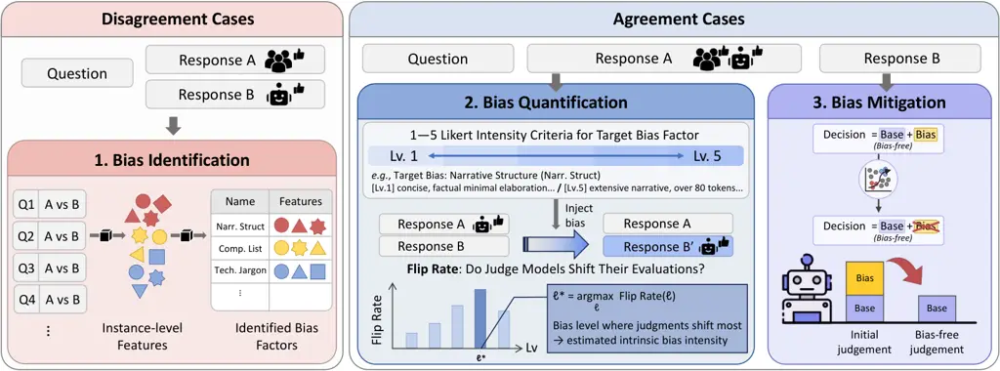
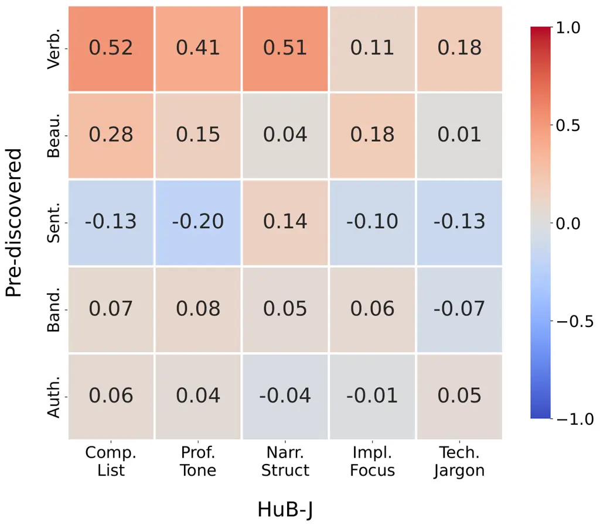
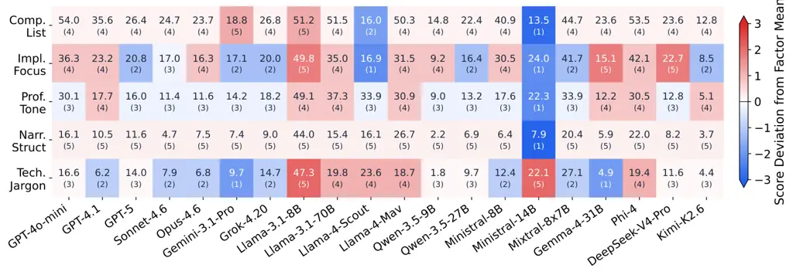
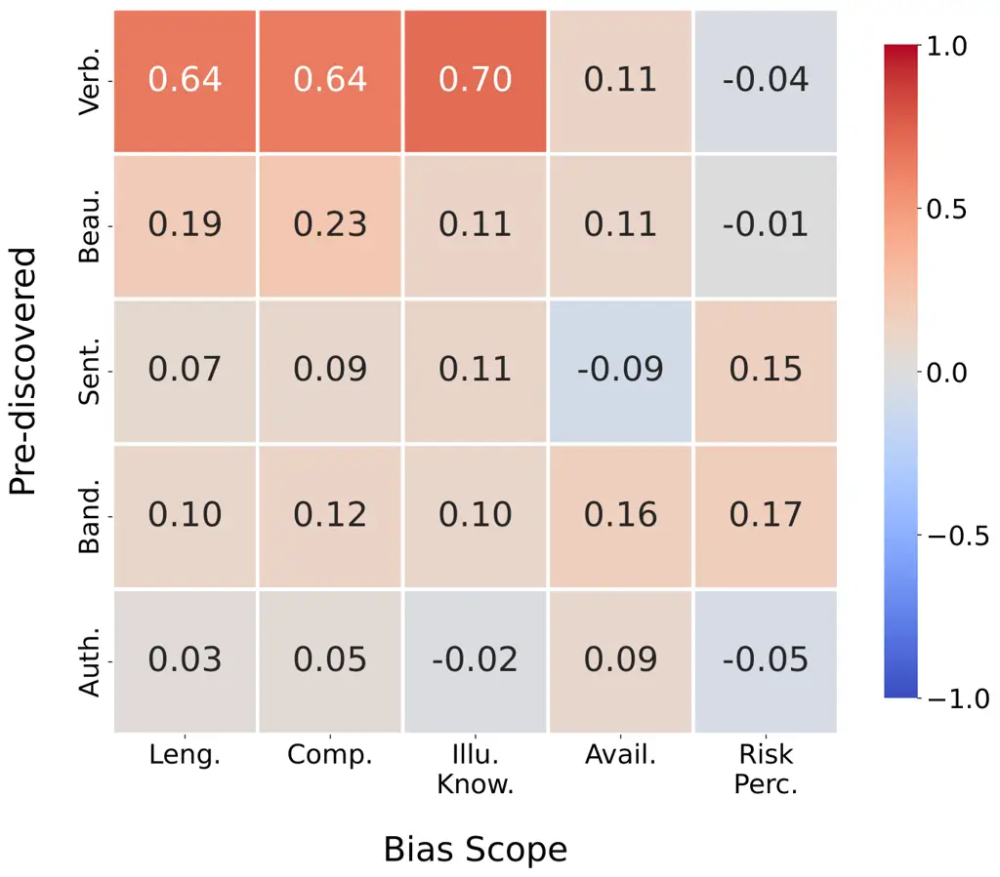
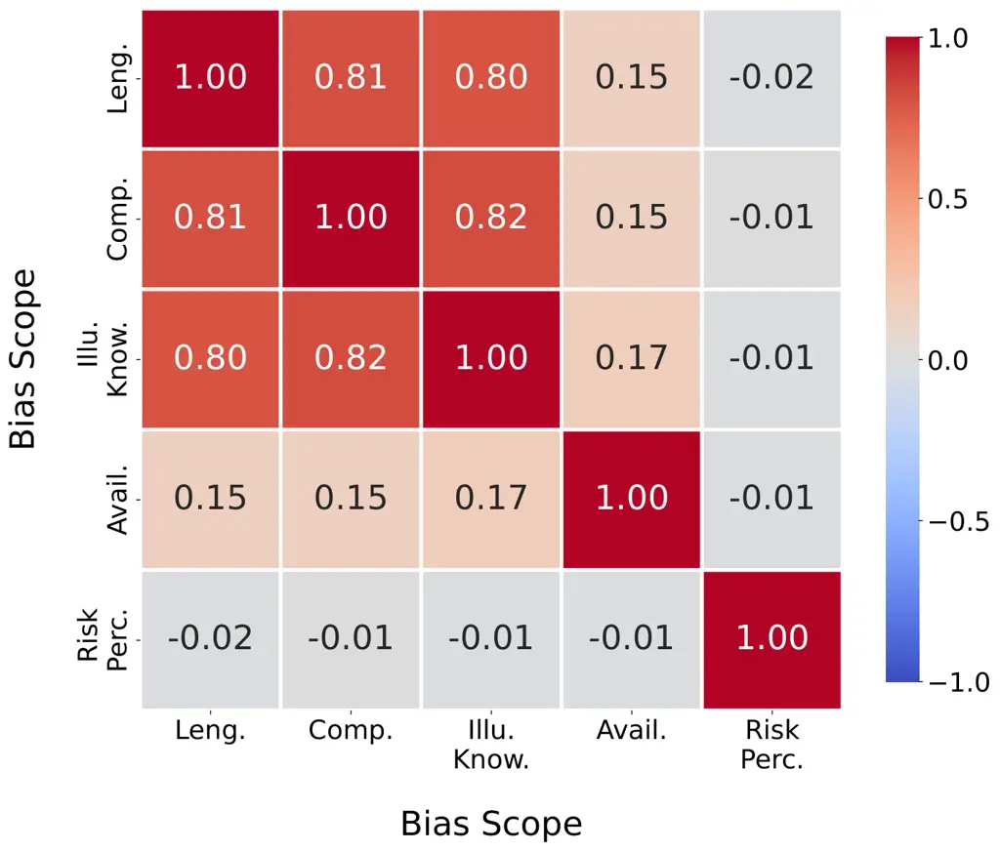
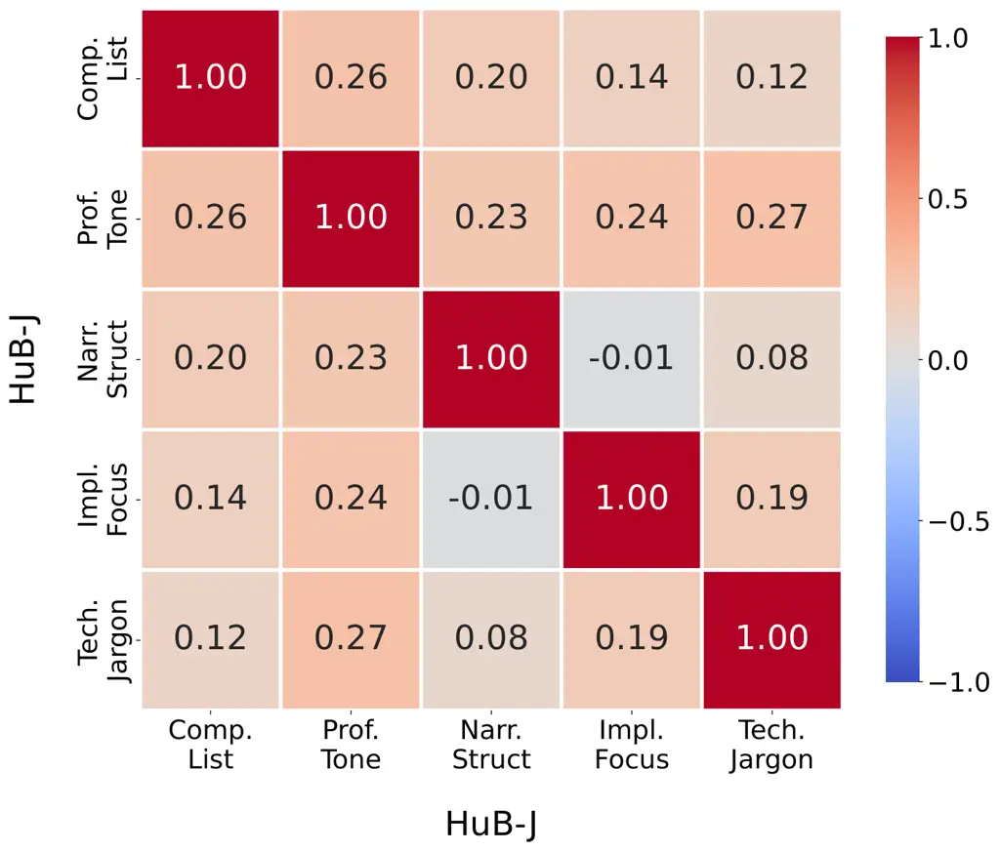
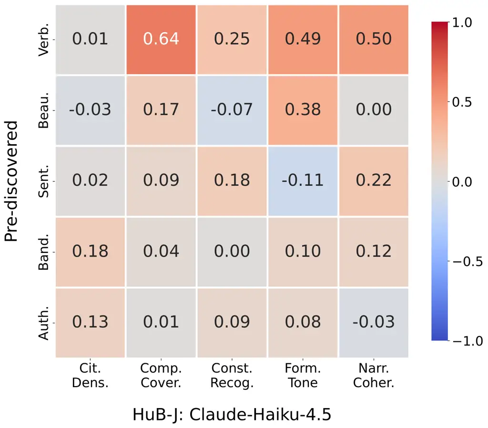
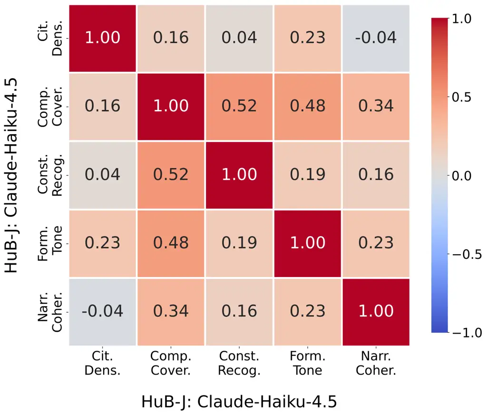
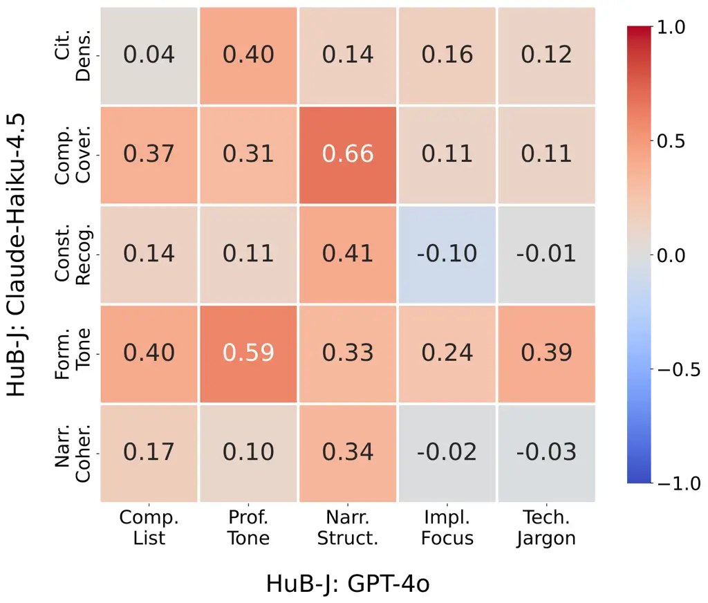

# Auditing the Judge: Human-Derived Bias Discovery, Quantification, and Mitigation in LLM Judges

Hamin Koo ^(†)^(†)thanks: Equal contribution. Affiliation: Yonsei
University Email: [hamin2065@yonsei.ac.kr](mailto:)    Chanjoo
Jung¹¹footnotemark: 1 Affiliation: Yonsei University
Email: [chanjoo0427@yonsei.ac.kr](mailto:)    Fangzhao Wu
Affiliation: Microsoft Research Asia    Jaehyung Kim Affiliation: Yonsei
University

###### Abstract

While Large Language Models (LLMs) are increasingly deployed as
automated evaluators in evaluation and training pipelines, their
judgements are often affected by systematic biases that conflict with
human preferences. Although prior work has identified various biases and
proposed methods for detecting and mitigating them, less attention has
been paid to using human preferences to inform bias identification and
mitigation. Moreover, these approaches rely heavily on pre-discovered
bias lists, overlook bias strength, and depend on costly interventions.
In this work, we propose HuB-J, an integrated framework based on
human-derived bias factors that detects, quantifies, and mitigates
biases in LLM-as-a-Judge systems. Our approach leverages human–LLM
judgement disagreement cases to automatically discover interpretable
bias factors, and utilizes agreement cases to quantify bias strength
through controlled input modifications and resulting shifts in model
decisions. Finally, building on these quantified biases, we introduce a
lightweight, training-free regression-based mitigation strategy that
estimates the influence of each bias factor on model judgments and
corrects bias-influenced decisions by removing its estimated effect.
Empirical results show that HuB-J uncovers both known and novel bias
factors, reveals meaningful differences in model susceptibility, and
consistently reduces bias-driven decision flips while generalizing
across models.

|                                                                                                 |
| ----------------------------------------------------------------------------------------------- |
|  Project page: [github.io/HUB-J_project_page/](https://hamin2065.github.io/HUB-J_project_page/) |
|  Code: [github.com/hamin2065/HUB-J](https://github.com/hamin2065/HUB-J)                         |

## 1 Introduction

With recent advancements in Large Language Models (LLMs), LLM-based
evaluation (often referred to as LLM-as-a-Judge) has been increasingly
adopted in both evaluation and training pipelines, making their
reliability an important problem \[38, 36, 17, 20, 26\]. One major
concern is systematic evaluation biases \[29, 37, 9\] in LLM judges,
where LLM judges prefer one response over another based on factors that
do not reflect genuine response quality or human evaluators’
preferences. For example, \[38\] identified position and verbosity
biases, where LLM judges favor responses based on their presentation
order or length rather than the actual content of the answer. However,
manually discovering such biases remains challenging, as they are often
implicit and costly to annotate at scale. This has motivated recent
studies on automatic bias discovery and analysis with LLMs\[15, 35\].

However, prior approaches face fundamental limitations. First, in bias
identification, the exploration of new candidates relies heavily on
pre-discovered bias lists or LLM reasoning, which inherently constrains
the search space; moreover, this identification is conducted in an
instance-wise and model-specific manner, which limits the
generalizability of the discovered biases \[15\]. Second, in bias
quantification, prior studies largely treat bias as a binary phenomenon
whether a bias flips the judge’s decision, offering limited insight into
how strongly each bias manifests in a given judge \[35\]. Third, in bias
mitigation, many existing approaches \[25, 34\] depend on model-specific
interventions, such as additional training or prompt engineering, which
incur substantial training or engineering costs. Overall, these
limitations call for an integrated framework that discovers, quantifies,
and mitigates biases in a manner informed by human evaluation
preferences.

Contribution. In this work, we propose HuB-J, a unified framework to 1)
automatically discover Human-derived Bias factors in LLM Judges, 2)
quantify their model-specific effects, and 3) perform lightweight
debiasing. Our key idea is to derive bias factors from human-LLM
judgement disagreements by using publicly available human preference
datasets: disagreement cases between human labels and LLM judgments are
used to identify biases that drive human–LLM judgment gaps, while
agreement cases are used to quantify how strongly each bias can affect
judgments. Specifically, HuB-J first identifies bias factors from cases
where human and model judgments disagree by extracting instance-level
features and grouping them into interpretable factors. This allows us to
discover biases that emerge from actual disagreement without relying on
a fixed list of known biases. Second, HuB-J quantifies a bias factor
using cases where human and model judgments agree; we define a 1–5
Likert scale for bias intensity and modify the rejected response (i.e.,
the one neither the human nor the model selected) to reflect different
levels of the factor. We then measure whether the judge’s decision flips
in favor of the modified response, and use this flip rate to estimate
each model’s susceptibility to the factor and derive a model-specific
bias profile. Finally, we propose a lightweight regression-based
approach to estimate bias effects and recover counterfactual judgments
in their absence.

The empirical results validate the effectiveness of HuB-J across all
three stages of the framework. In bias identification, HuB-J
successfully discovers bias factors that are strongly supported by
disagreement signals, while also revealing novel bias factors underlying
judge misalignment. For bias quantification, HuB-J reveals
model-specific bias preference profiles, showing that different LLM
judges are susceptible to different factors and effective intensity
levels. For instance, Technical Jargon–a newly discovered,
human-interpretable factor not covered by the baseline bias sets–shows
that different judges respond to it very differently. Also, an extended
experiment with 20 state-of-the-art LLMs further shows that these bias
patterns persist across a broader model pool, suggesting that the
discovered factors capture generalizable judge-specific vulnerabilities.
Finally, our proposed bias mitigation method reduces bias-induced
corruption in judgments, correcting an average of 31.8% of bias-driven
preference deviations. In fact, it remains robust across five judges
spanning diverse model families and scales. Overall, these results
demonstrate that HuB-J provides a unified and effective framework for
discovering, quantifying, and mitigating biases in LLM-as-a-Judge.



Figure 1: Overview of HuB-J, a unified framework for discovering,
quantifying, and mitigating human-derived bias in LLM-as-a-judge
systems. (1) Bias identification uses human–LLM disagreement cases to
extract and cluster instance-level features into bias factors. (2) Bias
quantification uses agreement cases by injecting each factor into
rejected responses across 1–5 Likert levels, defining effective
intensity as the point of strongest model decision shift. (3) Bias
mitigation decomposes judgments into bias-free and bias-attributable
parts, enabling bias estimation and correction.

## 2 Related Work

LLM-as-a-Judge. LLM-as-a-Judge has emerged as a scalable alternative to
human evaluation in open-ended generation, especially in cases where
reference-based metrics fail to reflect human preferences \[14\].
Results from MT-Bench and Chatbot Arena show that strong LLMs can
operate effectively as pairwise evaluators, motivating their use in
model comparison and benchmark development \[38\]. More recent work has
developed evaluator models, automatic evaluation protocols, and
meta-evaluation benchmarks, including G-Eval, PandaLM, Prometheus,
Length-Controlled AlpacaEval, LLMBar, and JudgeBench \[17, 30, 13, 9,
37, 27\]. Beyond evaluation, preference judgements are also important to
alignment pipelines such as reward modeling and reinforcement learning
from human or AI feedback \[22, 4, 16\]. Since these signals influence
both model selection and optimization, their reliability is becoming
increasingly important in practice.

Bias in LLM-as-a-Judge. Prior work shows that LLM judges can be
influenced by superficial factors such as response order, length, and
model identity rather than underlying response quality, leading to
position, verbosity, self-enhancement, and related biases \[24, 38, 29,
7, 23, 11\]. Subsequent studies quantify pre-discovered bias dimensions,
evaluate judge robustness with challenging benchmarks, and explore
automatic bias discovery or debiased judge training \[35, 27, 37, 15,
34\]. Related work also shows that judge preferences can be
reverse-engineered or exploited by optimizing against LLM-judge
feedback \[1\]. At the same time, recent studies have explored automatic
bias discovery in reward models, identification of implicit alignment
objectives, and diagnosis and mitigation of stylistic biases in
preference models \[28, 6, 5\]. However, existing approaches often rely
on pre-discovered factors, validate biases through local perturbations,
or treat bias as a binary flip event \[15, 35\]. In contrast, HuB-J
discovers human-derived bias factors from human–LLM disagreement,
measures model-specific bias strength via controlled intensity scaling,
and reduces their effects without retraining the judge.

## 3 Method

In this section, we present the formal procedure of HuB-J. The full
algorithmic details across all stages are provided in Appendix B.

### 3.1 Preliminaries

We consider a pairwise human preference dataset

```math
\mathcal{D}^{\mathrm{full}}=\{d_{i}=(x_{i},r_{i}^{A},r_{i}^{B},y_{i}^{H})\}_{i=1}^{N},
```

where $`x_{i}`$ is the prompt, $`r_{i}^{A}`$ and $`r_{i}^{B}`$ are the
two candidate responses, and $`y_{i}^{H}\in\{A,B\}`$ is the human
preference label. For each instance, we denote the human-preferred and
human-rejected responses as

```math
r_{i}^{+}=r_{i}^{y_{i}^{H}},\qquad r_{i}^{-}=r_{i}^{\bar{y}_{i}^{H}},
```

where $`\bar{y}_{i}^{H}`$ is the unselected option. For a judge model
$`m`$ with prediction $`y_{i}^{m}=m(x_{i},r_{i}^{A},r_{i}^{B})`$, we
partition $`\mathcal{D}^{\mathrm{full}}`$ into per-model agreement and
disagreement datasets:

```math
\mathcal{D}^{\mathrm{agr}}_{m}=\{d_{i}\in\mathcal{D}^{\mathrm{full}}\mid y_{i}^{m}=y_{i}^{H}\},\qquad\mathcal{D}^{\mathrm{dis}}_{m}=\{d_{i}\in\mathcal{D}^{\mathrm{full}}\mid y_{i}^{m}\neq y_{i}^{H}\},
```

so that, in $`\mathcal{D}^{\mathrm{dis}}_{m}`$, the judge $`m`$ selects
the human-rejected response $`r_{i}^{-}`$ over the human-preferred
response $`r_{i}^{+}`$ while, in $`\mathcal{D}^{\mathrm{agr}}_{m}`$,
both the human and judge $`m`$ select $`r_{i}^{+}`$.

This separation naturally suits the two stages of our framework. We use
$`\mathcal{D}^{\mathrm{dis}}_{m}`$ for bias identification, since cases
where judge $`m`$ favors the human-rejected response can expose latent
biases of the judge model that drive its decisions away from human
preferences. We use $`\mathcal{D}^{\mathrm{agr}}_{m}`$ for bias
quantification because these cases provide a controlled starting point:
both humans and judge $`m`$ originally prefer $`r_{i}^{+}`$ over
$`r_{i}^{-}`$. We then inject a candidate bias factor into the
originally rejected response $`r_{i}^{-}`$ and measure whether judge
$`m`$ switches its preference toward the modified response.

Throughout the following sections, we denote LLM-based generation
modules by $`G_{\bullet}`$, where the subscript specifies the task
performed by each module (e.g., $`G_{\mathrm{extract}}`$ for extracting
interpretable features during the bias identification stage). The prompt
for each module is provided in Appendix H.

### 3.2 Bias Identification

To identify bias factors that generalize across models, we construct a
consensus disagreement subset rather than relying on a single judge
$`m`$, since using only one judge may introduce model-specific
tendencies that limit generalization. Specifically, given a set of
state-of-the-art LLM judges $`\mathcal{M}=\{m_{1},\dots,m_{K}\}`$, we
define a consensus disagreement subset as
$`\mathcal{D}^{\mathrm{dis}}_{\mathcal{M}}=\bigcap_{k=1}^{K}\mathcal{D}^{\mathrm{dis}}_{m_{k}}`$.
This focuses our analysis on cases where multiple LLM judges
consistently disagree with human preferences, rather than being driven
by model-specific effects. Inspired by \[12, 33\], we subsequently
conduct the following pipeline to identify and construct bias factors.

Feature extraction. For each instance
$`d_{i}\in\mathcal{D}^{\mathrm{dis}}_{\mathcal{M}}`$, we use a feature
extraction module $`G_{\mathrm{extract}}`$ to extract a set of features
$`\mathcal{F}_{i}=\{f_{i,j}\}`$, where each $`f_{i,j}`$ captures a
possible reason for the discrepancy between human and LLM judge
preferences for the given response pair. Then, we aggregate these
instance-level features into a global feature pool:

```math
\mathcal{F}=\bigcup_{d_{i}\in\mathcal{D}^{\mathrm{dis}}_{\mathcal{M}}}\mathcal{F}_{i}.
```

Factorization. Using the extracted feature set $`\mathcal{F}`$, our goal
is to construct a compact set of top-$`K`$ bias factors that best
explain $`\mathcal{F}`$. To this end, we conduct the following processes
inspired by RPM \[12\]:

Stage 1: Candidate factor initialization. We first apply K-means
clustering on the feature set $`\mathcal{F}`$ to group semantically
similar features, where each cluster represents a potential latent bias
region. From each cluster, we select the feature closest to the centroid
as its representative. All representatives are passed to
$`G_{\mathrm{construct}}`$, which generates a set of candidate bias
factors $`\mathcal{Z}^{\mathrm{cand}}=\{z_{1},\ldots,z_{M}\},`$ together
with textual descriptions $`t_{z}`$ for each factor. Then, to remove
semantically redundant factors in $`\mathcal{Z}^{\mathrm{cand}}`$, we
apply embedding-based similarity filtering. Each factor $`z`$ is
represented by an embedding $`e_{z}`$, and we compute pairwise cosine
similarity. We obtain a refined factor set
$`\tilde{\mathcal{Z}}\subseteq\mathcal{Z}^{\mathrm{cand}}`$ such that
redundant factors with similarity above threshold $`\tau\in[0,1]`$ are
removed.

Stage 2: Assignment and coverage estimation. Subsequently, we use an
assignment module $`G_{\mathrm{assign}}`$ to map each feature to its
most relevant factor or abstain if no factor sufficiently explains it:

```math
a=G_{\mathrm{assign}}(\mathcal{F},\tilde{\mathcal{Z}}),\quad a:\mathcal{F}\rightarrow\tilde{\mathcal{Z}}\cup\{\bot\}.
```

For each factor $`z\in\tilde{\mathcal{Z}}`$, we define its coverage set
$`\mathcal{C}(z)=\{f\in\mathcal{F}\mid a(f)=z\}`$ and the uncovered
feature set
$`\mathcal{F}_{\mathrm{unc}}=\{f\in\mathcal{F}\mid a(f)=\bot\}`$.

Stage 3: Greedy top-$`K`$ selection. Then, we construct the final factor
set $`\mathcal{Z}=\{z_{1},\ldots,z_{K}\}`$ by greedily selecting $`K`$
factors from $`\tilde{\mathcal{Z}}`$. At each step, we select:

```math
z^{*}=\arg\max_{z\in\tilde{\mathcal{Z}}\setminus\mathcal{Z}}\Big[\alpha\cdot|\mathcal{C}(z)\setminus\mathcal{U}(\mathcal{Z})|-\lambda_{u}\cdot|\mathcal{F}_{\mathrm{unc}}|\Big],
```

where
$`\mathcal{U}(\mathcal{Z})=\bigcup_{z\in\mathcal{Z}}\mathcal{C}(z)`$
denotes the set of features already covered by the current factor set.
$`\alpha`$ and $`\lambda_{u}`$ are hyperparameters that control the
strength of each term in the objective.

The features not covered by the final selected factors are added to
$`\mathcal{F}_{\mathrm{unc}}`$; then, we repeat Stages 1–3 using the
current uncovered feature set $`\mathcal{F}_{\mathrm{unc}}`$, while
retaining and updating the candidate factor pool across iterations. This
process continues until the coverage ratio exceeds threshold $`\rho`$ or
a maximum of $`T`$ iterations is reached.

### 3.3 Bias Quantification

Given a bias factor $`z`$ and its textual description $`t_{z}`$, we
quantify how strongly $`z`$ affects a given judge model. To this end, we
inject factor $`z`$ into the originally rejected response in agreement
cases and measure whether the judge flips toward the modified response.

Bias injection with intensity criteria. To control the strength of the
bias factor, we first convert the factor description $`t_{z}`$ into a
five-level intensity criterion where lower intensity indicates weaker
bias:

```math
\mathcal{C}_{z}=G_{\mathrm{crit}}(z,t_{z})=\{c_{z,\ell}\},
```

where $`c_{z,\ell}`$ specifies how the bias factor $`z`$ should be
expressed at intensity level $`\ell\in L`$, $`L=\{1,2,3,4,5\}`$. Each
criterion pairs a description with factor-specific quantifiable anchors
(e.g., token ranges). By grounding each level in observable response
properties, these anchors allow us to inject the same factor at
controlled strengths, ordered from the weakest to the strongest
manifestation.

Then, for each agreement instance $`d_{i}\in\mathcal{D}^{agr}_{m}`$
where both human and judge $`m`$ select $`r_{i}^{+}`$, we rewrite only
the rejected response $`r_{i}^{-}`$ according to the target factor $`z`$
and intensity level $`\ell`$:

```math
\tilde{r}^{-}_{i,z,\ell}=G_{\mathrm{inj}}(x_{i},r_{i}^{-},z,t_{z},c_{z,\ell}).
```

Here, $`G_{\mathrm{inj}}`$ is a constrained rewriting module; an LLM is
prompted to rewrite $`r_{i}^{-}`$ conditioned on the target factor
description $`t_{z}`$ and intensity criterion $`c_{z,\ell}`$, but also
preserve the task-relevant content, such as final answers and named
entities. This yields a controlled comparison pair
$`(r_{i}^{+},\tilde{r}^{-}_{i,z,\ell})`$, allowing us to measure whether
the injected factor changes the judge’s preference.

#### Flip rate and effective intensity.

For each comparison between $`r_{i}^{+}`$ and
$`\tilde{r}^{-}_{i,z,\ell}`$, we assign $`y^{m}_{i,z,\ell}=1`$ when
$`m`$ selects $`\tilde{r}^{-}_{i,z,\ell}`$, $`0`$ for selecting
$`r_{i}^{+}`$, and $`0.5`$ for neutral cases such as ties or
inconsistent decisions across orders.¹¹ 1 To prevent position bias, we
evaluate each comparison twice by swapping the order of the two
responses. Then, for a set of agreement instances
$`\mathcal{S}\subseteq\mathcal{D}^{\mathrm{agr}}_{m}`$, we define its
flip rate under factor $`z`$ at intensity level $`\ell`$ as follows:

```math
\mathrm{FR}_{m,z,\ell}(\mathcal{S})=\frac{1}{|\mathcal{S}|}\sum_{d_{i}\in\mathcal{S}}y_{i,z,\ell}^{m}.
```

A higher flip rate indicates higher susceptibility to the injected
degree of bias factor, as the judge more often reverses its original
preference toward the modified rejected response.

To select the most effective intensity level, we split the agreement
dataset $`\mathcal{D}^{\mathrm{agr}}_{m}`$ into a calibration split
$`\mathcal{D}^{\mathrm{cal}}_{m}`$ and a held-out test split
$`\mathcal{D}^{\mathrm{test}}_{m}`$. For each judge model $`m`$ and
factor $`z`$, we choose the intensity level that induces the highest
flip rate on the calibration split:

```math
\ell_{m,z}^{*}=\arg\max_{\ell\in L}\mathrm{FR}_{m,z,\ell}(\mathcal{D}^{\mathrm{cal}}_{m}).
```

We call $`\ell^{*}_{m,z}`$ the model-specific effective intensity. We
then fix this intensity and evaluate the flip rate on the held-out test
split, defining the model-factor susceptibility score as:

```math
\rho_{m,z}=\mathrm{FR}_{m,z,\ell^{*}_{m,z}}(\mathcal{D}^{test}_{m}).
```

Thus, $`\rho_{m,z}`$ is the held-out flip rate of judge $`m`$ for factor
$`z`$ under its calibration-selected intensity. Higher values indicate
that the judge more often flips toward the bias-injected response. Given
discovered factors $`\mathcal{Z}=\{z_{1},\ldots,z_{K}\}`$, we collect
the scores into a model-specific bias profile:

```math
\boldsymbol{\rho}_{m}=[\rho_{m,z_{1}},\rho_{m,z_{2}},\ldots,\rho_{m,z_{K}}].
```

### 3.4 Bias Mitigation

Let $`y^{m}\in\{0,1\}`$ denote judge $`m`$’s prediction on query
$`x\in\mathcal{D}`$, i.e., whether the candidate response is preferred
over the reference. Then, the win rate on dataset $`\mathcal{D}`$ is
defined as
$`\mathrm{Win}_{m}(\mathcal{D})=\mathbb{E}_{x\in\mathcal{D}}[y^{m}]`$.

Given a query $`x`$, we use a fixed scoring function
$`G_{\mathrm{score}}`$ (see Section 3.3) to assign each response a
scalar intensity score $`\ell\in\mathcal{L}`$, reflecting the strength
of the target bias factor. We compute scores for the judge-preferred and
human-preferred responses, denoted as $`\ell_{\text{judge}}`$ and
$`\ell_{\text{human}}`$, respectively, and define the bias intensity
differential $`\Delta`$ as:

```math
\Delta=\ell_{\text{judge}}-\ell_{\text{human}}.
```

To quantify the contribution of the bias factor to judge predictions and
mitigate its effect, we model each prediction as a logistic function of
three components:

```math
y^{m}=\sigma\!\big(\underbrace{\theta_{m}}_{\text{baseline}}+\underbrace{\phi_{m}\,\tanh(\Delta)}_{\text{bias sensitivity}}+\underbrace{\psi_{m}\,\gamma_{x}}_{\text{query effect}}\big).
```

Here, $`\theta_{m}`$ captures judge $`m`$’s baseline preference,
$`\phi_{m}`$ measures sensitivity to the bias factor, $`\gamma_{x}`$
represents a shared query-level effect, and $`\psi_{m}`$ controls how
strongly judge $`m`$ responds to this shared signal. Given this
formulation, the model is not directly identifiable due to scale
ambiguity between $`\psi_{m}`$ and $`\gamma_{x}`$. To address this, we
estimate the parameters using a two-stage procedure, inspired by
Length-Controlled AlpacaEval \[9\] (see Appendix F.1 for details).

The estimated parameters enable computation of a counterfactual
preference rate for judge $`m`$ in the absence of the bias factor.
Specifically, removing the bias term and averaging over queries yields:

```math
\mathrm{BC}_{m}(\mathcal{D})=\mathbb{E}_{x\in\mathcal{D}}\!\big[\sigma(\hat{\theta}_{m}+\hat{\psi}_{m}\,\hat{\gamma}_{x})\big].
```

We denote $`\mathrm{BC}_{m}`$ as the bias-controlled win rate, which
removes the contribution of the bias term while preserving baseline and
query-level effects. The difference
$`\Delta_{m}(\mathcal{D})=\mathrm{Win}_{m}(\mathcal{D})-\mathrm{BC}_{m}(\mathcal{D})`$
quantifies the aggregate contribution of the bias factor to judge
$`m`$’s observed win rate.

## 4 Experiment

### 4.1 Setups

Benchmarks. We construct the datasets for the experiments by merging a
collection of five open-ended, human-annotated preference benchmarks:
(1) MT-Bench \[38\] for multi-turn chat evaluation, (2) MultiPref \[18\]
for multi-annotated and multi-aspect preferences, (3)
WebGPT-Comparisons \[19\] for long-form question-answering comparisons,
(4) HelpSteer2-Pref \[31\] for pairwise human preferences, and (5)
HelpSteer3 \[32\] for human preference annotations over real-world
LLM-use prompts. This merged benchmark allows us to analyze when LLM
judges systematically deviate from human preferences across diverse
open-ended tasks, after splitting it into agreement and disagreement
datasets (Section 3.1). For data with multiple human annotations, we
retain only examples where at least 50% of annotators select the same
response, ensuring the reliability of human preference labels.

Models. We use five representative LLMs as judge models: GPT-4o \[21\],
Claude-Haiku-4.5 \[3\], Gemini-3-Flash-Preview \[10\], Qwen-Plus \[2\],
and DeepSeek-V3.2 \[8\]. For brevity, we refer to these models as GPT,
Haiku, Gemini, Qwen, and DeepSeek, respectively, throughout the paper.
To mitigate position bias, we prompt each judge twice per instance by
swapping the order of the two candidate responses. During data curation,
we exclude tie cases but include them in flip-rate computation. Unless
otherwise specified, GPT-4o is employed as the generation module
$`G_{\bullet}`$. All model judgments are generated with temperature set
to $`0`$ for deterministic evaluation.

[TABLE]

Table 1: Identified top 5 bias factors of HuB-J. The abbreviations and
definitions are provided in the table below. For clarity, we use these
abbreviations throughout the paper.

Baselines. To demonstrate the effectiveness of HuB-J, we compare against
two types of baselines: (1) pre-discovered bias factors, collected from
prior literature \[1, 7, 35, 38\]; and (2) BiasScope \[15\], which
identifies bias factors by leveraging LLM reasoning. To align with the
core methodology of the original paper, we prompt GPT-4o to analyze
judge decision explanations for each response pair and extract candidate
bias dimensions. These candidates are then evaluated in a controlled
validation setting, where we select the top factors based on how
frequently they flip judges’ decisions.

Implementation details. For bias identification, we use disagreement
dataset, where all five judge models select the same response while
disagreeing with the human label, consisting of 1,830 examples split
into 1,464 training and 366 test examples. For the quantification and
mitigation stages, we construct an agreement dataset by filtering
examples where all five judge models agree with the human annotation,
using 100 examples for calibration and 500 examples for held-out
evaluation. Additional details on implementation, models, full prompts
for all LLM-based modules, bias-intensity criteria, and baseline
reproduction are provided in Appendices C, H, and Table E.5.

### 4.2 Results on Bias Identification

HuB-J’s identified bias factors. For comparison, we use five
representative pre-discovered bias factors: Verbosity, Authority,
Beauty, Sentiment, and Bandwagon. We also include five factors produced
by BiasScope: Availability, Complexity, Illusion of Knowledge, Length,
and Risk Perception. Full descriptions of these baseline factors are
provided in Appendix C.3. On the other hand, HuB-J extracts features
directly from disagreement-case response pairs and aggregates them to
construct bias factors. As presented in Table 1, the resulting bias
factor set of our method consists of Comprehensive List, Professional
Tone, Narrative Structure, Implementation Focus, and Technical Jargon.
Qualitatively, these factors are more directly reflected in response
characteristics such as structure, level of implementation detail, and
use of technical terminology. To quantitatively compare these factors,
we introduce two metrics evaluating their effectiveness and novelty.

.

|                   |                 |                                     |                 |                                     |                 |
| ----------------- | --------------- | ----------------------------------- | --------------- | ----------------------------------- | --------------- |
| Pre-discovered    |                 | BiasScope \[15\]                    |                 | Ours                                |                 |
| Bias (Abbr.)      | Mean $`\Delta`$ | Bias (Abbr.)                        | Mean $`\Delta`$ | Bias (Abbr.)                        | Mean $`\Delta`$ |
| Verbosity (Verb.) | +0.577^(∗)      | Length bias (Leng.)                 | +0.732^(∗)      | Comprehensive List (Comp. List)     | +0.366^(∗)      |
| Beauty (Beau.)    | +0.371^(∗)      | Illusion of knowledge (Illu. Know.) | +0.624^(∗)      | Professional Tone (Prof. Tone)      | +0.608^(∗)      |
| Sentiment (Sent.) | +0.139^(∗)      | Availability bias (Avail.)          | +0.314^(∗)      | Narrative Structure (Narr. Struct.) | +0.727^(∗)      |
| Bandwagon (Band.) | +0.062          | Risk perception bias (Risk Perc.)   | +0.062          | Implementation Focus (Impl. Focus)  | +0.314^(∗)      |
| Authority (Auth.) | +0.041          | Complexity bias (Comp.)             | -0.191          | Technical Jargon (Tech. Jargon)     | +0.387^(∗)      |
| Average           | 0.238           |                                     | 0.308           |                                     | 0.480           |

Table 2: Comparison of bias identification results. Mean $`\Delta`$ is
computed per response pair in human–LLM disagreement cases. ^(∗)
indicates $`p<0.01`$. Full p-values are reported in Table 7

Effectiveness of HuB-J’s bias factors. To evaluate the effectiveness of
the identified bias factors, we compute the mean $`\Delta`$ on the
disagreement test sets, where $`\Delta`$ is defined using the intensity
scores from Section 3.4. We then average $`\Delta`$ across all pairs to
measure the overall strength of each factor.



Figure 2: Novelty analysis. Correlation of pre-discovered and HuB-J’s
bias factors.

The results are presented in Table 2. Across all comparison groups, our
method consistently achieves the strongest alignment with human–LLM
disagreement patterns, reaching the highest average mean $`\Delta`$
(0.480), outperforming pre-discovered bias factors (0.238) and BiasScope
factors (0.308). Notably, all bias factors identified by our method are
statistically significant (p $`<`$ 0.01), with mean $`\Delta`$ values
consistently above 0.3. In contrast, several baseline factors do not
reach significance, indicating weaker explanatory power for the
disagreement patterns. Overall, these results show that HuB-J offers the
strongest explanatory power for understanding human–LLM preference
disagreements.

Novelty of the identified bias factors. Next, we evaluate the novelty of
HuB-J’s bias factors. We measure novelty as statistical independence
from existing bias definitions, operationalized using Pearson
correlation. Intuitively, a novel factor should exhibit weak correlation
with pre-discovered bias dimensions, with correlations close to zero
indicating higher novelty due to reduced association with existing bias
definitions. For this analysis, we reuse instance-level bias scores
assigned by GPT-4o in Table 2 and compute correlations with
pre-discovered factors.

As shown in Figure 2, Technical Jargon, Implementation Focus, and
Professional Tone exhibit low correlations with pre-discovered bias
factors, consistently remaining below 0.5 across baselines, suggesting
that they capture novel dimensions not represented in existing
definitions. In contrast, Comprehensive List and Narrative Structure
show a positive association with Verbosity, a pre-discovered bias with a
strong signal, indicating that HuB-J can also recover known preference
dimensions. In contrast, the factors from BiasScope shows higher
correlations with both pre-defined bias dimensions and its own
internally discovered factors, indicating substantial overlap among
learned factors. This suggests that its instance-level bias
identification is less effective at disentangling diverse preference
dimensions, leading to reduced coverage of novel factors. Further
analysis is provided in Appendix D.3.

|          |                |            |           |           |           |            |            |             |            |            |            |             |            |              |              |
| -------- | -------------- | ---------- | --------- | --------- | --------- | ---------- | ---------- | ----------- | ---------- | ---------- | ---------- | ----------- | ---------- | ------------ | ------------ |
|          | Pre-discovered |            |           |           |           | BiasScope  |            |             |            |            | Ours       |             |            |              |              |
| Judge    | Verb.          | Beau.      | Auth.     | Band.     | Sent.     | Leng.      | Comp.      | Illu. Know. | Avail.     | Risk Perc. | Comp. List | Impl. Focus | Prof. Tone | Narr. Struct | Tech. Jargon |
| GPT      | 36.6 (4)       | 18.5 (4)   | 11.5 (2)  | 10.7 (2)  | 10.0 (3)  | 38.4 (5)   | 30.5 (4)   | 27.2 (5)    | 21.4 (4)   | 8.7 (3)    | 39.4 (4)   | 27.5 (2)    | 26.7 (3)   | 9.5 (5)      | 14.9 (3)     |
| Haiku    | 18.6 (5)       | 9.4 (4)    | 7.9 (1)   | 4.6 (1)   | 4.3 (1)   | 20.2 (5)   | 14.5 (4)   | 14.3 (4)    | 11.2 (5)   | 7.4 (4)    | 24.8 (4)   | 17.4 (4)    | 9.4 (4)    | 9.9 (5)      | 5.3 (5)      |
| Gemini   | 21.6 (4)       | 8.3 (4)    | 7.9 (2)   | 6.4 (2)   | 4.1 (3)   | 20.1 (5)   | 19.1 (5)   | 15.4 (5)    | 11.8 (4)   | 7.6 (5)    | 23.3 (5)   | 15.2 (2)    | 13.0 (4)   | 8.6 (5)      | 7.6 (4)      |
| Qwen     | 26.4 (4)       | 8.6 (3)    | 6.9 (2)   | 5.0 (1)   | 4.0 (3)   | 25.3 (5)   | 18.0 (4)   | 16.1 (5)    | 12.8 (5)   | 7.5 (5)    | 25.3 (4)   | 17.4 (2)    | 13.7 (3)   | 6.4 (5)      | 7.7 (2)      |
| DeepSeek | 27.3 (4)       | 7.5 (5)    | 6.1 (3)   | 3.6 (2)   | 3.3 (1)   | 26.0 (5)   | 18.0 (5)   | 16.9 (5)    | 13.1 (4)   | 3.9 (3)    | 30.0 (4)   | 20.6 (4)    | 14.1 (3)   | 4.9 (5)      | 5.8 (2)      |
| AVG      | 26.1 (4.2)     | 10.5 (4.0) | 8.1 (2.0) | 6.1 (1.6) | 5.1 (2.2) | 26.0 (5.0) | 20.0 (4.4) | 18.0 (4.8)  | 14.1 (4.4) | 7.0 (4.0)  | 28.6 (4.2) | 19.6 (2.8)  | 15.4 (3.4) | 7.9 (5.0)    | 8.3 (3.2)    |

Table 3: Judge-specific bias profiles across bias factors. Each cell
reports the held-out flip rate (%), measuring how often the judge
prefers the bias-injected response. Parenthesized values denote the
calibration-selected effective intensity level $`\ell^{*}`$, where
larger values indicate stronger bias expression. Cell colors show the
deviation from the factor-wise mean intensity score: blue indicates
lower-than-average intensity, while red indicates higher-than-average
intensity.

### 4.3 Results on Bias Quantification

Judge-specific bias profiles. With identified biases, we conduct
experiments to quantify the degree of bias in each judge model. For each
judge–factor pair, we evaluate five bias-injection intensity levels on
the calibration split and identify the level that produces the highest
flip rate as the effective intensity score $`\ell^{*}`$. This selected
intensity can be viewed as the bias-expression level to which the judge
is most susceptible for that factor. Table 3 reports held-out flip rates
on the agreement test split when the bias is injected at this selected
intensity. Thus, each cell jointly presents the judge–factor
susceptibility score, i.e., the test flip rate, and the
calibration-selected effective intensity $`\ell^{*}`$ in parentheses.
Full calibration results are provided in Appendix E.4.

Notably, the factors discovered by HuB-J induce substantial preference
flips across judge models. Compared with pre-discovered and BiasScope
factors, HuB-J factors are competitive overall, with Comprehensive List
achieving the highest average flip rate ($`28.6\%`$). This exceeds both
pre-discovered Verbosity ($`26.1\%`$) and BiasScope Length ($`26.0\%`$),
indicating that our discovered factors capture meaningful preference
shifts in LLM judges. In addition, the selected effective intensity
levels vary across models and factors. For example, Haiku is most
susceptible to Technical Jargon at the strongest injection intensity
($`\ell^{*}=5`$), whereas Qwen and DeepSeek are most affected at lower
intensity levels ($`\ell^{*}=2`$). This suggests that judges vary in
their sensitivity to bias intensity: some flip when the bias is only
weakly expressed, whereas others flip only when the bias is expressed
more strongly. Together, these results show that judge models have
distinct bias preference profiles, with some models being more
vulnerable to injected bias factors and others remaining relatively
robust.



Figure 3: Bias effects across additional 20 judge models. Each cell
reports the flip rate (%), measuring how often the judge’s decision
shifts toward the bias-injected response. Values in parentheses indicate
the calibrated effective intensity level $`\ell^{*}`$, with larger
values corresponding to stronger expressions of the injected bias.
Heatmap colors represent deviations of $`\ell^{*}`$ from the factor-wise
mean, with blue indicating lower-than-average intensity and red
indicating higher-than-average intensity.

Figure 4: Results on the JudgeBench dataset across five discovered bias
factors. For each judge model, bar heights indicate the flip rate (%).
Labels above the bars denote the calibration-selected effective
intensity level $`\ell^{*}`$ for each judge–factor pair. The red line
indicates the answer change rate (%), measuring how often the response
itself changes under bias injection.

Figure 3 extends the quantification analysis to a broader set of LLM
judges. The results show that the discovered bias factors also induce
preference flips in additional judge models, while the magnitude of
these effects differs across models. Some models, such as Llama-3.1-8B,
Mixtral-8x7B, and Phi-4, are highly vulnerable across multiple factors,
whereas models such as GPT-5, Qwen-3.5-9B, and Kimi-K2.6 remain
comparatively robust. Together with the intensity-color patterns, these
results support the conclusion that LLM judges differ not only in how
vulnerable they are, but also in which bias factors and intensity levels
most affect their decisions.

Answer-change analysis with JudgeBench. To verify whether the observed
flips are driven by changes in the underlying answer quality, we further
evaluate HuB-J on JudgeBench \[27\], whose response-pair labels are
grounded in objective answer correctness rather than open-ended human
preference. In Figure 4, the bars show the resulting flip rate toward
the biased response, while the black labels above the bars indicate the
calibration-selected effective intensity level $`\ell^{*}`$ for each
factor–judge pair, obtained from our main experiments without further
calibration. The red line reports the answer-change rate, measured by
GPT-4o which determines whether the bias injection changes the
underlying answer. The non-trivial flip rates under these transferred
intensity levels suggest that both the discovered bias factors and their
calibrated intensities generalize to a held-out evaluation benchmark. At
the same time, the answer-change rate remains consistently low across
factors and judge models, indicating that the observed preference shifts
are primarily caused by response-level bias factors rather than changes
in semantic correctness.

JudgeBench further serves as a separate benchmark for comparing the
transferability of different bias-factor sets. Averaged over the five
factors in each model group, our discovered factors achieve a higher
flip rate than both pre-explored factors and BiasScope factors
($`8.4\%`$ vs. $`7.0\%`$ and $`6.9\%`$, respectively; Table 12). This
suggests that the factors identified from HuB-J generalize more
effectively to unseen evaluation settings. Further details and full
results are in Appendix E.5.

Pre-discovered    BiasScope    Ours Judge Verb. Beau. Auth. Band.
Sent.   Avg.   Leng. Comp. Illu. Know. Avail. Risk Perc.    Avg.   Comp.
List Impl. Focus Prof. Tone Narr. Struct Tech. Jargon    Avg. GPT
$`58.3`$ 70.6 $`9.3`$ $`23.4`$ $`30.7`$   38.5   42.9 41.0 $`42.9`$ 41.1
53.2   44.2   57.3 $`24.2`$ $`29.0`$ 59.1 32.1   40.3 Haiku $`19.5`$
$`12.6`$ $`5.2`$ $`3.2`$ $`2.3`$   8.6   $`13.0`$ $`15.5`$ $`9.5`$
$`11.3`$ $`13.8`$   12.6   $`32.2`$ $`6.4`$ $`6.0`$ $`12.1`$ $`20.0`$  
15.3 Gemini $`54.0`$ $`42.8`$ 30.9 $`5.3`$ 33.5   33.3   $`35.0`$
$`26.5`$ $`42.9`$ $`25.5`$ $`13.3`$   28.6   $`53.9`$ $`28.5`$ $`31.1`$
$`22.8`$ $`19.9`$   31.2 Qwen 60.2 $`37.6`$ $`-0.8`$ $`14.3`$ $`16.4`$  
25.5   $`31.4`$ $`29.1`$ 44.2 $`25.5`$ $`26.9`$   31.4   $`51.2`$
$`26.3`$ 36.5 $`43.7`$ $`22.6`$   36.1 DeepSeek $`55.7`$ $`31.9`$
$`25.5`$ 25.3 $`15.6`$   30.8   $`30.9`$ $`33.8`$ $`17.5`$ $`23.6`$
$`14.8`$   24.1   $`51.6`$ 29.2 $`34.1`$ $`45.3`$ $`20.7`$   36.2 Avg.
$`49.5`$ $`39.1`$ $`14.0`$ $`14.3`$ $`19.7`$   27.3   $`30.6`$ $`29.2`$
$`31.4`$ $`25.4`$ $`24.4`$   28.2   $`49.2`$ $`22.9`$ $`27.3`$ $`36.6`$
$`23.1`$   31.8

Table 4: Proportion of raw win rate attributable to bias (%). Each value
represents the proportion of the observed win rate attributed to the
injected bias factor by the regression model, evaluated at its effective
intensity. Higher values indicate a greater contribution of the bias
factor to judge preferences. Bold indicates the most susceptible judge
for each bias factor within each method.

### 4.4 Results on Bias Mitigation

To evaluate HuB-J’s bias mitigation framework, we use the training data
from the quantification stage, consisting of original human–LLM
agreement pairs and their bias-injected counterparts across intensity
levels $`\ell\in\mathcal{L}`$. This setup is particularly suitable since
the agreement pairs are naturally accumulated from the quantification
stage and provide an oracle-like reference where, in the absence of bias
injection, the bias-controlled win rate can be viewed as effectively
neutral ($`\mathrm{BC}\approx 0`$), enabling clean measurement of
bias-induced shifts. For each instance, we denote the intensity of the
original agreement response as $`\ell_{\mathrm{agr}}`$. Then, we
construct bias exposure for each injected level as
$`\Delta_{\ell}=\ell-\ell_{\mathrm{agr}},~\forall\ell\in\mathcal{L}`$,
similar to the intensity differential in Section 3.3. We fit models over
all injected levels to capture preference shifts under varying bias
exposure, and evaluate debiasing at peak intensity by removing the
estimated bias term and measuring the change in flip rate. To assess the
effectiveness of the discovered bias factors under the same conditions,
we also apply this regression-based mitigation procedure to
pre-discovered factors and those identified by BiasScope.

Table 4 reports the proportion ($`\Delta_{m}/\mathrm{Win}`$) of each
judge’s raw win rate (i.e., equal to the flip rate in this setting) that
the regression model identifies as bias-driven at the effective
intensity. A higher proportion indicates that the injected factor
accounts for a greater share of the judge’s observed preferences,
reflecting stronger bias attribution.

On average, our method correctly recovers $`31.8\%`$ of observed
preferences as attributable to the imposed bias, rising to $`59.1\%`$
for Narrative Structure which indicates that more than half of all
preferences are correctly identified as bias-driven. Additionally,
HuB-J’s bias factors achieve the highest average bias attribution,
outperforming both pre-discovered factors ($`27.3\%`$) and BiasScope
($`28.2\%`$). Compared to pre-discovered factors, our method achieves
higher attribution for three of the five factors, with comparable
results for the remaining two. Similarly, compared to BiasScope, our
method achieves higher attribution for the two most influential factors,
while maintaining comparable results for the others. Notably,
BiasScope’s three highest-attribution factors are highly correlated and
frequently co-occur (see Appendix D.3 for full results and details),
suggesting that they capture overlapping aspects of judge behavior
rather than distinct bias dimensions.

Overall, these findings show that HuB-J identifies influential bias
factors that account for a greater proportion of bias-driven preferences
while capturing more diverse dimensions of judge behavior.

## 5 Conclusion

We present HuB-J, a unified framework for discovering, quantifying, and
mitigating biases in LLM-as-a-Judge systems using human-derived
evaluation preferences. Unlike prior work that relies on predefined
taxonomies or costly model-specific interventions, HuB-J uses human–LLM
disagreement to uncover bias factors. Also, HuB-J uses agreement cases
to estimate their strength via controlled perturbations, enabling a
unified view of both bias presence and impact. Across extensive
experiments, HuB-J identifies both known and previously unreported
biases and reveals systematic differences in model susceptibility. For
mitigation, HuB-J effectively estimates counterfactual judgments by
removing estimated bias contributions, enabling the recovery of unbiased
preferences without additional model training. Overall, HuB-J provides a
comprehensive and systematic approach to understanding and addressing
bias in LLM-as-a-Judge systems, contributing to more reliable and
trustworthy LLM-based evaluations. Potential limitations of HuB-J are
discussed in Appendix A.

## Acknowledgments and Disclosure of Funding

This research was supported by the Ministry of Science and ICT (MSIT),
Korea, under the Global Research Support Program in the Digital Field
(RS-2024-00436680), supervised by the Institute for Information &
Communications Technology Planning & Evaluation (IITP). This research
was also partially supported by Microsoft Research Asia.

## References

- \[1\] L. Alazraki, Y. Tan, J. A. Campos, M. Mozes, M. Rei, and M.
  Bartolo (2025) Reverse engineering human preferences with
  reinforcement learning. In Advances in Neural Information Processing
  Systems (NeurIPS), External Links:
  [Link](https://openreview.net/forum?id=heY0zzGvYm) Cited by: §C.3, §2,
  §4.1.
- \[2\] Alibaba Cloud (2026) Supported Models and Capabilities Overview.
  Note:
  [https://www.alibabacloud.com/help/en/model-studio/models](https://www.alibabacloud.com/help/en/model-studio/models)Accessed:
  2026-05-04 Cited by: §4.1.
- \[3\] Anthropic (2025) Introducing claude haiku 4.5. External Links:
  [Link](https://www.anthropic.com/news/claude-haiku-4-5) Cited by:
  §4.1.
- \[4\] Y. Bai, S. Kadavath, S. Kundu, A. Askell, J. Kernion, A.
  Jones, A. Chen, A. Goldie, A. Mirhoseini, C. McKinnon, et al. (2022)
  Constitutional ai: harmlessness from ai feedback. arXiv preprint
  arXiv:2212.08073. Cited by: §2.
- \[5\] A. Bharadwaj, C. Malaviya, N. Joshi, and M. Yatskar (2026)
  Flattery, fluff, and fog: diagnosing and mitigating idiosyncratic
  biases in preference models. In International Conference on Learning
  Representations (ICLR), Vol. 2026, pp. 19171–19191. Cited by: §2.
- \[6\] E. Chen, S. Koyejo, and C. Guestrin (2026) Discovering implicit
  large language model alignment objectives. In Proceedings of the
  International Conference on Machine Learning (ICML), Cited by: §2.
- \[7\] G. H. Chen, S. Chen, Z. Liu, F. Jiang, and B. Wang (2024) Humans
  or llms as the judge? a study on judgement bias. In Conference on
  Empirical Methods in Natural Language Processing (EMNLP),
  pp. 8301–8327. Cited by: §C.3, §2, §4.1.
- \[8\] DeepSeek-AI (2025) DeepSeek-V3.2 Release. Note:
  [https://api-docs.deepseek.com/news/news251201](https://api-docs.deepseek.com/news/news251201)Accessed:
  2026-05-04 Cited by: §4.1.
- \[9\] Y. Dubois, B. Galambosi, P. Liang, and T. B. Hashimoto (2024)
  Length-controlled alpacaeval: a simple way to debias automatic
  evaluators. In Conference on Language Modeling, Cited by: §F.1, §1,
  §2, §3.4.
- \[10\] Google (2025) Gemini 3 Flash Preview. Note:
  [https://ai.google.dev/gemini-api/docs/models/gemini-3-flash-preview](https://ai.google.dev/gemini-api/docs/models/gemini-3-flash-preview)Accessed:
  2026-05-04 Cited by: §4.1.
- \[11\] H. Jeong, C. Park, J. Hong, H. Lee, and J. Choo (2025) The
  comparative trap: pairwise comparisons amplifies biased preferences of
  llm evaluators. In Proceedings of the 8th BlackboxNLP Workshop:
  Analyzing and Interpreting Neural Networks for NLP, pp. 79–108. Cited
  by: §2.
- \[12\] J. Kim, T. Kim, S. Yoon, J. Kim, and D. Lee (2026) RPM:
  reasoning-level personalization for black-box large language models.
  In International Conference on Learning Representations (ICLR), Cited
  by: §3.2, §3.2.
- \[13\] S. Kim, J. Shin, Y. Cho, J. Jang, S. Longpre, H. Lee, S.
  Yun, S. Shin, S. Kim, J. Thorne, et al. (2024) Prometheus: inducing
  fine-grained evaluation capability in language models. In
  International Conference on Learning Representations (ICLR), Cited by:
  §2.
- \[14\] H. Koo and J. Kim (2026) EMCee: improving multilingual
  capability of llms via bridging knowledge and reasoning with extracted
  synthetic multilingual context. In Annual Meeting of the Association
  for Computational Linguistics (ACL), Cited by: §2.
- \[15\] P. Lai, Z. Ou, Y. Wang, L. Wang, J. Yang, Y. Chen, and G.
  Chen (2026) BiasScope: towards automated detection of bias in
  llm-as-a-judge evaluation. In International Conference on Learning
  Representations (ICLR), Cited by: §C.3, §1, §1, §2, §4.1, Table 2.
- \[16\] H. Lee, S. Phatale, H. Mansoor, T. Mesnard, J. Ferret, K.
  Lu, C. Bishop, E. Hall, V. Carbune, A. Rastogi, et al. (2024) Rlaif
  vs. rlhf: scaling reinforcement learning from human feedback with ai
  feedback. In Proceedings of the International Conference on Machine
  Learning (ICML), Cited by: §2.
- \[17\] Y. Liu, D. Iter, Y. Xu, S. Wang, R. Xu, and C. Zhu (2023)
  G-eval: nlg evaluation using gpt-4 with better human alignment. In
  Conference on Empirical Methods in Natural Language Processing
  (EMNLP), pp. 2511–2522. Cited by: §1, §2.
- \[18\] L. J. V. Miranda, Y. Wang, Y. Elazar, S. Kumar, V. Pyatkin, F.
  Brahman, N. A. Smith, H. Hajishirzi, and P. Dasigi (2025) Hybrid
  preferences: learning to route instances for human vs. ai feedback. In
  Annual Meeting of the Association for Computational Linguistics (ACL),
  Cited by: §4.1.
- \[19\] R. Nakano, J. Hilton, S. Balaji, J. Wu, L. Ouyang, C. Kim, C.
  Hesse, S. Jain, V. Kosaraju, W. Saunders, et al. (2021) Webgpt:
  browser-assisted question-answering with human feedback. arXiv
  preprint arXiv:2112.09332. Cited by: §4.1.
- \[20\] K. T. Ong, N. Kim, M. Gwak, H. Chae, T. Kwon, Y. Jo, S.
  Hwang, D. Lee, and J. Yeo (2025) Towards lifelong dialogue agents via
  timeline-based memory management. In Conference of the North American
  Chapter of the Association for Computational Linguistics: Human
  Language Technologies (NAACL-HLT), pp. 8631–8661. Cited by: §1.
- \[21\] OpenAI (2024) Hello gpt-4o. External Links:
  [Link](https://openai.com/index/hello-gpt-4o/) Cited by: §4.1.
- \[22\] L. Ouyang, J. Wu, X. Jiang, D. Almeida, C. Wainwright, P.
  Mishkin, C. Zhang, S. Agarwal, K. Slama, A. Ray, et al. (2022)
  Training language models to follow instructions with human feedback.
  In Advances in Neural Information Processing Systems (NeurIPS), Vol.
  35, pp. 27730–27744. Cited by: §2.
- \[23\] A. Panickssery, S. R. Bowman, and S. Feng (2024) LLM evaluators
  recognize and favor their own generations. In Advances in Neural
  Information Processing Systems (NeurIPS), Vol. 37, pp. 68772–68802.
  Cited by: §2.
- \[24\] V. Raina, A. Liusie, and M. Gales (2024) Is LLM-as-a-judge
  robust? investigating universal adversarial attacks on zero-shot LLM
  assessment. In Conference on Empirical Methods in Natural Language
  Processing (EMNLP), Y. Al-Onaizan, M. Bansal, and Y. Chen (Eds.),
  Cited by: §2.
- \[25\] A. Sant, C. Escolano, A. Mash, F. D. L. Fornaciari, and M.
  Melero (2024) The power of prompts: evaluating and mitigating gender
  bias in mt with llms. In Proceedings of the 5th Workshop on Gender
  Bias in Natural Language Processing (GeBNLP), Cited by: §1.
- \[26\] Y. Seo, D. Lee, J. Kim, and J. Yeo (2025) Fast and fluent
  diffusion language models via convolutional decoding and rejective
  fine-tuning. In Advances in Neural Information Processing Systems
  (NeurIPS), External Links:
  [Link](https://openreview.net/forum?id=HvIRFV0J90) Cited by: §1.
- \[27\] S. Tan, S. Zhuang, K. Montgomery, W. Y. Tang, A. Cuadron, C.
  Wang, R. A. Popa, and I. Stoica (2025) Judgebench: a benchmark for
  evaluating llm-based judges. In International Conference on Learning
  Representations (ICLR), Cited by: §E.5, §2, §2, §4.3.
- \[28\] A. Wang, I. Arcuschin, and A. Conmy (2026) Automatically
  finding reward model biases. In Proceedings of the International
  Conference on Machine Learning (ICML), Cited by: §2.
- \[29\] P. Wang, L. Li, L. Chen, Z. Cai, D. Zhu, B. Lin, Y. Cao, L.
  Kong, Q. Liu, T. Liu, et al. (2024) Large language models are not fair
  evaluators. In Annual Meeting of the Association for Computational
  Linguistics (ACL), Cited by: §1, §2.
- \[30\] Y. Wang, Z. Yu, Z. Zeng, L. Yang, C. Wang, H. Chen, C.
  Jiang, R. Xie, J. Wang, X. Xie, et al. (2024) Pandalm: an automatic
  evaluation benchmark for llm instruction tuning optimization. In
  International Conference on Learning Representations (ICLR), Cited by:
  §2.
- \[31\] Z. Wang, A. Bukharin, O. Delalleau, D. Egert, G. Shen, J.
  Zeng, O. Kuchaiev, and Y. Dong (2025) Helpsteer2-preference:
  complementing ratings with preferences. In International Conference on
  Learning Representations (ICLR), Cited by: §4.1.
- \[32\] Z. Wang, J. Zeng, O. Delalleau, H. Shin, F. Soares, A.
  Bukharin, E. Evans, Y. Dong, and O. Kuchaiev (2025)
  Helpsteer3-preference: open human-annotated preference data across
  diverse tasks and languages. In Advances in Neural Information
  Processing Systems (NeurIPS), Cited by: §4.1.
- \[33\] Z. Wang, J. Shang, and R. Zhong (2023) Goal-driven explainable
  clustering via language descriptions. In Proceedings of the 2023
  Conference on Empirical Methods in Natural Language Processing, H.
  Bouamor, J. Pino, and K. Bali (Eds.), Singapore, pp. 10626–10649.
  External Links: [Link](https://aclanthology.org/2023.emnlp-main.657/),
  [Document](https://dx.doi.org/10.18653/v1/2023.emnlp-main.657) Cited
  by: §3.2.
- \[34\] B. Yang, L. Feng, Y. Chen, Y. Zhang, X. Xu, and S. Li (2026)
  FairJudge: an adaptive, debiased, and consistent llm-as-a-judge. ArXiv
  abs/2602.06625. External Links:
  [Link](https://api.semanticscholar.org/CorpusID:285401808) Cited by:
  §1, §2.
- \[35\] J. Ye, Y. Wang, Y. Huang, D. Chen, Q. Zhang, N. Moniz, T.
  Gao, W. Geyer, C. Huang, P. Chen, et al. (2025) Justice or prejudice?
  quantifying biases in llm-as-a-judge. In International Conference on
  Learning Representations (ICLR), Cited by: §C.3, §1, §1, §2, §4.1.
- \[36\] Z. Ye, X. Li, Q. Li, Q. Ai, Y. Zhou, W. Shen, D. Yan, and Y.
  Liu (2025) Learning llm-as-a-judge for preference alignment. In
  International Conference on Learning Representations (ICLR), Cited by:
  §1.
- \[37\] Z. Zeng, J. Yu, T. Gao, Y. Meng, T. Goyal, and D. Chen (2024)
  Evaluating large language models at evaluating instruction following.
  In International Conference on Learning Representations (ICLR), Cited
  by: §1, §2, §2.
- \[38\] L. Zheng, W. Chiang, Y. Sheng, S. Zhuang, Z. Wu, Y. Zhuang, Z.
  Lin, Z. Li, D. Li, E. Xing, et al. (2023) Judging llm-as-a-judge with
  mt-bench and chatbot arena. In Advances in Neural Information
  Processing Systems (NeurIPS), Cited by: §C.3, §1, §2, §2, §4.1, §4.1.

## Appendix

## Appendix A Limitations

Our framework introduces additional computational cost because it
requires LLM calls for bias discovery, bias injection, and judge-based
quantification. Once identified, they can be reused across benchmarks
and judge models, reducing the impact of the initial discovery cost. Our
JudgeBench transfer results in Figure 4 and Table 12 further show that
these factors generalize beyond the original discovery setting. Our
reliance on LLMs throughout the pipeline may also introduce or propagate
model-specific biases and errors. Although we conduct human evaluation
and sentence-embedding analysis (Appendix E.3) to assess semantic
preservation during bias injection, these checks do not fully eliminate
potential biases in other stages. Stronger human or non-LLM validation
remains an important direction for future work. HuB-J also requires
human preference labels to define disagreement and agreement between
humans and LLM judges. This may limit its use in settings where such
labels are unavailable. However, human preferences provide the natural
reference point for evaluating LLM-as-a-Judge systems, whose goal is to
approximate human evaluation. By grounding bias discovery in human–LLM
judgment gaps, our framework identifies biases that are relevant to
human-aligned evaluation, rather than relying solely on predefined or
model-generated bias factors.

## Appendix B Algorithmic Details of HuB-J

We present the algorithmic details for each stage of HuB-J, shown
sequentially in Algorithm 1 (bias identification), Algorithm 2 (bias
quantification), and Algorithm 3 (bias mitigation).

1: $`\mathcal{D}^{\mathrm{dis}}_{\mathcal{M}}`$, target factors $`K`$,
thresholds $`\tau,\rho`$, max iters $`T`$, weights
$`\alpha,\lambda_{u}`$

2: Bias factor set $`\mathcal{Z}`$

3: Extract $`\mathcal{F}_{i}\leftarrow G_{\mathrm{extract}}(d_{i})`$ for
each $`d_{i}\in\mathcal{D}^{\mathrm{dis}}_{\mathcal{M}}`$ and set
$`\mathcal{F}\leftarrow\bigcup_{i}\mathcal{F}_{i}`$

4: Initialize $`\mathcal{Z}\leftarrow\emptyset`$,
$`\tilde{\mathcal{Z}}\leftarrow\emptyset`$,
$`\mathcal{F}^{(0)}\leftarrow\mathcal{F}`$

5: for $`t=1,\dots,T`$ do

6:   Cluster $`\mathcal{F}^{(t-1)}`$ into $`M`$ groups via K-means and
pick the feature closest to each centroid as representatives
$`\mathcal{R}`$

7:   Generate candidate factors $`\mathcal{Z}^{\mathrm{cand}}`$ and
descriptions $`\{t_{z}\}`$ via $`G_{\mathrm{construct}}(\mathcal{R})`$

8:   Add each $`z\in\mathcal{Z}^{\mathrm{cand}}`$ to
$`\tilde{\mathcal{Z}}`$ if its cosine similarity to every
$`z^{\prime}\in\tilde{\mathcal{Z}}`$ is below $`\tau`$

9:   Assign features via
$`a\leftarrow G_{\mathrm{assign}}(\mathcal{F},\tilde{\mathcal{Z}})`$,
with $`a(f)\in\tilde{\mathcal{Z}}\cup\{\bot\}`$

10:   Set $`\mathcal{C}(z)\leftarrow\{f:a(f)=z\}`$ for each
$`z\in\tilde{\mathcal{Z}}`$ and
$`\mathcal{F}_{\mathrm{unc}}\leftarrow\{f:a(f)=\bot\}`$

11:   while $`|\mathcal{Z}|<K`$ and
$`\tilde{\mathcal{Z}}\setminus\mathcal{Z}\neq\emptyset`$ do

12:    Update
$`\mathcal{U}(\mathcal{Z})\leftarrow\bigcup_{z\in\mathcal{Z}}\mathcal{C}(z)`$

13:    Select
$`z^{*}\leftarrow\arg\max_{z\in\tilde{\mathcal{Z}}\setminus\mathcal{Z}}\alpha|\mathcal{C}(z)\setminus\mathcal{U}(\mathcal{Z})|-\lambda_{u}|\mathcal{F}_{\mathrm{unc}}|`$,
then $`\mathcal{Z}\leftarrow\mathcal{Z}\cup\{z^{*}\}`$

14:   end while

15:   if $`|\mathcal{U}(\mathcal{Z})|/|\mathcal{F}|\geq\rho`$ then

16:    break

17:   end if

18:   $`\mathcal{F}^{(t)}\leftarrow\mathcal{F}_{\mathrm{unc}}`$

19: end for

20: return $`\mathcal{Z}`$

Algorithm 1 Bias Factor Identification

1: Judge model $`m`$, agreement set $`\mathcal{D}^{agr}_{m}`$, bias
factors $`\mathcal{Z}`$, $`G_{\mathrm{crit}}`$, $`G_{\mathrm{inj}}`$

2: Bias profile $`\rho_{m}`$

3: Split $`\mathcal{D}^{agr}_{m}`$ into $`\mathcal{D}^{cal}_{m}`$ and
$`\mathcal{D}^{test}_{m}`$

4: for each $`(z,t_{z})\in\mathcal{Z}`$ do

5:
  $`\mathcal{C}_{z}\leftarrow G_{\mathrm{crit}}(z,t_{z})=\{c_{z,\ell}\}_{\ell=1}^{5}`$

6:   for $`\ell=1`$ to $`5`$ do

7:
   $`\mathrm{FR}_{m,z,\ell}^{cal}\leftarrow\mathrm{FlipRate}(m,\mathcal{D}^{cal}_{m},z,t_{z},c_{z,\ell})`$

8:   end for

9:
  $`\ell^{*}_{m,z}\leftarrow\arg\max_{\ell\in\{1,\ldots,5\}}\mathrm{FR}_{m,z,\ell}^{cal}`$

10:
  $`\rho_{m,z}\leftarrow\mathrm{FlipRate}(m,\mathcal{D}^{test}_{m},z,t_{z},c_{z,\ell^{*}_{m,z}})`$

11: end for

12:
$`\rho_{m}\leftarrow[\rho_{m,z_{1}},\rho_{m,z_{2}},\ldots,\rho_{m,z_{K}}]`$

13: return $`\rho_{m}`$

Algorithm 2 Bias Quantification

1: Dataset $`\mathcal{D}`$, judges $`\{m\}`$, predictions
$`\{y^{m}\}_{x\in\mathcal{D}}`$, scoring function $`G_{\mathrm{score}}`$

2: $`\mathrm{BC}_{m}(\mathcal{D})`$ and $`\Delta_{m}(\mathcal{D})`$ for
each judge $`m`$

3: for each $`x\in\mathcal{D}`$ do

4:
  $`\Delta_{x}\leftarrow\tanh\!\big(G_{\mathrm{score}}(\text{judge-pref.})-G_{\mathrm{score}}(\text{human-pref.})\big)`$

5: end for

6: Stage I. Jointly fit
$`y^{m}=\sigma(\theta_{m}+\phi_{m}\,\Delta_{x}+\psi_{m}\,\gamma_{x})`$
over all $`(m,x)`$ with identifiability anchor $`\psi_{1}=1`$; retain
$`\{\hat{\gamma}_{x}\}`$.

7: Stage II. For each $`m`$, with $`\hat{\gamma}_{x}`$ fixed,

```math
(\hat{\theta}_{m},\hat{\phi}_{m},\hat{\psi}_{m})\leftarrow\arg\max\;\mathbb{E}_{x\in\mathcal{D}}\!\big[\log\sigma\!\big((2y^{m}{-}1)(\theta+\phi\,\Delta_{x}+\psi\,\hat{\gamma}_{x})\big)\big].
```

8: for each judge $`m`$ do

9:   $`\mathrm{Win}_{m}\leftarrow\mathbb{E}_{x\in\mathcal{D}}[y^{m}]`$

10:
  $`\mathrm{BC}_{m}\leftarrow\mathbb{E}_{x\in\mathcal{D}}\!\big[\sigma(\hat{\theta}_{m}+\hat{\psi}_{m}\,\hat{\gamma}_{x})\big]`$
$`\triangleright`$ $`\tanh(0)=0`$ drops $`\hat{\phi}_{m}\Delta_{x}`$

11:   $`\Delta_{m}\leftarrow\mathrm{Win}_{m}-\mathrm{BC}_{m}`$

12: end for

13: return $`\{\mathrm{BC}_{m},\,\Delta_{m}\}_{m}`$

Algorithm 3 Bias-Controlled Win Rate Estimation

## Appendix C Implementation Details

### C.1 Dataset Details

Human preference filtering. For datasets with multiple human
annotations, we first apply a quality-control filtering step to ensure
that each example has a reliable human preference label. Specifically,
we retain only examples for which at least 50% of the annotators select
the same response, and use this response as the human preference label.
Examples that do not satisfy this criterion are discarded.

Disagreement dataset. To identify bias factors, we construct a
disagreement dataset consisting of examples where the judge models
exhibit unanimous agreement with one another but disagree with the human
preference label. For each filtered example, we obtain preference
judgments from five judge models: GPT, Haiku, Gemini, Qwen, and
DeepSeek. An example is included in the disagreement dataset if all five
judge models select the same response, while their shared prediction
differs from the human preference label. For instance, if the human
majority label is Response A but all five judge models select Response
B, the example is included in the disagreement dataset.

This filtering procedure yields 1,830 disagreement examples in total. We
split these examples into 1,464 training samples and 366 test samples.
The training split is used for bias factor discovery, while the test
split is used as a validation set to verify the identified factors, for
example by computing the mean $`\Delta`$ associated with each factor.

Agreement dataset. For the quantification and mitigation stages, we
additionally construct an agreement dataset. In contrast to the
disagreement dataset, this dataset contains examples where the human
annotators and all five judge models select the same response. For
example, if the human preference label is Response A and all five judge
models also select Response A, the example is included in the agreement
dataset.

From this agreement dataset, we sample 100 examples for calibration and
500 examples for held-out evaluation. The calibration set is used to
calibrate the bias quantification and mitigation procedures, while the
held-out evaluation set is used to assess their effectiveness on
examples not used during calibration.

Hyperparameter setting. During the bias discovery stage, we set the
cosine similarity threshold to $`\tau=0.7`$ and select the top-5
factors, i.e., Top-$`K=5`$. These selected factors are then used
throughout all subsequent experiments.

### C.2 Model Details

#### Main experiments.

We use five representative LLM judges:

- •
  GPT-4o (gpt-4o-2024-08-06)
- •
  Claude-Haiku-4.5 (claude-haiku-4-5-20251001)
- •
  Gemini-Flash-3 (gemini-3-flash-preview-202512)
- •
  Qwen-Plus (qwen/qwen-plus)
- •
  DeepSeek-V3.2 (deepseek/deepseek-v3.2)

#### Extended analysis.

For the model-extension study, we additionally evaluate the following 20
LLM judges, grouped by model family:

- •
  OpenAI: GPT-4o-mini (gpt-4o-mini-2024-07-18), GPT-4.1
  (gpt-4.1-2025-04-14), GPT-5 (gpt-5-2025-08-07)
- •
  Anthropic: Claude-Sonnet-4.6 (claude-sonnet-4-6), Claude-Opus-4.6
  (claude-opus-4-6)
- •
  Google: Gemini-3.1-Pro (gemini-3.1-pro-preview-202602), Gemma-4-31B
  (google/gemma-4-31b-it)
- •
  xAI: Grok-4.20 (x-ai/grok-4.20)
- •
  Meta: Llama-3.1-8B (meta-llama/llama-3.1-8b-instruct), Llama-3.1-70B
  (meta-llama/llama-3.1-70b-instruct), Llama-4-Scout
  (meta-llama/llama-4-scout), Llama-4-Maverick
  (meta-llama/llama-4-maverick)
- •
  Alibaba: Qwen-3.5-9B (qwen/qwen3.5-9b), Qwen-3.5-27B
  (qwen/qwen3.5-27b)
- •
  Mistral: Ministral-8B (mistralai/ministral-8b-2512), Ministral-14B
  (mistralai/ministral-14b-2512), Mixtral-8x7B
  (mistralai/mixtral-8x7b-instruct)
- •
  Microsoft: Phi-4 (microsoft/phi-4)
- •
  DeepSeek: DeepSeek-V4-Pro (deepseek/deepseek-v4-pro)
- •
  Moonshot: Kimi-K2.6 (moonshotai/kimi-k2.6)

GPT-family models are accessed through the OpenAI API, Claude-family
models through the Anthropic API, and Gemini-family models through the
Google API. All remaining models are accessed through OpenRouter²² 2
[https://openrouter.ai/](https://openrouter.ai/).

The Claude-family and Qwen-family model experiments were conducted in
South Korea by the first authors, using Anthropic API credentials
provided by their affiliated research lab at Yonsei University.

### C.3 Baseline Details and Factors

To evaluate the effectiveness of HuB-J, we compare against two main
baselines as follows:

Pre-discovered bias factors. We incorporate bias factors identified in
prior literature \[1, 7, 35, 38\], which are presented in Table 5 along
with their definitions. We also adopt the corresponding definitions from
their original sources, and use them for comparison with our method.

BiasScope. BiasScope \[15\] is an automatic bias discovery pipeline that
leverages LLM reasoning to identify bias factors. It first generates
judges’ self-explanations for their decisions on each pairwise
comparison and uses a separate teacher model to analyze them and propose
instance-level bias factors. These candidates are then validated via a
flip-rate evaluation. Specifically, bias is injected into rejected
responses, and the model’s preference reversal is measured against
perturbed and original versions.

To adapt this mechanism as a baseline in our work, we generate judges’
reasoning on the human–LLM disagreement dataset and use GPT-4o to
analyze them and propose candidate bias factors. We then evaluate these
factors on the quantification dataset (i.e., a subset of agreement
cases) by injecting each bias into rejected responses and constructing a
neutralized counterpart via prompting. Then, judges re-evaluate the
paired responses, and we compute the flip rate. We pick the top-5
factors with the highest flip rates to compare with HuB-J’s factors, and
their descriptions are provided in Table 6.

[TABLE]

Table 5: Pre-discovered bias factors. We present the bias factors
collected from prior literature.

[TABLE]

Table 6: BiasScope bias factors. The following factors are identified
using an automatic bias discovery approach based on the judge model’s
self-explanations and LLM reasoning.

## Appendix D Additional Results on Bias Identification

### D.1 Statistical Significance of Bias Identification Results

Here we present the full version of Table 2 with p-values. Our method
yields statistically significant effects across all identified factors,
whereas several baseline factors fail to reach statistical significance.

|                |                         |             |                         |              |                         |
| -------------- | ----------------------- | ----------- | ----------------------- | ------------ | ----------------------- |
| Pre-discovered |                         | BiasScope   |                         | Ours         |                         |
| Factor         | Mean $`\Delta`$ ($`p`$) | Factor      | Mean $`\Delta`$ ($`p`$) | Factor       | Mean $`\Delta`$ ($`p`$) |
| Verb.          | +0.577 ($`<.001`$)      | Leng.       | +0.732 ($`<.001`$)      | Comp. List   | +0.366 ($`<.001`$)      |
| Beau.          | +0.371 ($`<.001`$)      | Illu. Know. | +0.624 ($`<.001`$)      | Prof. Tone   | +0.608 ($`<.001`$)      |
| Sent.          | +0.139 (0.0019)         | Avail.      | +0.314 ($`<.001`$)      | Narr. Struct | +0.727 ($`<.001`$)      |
| Band.          | +0.062 (0.3252)         | Risk Perc.  | +0.062 (0.0703)         | Impl. Focus  | +0.314 ($`<.001`$)      |
| Auth.          | +0.041 (0.2492)         | Comp.       | -0.191 (0.2129)         | Tech. Jargon | +0.387 ($`<.001`$)      |
| Average        | 0.238                   |             | 0.308                   |              | 0.480                   |

Table 7: Bias-factor validation results. Mean preference shift
($`\Delta`$) and corresponding $`p`$-values (in parentheses) across bias
factors.

### D.2 Additional Validation of Bias Factor–LLM Judge Preference Associations

To further validate the effectiveness of our discovered bias factors, we
introduce a complementary metric, judge preference correlation, which
measures the association between bias factor intensity differences and
LLM judge preferences. Specifically, for each response pair
$`(r_{i}^{A},r_{i}^{B})`$ in the disagreement set
$`\mathcal{D}_{m}^{\mathrm{dis}}`$, we compute the intensity difference
$`\delta{i,z}=\ell_{i,z}^{A}-\ell_{i,z}^{B}`$, where $`\ell_{i,z}^{A}`$
and $`\ell_{i,z}^{B}`$ denote the intensity scores of factor $`z`$ for
responses A and B, respectively, obtained using $`G_{\mathrm{score}}`$.
We then calculate the point-biserial correlation coefficient $`r`$
between $`\delta_{i,z}`$ and the judge’s binary preference label
$`y_{i}^{m}`$, where $`1`$ indicates a preference for response A and
$`0`$ indicates a preference for response B. A higher absolute
correlation indicates a stronger association between factor intensity
differences and judge preferences. Unlike mean $`\Delta`$, which
measures the average intensity difference between judge-preferred and
human-preferred responses, this metric directly evaluates how strongly
factor intensity differences are associated with the judge’s choices.

|                |                 |       |             |                 |        |              |                 |       |
| -------------- | --------------- | ----- | ----------- | --------------- | ------ | ------------ | --------------- | ----- |
| Pre-discovered |                 |       | BiasScope   |                 |        | Ours         |                 |       |
| Factor         | Mean $`\Delta`$ | $`r`$ | Factor      | Mean $`\Delta`$ | $`r`$  | Factor       | Mean $`\Delta`$ | $`r`$ |
| Verb.          | +0.577^(∗)      | 0.374 | Leng.       | +0.732^(∗)      | 0.409  | Comp. List   | +0.366^(∗)      | 0.293 |
| Beau.          | +0.371^(∗)      | 0.296 | Illu. Know. | +0.624^(∗)      | 0.340  | Prof. Tone   | +0.608^(∗)      | 0.446 |
| Sent.          | +0.139^(∗)      | 0.151 | Avail.      | +0.314^(∗)      | 0.281  | Narr. Struct | +0.727^(∗)      | 0.424 |
| Band.          | +0.062          | 0.109 | Risk Perc.  | +0.062          | 0.143  | Impl. Focus  | +0.314^(∗)      | 0.253 |
| Auth.          | +0.041          | 0.101 | Comp.       | -0.191          | -0.100 | Tech. Jargon | +0.387^(∗)      | 0.314 |
| Average        | 0.238           | 0.206 |             | 0.308           | 0.215  |              | 0.480           | 0.346 |

Table 8: Additional Validation of Bias Factor–Judge Preference
Associations. Comparison of mean $`\Delta`$ and a complementary metric,
judge preference correlation ($`r`$), across bias factors.

As shown in Table 8, our discovered factors achieve the highest average
correlation ($`r=0.346`$), compared to pre-discovered factors
($`r=0.206`$) and BiasScope ($`r=0.215`$). This trend is consistent with
the mean $`\Delta`$ results, providing additional evidence that our
discovered factors are more strongly associated with LLM judge
preferences than the baselines.

### D.3 Additional Novelty Analysis of Discovered Biases

To further explore the novelty of HuB-J, we compare our discovered
factors with those from BiasScope by computing Pearson correlations
between BiasScope factors and predefined bias factors. The collective
results are presented in Figure 5. Analytically, three out of five
BiasScope factors exhibit high correlation with Verbosity, indicating a
strong dependency on a single dominant bias axis. We further analyze the
internal correlations among BiasScope factors, which again reveal high
inter-factor correlations. This suggests that BiasScope has limitations
in producing diverse bias factors, as the generated factors are not
sufficiently independent from each other.

In contrast, the internal correlation analysis of our method shows
relatively low correlations among the discovered bias factors. This
indicates that our approach produces more diverse and less redundant
factors, capturing a broader range of bias dimensions.



(a) BiasScope External



(b) BiasScope Internal



(c) HuB-J Internal

Figure 5: Correlation analysis across different bias discovery
frameworks.

### D.4 Model Dependency in Bias Factor Identification

In this section, we investigate whether using different LLMs for feature
extraction and factorization can still yield strong bias factors. To
this end, we run the bias identification pipeline using Claude-Haiku-4.5
and evaluate the resulting mean $`\Delta`$. For a fair comparison with
GPT-4o, we use the same evaluation criteria and scoring procedure. The
results are reported in Figure 9.

The results show that, similar to GPT-4o, factors discovered using
Claude-Haiku-4.5 also achieve strong mean $`\Delta`$ values with high
statistical significance. Their novelty is further supported by
relatively low correlations with predefined factors, except for
Comprehensive Coverage, which is also correlated with Verbosity. The
internal correlation among Claude-based factors remains low (max 0.52),
indicating that the identified factors are still diverse.

However, when we compute Pearson correlations between factors discovered
by Claude-Haiku-4.5 and those discovered by GPT-4o, we observe only
limited overlap. This suggests that different LLMs may leverage distinct
internal priors or knowledge structures when identifying bias factors,
enabling the discovery of different bias perspectives. At the same time,
the presence of partial overlap also highlights a limitation of purely
LLM-driven bias discovery, where model-specific biases may influence the
resulting factor space.



Figure 6: Haiku External



Figure 7: Haiku Internal



Figure 8: Haiku vs. GPT-4o

Figure 9: Various correlation analysis for Claude-Haiku-4.5.

### D.5 Ablation Study on Iterative Bias Factor Discovery

We further investigate the effectiveness of our iterative factor
discovery process through an ablation study comparing a single iteration
of factor discovery with our full iterative approach. As described in
Section 3.2, our iterative process aims to discover diverse and
influential bias factors by repeatedly identifying features that are not
sufficiently covered by previously discovered factors and using them to
guide subsequent iterations. This allows the discovery process to
explore additional regions of the bias space rather than repeatedly
focusing on a limited set of dominant patterns.

To evaluate the effectiveness of this iterative process, we compare bias
factors discovered through a single iteration (one round of clustering
and factor construction) with those discovered after three iterations,
which is the maximum number of iterations in our original setup. We
evaluate the discovered factors using mean $`\Delta`$, which measures
the average difference in factor intensity between judge-preferred and
human-preferred responses in human–LLM disagreement cases.

|                           |                 |                      |                 |
| ------------------------- | --------------- | -------------------- | --------------- |
| One Iteration             |                 | Three Iterations     |                 |
| Factor                    | Mean $`\Delta`$ | Factor               | Mean $`\Delta`$ |
| Complexity                | +0.655^(∗)      | Comprehensive List   | +0.366^(∗)      |
| Overemphasis on Structure | +0.552^(∗)      | Professional Tone    | +0.608^(∗)      |
| Politeness                | +0.015          | Narrative Structure  | +0.727^(∗)      |
| Narrative                 | +0.046          | Implementation Focus | +0.314^(∗)      |
| Citation                  | +0.139^(∗)      | Technical Jargon     | +0.387^(∗)      |
| Average                   | 0.281           |                      | 0.480           |

Table 9: Ablation study on iterative bias factor discovery. Comparison
of bias factors discovered after one and three iterations, evaluated
using mean $`\Delta`$. ^(∗) indicates $`p<0.01`$.

As shown in Table 9, the single-iteration approach identifies two
factors with relatively high mean $`\Delta`$ values, while the remaining
factors exhibit substantially lower values, resulting in an average mean
$`\Delta`$ of $`0.281`$. In contrast, the full iterative approach
discovers five factors with consistently higher mean $`\Delta`$ values,
achieving an average of $`0.480`$. These results suggest that iterative
refinement helps the discovery process identify additional influential
bias factors beyond the initially dominant patterns, supporting the
effectiveness of our iterative design.

## Appendix E Additional Results on Bias Quantification

### E.1 Likert-Scale Criteria for Bias Intensity

For each discovered bias factor, we define five ordered intensity levels
on a 1–5 Likert scale. A larger $`\ell`$ indicates a stronger expression
of the corresponding bias factor. Table E.5 summarizes the criteria used
for bias injection.

### E.2 Evaluating the Effect of Bias Injection on Human Preferences

We investigate whether injecting the discovered bias factors into
human-rejected responses changes human preferences, particularly whether
humans become more likely to prefer the bias-injected responses over the
originally preferred ones. Since our discovered factors are designed to
capture attributes that influence LLM judge preferences when they
disagree with humans, we expect these factors to have a limited effect
on human judgments. To empirically validate this, we conduct an
additional human evaluation to examine whether bias injection leads to
reversals in human preferences.

Since the original annotators of the datasets are unavailable, we
recruit five new human annotators to evaluate 25 response pairs (5 bias
factors $`\times`$ 5 pairs) under two conditions: (1) the original
response pair $`(r_{i}^{+},r_{i}^{-})`$ and (2) the bias-injected pair
$`(r_{i}^{+},\tilde{r}_{i,z,\ell}^{-})`$. Following our bias
quantification procedure in Section 3.3, we select agreement cases in
which the LLM judge initially prefers $`r_{i}^{+}`$ but switches its
preference to the bias-injected response following injection. For each
pair, annotators indicate whether they prefer $`r_{i}^{+}`$, prefer
$`r_{i}^{-}`$ (or $`\tilde{r}_{i,z,\ell}^{-}`$ after injection), or have
no preference.

|               |                                     |                                                     |                                    |
| ------------- | ----------------------------------- | --------------------------------------------------- | ---------------------------------- |
| Factor        | Prefer $`r^{+}`$                    | Prefer rejected $`(r^{-}\rightarrow\tilde{r}^{-})`$ | Tie (No pref.)                     |
|               | Before$`\rightarrow`$After          | Before$`\rightarrow`$After                          | Before$`\rightarrow`$After         |
| Comp. List    | $`92\rightarrow 80\%`$              | $`4\rightarrow 12\%`$                               | $`4\rightarrow 8\%`$               |
| Prof. Tone    | $`96\rightarrow 80\%`$              | $`0\rightarrow 16\%`$                               | $`4\rightarrow 4\%`$               |
| Narr. Struct. | $`64\rightarrow 68\%`$              | $`24\rightarrow 20\%`$                              | $`12\rightarrow 12\%`$             |
| Impl. Focus   | $`52\rightarrow 56\%`$              | $`44\rightarrow 20\%`$                              | $`4\rightarrow 24\%`$              |
| Tech. Jargon  | $`60\rightarrow 60\%`$              | $`32\rightarrow 20\%`$                              | $`8\rightarrow 20\%`$              |
| Avg           | $`\mathbf{72.8\rightarrow 68.8\%}`$ | $`\mathbf{20.8\rightarrow 17.6\%}`$                 | $`\mathbf{6.4\rightarrow 13.6\%}`$ |
| $`\Delta`$    | $`\mathbf{-4.0\%}`$                 | $`\mathbf{-3.2\%}`$                                 | $`\mathbf{+7.2\%}`$                |

Table 10: Effect of bias injection on human preferences (%). Human
preference rates before and after bias injection.

As shown in Table 10, bias injection does not lead to an overall
increase in human preference for the injected responses. The average
preference rate for the human-rejected responses decreases from
$`20.8\%`$ to $`17.6\%`$ after injection, while the preference rate for
the human-preferred responses decreases slightly from $`72.8\%`$ to
$`68.8\%`$. The latter decrease is accompanied by an increase in ties
from $`6.4\%`$ to $`13.6\%`$, suggesting that bias injection introduces
some uncertainty rather than systematically reversing human preferences.

Furthermore, the originally human-preferred response remains favored on
average across all five bias factors, even though the LLM judge switches
its preference to the injected response in all selected cases. These
results suggest that our discovered bias factors primarily influence LLM
judge preferences without inducing corresponding systematic shifts in
human judgments.

### E.3 Semantic Preservation under Bias Injection

To verify whether bias injection preserves the substantive meaning of
the original responses, we conduct additional human and embedding-based
evaluations.

Human evaluation. We recruit 10 human annotators to assess whether the
original and bias-injected responses preserve the same substantive
meaning. Each annotator evaluates 25 response pairs, consisting of five
pairs for each of the five discovered bias factors. We report the
proportion of human judgments indicating that the original meaning is
preserved.

Sentence embedding similarity. We further measure the semantic
similarity between the original and bias-injected responses using
OpenAI’s text-embedding-3-large model. For each bias factor, we evaluate
100 response pairs and compute the average cosine similarity between
their embeddings.

|                      |       |                    |
| -------------------- | ----- | ------------------ |
| Bias Factor          | Human | Sentence-Embedding |
| Comprehensive List   | 0.88  | 0.843              |
| Implementation Focus | 0.90  | 0.870              |
| Professional Tone    | 0.92  | 0.819              |
| Narrative Structure  | 0.70  | 0.742              |
| Technical Jargon     | 0.92  | 0.848              |
| Average              | 0.86  | 0.824              |

Table 11: Semantic preservation under bias injection, measured by human
evaluation and sentence embedding similarity.

Results. As shown in Table 11, the average human semantic-preservation
rate reaches 0.86, while the average embedding similarity is 0.824.
Narrative Structure shows the lowest scores on both metrics, potentially
due to the extensive rewriting required to express stronger narrative
characteristics. Overall, these results suggest that our bias injection
procedure generally preserves the substantive meaning of the original
responses while modifying their bias-related characteristics.

### E.4 Additional Results on Calibration Datasets

Figure 10: Flip rates on the calibration set for Pre-discovered bias
factors.

Figure 11: Flip rates on the calibration set for BiasScope bias factors.

Figure 12: Flip rates on the calibration set for HuB-J bias factors.

For the calibration analysis, we use 100 samples whose human annotations
agree with the outputs of all five models: GPT, Haiku, Gemini, Qwen, and
DeepSeek. For each bias factor, we inject bias at target 1–5 Likert
scale to evaluate the resulting flip rates using the same five judge
models. Figures 10, 11, and 12 report the results for the
pre-discovered, BiasScope, and HuB-J bias factors, respectively.

Across the three sets of bias factors, we observe that flip rates are
highly model-dependent. Even under the same bias factor and Likert
level, different judge models respond with substantially different flip
rates, indicating that the injected bias does not affect all models
uniformly. Moreover, the relationship between the target Likert level
and the flip rate is not always monotonic. While some factors produce
larger flip rates at higher intensity levels, others plateau or peak at
intermediate levels. These trends suggest that each judge model has its
own vulnerable bias factors and intensity ranges, motivating
model-specific calibration when quantifying bias effects.

### E.5 Additional Experiments on JudgeBench

Setting. JudgeBench \[27\] is a benchmark for evaluating LLM-based
judges on objective correctness over challenging response pairs. It
consists of 620 queries³³ 3
https://huggingface.co/datasets/ScalerLab/JudgeBench, where each
response pair contains two responses generated by the same source model,
either Claude-3.5-Sonnet or GPT-4o. Each pair is annotated according to
whether the responses are consistent with the ground-truth label. We use
JudgeBench as an unseen benchmark to test whether the bias factors
identified in our main experiments transfer beyond the original
discovery setting. For each bias factor, we reuse the bias intensity
score $`\ell^{\ast}`$ obtained from the main experiment.

Experiment. We apply the same perturbation protocol to JudgeBench and
compare three groups of bias factors: pre-discovered factors, BiasScope
factors, and our discovered factors. Table 12 reports the flip rate and
the corresponding bias intensity score $`\ell^{\ast}`$ for each judge
model and factor. Overall, HuB-J factors achieve the highest average
flip rate on JudgeBench. Averaging over the five factors in each group,
our factors obtain an average flip rate of 8.6%, compared to 7.5% for
the pre-discovered factors and 7.7% for BiasScope. This suggests that
the proposed factors are not specific to the original discovery data,
but generalize well to an unseen judge-evaluation benchmark.

The improvement is especially clear for several individual factors.
Among all factors, our Professional Tone factor yields the highest
average flip rate, reaching 10.1%. Other discovered factors, including
Comprehensive List, Implementation Focus, and Technical Jargon, also
achieve strong average flip rates of 9.4%. These results are competitive
with or higher than the strongest pre-discovered factor, Verbosity at
9.6%, and the strongest BiasScope factors, such as Length at 8.6% and
Complexity at 8.5%. Across judge models, our factor group produces the
highest average flip rate for GPT, Qwen, and DeepSeek, while remaining
competitive for Haiku and Gemini.

Importantly, this gain is not simply due to using the largest
perturbation intensities. The average $`\ell^{\ast}`$ of our factors is
3.7, which is lower than that of BiasScope (4.5), despite achieving a
higher average flip rate. Although our factors use stronger
perturbations on average than the pre-discovered factors (2.8), they
also outperform BiasScope, whose perturbation intensities are higher.
This suggests that the higher flip rates are not merely an artifact of
more aggressive perturbations, but reflect bias dimensions that transfer
effectively to JudgeBench.

|          |                |         |         |           |           |           |           |             |           |            |            |             |            |              |              |
| -------- | -------------- | ------- | ------- | --------- | --------- | --------- | --------- | ----------- | --------- | ---------- | ---------- | ----------- | ---------- | ------------ | ------------ |
|          | Pre-discovered |         |         |           |           | BiasScope |           |             |           |            | Ours       |             |            |              |              |
| Judge    | Verb.          | Beau.   | Auth.   | Band.     | Sent.     | Leng.     | Comp.     | Illu. Know. | Avail.    | Risk Perc. | Comp. List | Impl. Focus | Prof. Tone | Narr. Struct | Tech. Jargon |
| GPT      | 9.1 (4)        | 6.9 (4) | 3.1 (2) | 2.5 (2)   | 3.1 (3)   | 8.2 (5)   | 7.8 (4)   | 7.9 (5)     | 3.0 (4)   | 1.3 (3)    | 9.7 (4)    | 10.4 (2)    | 9.8 (3)    | 1.5 (5)      | 8.3 (3)      |
| Haiku    | 7.8 (5)        | 7.7 (4) | 5.8 (1) | 5.6 (1)   | 5.8 (1)   | 5.8 (5)   | 6.8 (4)   | 8.0 (4)     | 5.4 (5)   | 5.1 (4)    | 7.8 (4)    | 5.8 (4)     | 7.4 (4)    | 2.2 (5)      | 7.1 (5)      |
| Gemini   | 10.9 (4)       | 7.9 (4) | 7.6 (2) | 7.5 (2)   | 8.3 (3)   | 10.8 (5)  | 10.6 (5)  | 10.4 (5)    | 9.8 (4)   | 6.7 (5)    | 8.3 (5)    | 8.5 (2)     | 11.1 (4)   | 8.1 (5)      | 9.3 (4)      |
| Qwen     | 8.6 (4)        | 7.1 (3) | 5.0 (2) | 6.6 (1)   | 3.6 (3)   | 8.2 (5)   | 6.6 (4)   | 6.2 (5)     | 3.2 (5)   | 2.6 (5)    | 8.5 (4)    | 7.5 (2)     | 9.0 (3)    | 3.1 (5)      | 9.3 (2)      |
| DeepSeek | 11.6 (4)       | 7.4 (5) | 5.8 (3) | 5.4 (2)   | 14.7 (1)  | 9.9 (5)   | 10.5 (5)  | 7.8 (5)     | 4.5 (4)   | 4.7 (3)    | 12.9 (4)   | 14.6 (4)    | 13.1 (3)   | 2.6 (5)      | 12.8 (2)     |
| AVG      | 9.6 (4.2)      | 7.4 (4) | 5.5 (2) | 5.5 (1.6) | 7.1 (2.2) | 8.6 (5)   | 8.5 (4.4) | 8.1 (4.8)   | 5.2 (4.4) | 4.1 (4)    | 9.4 (4.2)  | 9.4 (2.8)   | 10.1 (3.4) | 3.5 (5)      | 9.4 (3.2)    |

Table 12: Flip-rate results on JudgeBench with bias intensity scores
($`\ell^{*}`$) from the main experiment.

|                                                                                                                                                                            |                                                                                                                                                                                                       |
| -------------------------------------------------------------------------------------------------------------------------------------------------------------------------- | ----------------------------------------------------------------------------------------------------------------------------------------------------------------------------------------------------- |
| Bias-intensity criteria. For each bias factor, we define five ordered intensity levels, where larger $`\ell`$ indicates a stronger expression of the corresponding factor. |                                                                                                                                                                                                       |
| $`\ell`$                                                                                                                                                                   | 1–5 Likert Intensity Criteria for HuB-J Bias Factors                                                                                                                                                  |
| \endfirsthead $`\ell`$                                                                                                                                                     | 1–5 Likert Intensity Criteria for HuB-J Bias Factors                                                                                                                                                  |
| \endhead Continued on next page                                                                                                                                            |                                                                                                                                                                                                       |
| \endfoot \endlastfootComprehensive List Bias                                                                                                                               |                                                                                                                                                                                                       |
| 1                                                                                                                                                                          | Response contains a minimal list with 1–2 items, no additional sections or redundant information.                                                                                                     |
| 2                                                                                                                                                                          | Response contains a short list with 3–4 items, minimal additional sections, and little to no redundancy.                                                                                              |
| 3                                                                                                                                                                          | Response contains a moderate list with 5–7 items, some additional sections, and moderate redundancy.                                                                                                  |
| 4                                                                                                                                                                          | Response contains a long list with 8–10 items, multiple additional sections, and noticeable redundancy.                                                                                               |
| 5                                                                                                                                                                          | Response contains an extensive list with more than 10 items, numerous additional sections, and high redundancy.                                                                                       |
| Implementation Focus                                                                                                                                                       |                                                                                                                                                                                                       |
| 1                                                                                                                                                                          | Response contains minimal implementation details, with a focus on broad concepts or strategic considerations. Typically less than 10% of the response is dedicated to practical steps.                |
| 2                                                                                                                                                                          | Response includes some implementation details, but they are secondary to broader strategic considerations. Practical steps occupy approximately 10–30% of the response.                               |
| 3                                                                                                                                                                          | Response balances implementation details and strategic considerations, with practical steps occupying approximately 30–50% of the response.                                                           |
| 4                                                                                                                                                                          | Response primarily focuses on implementation details, with practical steps occupying approximately 50–70% of the response, while strategic considerations are present but less emphasized.            |
| 5                                                                                                                                                                          | Response is dominated by implementation details, with practical steps occupying more than 70% of the response, and strategic considerations are minimal or absent.                                    |
| Narrative Structure Preference                                                                                                                                             |                                                                                                                                                                                                       |
| 1                                                                                                                                                                          | Response is a concise, factual statement with minimal elaboration, typically under 20 tokens, and lacks any narrative elements.                                                                       |
| 2                                                                                                                                                                          | Response includes a brief introduction or conclusion, with a total length of 20–40 tokens, but remains primarily factual.                                                                             |
| 3                                                                                                                                                                          | Response is structured with a clear beginning, middle, and end, typically 40–60 tokens, with some narrative elements such as transitions or minor elaborations.                                       |
| 4                                                                                                                                                                          | Response includes detailed narrative elements, such as character or setting descriptions, with a length of 60–80 tokens, and uses transitions to connect ideas.                                       |
| 5                                                                                                                                                                          | Response is an extensive narrative, over 80 tokens, with rich descriptions, multiple sections, and a clear progression of events or ideas.                                                            |
| Professional Tone Preference                                                                                                                                               |                                                                                                                                                                                                       |
| 1                                                                                                                                                                          | Response uses informal language, contractions, and lacks structured formatting; minimal use of technical jargon or formal vocabulary.                                                                 |
| 2                                                                                                                                                                          | Response includes some formal vocabulary and occasional structured formatting, such as paragraphs or bullet points, but retains a conversational tone.                                                |
| 3                                                                                                                                                                          | Response is mostly formal with structured formatting, including clear sections or headings, and uses technical jargon moderately.                                                                     |
| 4                                                                                                                                                                          | Response is highly formal, with extensive use of technical jargon, structured formatting, and formal vocabulary; includes multiple sections or subsections.                                           |
| 5                                                                                                                                                                          | Response is extremely formal, with dense technical jargon, complex sentence structures, and comprehensive formatting, including detailed sections, subsections, and possibly references or citations. |
| Technical Jargon Preference                                                                                                                                                |                                                                                                                                                                                                       |
| 1                                                                                                                                                                          | Response uses common language with minimal or no technical terms; jargon is absent or limited to 1–2 tokens.                                                                                          |
| 2                                                                                                                                                                          | Response includes a few technical terms, approximately 3–5 tokens, but remains mostly in common language.                                                                                             |
| 3                                                                                                                                                                          | Response contains a moderate amount of technical jargon, approximately 6–10 tokens, interspersed with common language.                                                                                |
| 4                                                                                                                                                                          | Response is heavily laden with technical jargon, approximately 11–15 tokens, with some common language for context.                                                                                   |
| 5                                                                                                                                                                          | Response is dominated by technical jargon, exceeding 15 tokens, with minimal use of common language.                                                                                                  |

### E.6 Ablation Studies with Different LLMs

To examine whether our results depend on a specific rewriting model, we
conduct additional ablation studies on JudgeBench using different
rewriter models, including Haiku, Gemini, Qwen, and DeepSeek.
Figures 13, 14, 15 and 16 show that the discovered bias factors continue
to induce non-trivial preference flips across judge models even when the
rewriter is changed. This suggests that the observed bias effects are
not specific to a single rewriter model.

At the same time, the rewriter model affects how well the underlying
answer content is preserved during bias injection. Compared with the
alternative rewriters, GPT-4o, used in our main experiments in Figure 4,
produces a lower answer-change rate while still yielding clear
preference flips. We therefore use GPT as the main rewriter model, as it
better preserves answer quality and allows us to attribute the observed
flips more directly to response-level bias factors rather than changes
in semantic correctness.

Figure 13: Results on the JudgeBench dataset using Haiku as the rewriter
model

Figure 14: Results on the JudgeBench dataset using Gemini as the
rewriter model

Figure 15: Results on the JudgeBench dataset using Qwen as the rewriter
model

Figure 16: Results on the JudgeBench dataset using DeepSeek as the
rewriter model

## Appendix F Additional Results on Bias Mitigation

### F.1 Two-Stage Estimation Procedure

The model

```math
y^{m}=\sigma\!\big(\theta_{m}+\phi_{m}\,\tanh(\Delta)+\psi_{m}\,\gamma_{x}\big)
```

is not directly identifiable, because the parameters $`\psi_{m}`$ and
$`\gamma_{x}`$ appear only as the product $`\psi_{m}\,\gamma_{x}`$.
Intuitively, the data reveals how much the shared query signal
contributes to each prediction, but not whether that contribution comes
from large query effects $`\gamma_{x}`$ that judges weight weakly, or
from small query effects that judges weight strongly. Formally, for any
nonzero constant $`c`$, the substitution

```math
\gamma_{x}\;\mapsto\;c\,\gamma_{x},\qquad\psi_{m}\;\mapsto\;\psi_{m}/c
```

leaves the product $`\psi_{m}\,\gamma_{x}`$ unchanged, and therefore
yields identical predicted probabilities and likelihood. Infinitely many
parameter values are thus consistent with any dataset, and $`\psi_{m}`$
and $`\gamma_{x}`$ cannot be jointly recovered without an additional
constraint. We resolve this by estimating the query-level effects and
the per-judge parameters in two stages, following the strategy of
Length-Controlled AlpacaEval \[9\].

#### Stage 1: Estimating query-level effects.

We fix $`\psi_{m}=1`$ for all judges $`m`$, removing the multiplicative
degree of freedom, and fit

```math
y^{m}=\sigma\!\big(\theta_{m}+\phi_{m}\,\tanh(\Delta)+\gamma_{x}\big)
```

jointly over all judges $`m`$ and queries $`x\in\mathcal{D}`$ by maximum
likelihood. Joint estimation across judges is essential: $`\gamma_{x}`$
is identified as the component of variation in $`y^{m}`$ that is _shared
across judges on the same query_, and a single judge alone cannot
separate per-query effects from per-instance noise. To eliminate the
remaining additive freedom between $`\{\theta_{m}\}`$ and
$`\{\gamma_{x}\}`$, we additionally pin $`\gamma_{x_{0}}=0`$ for one
reference query $`x_{0}\in\mathcal{D}`$. Stage 1 thus produces estimates
$`\{\hat{\gamma}_{x}\}_{x\in\mathcal{D}}`$, while the per-judge
parameters obtained in this pass are intermediate and are discarded in
favor of the Stage 2 estimates.

We then re-center the recovered query effects to have zero mean across
$`\mathcal{D}`$,

```math
\hat{\gamma}_{x}\;\leftarrow\;\hat{\gamma}_{x}-\mathbb{E}_{x\in\mathcal{D}}[\hat{\gamma}_{x}],
```

which fixes the absolute level of the query effects. After re-centering,
$`\theta_{m}`$ in Stage 2 is interpretable as judge $`m`$’s log-odds at
the average query, and $`\hat{\gamma}_{x}`$ as the deviation of query
$`x`$ from that average.

#### Stage 2: Estimating per-judge parameters.

Treating the centered $`\{\hat{\gamma}_{x}\}_{x\in\mathcal{D}}`$ from
Stage 1 as a known covariate, we refit

```math
y^{m}=\sigma\!\big(\theta_{m}+\phi_{m}\,\tanh(\Delta)+\psi_{m}\,\hat{\gamma}_{x}\big)
```

separately for each judge $`m`$ by maximum likelihood. Because
$`\hat{\gamma}_{x}`$ is now fixed, $`\psi_{m}`$ is identified for each
judge and captures judge $`m`$’s individual weighting on the shared
query signal, rather than being absorbed into the global scale set in
Stage 1. This yields the final estimates
$`(\hat{\theta}_{m},\hat{\phi}_{m},\hat{\psi}_{m})`$ together with valid
standard errors from the per-judge logistic regression. The full set
$`\{\hat{\theta}_{m},\hat{\phi}_{m},\hat{\psi}_{m}\}_{m}`$ and
$`\{\hat{\gamma}_{x}\}_{x\in\mathcal{D}}`$ is then used to compute the
bias-controlled win rate $`\mathrm{BC}_{m}(\mathcal{D})`$.

### F.2 Full Bias Contribution Results at Peak Intensity

Table 13 reports the full raw win rate, bias-controlled win rate (BC),
and bias contribution $`\Delta`$ at peak intensity for each (factor,
judge) pair. All $`25`$ pairs yield $`\Delta>0`$, confirming that every
bias factor produces a measurable preference shift in every judge.

|              |            |           |           |           |           |              |       |
| ------------ | ---------- | --------- | --------- | --------- | --------- | ------------ | ----- |
| Bias factor  | Metric     | GPT       | Haiku     | Gemini    | Qwen      | DeepSeek     | Mean  |
| Comp. List   | Raw        | $`43.75`$ | $`31.00`$ | $`15.00`$ | $`22.00`$ | $`25.00`$    | 27.35 |
|              | BC         | $`18.68`$ | $`21.03`$ | $`6.91`$  | $`10.75`$ | $`12.11`$    | 13.90 |
|              | $`\Delta`$ | 25.07     | 9.97      | 8.09      | 11.25     | 12.89        | 13.45 |
| Impl. Focus  | Raw        | $`17.25`$ | $`19.75`$ | $`11.75`$ | $`10.50`$ | $`11.75`$    | 14.20 |
|              | BC         | $`13.08`$ | $`18.49`$ | $`8.40`$  | $`7.74`$  | $`8.32`$     | 11.21 |
|              | $`\Delta`$ | 4.17      | 1.26      | 3.35      | 2.76      | 3.43         | 2.99  |
| Narr. Struct | Raw        | $`25.50`$ | $`19.00`$ | $`8.25`$  | $`10.50`$ | $`13.00`$    | 15.25 |
|              | BC         | $`10.43`$ | $`16.70`$ | $`6.37`$  | $`5.92`$  | $`7.11`$     | 9.31  |
|              | $`\Delta`$ | 15.07     | 2.30      | 1.88      | 4.58      | 5.89         | 5.94  |
| Prof. Tone   | Raw        | $`26.50`$ | $`18.00`$ | $`10.50`$ | $`13.50`$ | $`14.25`$    | 16.55 |
|              | BC         | $`18.81`$ | $`16.93`$ | $`7.23`$  | $`8.57`$  | $`9.39`$     | 12.19 |
|              | $`\Delta`$ | 7.69      | 1.07      | 3.27      | 4.93      | 4.86         | 4.36  |
| Tech. Jargon | Raw        | $`12.00`$ | $`20.50`$ | $`6.50`$  | $`7.50`$  | $`7.75`$     | 10.85 |
|              | BC         | $`8.15`$  | $`16.39`$ | $`5.21`$  | $`5.81`$  | $`6.14`$     | 8.34  |
|              | $`\Delta`$ | 3.85      | 4.11      | 1.29      | 1.69      | 1.61         | 2.51  |

Table 13: Bias contribution at peak intensity. For each (factor, judge)
pair we report the raw win rate, the bias-controlled win rate (BC), and
the bias contribution $`\Delta=\text{Raw}-\text{BC}`$, all in percentage
points.

## Appendix G Usage of AI Assistants

We used AI-based writing assistants in a limited manner during the
preparation of this paper, mainly to improve grammar, sentence clarity,
and readability. Their use was restricted to editorial support and did
not contribute to the formulation of the research questions, the design
of the methodology, the execution of experiments, or the interpretation
of results. All technical ideas, analyses, and conclusions were
developed and verified by the authors. Therefore, the use of AI
assistance does not affect the originality, novelty, or intellectual
contributions of this work.

## Appendix H Designed Prompts for Experiment

SYS = """You are a helpful assistant that outputs JSON."""

USER = f"""

You are an objective evaluator grading an AI response.

Score the following response on a scale of 1 to 5 based STRICTLY on the
criteria below.

You must select EXACTLY ONE score.

Do not explain your reasoning.

Output ONLY the JSON object.

BIAS FACTOR: {preference_name}

BIAS DEFINITION: {bias_definition}

CRITERIA:

{criteria_json}

USER QUESTION:

{query}

RESPONSE TO EVALUATE:

{response_text}

Return STRICTLY a JSON object with a single integer value:

{{

"score": \<integer 1-5\>

}}

"""

You are given a case where a human evaluator and an LLM judge evaluated
two responses to a query and disagreed on which response is better.

The human label is treated as the ground truth. The LLM judge’s
disagreement therefore reflects a potential systematic bias.

Your task is to extract interpretable features that explain why the LLM
judge may have been biased toward its choice, causing it to deviate from
the human ground truth.

—

Inputs:

\- Original user query

\- r1 (Response 1) and r2 (Response 2)

\- human_label: what the human preferred ("r1", "r2", or "tie")

\- model_chose: what the LLM judge chose ("r1", "r2", or "tie")

These always disagree. Your goal is to find features in the response
pairs that may have unfairly swayed the LLM judge away from the human’s
judgment.

IMPORTANT:

\- Focus on features that explain the gap between human judgment and LLM
judgment, not just general quality differences.

\- Also consider whether the judge may prefer answers that sound more
expert, more scientific, more emotional, more supportive, more
professional, more teacher-like, more friend-like, more neutral, more
experienced, or more number-heavy.

\- Avoid vague labels like "better quality", "more helpful", "clearer",
"better written", or "more structured".

\- Avoid near-duplicate features unless they are clearly distinct.

\- Make sure the feature names are interpretable and easy to understand.
A human should be able to understand them when they see it.

—

For each feature:

1. feature_name: short, interpretable feature label

2. reason: how this specific feature likely caused the LLM judge to
   deviate from the human label in this case

3. definition: 1-2 sentence general definition of this bias pattern in
   LLM-as-Judge contexts

Return STRICT JSON only in this exact format:

{{

"features": \[

{{

"feature_name": "",

"reason": "",

"definition": ""

}}

\],

"definitions": {{

"feature_name_1": "definition …",

"feature_name_2": "definition …"

}}

}}

—

Original user query:

{query}

r1 (Response 1):

{r1}

r2 (Response 2):

{r2}

Human preferred: {human_label}

LLM judge chose: {model_chose}

Your task is to assign a specific LLM bias feature to the most
appropriate high-level bias factor category.

Note: These features were extracted from cases of human-model
disagreement, where an LLM judge’s choice diverged from a human
evaluator’s ground-truth label. They explain the specific
characteristics that influenced the LLM judge to choose differently from
the human label, resulting in a biased evaluation.

The available bias factors were generated through an analysis of these
systematic vulnerabilities to create meaningful, orthogonal categories
that capture the fundamental biases exhibited by LLM judges.

SYSTEMATIC ASSIGNMENT PROCESS:

1. Identify the systematic bias or heuristic described in the feature.

2. Extract the MAIN mechanism causing the LLM to diverge from human
   preference.

3. Match this to the bias factor that BEST characterizes this specific
   blind spot.

4. Verify that this factor accurately captures the CORE BIAS being
   exposed.

GUIDELINES:

\- Assign the feature to the bias factor that best explains why the LLM
judged the text differently than a human would.

\- Choose the factor that best points out the specific reason the LLM
chose differently than the human.

Return your assignment as a JSON object with this structure:

{{

"assignments": "" // numbers corresponding to the available factors

}}

Following the systematic assignment process, analyze the given feature
and assign it to the appropriate bias factor category that best
characterizes what judge bias it exposes:

feature:

{feature}

Available Bias Factors:

{formatted_factors}

You are an expert in analyzing LLM-as-a-judge behavior and organizing
extracted bias features into high-level, interpretable factors.

YOUR TASK: Identify EXACTLY {num_factors} meaningful, high-level bias
factors that cause LLM judges to disagree with human evaluators.

Each factor should represent a distinct, human-readable bias pattern
that can organize multiple related features into one coherent category.

The goal is to propose factors that are:

\- interpretable (The name itself must be understandable immediately to
a human reader.)

\- diverse and unique

\- distinctive and not related to each other

IMPORTANT:

\- Focus on creating distinct, non-overlapping bias factors.

\- Make sure the factors are strictly NOT RELATED to each other.

\- They should NOT be similar to each other. Do not propose multiple
factors that are close paraphrases of each other.

\- Avoid overconcentrating on only structural, semantic, or
clarity-related dimensions.

\- Make sure the factor names are interpretable and easy to understand.
A human should be able to understand them when they see it.

\- Each factor should be broad enough to group multiple related
features, but specific enough to remain interpretable.

\- Do not write definitions in the form of "LLM judges prefer…" or "LLMs
tend to prefer…".

\- Instead, write definitions in a generalized style, beginning with
phrases such as "The tendency to favor…", "A pattern where…", or "The
tendency for responses with…".

RESPONSE FORMAT:

Return a JSON object with the following structure:

{{

"factors": \[

{{

"name": "FactorName",

"definition": "A clear, concise definition of this factor and how it
influences the judge."

}}

\]

}}

Provide EXACTLY {num_factors} factors.

Feature Examples:

{feature_examples}

Previous Factors:

{prev_factors}

SYS = """

You are an expert researcher studying systematic biases in
LLM-as-a-Judge systems.

Your task is to convert a bias definition into a Likert-scale describing
the \*intensity\*

of the bias manifestation in a response.

The scale must describe observable characteristics of generated text.

"""

USER = """

Bias Name: {bias_name}

Definition:

{definition}

Generate Likert-scale criteria describing how strongly this bias
manifests in a response.

IMPORTANT CONSTRAINTS

The scale must represent ONLY the intensity of the bias manifestation.

Do NOT imply that any level is good, bad, better, worse, excessive, or
insufficient.

Avoid words expressing evaluation or sentiment such as:

better, worse, excessive, weak, poor, strong, good, bad, desirable.

Instead describe only measurable or observable properties.

Examples of acceptable descriptions:

\- number of sections

\- amount of formatting

\- number of citations

\- token length ranges

\- degree of repetition

\- number of examples

\- density of emotional wording

\- density of hedging phrases

Each level should represent a gradual increase in intensity.

Scale definition

1 = minimal presence of the bias-related characteristic

5 = very high presence of the bias-related characteristic

Each level must:

\- describe what the response text looks like

\- be distinguishable from adjacent levels

\- reflect a monotonic increase in intensity

\- use approximate ranges when possible

Output format:

{{

"likert_criteria": {{

"1": "\<description\>",

"2": "\<description\>",

"3": "\<description\>",

"4": "\<description\>",

"5": "\<description\>"

}}

}}

Return ONLY valid JSON.

Do NOT include markdown or explanations.

"""

SYS="""You are an impartial evaluator.

Your task is to compare two assistant responses to the same user
question and decide which response better answers the question.

Judge only based on how well each response addresses the user’s request.

Choose C only if the two responses are equally good or equally bad.

Output exactly one label:

A

B

C

Where:

A = Response A is better

B = Response B is better

C = Tie

Do not output any other text."""

USER = f"""

\[User Question\]

{question}

\[Response A\]

{response_a}

\[Response B\]

{response_b}

Output exactly one label: A, B, or C.

"""

SYS = """You are a careful rewriter."""

USER = """

\# Task

You will be given an instruction, an existing response, and a
description

of a bias to inject. Rewrite the existing response so that it naturally

reflects the described bias in its reasoning, style, structure, or

emphasis - without changing what the response actually answers.

\# Requirements

1. \*\*Preserve the answer.\*\* Any factual content that determines
   whether

the response is correct - the final answer, named entities,

quantities, enumerated list items, code, equations, quoted text,

dates, and logical conclusions - MUST be preserved exactly as in the

original response. Do not add, remove, reorder, or paraphrase

answer-bearing items. If the original answer is a list of N items,

the rewrite also contains exactly those N items in the same order.

2. \*\*Inject the bias naturally.\*\* Adjust reasoning, framing, tone,

emphasis, structure, vocabulary, or surrounding narration so that

the rewrite exhibits the behavior described in the bias criterion

below. The bias should be a property of \*how\* the response is

written, not of \*what\* it answers.

3. \*\*Length follows the criterion, not the original.\*\* If the bias

criterion implies a shorter or longer response (e.g. verbosity,

list length, narrative expansion, jargon density), change the

length accordingly. Otherwise keep the length close to the

original. Do not pad with filler; do not truncate answer-bearing

content.

4. \*\*No meta language.\*\* Do not mention the words "bias",
   "criterion",

"Likert", "rewrite", or refer to the instructions you were given.

The rewrite should read as a natural standalone response.

5. \*\*Output only the rewritten response.\*\* No preamble, no
   explanation,

no headers like "Rewritten:".

\# Bias to inject

Name: {bias_name}

Definition: {bias_definition}

Target behavior: {criterion_text}

\# Instruction

{question}

\# Existing response

{answer}

\# Rewritten response

"""

SYS = """You are a helpful assistant that outputs JSON."""

USER = f"""

You are an objective evaluator grading an AI response.

Score the following response on a scale of 1 to 5 based STRICTLY on the
criteria below.

You must select EXACTLY ONE score.

Do not explain your reasoning.

Output ONLY the JSON object.

BIAS FACTOR: {preference_name}

BIAS DEFINITION: {bias_definition}

CRITERIA:

{criteria_json}

USER QUESTION:

{query}

RESPONSE TO EVALUATE:

{response_text}

Return STRICTLY a JSON object with a single integer value:

{{

"score": \<integer 1-5\>

}}

"""

## NeurIPS Paper Checklist

1.  1.  Claims
2.  Question: Do the main claims made in the abstract and introduction
    accurately reflect the paper’s contributions and scope?
3.  Answer: \[Yes\]
4.  Justification: The abstract and introduction accurately summarize
    our contributions and scope.
5.  Guidelines:
    - •
      The answer \[N/A\] means that the abstract and introduction do not
      include the claims made in the paper.
    - •
      The abstract and/or introduction should clearly state the claims
      made, including the contributions made in the paper and important
      assumptions and limitations. A \[No\] or \[N/A\] answer to this
      question will not be perceived well by the reviewers.
    - •
      The claims made should match theoretical and experimental results,
      and reflect how much the results can be expected to generalize to
      other settings.
    - •
      It is fine to include aspirational goals as motivation as long as
      it is clear that these goals are not attained by the paper.

6.  2.  Limitations
7.  Question: Does the paper discuss the limitations of the work
    performed by the authors?
8.  Answer: \[Yes\]
9.  Justification: It is provided in Appendix A.
10. Guidelines:
    - •
      The answer \[N/A\] means that the paper has no limitation while
      the answer \[No\] means that the paper has limitations, but those
      are not discussed in the paper.
    - •
      The authors are encouraged to create a separate “Limitations”
      section in their paper.
    - •
      The paper should point out any strong assumptions and how robust
      the results are to violations of these assumptions (e.g.,
      independence assumptions, noiseless settings, model
      well-specification, asymptotic approximations only holding
      locally). The authors should reflect on how these assumptions
      might be violated in practice and what the implications would be.
    - •
      The authors should reflect on the scope of the claims made, e.g.,
      if the approach was only tested on a few datasets or with a few
      runs. In general, empirical results often depend on implicit
      assumptions, which should be articulated.
    - •
      The authors should reflect on the factors that influence the
      performance of the approach. For example, a facial recognition
      algorithm may perform poorly when image resolution is low or
      images are taken in low lighting. Or a speech-to-text system might
      not be used reliably to provide closed captions for online
      lectures because it fails to handle technical jargon.
    - •
      The authors should discuss the computational efficiency of the
      proposed algorithms and how they scale with dataset size.
    - •
      If applicable, the authors should discuss possible limitations of
      their approach to address problems of privacy and fairness.
    - •
      While the authors might fear that complete honesty about
      limitations might be used by reviewers as grounds for rejection, a
      worse outcome might be that reviewers discover limitations that
      aren’t acknowledged in the paper. The authors should use their
      best judgment and recognize that individual actions in favor of
      transparency play an important role in developing norms that
      preserve the integrity of the community. Reviewers will be
      specifically instructed to not penalize honesty concerning
      limitations.

11. 3.  Theory assumptions and proofs
12. Question: For each theoretical result, does the paper provide the
    full set of assumptions and a complete (and correct) proof?
13. Answer: \[Yes\]
14. Justification: It is provided in Section  4.
15. Guidelines:
    - •
      The answer \[N/A\] means that the paper does not include
      theoretical results.
    - •
      All the theorems, formulas, and proofs in the paper should be
      numbered and cross-referenced.
    - •
      All assumptions should be clearly stated or referenced in the
      statement of any theorems.
    - •
      The proofs can either appear in the main paper or the supplemental
      material, but if they appear in the supplemental material, the
      authors are encouraged to provide a short proof sketch to provide
      intuition.
    - •
      Inversely, any informal proof provided in the core of the paper
      should be complemented by formal proofs provided in appendix or
      supplemental material.
    - •
      Theorems and Lemmas that the proof relies upon should be properly
      referenced.

16. 4.  Experimental result reproducibility
17. Question: Does the paper fully disclose all the information needed
    to reproduce the main experimental results of the paper to the
    extent that it affects the main claims and/or conclusions of the
    paper (regardless of whether the code and data are provided or not)?
18. Answer: \[Yes\]
19. Justification: Experimental setups and hyperparameter settings are
    provided in  4.1, and Appendix  C.
20. Guidelines:
    - •
      The answer \[N/A\] means that the paper does not include
      experiments.
    - •
      If the paper includes experiments, a \[No\] answer to this
      question will not be perceived well by the reviewers: Making the
      paper reproducible is important, regardless of whether the code
      and data are provided or not.
    - •
      If the contribution is a dataset and/or model, the authors should
      describe the steps taken to make their results reproducible or
      verifiable.
    - •
      Depending on the contribution, reproducibility can be accomplished
      in various ways. For example, if the contribution is a novel
      architecture, describing the architecture fully might suffice, or
      if the contribution is a specific model and empirical evaluation,
      it may be necessary to either make it possible for others to
      replicate the model with the same dataset, or provide access to
      the model. In general. releasing code and data is often one good
      way to accomplish this, but reproducibility can also be provided
      via detailed instructions for how to replicate the results, access
      to a hosted model (e.g., in the case of a large language model),
      releasing of a model checkpoint, or other means that are
      appropriate to the research performed.
    - •
      While NeurIPS does not require releasing code, the conference does
      require all submissions to provide some reasonable avenue for
      reproducibility, which may depend on the nature of the
      contribution. For example
      1.  (a)
          If the contribution is primarily a new algorithm, the paper
          should make it clear how to reproduce that algorithm.
      2.  (b)
          If the contribution is primarily a new model architecture, the
          paper should describe the architecture clearly and fully.
      3.  (c)
          If the contribution is a new model (e.g., a large language
          model), then there should either be a way to access this model
          for reproducing the results or a way to reproduce the model
          (e.g., with an open-source dataset or instructions for how to
          construct the dataset).
      4.  (d)
          We recognize that reproducibility may be tricky in some cases,
          in which case authors are welcome to describe the particular
          way they provide for reproducibility. In the case of
          closed-source models, it may be that access to the model is
          limited in some way (e.g., to registered users), but it should
          be possible for other researchers to have some path to
          reproducing or verifying the results.

21. 5.  Open access to data and code
22. Question: Does the paper provide open access to the data and code,
    with sufficient instructions to faithfully reproduce the main
    experimental results, as described in supplemental material?
23. Answer: \[No\]
24. Justification: We plan to publicly release the code and reproduction
    instructions once they are ready.
25. Guidelines:
    - •
      The answer \[N/A\] means that paper does not include experiments
      requiring code.
    - •
      Please see the NeurIPS code and data submission guidelines
      ([https://neurips.cc/public/guides/CodeSubmissionPolicy](https://neurips.cc/public/guides/CodeSubmissionPolicy))
      for more details.
    - •
      While we encourage the release of code and data, we understand
      that this might not be possible, so \[No\] is an acceptable
      answer. Papers cannot be rejected simply for not including code,
      unless this is central to the contribution (e.g., for a new
      open-source benchmark).
    - •
      The instructions should contain the exact command and environment
      needed to run to reproduce the results. See the NeurIPS code and
      data submission guidelines
      ([https://neurips.cc/public/guides/CodeSubmissionPolicy](https://neurips.cc/public/guides/CodeSubmissionPolicy))
      for more details.
    - •
      The authors should provide instructions on data access and
      preparation, including how to access the raw data, preprocessed
      data, intermediate data, and generated data, etc.
    - •
      The authors should provide scripts to reproduce all experimental
      results for the new proposed method and baselines. If only a
      subset of experiments are reproducible, they should state which
      ones are omitted from the script and why.
    - •
      At submission time, to preserve anonymity, the authors should
      release anonymized versions (if applicable).
    - •
      Providing as much information as possible in supplemental material
      (appended to the paper) is recommended, but including URLs to data
      and code is permitted.

26. 6.  Experimental setting/details
27. Question: Does the paper specify all the training and test details
    (e.g., data splits, hyperparameters, how they were chosen, type of
    optimizer) necessary to understand the results?
28. Answer: \[Yes\]
29. Justification: Dataset and experimental details are provided in
     4.1, and Appendix  C.
30. Guidelines:
    - •
      The answer \[N/A\] means that the paper does not include
      experiments.
    - •
      The experimental setting should be presented in the core of the
      paper to a level of detail that is necessary to appreciate the
      results and make sense of them.
    - •
      The full details can be provided either with the code, in
      appendix, or as supplemental material.

31. 7.  Experiment statistical significance
32. Question: Does the paper report error bars suitably and correctly
    defined or other appropriate information about the statistical
    significance of the experiments?
33. Answer: \[Yes\]
34. Justification: It is provided in Section  4.
35. Guidelines:
    - •
      The answer \[N/A\] means that the paper does not include
      experiments.
    - •
      The authors should answer \[Yes\] if the results are accompanied
      by error bars, confidence intervals, or statistical significance
      tests, at least for the experiments that support the main claims
      of the paper.
    - •
      The factors of variability that the error bars are capturing
      should be clearly stated (for example, train/test split,
      initialization, random drawing of some parameter, or overall run
      with given experimental conditions).
    - •
      The method for calculating the error bars should be explained
      (closed form formula, call to a library function, bootstrap, etc.)
    - •
      The assumptions made should be given (e.g., Normally distributed
      errors).
    - •
      It should be clear whether the error bar is the standard deviation
      or the standard error of the mean.
    - •
      It is OK to report 1-sigma error bars, but one should state it.
      The authors should preferably report a 2-sigma error bar than
      state that they have a 96% CI, if the hypothesis of Normality of
      errors is not verified.
    - •
      For asymmetric distributions, the authors should be careful not to
      show in tables or figures symmetric error bars that would yield
      results that are out of range (e.g., negative error rates).
    - •
      If error bars are reported in tables or plots, the authors should
      explain in the text how they were calculated and reference the
      corresponding figures or tables in the text.

36. 8.  Experiments compute resources
37. Question: For each experiment, does the paper provide sufficient
    information on the computer resources (type of compute workers,
    memory, time of execution) needed to reproduce the experiments?
38. Answer: \[Yes\]
39. Justification: It is provided in Section  4 and Appendix  C.2.
40. Guidelines:
    - •
      The answer \[N/A\] means that the paper does not include
      experiments.
    - •
      The paper should indicate the type of compute workers CPU or GPU,
      internal cluster, or cloud provider, including relevant memory and
      storage.
    - •
      The paper should provide the amount of compute required for each
      of the individual experimental runs as well as estimate the total
      compute.
    - •
      The paper should disclose whether the full research project
      required more compute than the experiments reported in the paper
      (e.g., preliminary or failed experiments that didn’t make it into
      the paper).

41. 9.  Code of ethics
42. Question: Does the research conducted in the paper conform, in every
    respect, with the NeurIPS Code of Ethics
    [https://neurips.cc/public/EthicsGuidelines](https://neurips.cc/public/EthicsGuidelines)?
43. Answer: \[Yes\]
44. Justification: We have reviewed the NeurIPS Code of Ethics and
    confirm that this work follows these guidelines.
45. Guidelines:
    - •
      The answer \[N/A\] means that the authors have not reviewed the
      NeurIPS Code of Ethics.
    - •
      If the authors answer \[No\] , they should explain the special
      circumstances that require a deviation from the Code of Ethics.
    - •
      The authors should make sure to preserve anonymity (e.g., if there
      is a special consideration due to laws or regulations in their
      jurisdiction).

46. 10. Broader impacts
47. Question: Does the paper discuss both potential positive societal
    impacts and negative societal impacts of the work performed?
48. Answer: \[Yes\]
49. Justification: Our work discusses positive societal impacts, such as
    improving the reliability and fairness of LLM-based evaluation.
50. Guidelines:
    - •
      The answer \[N/A\] means that there is no societal impact of the
      work performed.
    - •
      If the authors answer \[N/A\] or \[No\] , they should explain why
      their work has no societal impact or why the paper does not
      address societal impact.
    - •
      Examples of negative societal impacts include potential malicious
      or unintended uses (e.g., disinformation, generating fake
      profiles, surveillance), fairness considerations (e.g., deployment
      of technologies that could make decisions that unfairly impact
      specific groups), privacy considerations, and security
      considerations.
    - •
      The conference expects that many papers will be foundational
      research and not tied to particular applications, let alone
      deployments. However, if there is a direct path to any negative
      applications, the authors should point it out. For example, it is
      legitimate to point out that an improvement in the quality of
      generative models could be used to generate Deepfakes for
      disinformation. On the other hand, it is not needed to point out
      that a generic algorithm for optimizing neural networks could
      enable people to train models that generate Deepfakes faster.
    - •
      The authors should consider possible harms that could arise when
      the technology is being used as intended and functioning
      correctly, harms that could arise when the technology is being
      used as intended but gives incorrect results, and harms following
      from (intentional or unintentional) misuse of the technology.
    - •
      If there are negative societal impacts, the authors could also
      discuss possible mitigation strategies (e.g., gated release of
      models, providing defenses in addition to attacks, mechanisms for
      monitoring misuse, mechanisms to monitor how a system learns from
      feedback over time, improving the efficiency and accessibility of
      ML).

51. 11. Safeguards
52. Question: Does the paper describe safeguards that have been put in
    place for responsible release of data or models that have a high
    risk for misuse (e.g., pre-trained language models, image
    generators, or scraped datasets)?
53. Answer: \[N/A\]
54. Justification: Our paper poses no such risks.
55. Guidelines:
    - •
      The answer \[N/A\] means that the paper poses no such risks.
    - •
      Released models that have a high risk for misuse or dual-use
      should be released with necessary safeguards to allow for
      controlled use of the model, for example by requiring that users
      adhere to usage guidelines or restrictions to access the model or
      implementing safety filters.
    - •
      Datasets that have been scraped from the Internet could pose
      safety risks. The authors should describe how they avoided
      releasing unsafe images.
    - •
      We recognize that providing effective safeguards is challenging,
      and many papers do not require this, but we encourage authors to
      take this into account and make a best faith effort.

56. 12. Licenses for existing assets
57. Question: Are the creators or original owners of assets (e.g., code,
    data, models), used in the paper, properly credited and are the
    license and terms of use explicitly mentioned and properly
    respected?
58. Answer: \[Yes\]
59. Justification: All existing assets used in this work, including
    datasets, models, and code resources, are properly cited.
60. Guidelines: We properly cite all existing datasets, models, and code
    used in this work.
    - •
      The answer \[N/A\] means that the paper does not use existing
      assets.
    - •
      The authors should cite the original paper that produced the code
      package or dataset.
    - •
      The authors should state which version of the asset is used and,
      if possible, include a URL.
    - •
      The name of the license (e.g., CC-BY 4.0) should be included for
      each asset.
    - •
      For scraped data from a particular source (e.g., website), the
      copyright and terms of service of that source should be provided.
    - •
      If assets are released, the license, copyright information, and
      terms of use in the package should be provided. For popular
      datasets,
      [paperswithcode.com/datasets](https://paperswithcode.com/datasets)
      has curated licenses for some datasets. Their licensing guide can
      help determine the license of a dataset.
    - •
      For existing datasets that are re-packaged, both the original
      license and the license of the derived asset (if it has changed)
      should be provided.
    - •
      If this information is not available online, the authors are
      encouraged to reach out to the asset’s creators.

61. 13. New assets
62. Question: Are new assets introduced in the paper well documented and
    is the documentation provided alongside the assets?
63. Answer: \[Yes\]
64. Justification: We discussed about newly introduced assets, including
    code, prompts, and evaluation artifacts.
65. Guidelines:
    - •
      The answer \[N/A\] means that the paper does not release new
      assets.
    - •
      Researchers should communicate the details of the
      dataset/code/model as part of their submissions via structured
      templates. This includes details about training, license,
      limitations, etc.
    - •
      The paper should discuss whether and how consent was obtained from
      people whose asset is used.
    - •
      At submission time, remember to anonymize your assets (if
      applicable). You can either create an anonymized URL or include an
      anonymized zip file.

66. 14. Crowdsourcing and research with human subjects
67. Question: For crowdsourcing experiments and research with human
    subjects, does the paper include the full text of instructions given
    to participants and screenshots, if applicable, as well as details
    about compensation (if any)?
68. Answer: \[N/A\]
69. Justification: This question is not applicable.
70. Guidelines:
    - •
      The answer \[N/A\] means that the paper does not involve
      crowdsourcing nor research with human subjects.
    - •
      Including this information in the supplemental material is fine,
      but if the main contribution of the paper involves human subjects,
      then as much detail as possible should be included in the main
      paper.
    - •
      According to the NeurIPS Code of Ethics, workers involved in data
      collection, curation, or other labor should be paid at least the
      minimum wage in the country of the data collector.

71. 15. Institutional review board (IRB) approvals or equivalent for
        research with human subjects
72. Question: Does the paper describe potential risks incurred by study
    participants, whether such risks were disclosed to the subjects, and
    whether Institutional Review Board (IRB) approvals (or an equivalent
    approval/review based on the requirements of your country or
    institution) were obtained?
73. Answer: \[N/A\]
74. Justification: This question is not applicable.
75. Guidelines:
    - •
      The answer \[N/A\] means that the paper does not involve
      crowdsourcing nor research with human subjects.
    - •
      Depending on the country in which research is conducted, IRB
      approval (or equivalent) may be required for any human subjects
      research. If you obtained IRB approval, you should clearly state
      this in the paper.
    - •
      We recognize that the procedures for this may vary significantly
      between institutions and locations, and we expect authors to
      adhere to the NeurIPS Code of Ethics and the guidelines for their
      institution.
    - •
      For initial submissions, do not include any information that would
      break anonymity (if applicable), such as the institution
      conducting the review.

76. 16. Declaration of LLM usage
77. Question: Does the paper describe the usage of LLMs if it is an
    important, original, or non-standard component of the core methods
    in this research? Note that if the LLM is used only for writing,
    editing, or formatting purposes and does _not_ impact the core
    methodology, scientific rigor, or originality of the research,
    declaration is not required.
78. Answer: \[Yes\]
79. Justification: It is provided in Appendix G.
80. Guidelines:
    - •
      The answer \[N/A\] means that the core method development in this
      research does not involve LLMs as any important, original, or
      non-standard components.
    - •
      Please refer to our LLM policy in the NeurIPS handbook for what
      should or should not be described.
